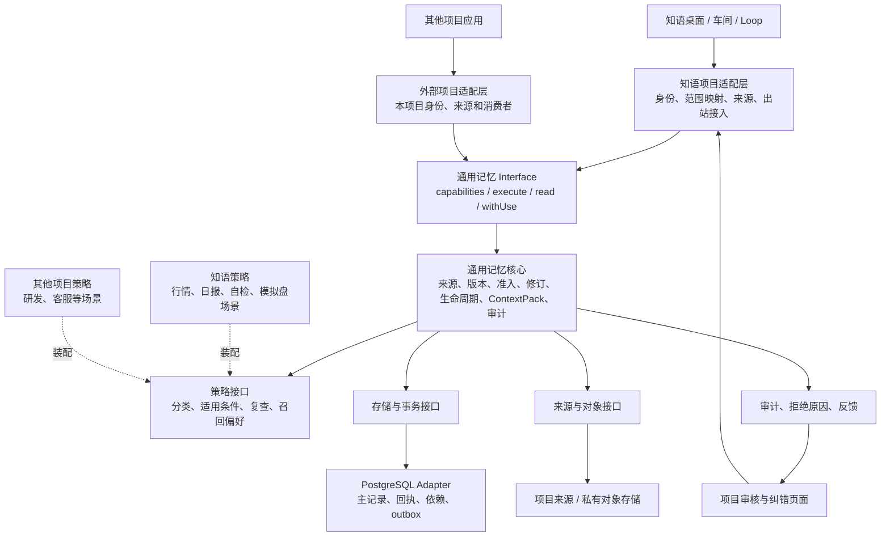

# 通用记忆：核心、项目适配与业务策略拆分方案

日期：2026-10-21。状态：G1 观测子集已实现于独立核心与 PG Adapter，知语采用旧合同兼容适配；后续 G2–G5 仍为设计，不提供独立 HTTP 服务。验收见 [G1 记录](../verification/general-memory-g1-2026-10-21.md)。

拆分前可用版本已保存至 `pi` 分支的 `1e008e9b2d5a0710618d1fe56b319fd69f6b26e6`；本方案与 G1 在 `codex/general-memory` 分支推进。G1 不改写历史记录或启动业务任务，当前装载与生产验收以 G1 验收记录为准。

依据：[已有模块技术方案](../plans/memory-module-technical-plan-2026-10-20.md)、[数据权威归属](../reference/memory-data-authority.md)、[行情与日报治理](../plans/memory-operational-lifecycle-2026-10-21.md)、[工程控制原则](engineering-cybernetics-guiding-principles.md)。具体接入约束见 [通用记忆接入协议草案](../reference/general-memory-protocol-v1.md)。

## 1. 目标与设计判断

把已经运行的记忆机制做成可接入其他项目的 Module，同时让知语作为第一个正式消费者继续工作。Module 的公开 Interface 要承接完整的保存、核验、读取、使用和纠错闭环，避免把事务、审核和出站校验重新散落到调用者。

三层是职责划分，不是三个独立进程。先保持模块化单体和 PostgreSQL；不为通用化立即建设微服务、消息总线、任意数据库支持或多套 SDK。物理拆包以真实调用者和适配差异为依据，第二个外部消费者未验证前不宣称已经通用。

被控对象是“有范围、来源和适用条件的可用记忆状态”。观测来自注册来源、实际业务状态和用户纠错；输出是经过授权的上下文与可追溯变更，不直接控制金融交易、消息发送或其他业务执行器。

成功条件：知语行为不退化；外部示例无需导入 Next.js、知语用户表、Work/Loop 或 Brain 即可完成同一闭环；格式正确而身份、来源或生命周期不合规的请求仍被拒绝。

## 2. 真实现状与需要拆开的依赖

截至本方案，能力已集中至 `apps/web/lib/memory/`，Brain 多数入口是兼容转发，但目录集中不等于已独立。

| 当前证据 | 问题 | 拆分归属 |
| --- | --- | --- |
| `client.ts` 直接引用 `@/lib/db/client`、用户表和执行租约 | 客户端构造与宿主身份、存储绑定 | 身份发行及装配进入项目适配；命令行为进入核心 |
| `contracts.ts` 引用 InteractionTask 和场景类型 | 公共类型仍泄露知语领域 | 通用信封与扩展 schema 替代领域类型；旧 DTO 保留兼容 |
| `kernel/memory-types.ts` 固定 workshop/work/chat/loop | 作用域和主体语言带项目假设 | 通用 namespace、scope、principal；知语显式映射 |
| `adapters/postgres/*` 使用应用 schema 与全局 db | 数据库实现未形成独立 Adapter | 分离事务接口与 PG 实现；先复用旧表和连接 |
| `sources/catalog.ts` 和精确出站读取列举具体来源 | 新来源要改核心枚举和出站分支 | 注册式来源 Adapter；保留能力声明与拒绝机制 |
| `records/operational-content.ts` 包含行情及 Work 自检识别 | 领域词汇、分类与期限不能成为全项目默认 | 知语业务策略层 |
| `continuity/business-checkpoint-runtime.ts` 读取实际车间运行快照 | 连续性与知语运行模型绑定 | 核心定义适用性要求，项目 Adapter 提供真实绑定 |
| `context/exact-use-admission.ts` 混有通用保护、PG 锁和具体文件/计划 reader | 直接搬文件仍会保留耦合 | 按函数拆通用准入、事务实现和来源实现 |

本轮判断基于源码，不把目标结构描述为已经装载。既有 PG、SQLite raw-message、向量索引并不意味着已有同等能力的多数据库通用实现。

## 3. 三层架构与依赖方向



调用方向为“项目适配 → 核心”，核心只依赖契约和注入接口。策略是核心调用的受限纯决策接口；不能反向调用业务工具、数据库或修改授权。依赖反转不等于核心 import 适配实现。

### 3.1 通用记忆核心

| 能力 | 核心负责 | 核心不持有的项目假设 |
| --- | --- | --- |
| 观测与证据 | 不可改写原文、版本引用、明确范围与读取回执 | 微信、行情、工单等来源名与采集实现 |
| 理解与经验 | 候选、证据绑定、条件与反例、审核和替代 | 固定领域提示词、业务事实自证 |
| 修订与依赖 | 版本冲突、幂等、失效传播、恢复与审计 | 替代业务主库 writer |
| 生命周期 | 使用到期、复查、停用与保留分别建模 | 一律 24 小时或一律 30 天 |
| 查询与使用 | 发现、精确读取、召回、ContextPack、最终使用准入 | 固定模型供应商或某一种索引 |
| 连续性与文件 | 版本清单、适用性条件、来源变化处理 | Work/Loop 调度、文件系统路径权限 |

“长期记忆”是可复用理解，不是业务当前状态权威；“运行记录”不因被保存而可长期召回。核心能承接它们的治理与读取，但账户、订单、任务配置仍由所属业务域更新。

### 3.2 项目适配层

知语适配层负责真实登录身份、执行租约、授权与 scope 映射，注册消息、Wiki、计划、文件、业务状态和连续性来源，并把所有相关模型入口接入最终使用保护。桌面路由、React 页面、应用鉴权、数据库连接与私有文件路径留在宿主。

外部项目只需实现它使用的能力：单机研发助手可以只接入观测、经验与项目文档，不需要制造 workshop 或 Loop。没接入历史 reader 就必须声明无法读取过去正文；没接入模型出站保护就不能声明具备完整使用闭环。

### 3.3 业务策略层

策略输入为已经限定范围的记录特征、来源能力、当前时间和适用场景，输出可解释的分类、复查要求和召回偏好；每次保存策略 ID、版本、理由及输入摘要。

知语策略包括行情/日报/混合内容识别、24 小时使用窗口、检查点 7 天、经验默认 30 天且最多 90 天复查。工具权限、自选股角色分工属于项目授权约束，不能仅放在可替换业务策略中。

未识别内容进入 `unclassified` 待治理，不凭“没有命中日报正则”自动成为可信长期知识。迁移期间旧知语路径保持已有行为；该默认值变化必须独立评估，不能借拆包静默重分类历史数据。

## 4. 不能被策略放宽的核心不变量

1. namespace、真实主体、资源范围和授权由可信宿主绑定，请求正文不能自报 owner。
2. denied、过期、来源版本不匹配、审核未完成等硬拒绝优先；业务策略只能进一步收紧或在授权范围内选择，不能覆盖拒绝。
3. 原始观测与执行回执不可改写；纠错形成新版本或关联事件，不能伪造历史成功。
4. 命令、审计回执、版本与失效标记在同一权威事务内提交；失败不返回 committed。
5. 搜索结果只用于发现；进入模型前按当时来源、权限、版本和期限再次核验。
6. 依赖失效事件可异步刷新索引，但最终准入不能等待索引或后台消费者“最终一致”。
7. 策略和模型输出都是输入，不提供额外权限，不把 confidence 或 verified 字段当作事实证明。
8. 索引、缓存和摘要可重建；原文、已提交审核与真实动作回执不能依赖它们恢复。

## 5. 数据与命名空间

通用记录使用 `(tenantId, projectId, kind, id)` 标识。tenant 表示数据隔离域，project 表示该域内项目；scope 在 namespace 内进一步限制资源和角色。相同用户或相同 UUID 不构成跨项目共享授权。`global` 只表示当前项目内全局，不能推导所有项目可见。

首个知语 Adapter 用受信配置将已认证 userId 映射到租户，使用固定 `zhiyu` 项目；旧 global/workspace/workshop/work 含义保持不变。现有 ID、表名、证据引用、版本令牌和 commandId 不批量重写。其他项目初期采用独立数据库或独立部署，不与缺少 project 列的旧表共享租户数据。

共享数据库接入是后续独立阶段：所有主记录、来源、审核、依赖边、回执、唯一约束、索引、对象路径和缓存键必须具备 namespace 隔离，并通过负向检查后才能启用。不能只在 memory 表加 projectId 就宣布完成。

记录语义区分原始观测、理解、业务状态引用、资料、连续性、配置引用与审计；`long_term/run_record/acceptance_record` 是用途分类，`candidate/active/verified/...` 是审核/可用状态，二者不混成一个枚举。业务扩展须有命名空间及 schema，不能用任意 metadata 修改受保护字段。

## 6. 接口、Adapter 与装配

公开 Interface 只保留四组行为：能力协商、版本化命令、目的明确的读取、最终使用。具体操作由有界判别联合承载，避免新增一类来源就扩张顶层方法。协议不暴露 SQL、ORM transaction 或宿主数据表类型。

| 内部接口 | 最小职责 | 首批实际实现 |
| --- | --- | --- |
| Identity/Authorization | 可信主体、执行身份、scope、权限纪元与拒绝理由 | 知语 session/lease；外部最小示例的服务端身份 |
| TransactionalStore | 原子命令、CAS、命令回执、审核、依赖失效、outbox | 当前 PG Adapter；测试内存实现不声明生产持久性 |
| SourceRegistry/SourceReader | 来源注册、固定版本、当前读取、权限与历史能力 | 知语来源集；示例项目的版本化文档来源 |
| ObjectStore | 私有对象、内容 hash、受控读取与孤儿恢复 | 当前私有文件存储；未接入时禁止文件能力 |
| Retrieval | 有界候选与覆盖描述 | 当前候选查询；其他索引按需要增补 |
| Clock/Id | 权威时间、可复现版本与稳定命令标识 | 宿主实现、测试实现 |
| DomainPolicy | 分类、复查、应用条件与优先级建议 | 知语策略、研发示例策略 |

这些是内部 Seam，不要求普通业务调用者学习全部接口。来源 Adapter 不能自行给自己签发权限；由宿主授权器独立决定，再由核心合并硬约束。

目标目录（拟建，不表示文件已存在）：

```text
packages/memory/
  src/contracts/       # 公开 DTO、版本、错误与能力声明
  src/core/            # 行为与不变量，按 ingestion/revision/context 等能力分开
  src/ports/           # 内部 Adapter 接口，不导出身份发行器给模型调用
  testkit/             # 契约检查与故障注入，测试用途
packages/memory-postgres/  # 通用存储实现，成熟后独立迁移归属
apps/web/lib/memory-zhiyu/ # 装配、身份/来源/运行时映射
apps/web/lib/memory-policies/zhiyu/ # 知语领域分类和生命周期
apps/web/lib/memory/      # 迁移期间的旧 Interface 兼容门面
examples/memory-project/ # 独立 Node 项目接入样例，无 Next/Work/Loop
```

当前 `ingestion/revision/context/...` 的能力可分别定位与测试；不新增一个接管所有业务状态和工具的 Brain 总类。每次迁移删除原实现或改为显式兼容转发，避免两个权威 writer。

## 7. 完整闭环与异常处理

标准链路：注册来源与身份 → 追加观测 → 形成有来源的候选 → 按授权审核 → 召回/精确读取 → 最终使用准入 → 保存真实使用反馈 → 纠错或来源变化使依赖失效 → 重新核验。

业务动作仍由业务执行器承担，记忆使用回执只证明核验和交付到消费者，不证明模型采纳或交易/发送成功。暂停消费者时不能因迁移或恢复记忆而自动恢复业务任务。

| 扰动 | 系统行为 | 用户可见/恢复方式 |
| --- | --- | --- |
| 来源、授权或审计不可用 | 停止受影响读取/使用，不假造完整结果 | provider/detail/warnings、阻断原因、重试入口 |
| 相同命令重试 | 同内容返回原回执；不同内容报冲突 | 查看命令状态，不创建重复记录或续期 |
| 已提交后响应丢失 | 按 commandId 查询回执 | 不把 unknown 当失败重放外部动作 |
| 索引延迟/失效消费者中断 | 返回覆盖范围；精确准入读权威版本 | 展示延迟与重建状态；outbox 可幂等恢复 |
| 对象上传成功、记录事务失败 | 不可见的暂存对象与恢复任务 | 回查上传/提交状态，按保留策略处理孤儿 |
| 来源改变、审核撤销或到期 | 立即阻止新使用；旧日志不改写 | 停用、纠错、重新提炼；保留历史解释 |
| 策略版本变化 | 显式提案/迁移，不默认追认历史 | 查看策略差异、影响预览、逐项回执与撤回 |

## 8. 知语兼容迁移计划

| 阶段 | 具体改动 | 放行条件 | 回退方式 |
| --- | --- | --- | --- |
| G0：设计基线 | 本方案、接入协议、当前消费者与能力清单 | 文档自洽；当前版本已独立推送保存 | 无运行改动 |
| G1：独立契约与核心切口 | 抽通用 DTO、namespace、错误；先迁观测/版本/命令回执闭环 | 外部 Node fixture 可保存/精确读/重复重试，原 API 不变 | 切回旧门面，保持旧表格式 |
| G2：项目适配与策略 | 注入身份、PG、知语来源、领域分类；逐函数迁移混合文件 | 已有 24h/7d/30d 等策略保持一致；拒绝不变 | 每个能力只切一个 writer；关闭未放行能力 |
| G3：审核、召回与出站 | 迁审核修订、依赖、ContextPack、所有消费者保护 | 源变化/权限撤销/到期在精确使用和出站均拒绝 | 按消费者切回兼容实现，禁止双写 |
| G4：外部项目完整验收 | 独立示例接入自己的身份、文档与研发策略 | 无知语 import、不同生命周期、完整正负闭环 | 外部项目保持隔离，不影响知语 |
| G5：可选服务化与共享租户 | 有真实消费者后定义传输和 namespace 数据迁移 | 全链路 namespace、密钥/部署/审计与回退验证 | 保留独立部署；不提前共享旧表 |

每阶段记录变更 ID、实际源码与 schema 版本、消费者、策略版本、匹配输入、真实结果、装载回读与回滚触发。影子比对只做纯计算和只读结果比较，不重复写审计、不调用模型、不触发业务动作。拒绝差异和证据缺失优先于命中率。

迁移存储使用 expand → 校验 → 切换 → 后续 contract；旧接口和旧 schema 能力至少保留到匹配回归和生产观察通过。不能在同次发布删除旧列再声称可回滚。恢复策略/代码不等于撤销已提交审核，须以新命令处理状态补偿，不删除审计。

当前桌面 Web 与记忆中心继续作为审核、暂停使用、纠错、分类和回执查看入口；不新增一套平行管理页面。后续只增加项目标识、有效策略版本、来源覆盖和阻断原因，使用户能看懂“已保存、待审核、可使用、已失效”的区别。

## 9. 验收标准与停止条件

保留当前版本 210 个文件、2397 项通过、4 项跳过的回归记录作为基线；各阶段针对实际迁移闭包重跑，数量本身不作为通用性的证明。

- 核心与通用契约不得导入 `@/`、Next、知语数据库 schema、work-runtime、workshops 或 Brain。
- 知语与独立示例运行同一协议契约检查；模拟 Adapter 只检验接口，生产持久性必须在真实 PG 中验证。
- 相同用户跨项目、伪造 owner、伪造已审核、未注册来源、旧版本、错误摘录、来源撤权、到期、重复命令异体、崩溃重试、失效消费者停摆均有拒绝/恢复检查。
- 以真实历史字段与匹配快照比对 ID、版本、内容、审核、权限、生命周期、ContextPack 与拒绝原因；不得把历史运行记录重新提升为长期知识。
- 桌面能查看当前原文、候选条件、审核原因、失效状态和回执；核心失败不能显示“成功”或空列表。
- 发现越权、丢回执、重复写、静默降级或无法回退，立即停止该切口放行。不能降低审核与出站标准换取兼容。
- 完整业务阶段再做必要生产构建与桌面验收；构建产物总计仅保留最近两套。文档阶段不生成新构建。

## 10. 当前交付与后续边界

G1 已创建通用观测核心、独立 PG Adapter、独立示例消费者与知语兼容 Adapter，完成记录接入切口；没有迁移历史数据、启用知语旧表的共享租户或提供远程使用保护。其余目录按后续阶段迁移。G1 的 R 级示例不能替代 G4 的完整知识与使用闭环验证。
