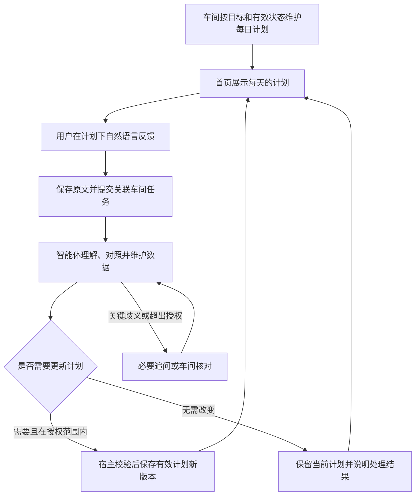

# 个人日计划：车间维护、自然语言反馈与每日规划

状态：核心健康数据与日计划流程已有部署基线；一个车间持续维护、计划下自然语言反馈的新交互方案待实施。2026-11-03。

本次修订依据：用户明确由一个车间长期维护个人数据与每日计划。首页展示结果，用户在每天的计划下自然语言说明实际情况；智能体自行理解、整理与规划，用户不需要选择事件分类或管理计划状态。最新操作口径以 [车间维护与自然语言反馈方案](personal-day-workshop-operating-flow.md) 为准。

已部署基线 `de8ff47` 覆盖个人使用的桌面 Web 及必要后端，旧入口为 `/?page=personal-day`；后续入口重组尚未上线。测试使用隔离数据库和虚构档案，正式账户不预填身体事实。移动端和原生客户端继续后置。实际装载、测试证据和保留事项见 [实施验收记录](../validation/personal-day-2026-11-03.md)；以下完整方案中的长期扩展不因核心流程落地而自动标记完成。

## 一、产品目标与整体判断

让用户每天清楚知道“今天怎么练、怎么吃、为什么这样安排”，能够方便地记录实际执行，并让后续安排参考真实反馈。系统长期记住的是有来源、有时间和适用条件的个人状态。

用户从首页使用个人日计划，在关联车间管理健身与饮食规划。当前由一个日计划车间承担训练与饮食两组职责，宿主合并计划、核对约束和保存状态；职责分组不冒充两个已经独立运行的智能体。共用统一 Pi 模型配置，不要求分别申请 API Key。

身体事实、目标、过敏与禁忌、食物和动作数据由业务系统维护。模型负责结合资料提出方案与解释；计量换算、营养计算、约束检查、版本发布和权限验证由程序负责。

目标优先级由用户明确选择，例如改善体能、建立习惯、增肌或减脂。目标时间、预算、可用器械和可执行时间共同约束计划；系统不默认所有用户都需要减重，也不保证某日期达到某体重。

规划分为三个时间层：长期目标与训练原则保持稳定；明日计划根据用户已知条件形成；今日剩余计划随真实变化局部调整。未来更远日期保持待安排，历史一段时间的训练与饮食统计用于判断连续性、恢复和趋势，不生成预先锁定的一周日程。

直接被控制的对象是“指定日期、当前事实下仍可执行的剩余安排”。评价标准除了目标贡献，还包括可执行性、用户操作成本和不必要的计划变动次数；不以时间线排得越满越好作为成功标准。

“个人日计划”可以容纳用户手动提供的会议、通勤、家庭安排和其他固定事项，作为真实时间边界。本次智能规划的业务内容仍是健身与饮食；纳入固定事项不授予健康智能体修改工作任务或外部日历的权限。

## 二、现有项目可以复用什么

源码观察时间：2026-11-03。以下是现有能力盘点，不代表已经完成健康场景验收。

- Pi 执行与统一模型配置：`apps/web/lib/ai/model-configuration.ts`；新角色沿用模型配置中心，不增加独立的健康模型凭证体系。
- Work、Loop、命令版本和运行空间：`docs/architecture/workshop-workspace-model.md`、`apps/web/app/api/workshops/[id]/loops/route.ts`。复用持续任务与执行租约，不再建一套 cron 或任务执行器。
- 工作记忆与长期记忆治理：`docs/architecture/ordinary-business-memory.md`。当前业务状态以结构化记录为准，记忆用于补充经验和未决问题。
- 文件授权、不可变快照、文档转换：`apps/web/lib/memory/files/upload.ts`、`apps/web/lib/workshops/document-markdown.ts`。转换器已有多种格式支持，但具体文件是否转换和入库成功，仍必须看回执。
- 通用车间上传接口对 `document_markdown_cleaner` 保留角色限制；健康模块基线已有独立的加密上传入口并复用转换器。后续接入车间资料管理时增加明确授权绑定与回执，不通过扩大通用上传权限完成整合。
- 当前个人账户接口只更新姓名、头像等字段：`apps/web/app/(auth)/api/user/profile/route.ts`。身体数据应建立独立业务模型，不塞入账户设置、提示词或通用消息表。

上述健康领域数据、目录、计划与记录的核心链路已在部署基线中实现。当前需要补齐的是所有规划/提取/预演任务的统一 Work 归属、实际配置装载、首页有效结果投影，以及重复入口的收敛。

此前的 `model_not_configured` 已在基线验收中核对：配置中心版本 2 可解析，`qwen3.7-plus` 经 Pi 的 Anthropic 协议完成虚构档案真实调用。详见实施验收记录。后续整合仍须验证车间读取的实际模型配置，不能只检查界面上的连接名称。

## 三、首先解决数据和配置的一致性

### 3.1 唯一的身体档案

一个用户有一份权威健康档案，所有角色通过受限接口读取。档案保存版本，不允许两个角色分别记住不同的身高、体重或过敏信息。

档案按用途分组，逐步填写；选填信息可以标为未知，不用默认值伪装完整数据。

- 基础与测量：年龄或满足计算所需的年龄信息、身高、近期体重。体脂率、围度等选填，附测量方法和时间。涉及特定公式时，说明所需生理参数的用途，用户可跳过并暂不启用该公式。
- 目标：当前主目标、优先级、期望周期、用户愿意接受的投入。目标调整产生新版本。
- 训练条件：经验、通常可用的时间窗口、单次可用时间、地点、器械、喜欢或不接受的运动。通常作息可在维护授权范围内作为规划依据；当天明确反馈优先，未确认的惯例条件要保留推定标记。
- 饮食条件：饮食偏好、过敏和不耐受、忌口、常吃食物、就餐人数、外食频率、做饭条件、备餐时间、预算。
- 需要回避的情况：用户确认的伤病限制、运动或饮食方面的专业人员要求。只收集规划所必需的信息，不要求上传整份病历。
- 作息与每日状态：睡眠、疲劳、疼痛、当天日程变化。这些进入有时间的记录，不作为永久档案默认覆盖。

过敏、明确禁忌属于硬约束；“不喜欢吃”属于偏好。两者不能混成同一种记忆，也不能通过多次记录推断出某种疾病。

### 3.2 原始记录与理解结果分层

测量值与执行记录保留数值、单位、发生时间、录入时间、来源、上下文和纠错关联。例如体重记录应能区分手动填写、设备导入，以及不同测量条件。

数据分为用户确认事实、设备读数、用户估算、模型推断和未知。体脂秤读数、外食估算和模型解释必须有各自标识。模型不能覆盖原始记录，也不能把未记录当作没有完成。

重复录入、错误单位或明显异常的数值先请用户核对。修正产生关联记录；日常历史不被静默改写，隐私删除另走明确的数据删除流程。

### 3.3 一个可复现的计划输入快照

每次规划固定以下版本：身体档案、目标、有效约束、测量截止时间、已批准的资料集合、食物/动作目录、领域规则，以及模型连接和实际模型身份。

日计划还固定业务日期、时区、可用时间、地点、已确认固定事项、当前计划修订、实际执行记录截止位置，以及发起重排的变化事件。今天与明天使用各自的日期和约束，不把“通常有空”当成已经确认的空闲时间。

页面、后台和两个角色使用同一快照。运行中档案或限制发生变化时，结果标记过期并重新校验；旧快照的结果不能直接成为当前计划。

计划明确展示“采用了哪次体重记录、哪些资料、哪些估算、哪些信息缺失”。理论版本和模型版本分别记录，不能用更换模型冒充规则或事实的更新。

## 四、页面分工与领域能力

### 4.1 首页：每日计划与一个反馈入口

首页展示今天的安排和已有后续计划。每天的计划下面只有一个自然语言反馈入口，用户可一次概述整天，也可多次补充；不需要逐项关联任务、选择完成比例、点击变化/重排按钮或每天填写条件表单。

用户说明实际做了什么、吃了什么、感受如何及后续安排，由关联车间处理。首页回显原文、真实处理状态与简短说明，展示更新后的有效计划；详细历史、变化原因和车间入口按需展开。

### 4.2 车间：长期维护数据、理解和计划

一个个人日计划车间长期负责事实整理、当前状态理解、健身饮食协调及日常计划维护。训练与饮食规则分别管理，交付一份协调后的计划。所有理解、资料提取、规划与预演模型工作都有真实车间归属，使用实际装载的工作方式、有效模型和受限工具。

首次启用时约定维护范围。范围内的日常记录与计划由智能体自主维护，首页不再将每轮生成、调整和采用作为用户必经步骤；超出授权或涉及重要边界的修改进入已有核对流程。

### 4.3 唯一档案与实际记录

身体基础、目标、训练条件、饮食限制和授权共用一个事实源。用户既可使用档案编辑器，也可通过自然语言提供明确的新记录或更正。车间保存有来源的解释与事实记录，原始反馈不可被改写。

实际活动时长、次数、负重、食物及份量按原文整理。没有说明的字段保持未知，不把计划数值当作真实测量，不因没提到某一事项就认定没做。

### 4.4 健身与饮食交付

计划按当日条件、有效目标与近期真实记录规划，保留动作说明、适用条件、资料来源和需要回避的限制。饮食列出搭配、份量参考、生熟/包装状态和备餐条件；营养使用有来源数据确定性换算，缺失不是零，估计不冒充称重。

实际已发生的行为与固定事项保留，仍适用的安排继续使用。没有准确时间时可形成有明确依据与不确定性标记的弹性安排，不强制用户每天填写时间表，也不把惯例伪装成当天已确认事实。

### 4.5 资料与工作方式在车间管理

用户从车间的知识与依据入口导入资料并管理采用范围。文件解析、模型提取、用户授权范围和某轮实际读取分别留痕；外部正文不能改变系统权限。

长期调整可在车间交代或编辑。按实际影响进行候选、验证、受控保存和装载回读；普通生活反馈不自动扩大成永久规则或目标变更。

### 4.6 进展与纠错

首页按需展示有来源的执行与记录趋势，车间消费同一份有效事实继续规划。用户可直接说「刚才那顿是昨天吃的」等更正，系统保留关联并更新理解及受影响计划，不要求用户手工修复内部任务状态。

无反馈的内容保持未知；用户可不写满每日记录，车间在足够信息和授权范围内继续工作。不能因一天波动、没达到原计划或遗漏反馈而自动追加补吃、补练或惩罚性安排。

## 五、完整操作闭环

日常体验为“看计划、说实际情况、看处理说明与后续计划”。普通日计划不逐轮要求用户点击生成、重排和采用；用户保留纠正、暂停、查看依据和调整边界的权利。

Loop 是该车间的持续触发器，和反馈处理使用同一份状态与权限。启用维护及持续运行按明确范围授权，不因读取页面启动任务；电脑离线时显示未处理与真实更新时间。

## 六、角色、知识与动作边界

健身教练负责训练安排、动作替换、训练日志解释和训练调整候选。饮食规划负责餐食搭配、食物替换、备餐建议和饮食调整候选。

宿主业务服务负责统一读取、规则校验、计划整合、数值计算、版本管理、发布、撤回和审计。各职责共享经过授权的事实与限制，通过受控工具追加有来源的新记录、解释和计划；不能覆盖原始观测、擅改专业限制或自身权限。

优先级为：硬边界与有效限制 → 用户当前目标及可执行条件 → 适用的指南与规则 → 经过准入的个人理论资料 → 个人偏好和模型建议。明确拒绝优先于允许。

理论参考可从 WHO 身体活动指南与《中国居民膳食指南》开始，保留人群和版本。[WHO 对成年人给出周身体活动及力量训练建议](https://www.who.int/europe/news-room/fact-sheets/item/physical-activity)，[中国膳食指南强调食物多样、合理搭配及吃动平衡](https://sfncc.caas.cn/xyyw/79c86454ef84437eb3e0df055deffd56.htm)。这些提供一般性依据，不能直接当成某个用户的个体训练量或食谱。

建议最初实施范围为一般成年人的日常健身与膳食管理。对未成年人、孕期、需要疾病治疗饮食或存在特殊运动限制的情况，增加对应的适用性与专业人员要求流程；不直接套用一般成人减脂模板。系统不自行诊断、调整药物或开出治疗方案。

## 七、计划如何生成和持续调整

1. 从用户原始反馈或持续任务识别本轮维护目标、事实、感受、后续条件与请求；分类由车间承担，绑定业务日期、时区和原文来源。
2. 读取同一用户的有效授权、结构化档案、近期观测、已确认时间边界和已采用日计划，核对数据新鲜度与覆盖范围。
3. 形成状态估计，明确哪些是事实、估算、未知或存在冲突。缺少关键输入时说明影响，不补造数据。
4. 固定已完成事实、正在执行事项及不能移动的安排，确定受影响范围，优先保留仍可执行的原安排。
5. 读取已准入、仍有效、属于本健康范围的资料。正文、摘要、原则与检索回执保持关联。
6. 在同一输入快照下生成训练与饮食候选，使用确定性计算核对数值与单位。
7. 核对时间、器械、食物可得性、过敏、限制、预算和两类计划的一致性，同时计入必要准备、通勤和缓冲时间。只允许有预算上限的修正，不无限循环自评。
8. 保存候选、依据和必要的变更说明。在事先授权的日常维护范围内，宿主再次核对当前时间、版本、约束与反馈后保存有效计划；越界修改才进入相应核对或审核，避免把过期结果发布。
9. 用户用自然语言继续反馈，车间追加实际记录、纠正理解并维护后续计划；保留原计划和依据。原计划与实际之间的差异由车间评估，用户无需管理欠账或完成比例。

### 7.1 变化发生后，如何选择重排范围

新的事实与条件主要来自日计划下的自然语言反馈；将来可在授权后接入其他观测来源。语音先展示识别文本；时间、否定词或目标日期不明确时需核对。外部日历接入属于后续能力，当前可由用户手动输入不可用时段。

影响只限一餐或一个动作时做局部替换；变化占用多个安排的时间时重排今天剩余部分；涉及明天的已知安排或用户明确要求延期时才处理明日候选。当天一次加班不自动修改长期作息或以后每天的训练偏好。

系统按顺序处理：保留仍有效的安排 → 检查是否能移到同日其他已知窗口 → 提供合规的短方案或资源替代 → 删除可选项 → 明确暂停、取消或加入明日待评估项。涉及取舍时说明对目标的影响，不为填满时间线制造任务。

以上顺序是有条件的候选生成策略，不强迫用户依次尝试，也不优先安排已经不合适的运动。安全限制、用户明确选择和不可移动的安排优先。

日常默认维护一份有效计划并简短说明变化；需要用户决定的实质取舍才提出少量有差别的选择。只有局部调整无法解决冲突，或用户主动要求时，才扩大到全日剩余部分；历史完成情况和固定事项继续保留。

新输入先判断是否影响当前安排的可执行性。仅补充说明、与剩余安排无关的测量或同一事件的重复通知，不自动触发整日模型重排。用户可连续补充反馈，系统按来源和处理进度增量整理，必要时合并同一批任务。

### 7.2 实际行为和未知内容要区分

实际已发生的训练和已吃餐食始终保留。用户只说练了二十分钟，就记录这段实际行为及其来源；没有必要让用户先选择是否属于某种完成状态。原计划是否仍适用、后续是否继续，由车间结合当前数据判断。

没有提到的事项只能保持未知，不能自动推断为没做，也不凭原食谱准确计算没有记录的摄入。已有历史状态字段可以兼容读取，新的日常交互不再依赖用户维护这些字段。

用户可以自然语言追加更正；更正关联原文和旧理解，不覆盖原始观测。首页显示当前有效理解与计划，并保留查看依据入口。

### 7.3 未完成事项如何进入明天

未完成项不是自动累积的欠账。固定日期的旧餐次或已过期事项只保留事实与原因；仍有价值的训练或准备事项进入“明日待评估”，结合明日条件、近期负荷和目标重新安排。可选项允许直接取消。

“加入明日待评估”与“明日已排好”是不同状态。用户明确要求延期但明日时间未知时，先显示待安排；不能承诺一个编造的时段。明日空间不足时呈现优先级和冲突，允许缩小安排或放弃部分目标。

近期连续未完成优先检查计划是否太满、所选时段是否不合适、准备成本是否过高。用户确认后调整通常偏好或目标投入，不因积压而不断提高第二天的负担。

### 7.4 一条反馈如何进入后续计划

以下仅演示产品交互，不是针对真实身体情况的训练或饮食建议。

用户原本确认晚间去健身房、回家做饭，下午告知“今天要加班，回家后能留给训练的时间最多 20 分钟，也没法按原计划做饭”。

系统保留已吃餐食和已完成事项，把新的不可用时间记为变化事件，并核对回家后窗口、地点及现有规则。如果条件允许，车间在授权范围内维护为合规的短方案与可执行的晚餐安排；不能安排合适训练时保留事实并调整后续计划，说明取舍。不会把原动作强塞入 20 分钟，也不为补回当天安排自动减少饮食或挤占用户保留的睡眠时间。

处理完成后，首页显示简短说明和有效计划新修订，不要求用户理解重排类别或再点击采用。明日的惯常条件与明确确认的条件要区分，不能承诺编造的精确时段。

日常输入过期时按字段和任务判断影响。例如当天行程未知不等于可以安排任意时长；缺少近期执行反馈时，不自动上调训练负荷。有效期和调整阈值需要在实施时结合选定规则及适用人群评审，不能把统一固定天数或模型自评分当作临床标准。

用户对某餐或动作的一次拒绝先是本轮反馈；反复出现且经用户确认的稳定偏好可以进入长期约束。每条经验注明来源、适用条件、反例和复查时机。

## 八、结构化数据与工程集成

以下为逻辑实体及分层要求；已有健康表与 Work 实体优先复用，新反馈理解关联按实际 schema 增量补齐，不另造重复状态源。

- `HealthProfile` 与版本：用户身份关联、稳定信息、目标、有效限制和授权。
- `HealthObservation`：测量、睡眠、训练实际、饮食实际、主观反馈等原始事件，包含单位、时间、来源、估算状态和纠错关联。
- `HealthAssessment` / 反馈理解：基于原始反馈和观测窗口的可重算解释与状态估计，关联原文、日期、处理版本、缺失项和纠错，与原始事实分开。
- `HealthPrinciple`：资料中的原则候选、适用范围、冲突、审核和撤销。原文件及绑定优先复用现有托管资料机制。
- `FoodCatalog` / `ExerciseCatalog`：有版本、有来源、允许人工核对的食物和动作目录。可靠食物数据来源与使用授权需要在实施前确定；可以先维护用户常用、已核对的数据。
- `HealthProgram`：长期目标、训练方向、适用规则和可调整范围，不保存提前锁定的逐日周日程。
- `DailyContext` / `DayPlan` 与修订：业务日期、时区、已确认固定事项、可用窗口、地点与资源、计算结果、快照、当前状态和被替代关系。健身和饮食条目归属同一日计划，其他生活领域扩展时复用这个日期与版本基础。
- `PlanItem` / `PlanChange`：稳定条目身份、约束、依赖、预计时间、优先级、执行事件关联、变化原因与作用范围、调整前后和采用回执。条目安排修订与真实执行事件分开，任务延期不等于自动建立明日已确认安排。
- 命令、运行、Loop、事件与审核：复用既有账本和 Work runtime，领域实体保存关联引用，不复制一套任务真相。

所有查询和写入按真实会话用户隔离，后台带明确所有者与业务范围。单人使用也保留 owner 边界，为后续不同用户独立使用打基础；不在当前阶段扩展多租户运营或家庭共享。

规则版本、模型配置、知识身份和已采用计划分别管理。向量服务沿用部署配置和固定索引身份；更换模型或维度时走重建流程，不让健康模块自行更改全局向量设置。

## 九、持续任务、异常与恢复

持续工作属于个人日计划车间内的 Loop，负责按授权维护每日计划、消费反馈并判断是否需要更新。用户可以开启、暂停和修改时段，页面显示最近运行、下次运行、心跳、采用的数据截止时间和失败原因。周期性回顾仍可保留，不绑定未来一周的逐日安排。

同一用户与业务日期使用稳定任务身份；网络重试和 Worker 重启不自动创建第二份生效日计划。明确需要更新时创建新修订，提交有效计划时使用版本检查；同一天只允许一个当前生效版本。

同一变化事件的重试复用命令身份。连续补充反馈时按事件顺序和快照增量处理，必要时合并在途工作，回复说明实际处理范围，避免每句话都全量改写日程。跨今天与明天的延期必须核对两日版本并一致提交；失败时不显示单方面移动成功。

生成期间用户完成了某个事项或修改了空闲窗口，旧候选失效，不能覆盖新事实。已经展示但过了可执行时间的候选也要重新校验。撤销创建新修订，只恢复当前仍可行的未执行安排，不撤销已经发生的执行事实。

模型不可用时保留已采用且仍适用的安排，并标明未生成新建议。已经受到新时间约束影响的条目标为不可按原安排执行，暂停其过期提醒；不能把已不可行的旧安排继续显示为正常。用户仍能手动记录、取消或选择已有合规替代方案。资料解析或索引失败时显示具体未就绪范围；关键依据缺失时阻止受影响的发布，不伪装为完整检索。

档案、过敏或限制发生变化时，对未来计划作失效检查并说明原因；已经完成的记录保留。执行中出现不适反馈时停止自动推进受影响训练，给出人工处理入口。

电脑关闭或本地服务停止时，后台不能继续运行；恢复后显示中断和遗漏，不集中补发过期提醒，也不把几天漏做的训练叠到当天。

跨午夜时按计划绑定的日期和时区处理，尚在进行中的事项保留原关联，实际完成时间如实记录；新一天不会把它复制为新任务。旅行或时区变化需明确更新日期边界，不能让“明天”的安排被静默改到另一业务日期。

对外发消息、向第三方发布身体数据、购买食材或器械都不属于默认动作。需要这些能力时另行明确对象、授权和审核界面。

## 十、身体数据的隐私与用户控制

本地保存不代表数据不会外发。调用云模型时，规划所需的部分事实可能发送给当前文本模型服务；云向量化会发送所选择资料的文本；语音转写会发送用户选择的音频。首次配置健康功能时分别说明数据类别、接收服务和用途。

默认不把完整身体历史、病历或全套身份资料塞进模型上下文，不把原始身体记录自动写入通用向量记忆。用户可以查看角色实际需要的字段范围、减少共享或关闭后续调用。

固定事项可只保存或向健康角色提供“这段时间不可用”，不要求透露会议主题、联系人或工作正文。个人日计划宿主负责时间冲突，健身与饮食角色只获得与各自方案有关的最小信息。

身体数据、私人资料、摘要和备份需要相应的存储保护与访问控制，实施后以实际验证为准。日志不包含完整健康正文，其他生活智能体不能默认读取健康数据。

提供导出、更正、暂停和删除入口。删除应覆盖原始记录、附件、派生摘要、向量与缓存，并明确备份保留和恢复后的删除标记处理；审计只保留不含健康内容的必要操作元数据。已发送给模型服务的数据不能承诺通过本地删除撤回，需按服务实际政策说明。

## 十一、实施阶段与每阶段验收

### 阶段 A：事实与依据

完成身体档案、观测记录、目标和限制、健康资料授权与处理状态、基础食物和动作目录，以及数据使用说明。验收重点是单位、纠错、版本、来源、权限和实际可录入性。

### 阶段 B：自然语言反馈与日计划维护

完成计划下的统一反馈入口、原文持久化、车间理解与事实维护、日常授权内的计划更新及首页结果同步。验收“看每日计划 → 自然语言说明实际情况 → 车间维护记录和后续安排 → 查看结果 → 自然语言纠正”的完整流程，不要求用户操作事件分类、完成比例、重排或逐轮采用。

### 阶段 C：反馈、复盘与有边界的自动运行

完成趋势与覆盖率、每日收尾和周期回顾、调整候选、暂停/恢复、失败恢复和明确授权的持续任务。以匹配条件的回放和真实受控使用分别评估，不把一次运行成功当成长周期效果。

### 后续扩展

在上述闭环稳定后，再评估睡眠管理、日程和其他生活智能体；复用身份、事件、知识准入和审核机制，保留各领域自己的事实、权限与判断规则。设备同步、餐食照片识别、购买和移动端不作为本次落地的前置条件。

## 十二、必须覆盖的测试与验收

验收不以模型自评或文本长度作为通过条件，至少覆盖以下场景：

- 同一事实被两个角色读取时版本和单位一致；档案中途变更时旧草稿不能覆盖新数据。
- 未填写、过期、重复、异常和纠错记录明确显示；未记录不等于未完成。
- 过敏、明确运动限制、无器械、无时间和预算约束能阻止或改变不符合条件的方案。
- 食材生熟重量、份量、配方和营养汇总可复算；未知数据不能假装精确。
- 资料只有上传回执、转换失败、没有有效检索、原文引用不匹配或原则被撤销时，不宣称已采用或完整有据。
- 导入资料中的恶意指令不能扩展权限；跨用户或未授权车间读取健康数据必须拒绝。
- 重复请求、断网、重启、租约冲突和同时修改不造成双份生效计划；暂停能阻止后续自动执行。
- 睡眠或执行信息不足时不擅自升级负荷；一次偏离不触发补偿性训练或惩罚性饮食。
- 模型失败时有明确状态、原计划入口和重试/修复方法，不能把旧计划重标为今天新生成。
- 桌面浏览器能完成首次设置、资料管理、查看每日计划、自然语言反馈、查看车间维护结果、继续纠错与暂停；同时检查键盘操作、等待反馈和窗口缩放。
- 临时加班、地点改变、食材不可用、可用时间缩短时，只改变必要的剩余条目；固定事项、已完成事实和当前执行中的事项不能被静默移动或重写。
- 用户实际说明的行为、明确没做的事项与未提到的内容分别理解，保留原文；不要求用户选择完成状态，也不把实际差异变成明日欠账。
- 时间窗口未知、全天已满、准备或通勤后没有可行窗口时，明确显示冲突与取舍，不虚构可行计划，也不无限反复重排。
- 重排生成与采用之间新增完成记录、修改档案或改变当前时间后，过期候选不能覆盖新状态；今天与明天的移动失败不能留下双份或缺失安排。
- 连续变化、重复点击、语音误识别、撤销、跨午夜和时区改变均有明确版本与执行事实，不产生过期提醒或重复任务。
- 数据导出、删除和备份恢复规则得到实际验证，日志不泄露身体数据。

阶段验收分别记录已编辑、已保存、实际装载、程序验证、真实使用效果和遗留项。开发模式验证实现与交互，完整阶段交付保留生产构建、接口与桌面流程验收。

## 十三、本次实施范围与保留事项

当前已确认的产品方向为“个人日计划”：主要安排明天，当天条件变化时重排剩余部分；长期目标和历史趋势提供方向。实施按“个人使用、一般成人、一个长期负责车间、每日计划下自然语言反馈、授权范围内自主维护”展开。

已部署基线仍使用表单、草稿与用户采用。最新重构改为：首次约定目标、依据、限制和维护范围，用户在每日计划下自然语言反馈，车间在授权内自行维护事实与有效计划。持续触发、异常、重要规则与权限管理归车间，不因日常自动维护而绕过已有边界。

当前动作与餐食采用有限目录，Pi 负责在目录内结合档案、条件、实际记录与已审核原则选择候选，宿主验证约束。营养数据来自用户核对的每 100g 标签，缺失值保持未知；份量为目录搭配示例，不是精确个人能量处方。更丰富的动作/食谱、可靠食品成分数据库、个体化能量目标与治疗饮食、自动周期复盘、设备同步、OCR、语音输入、日历与购买尚未实现。业务日期固定为 Asia/Shanghai，未实现旅行时区自动切换。
