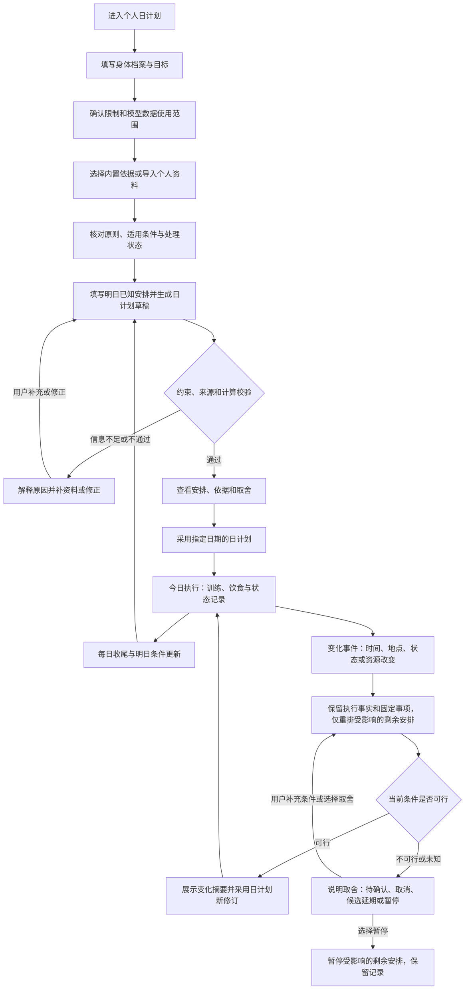

# 个人日计划：健身、饮食与临时重排方案

状态：个人日计划、身体档案、健身饮食、临时重排核心流程已实现，已完成本地生产部署与验收。2026-11-03。

本次修订依据：用户确认以个人日计划为中心。主要提前安排明天，当天条件变化时重排剩余部分；长期目标和历史统计继续保留。

本次交付覆盖个人使用的桌面 Web 及必要后端，入口为 `/?page=personal-day`。测试使用隔离数据库和虚构档案，正式账户不预填身体事实。移动端和原生客户端继续后置。实际装载、测试证据和保留事项见 [实施验收记录](../validation/personal-day-2026-11-03.md)；以下完整方案中的长期扩展不因核心流程落地而自动标记完成。

## 一、产品目标与整体判断

让用户每天清楚知道“今天怎么练、怎么吃、为什么这样安排”，能够方便地记录实际执行，并让后续安排参考真实反馈。系统长期记住的是有来源、有时间和适用条件的个人状态。

用户面对一个“健康管理”空间。内部设置健身教练与饮食规划两个领域角色，由宿主程序合并计划、核对约束和保存状态。两者可以共用同一个 Pi 模型连接，不要求分别申请 API Key。

身体事实、目标、过敏与禁忌、食物和动作数据由业务系统维护。模型负责结合资料提出方案与解释；计量换算、营养计算、约束检查、版本发布和权限验证由程序负责。

目标优先级由用户明确选择，例如改善体能、建立习惯、增肌或减脂。目标时间、预算、可用器械和可执行时间共同约束计划；系统不默认所有用户都需要减重，也不保证某日期达到某体重。

规划分为三个时间层：长期目标与训练原则保持稳定；明日计划根据用户已知条件形成；今日剩余计划随真实变化局部调整。未来更远日期保持待安排，历史一段时间的训练与饮食统计用于判断连续性、恢复和趋势，不生成预先锁定的一周日程。

直接被控制的对象是“指定日期、当前事实下仍可执行的剩余安排”。评价标准除了目标贡献，还包括可执行性、用户操作成本和不必要的计划变动次数；不以时间线排得越满越好作为成功标准。

“个人日计划”可以容纳用户手动提供的会议、通勤、家庭安排和其他固定事项，作为真实时间边界。本次智能规划的业务内容仍是健身与饮食；纳入固定事项不授予健康智能体修改工作任务或外部日历的权限。

## 二、现有项目可以复用什么

源码观察时间：2026-11-03。以下是现有能力盘点，不代表已经完成健康场景验收。

- Pi 执行与统一模型配置：`apps/web/lib/ai/model-configuration.ts`；新角色沿用模型配置中心，不增加独立的健康模型凭证体系。
- Work、Loop、命令版本和运行空间：`docs/architecture/workshop-workspace-model.md`、`apps/web/app/api/workshops/[id]/loops/route.ts`。复用持续任务与执行租约，不再建一套 cron 或任务执行器。
- 工作记忆与长期记忆治理：`docs/architecture/ordinary-business-memory.md`。当前业务状态以结构化记录为准，记忆用于补充经验和未决问题。
- 文件授权、不可变快照、文档转换：`apps/web/lib/memory/files/upload.ts`、`apps/web/lib/workshops/document-markdown.ts`。转换器已有多种格式支持，但具体文件是否转换和入库成功，仍必须看回执。
- 当前上传服务只允许 `document_markdown_cleaner` 角色接收文件。健康页面不能直接假定其拥有上传权限；应增加明确的健康资料授权绑定或复用文档清洗车间交接，保留现有角色限制。
- 当前个人账户接口只更新姓名、头像等字段：`apps/web/app/(auth)/api/user/profile/route.ts`。身体数据应建立独立业务模型，不塞入账户设置、提示词或通用消息表。

尚需新增：健康档案、测量与执行记录、经过审核的健康资料范围、食物与动作目录、健康领域约束、结构化计划、计划采用与调整流程，以及对应页面和验收。

此前出现的 `model_not_configured` 仍保留为前置验收事项。本次只读查询显示配置中心已为默认连接保存了版本 2，文本、智能体和对话用途均可解析；尚未据此声称真实供应商调用已通过。

## 三、首先解决数据和配置的一致性

### 3.1 唯一的身体档案

一个用户有一份权威健康档案，所有角色通过受限接口读取。档案保存版本，不允许两个角色分别记住不同的身高、体重或过敏信息。

档案按用途分组，逐步填写；选填信息可以标为未知，不用默认值伪装完整数据。

- 基础与测量：年龄或满足计算所需的年龄信息、身高、近期体重。体脂率、围度等选填，附测量方法和时间。涉及特定公式时，说明所需生理参数的用途，用户可跳过并暂不启用该公式。
- 目标：当前主目标、优先级、期望周期、用户愿意接受的投入。目标调整产生新版本。
- 训练条件：经验、通常可用的时间窗口、单次可用时间、地点、器械、喜欢或不接受的运动。通常有空只是可编辑偏好；每天是否可用，以当天或明日确认的条件为准。
- 饮食条件：饮食偏好、过敏和不耐受、忌口、常吃食物、就餐人数、外食频率、做饭条件、备餐时间、预算。
- 需要回避的情况：用户确认的伤病限制、运动或饮食方面的专业人员要求。只收集规划所必需的信息，不要求上传整份病历。
- 作息与每日状态：睡眠、疲劳、疼痛、当天日程变化。这些进入有时间的记录，不作为永久档案默认覆盖。

过敏、明确禁忌属于硬约束；“不喜欢吃”属于偏好。两者不能混成同一种记忆，也不能通过多次记录推断出某种疾病。

### 3.2 原始记录与理解结果分层

测量值与执行记录保留数值、单位、发生时间、录入时间、来源、上下文和纠错关联。例如体重记录应能区分手动填写、设备导入，以及不同测量条件。

数据分为用户确认事实、设备读数、用户估算、模型推断和未知。体脂秤读数、外食估算和模型解释必须有各自标识。模型不能覆盖原始记录，也不能把未记录当作没有完成。

重复录入、错误单位或明显异常的数值先请用户核对。修正产生关联记录；日常历史不被静默改写，隐私删除另走明确的数据删除流程。

### 3.3 一个可复现的计划输入快照

每次规划固定以下版本：身体档案、目标、有效约束、测量截止时间、已批准的资料集合、食物/动作目录、领域规则，以及模型连接和实际模型身份。

日计划还固定业务日期、时区、可用时间、地点、已确认固定事项、当前计划修订、实际执行记录截止位置，以及发起重排的变化事件。今天与明天使用各自的日期和约束，不把“通常有空”当成已经确认的空闲时间。

页面、后台和两个角色使用同一快照。运行中档案或限制发生变化时，结果标记过期并重新校验；旧快照的结果不能直接成为当前计划。

计划明确展示“采用了哪次体重记录、哪些资料、哪些估算、哪些信息缺失”。理论版本和模型版本分别记录，不能用更换模型冒充规则或事实的更新。

## 四、六个页面及其操作流程

主入口建议为“生活 → 个人日计划”，内部有“日计划、身体档案、训练、饮食、资料、进展”六个页签。“日计划”内切换“今日、明日、调整记录”，日常主要操作集中在这一页。

### 4.1 日计划：今日执行、明日安排和临时重排

“今日”首屏突出当前时刻之后的剩余安排、下一项、剩余可用时间和需要处理的信息，已经完成的内容可以折叠查看。显示业务日期、已采用计划版本和训练日/休息日。计划状态明确区分草稿、已采用、受变化影响、重排待采用和已暂停。

训练区域展示训练目的、预计用时、动作顺序和替代选项。饮食区域展示各餐、食材份量、备餐提示及估算范围。两者共享当天时间和能量安排。

主要操作是“开始训练”“记录完成情况”“记录实际饮食”“替换一餐/动作”“情况变了，调整剩余安排”。解释与资料引用放在“为什么这样安排”中，避免首页堆满长报告。

出现临时加班、没有器械或食材缺货时，只调整受影响部分；已经完成的训练、吃过的饭和用户确认的历史保留。

“明日”只需要补充与平常不同的条件：哪些时段确定有空、在哪里、怎么解决吃饭、有哪些必须保留的事。支持自然语言输入和表单核对。已有档案和偏好自动带入；未知条件保持待确认，可以采用可用时间窗口，不强求每件事精确到分钟。

“调整记录”显示触发原因、调整前后、保留了什么、取消或延期了什么、影响哪一天、采用人和版本。用户能查看原安排，撤销仍未执行且当前条件允许的改动。

重排结果首先展示最少必要变化，例如“训练改为获准的短方案；晚餐改用外食选项；早餐与午餐记录保留”，然后才提供详细解释。只需一次采用，不为每个小改动反复弹窗。

异常入口直接显示“缺少身体信息”“资料尚未就绪”“计划生成失败”“存在待处理限制”等原因，并给出对应修复入口。

### 4.2 身体档案：事实、目标和约束的共同入口

首次使用依次填写基础信息、目标、训练条件、饮食条件和必要限制；最后查看完整摘要、缺失项、数据用途及模型使用范围。

持续使用时，页面分为当前档案和测量时间线。记录一次体重无需重新填写整份表单。用户可以更正数据、调整目标、查看版本及授权范围。

### 4.3 训练：以当天可执行条件安排具体一次训练

先看当天训练与近期已完成记录，并根据既定训练策略判断下一次适合安排什么。明天的动作内容结合实际空闲、地点、器械和近期反馈生成。动作包括明确名称、器械、组数、次数或时长、休息时间、强度表达、完成标准、需要停止或替换的情况，以及经核对的动作参考来源。

长期训练方向、动作进阶和恢复约束继续存在；日程变化时重新寻找可执行安排。时间缩短时选择经过规则校验的短方案或暂停，不把原训练按比例挤进更短时间，也不为了赶计划压缩必要准备和休息。

用户记录实际重量、次数、用时、主观难度和不适情况，允许只完成一部分。新手训练不依赖猜测的最大力量数值。

动作建议必须能映射到经过维护的动作目录。演示优先采用可核对的资料与动作说明；生成式视频不作为动作正确性的依据。

### 4.4 饮食：能做出来、吃得下、方便替换

提供今日与明日视图，以及历史饮食回顾。每餐列出食物、份量、生重/熟重或包装规格、做法、备餐时间和替换选项；购物清单只汇总已采用、需要购买的食材，并考虑已购或已备食材，默认只在应用内展示。

能量与营养汇总使用有来源的食物数据和确定性换算，保存计算版本。食材缺少数据时标为缺失或估算，不能填零后声称精确达标。

替换餐食时重新核对过敏、总量、预算和备餐条件。训练与饮食联动，不能由两个角色各自生成互相冲突的安排。外食和照片识别的份量需用户校正，不能伪装为称重结果。

当天重排时，已吃的食物按实际情况锁定，只规划剩余餐次。已经备好但未吃的食物作为现实资源考虑，尽量减少浪费；不能把原早餐的任务整体搬成明天必须补吃的一餐。

### 4.5 资料：导入、理解、审核、采用

支持用户导入自己有权使用的书籍、文件或文章。每份资料显示名称、作者/机构、版本、原始文件、处理状态、适用人群、原文定位和提取覆盖范围。

流程为上传成功、解析/转换、预览核对、原则候选、适用性与冲突检查、用户确认采用、检索就绪。每个阶段有独立状态；文件存在不等于已经可以被计划使用。

模型提取“建议什么、什么条件下适用、来源在哪里、有哪些例外”。页面按资料与主题展示关键候选，支持批量审阅适合的原则，减少逐句确认的负担。

采用资料只授予限定范围的读取和参考，不表示其内容已获得临床验证。外部文件中的提示词或命令始终作为资料正文，不能改变系统权限和安全边界。

理论冲突时展示各自依据、适用条件与尚不明确的部分。高相似度检索结果不自动成为更可靠的理论；用户偏好的理论也不能覆盖明确禁忌。

### 4.6 进展：以真实执行支持调整

展示测量趋势、记录覆盖率、训练完成情况、饮食执行情况、疲劳与主观体验。缺失数据明确显示，不能把缺失记成零，也不能只看体重是否下降。

每日收尾用少量问题确认实际情况，明日规划直接使用这些反馈。按用户选择的周期汇总“观察事实 → 可能原因 → 不确定项 → 调整候选”；可以保留周回顾，但它负责回看趋势，不要求用户承诺下一周的具体日程。候选列出调整前后、依据、影响和恢复方式，由用户在授权范围内采用。

收尾可以批量确认，也可以跳过。跳过后保留未知状态，明日仍能生成符合现有信息的基础草稿；依赖未确认执行数据的建议应标明限制，不反复追问用户为每个条目填表。

不根据一天体重波动频繁改计划，也不因一餐偏离就自动追加训练或进一步减少饮食。用户可直接说明“不喜欢这个安排”“最近太累”“预算不合适”，作为后续规划输入。

## 五、完整页面流程

首次确认长期目标、限制和日计划的调整权限；以后只补充明日条件和明显变化，采用当天或明天的具体计划。早晨若条件没有变化，可直接执行已确认的当日计划，不要求重新生成或再次确认。

默认重排先出候选，展示调整前后，用户一次采用。用户已经明确要求“将尚未开始的训练移到今晚 20 点”，且规则检查通过时，可以直接执行这一具体的应用内改动并提供恢复入口，不重复索取同一授权。表达存在歧义或无法满足约束时，只询问影响选择的关键信息。

用户需要自动规划时，再开启有范围的持续任务。默认可以在用户选择的时段生成明日草稿；在已确认范围内自动采用需要明确设置。触及目标、关键限制、固定事项或显著负荷/饮食策略变化时，不能借日程自动化越过原有审核和拒绝边界。

## 六、角色、知识与动作边界

健身教练负责训练安排、动作替换、训练日志解释和训练调整候选。饮食规划负责餐食搭配、食物替换、备餐建议和饮食调整候选。

宿主业务服务负责统一读取、规则校验、计划整合、数值计算、版本管理、发布、撤回和审计。角色共享经过授权的事实与限制，但不能直接更改对方计划，也不能改写身体事实、专业限制或自身权限。

优先级为：硬边界与有效限制 → 用户当前目标及可执行条件 → 适用的指南与规则 → 经过准入的个人理论资料 → 个人偏好和模型建议。明确拒绝优先于允许。

理论参考可从 WHO 身体活动指南与《中国居民膳食指南》开始，保留人群和版本。[WHO 对成年人给出周身体活动及力量训练建议](https://www.who.int/europe/news-room/fact-sheets/item/physical-activity)，[中国膳食指南强调食物多样、合理搭配及吃动平衡](https://sfncc.caas.cn/xyyw/79c86454ef84437eb3e0df055deffd56.htm)。这些提供一般性依据，不能直接当成某个用户的个体训练量或食谱。

建议最初实施范围为一般成年人的日常健身与膳食管理。对未成年人、孕期、需要疾病治疗饮食或存在特殊运动限制的情况，增加对应的适用性与专业人员要求流程；不直接套用一般成人减脂模板。系统不自行诊断、调整药物或开出治疗方案。

## 七、计划如何生成和持续调整

1. 明确本次是明日生成、今日剩余重排、局部替换还是周期性回顾；绑定具体业务日期、时区和变化事件。
2. 读取同一用户的有效授权、结构化档案、近期观测、已确认时间边界和已采用日计划，核对数据新鲜度与覆盖范围。
3. 形成状态估计，明确哪些是事实、估算、未知或存在冲突。缺少关键输入时说明影响，不补造数据。
4. 固定已完成事实、正在执行事项及不能移动的安排，确定受影响范围，优先保留仍可执行的原安排。
5. 读取已准入、仍有效、属于本健康范围的资料。正文、摘要、原则与检索回执保持关联。
6. 在同一输入快照下生成训练与饮食候选，使用确定性计算核对数值与单位。
7. 核对时间、器械、食物可得性、过敏、限制、预算和两类计划的一致性，同时计入必要准备、通勤和缓冲时间。只允许有预算上限的修正，不无限循环自评。
8. 保存结构化草稿、依据和变更摘要，给出采用、局部修改和暂停入口。采用时再次核对当前时间、计划版本、约束版本和执行记录，防止把过时草稿发布为当前安排。
9. 用户执行后写实际记录；收尾和回顾形成新的评估与候选，保留原计划和之前的依据。当天未完成事项在明日规划中重新判断价值与可行性。

### 7.1 变化发生后，如何选择重排范围

变化输入可以来自用户一句话、快捷选项或将来获得授权的日历更新。语音先展示识别文本；时间、否定词或目标日期不明确时需核对。外部日历接入属于后续能力，当前可由用户手动输入不可用时段。

影响只限一餐或一个动作时做局部替换；变化占用多个安排的时间时重排今天剩余部分；涉及明天的已知安排或用户明确要求延期时才处理明日候选。当天一次加班不自动修改长期作息或以后每天的训练偏好。

系统按顺序处理：保留仍有效的安排 → 检查是否能移到同日其他已知窗口 → 提供合规的短方案或资源替代 → 删除可选项 → 明确暂停、取消或加入明日待评估项。涉及取舍时说明对目标的影响，不为填满时间线制造任务。

以上顺序是有条件的候选生成策略，不强迫用户依次尝试，也不优先安排已经不合适的运动。安全限制、用户明确选择和不可移动的安排优先。

默认展示一个推荐方案和至多两个有实际差别的备选，不展示一长串近似安排。只有局部调整无法解决冲突，或用户主动要求时，才扩大到全日剩余部分；历史完成情况和固定事项继续保留。

新输入先判断是否影响当前安排的可执行性。仅补充说明、与剩余安排无关的测量或同一事件的重复通知，不自动触发整日模型重排。用户可连续补充变化，确认这批信息后统一计算。

### 7.2 已完成、进行中、部分完成和未记录要分开

已完成训练与已吃餐食始终作为事实保留。进行中事项不能被后台静默挪走；需要中断时先记录实际完成部分。部分完成之后是否继续，要结合剩余时间和规则重新评估，不只从原时长减去已用时长。

时间到了但没有记录，只能标为“已过计划时间，完成情况待确认”。用户可以快速选择已完成、部分完成、没做或取消；系统不能据此推断失败、增加补偿任务或准确计算未记录的饮食。

近期实际记录可以帮助判断当前进度，计划本身不能当作已经执行的证据。界面同时展示“原计划、实际执行、当前剩余安排”，避免用户不知道新安排包含了什么。

### 7.3 未完成事项如何进入明天

未完成项不是自动累积的欠账。固定日期的旧餐次或已过期事项只保留事实与原因；仍有价值的训练或准备事项进入“明日待评估”，结合明日条件、近期负荷和目标重新安排。可选项允许直接取消。

“加入明日待评估”与“明日已排好”是不同状态。用户明确要求延期但明日时间未知时，先显示待安排；不能承诺一个编造的时段。明日空间不足时呈现优先级和冲突，允许缩小安排或放弃部分目标。

近期连续未完成优先检查计划是否太满、所选时段是否不合适、准备成本是否过高。用户确认后调整通常偏好或目标投入，不因积压而不断提高第二天的负担。

### 7.4 一个完整的临时变化示例

以下仅演示产品交互，不是针对真实身体情况的训练或饮食建议。

用户原本确认晚间去健身房、回家做饭，下午告知“今天要加班，回家后能留给训练的时间最多 20 分钟，也没法按原计划做饭”。

系统保留已吃餐食和已完成事项，把新的不可用时间记为变化事件，并核对回家后窗口、地点及现有规则。如果条件允许，可以展示“采用已有的短训练替代方案，晚餐切换可执行的外食/现成食物选项”；如果不能安排合适训练，则提供“今天取消本次训练，明天重新评估”的选项。不会把原动作强塞入 20 分钟，也不为补回当天安排自动减少饮食或挤占用户保留的睡眠时间。

结果用差异摘要说明保留、替换、取消和待评估项，采用后生成日计划新修订。若用户没有说明明日条件，界面只显示待评估，不显示已排定。

日常输入过期时按字段和任务判断影响。例如当天行程未知不等于可以安排任意时长；缺少近期执行反馈时，不自动上调训练负荷。有效期和调整阈值需要在实施时结合选定规则及适用人群评审，不能把统一固定天数或模型自评分当作临床标准。

用户对某餐或动作的一次拒绝先是本轮反馈；反复出现且经用户确认的稳定偏好可以进入长期约束。每条经验注明来源、适用条件、反例和复查时机。

## 八、结构化数据与工程集成

以下为拟新增的领域实体，不表示数据库已经建表。最终命名与项目 schema 规范对齐。

- `HealthProfile` 与版本：用户身份关联、稳定信息、目标、有效限制和授权。
- `HealthObservation`：测量、睡眠、训练实际、饮食实际、主观反馈等原始事件，包含单位、时间、来源、估算状态和纠错关联。
- `HealthAssessment`：基于明确观测窗口的状态估计，关联输入及缺失项，与原始事实分开。
- `HealthPrinciple`：资料中的原则候选、适用范围、冲突、审核和撤销。原文件及绑定优先复用现有托管资料机制。
- `FoodCatalog` / `ExerciseCatalog`：有版本、有来源、允许人工核对的食物和动作目录。可靠食物数据来源与使用授权需要在实施前确定；可以先维护用户常用、已核对的数据。
- `HealthProgram`：长期目标、训练方向、适用规则和可调整范围，不保存提前锁定的逐日周日程。
- `DailyContext` / `DayPlan` 与修订：业务日期、时区、已确认固定事项、可用窗口、地点与资源、计算结果、快照、当前状态和被替代关系。健身和饮食条目归属同一日计划，其他生活领域扩展时复用这个日期与版本基础。
- `PlanItem` / `PlanChange`：稳定条目身份、约束、依赖、预计时间、优先级、执行事件关联、变化原因与作用范围、调整前后和采用回执。条目安排修订与真实执行事件分开，任务延期不等于自动建立明日已确认安排。
- 命令、运行、Loop、事件与审核：复用既有账本和 Work runtime，领域实体保存关联引用，不复制一套任务真相。

所有查询和写入按真实会话用户隔离，后台带明确所有者与业务范围。单人使用也保留 owner 边界，为后续不同用户独立使用打基础；不在当前阶段扩展多租户运营或家庭共享。

规则版本、模型配置、知识身份和已采用计划分别管理。向量服务沿用部署配置和固定索引身份；更换模型或维度时走重建流程，不让健康模块自行更改全局向量设置。

## 九、持续任务、异常与恢复

持续工作属于健康车间内的 Loop，例如明日草稿、每日收尾、变化后的重排和获授权的应用内提醒。用户可以开启、暂停和修改时段，页面显示最近运行、下次运行、心跳、采用的数据截止时间和失败原因。周期性回顾仍可保留，不绑定未来一周的逐日安排。

同一用户与业务日期使用稳定任务身份；网络重试和 Worker 重启不自动创建第二份生效日计划。用户明确要求重做时创建新修订，采用时使用版本检查；同一天只允许一个当前生效版本。

同一变化事件的重试复用命令身份。连续补充信息时合并尚未采用的候选，界面标明哪些新增条件已进入本次计算，避免每句话都生成一次完全不同的日程。跨今天与明天的延期必须核对两日版本并一致提交；失败时不显示单方面移动成功。

生成期间用户完成了某个事项或修改了空闲窗口，旧候选失效，不能覆盖新事实。已经展示但过了可执行时间的候选也要重新校验。撤销创建新修订，只恢复当前仍可行的未执行安排，不撤销已经发生的执行事实。

模型不可用时保留已采用且仍适用的安排，并标明未生成新建议。已经受到新时间约束影响的条目标为不可按原安排执行，暂停其过期提醒；不能把已不可行的旧安排继续显示为正常。用户仍能手动记录、取消或选择已有合规替代方案。资料解析或索引失败时显示具体未就绪范围；关键依据缺失时阻止受影响的发布，不伪装为完整检索。

档案、过敏或限制发生变化时，对未来计划作失效检查并说明原因；已经完成的记录保留。执行中出现不适反馈时停止自动推进受影响训练，给出人工处理入口。

电脑关闭或本地服务停止时，后台不能继续运行；恢复后显示中断和遗漏，不集中补发过期提醒，也不把几天漏做的训练叠到当天。

跨午夜时按计划绑定的日期和时区处理，尚在进行中的事项保留原关联，实际完成时间如实记录；新一天不会把它复制为新任务。旅行或时区变化需明确更新日期边界，不能让“明天”的安排被静默改到另一业务日期。

对外发消息、向第三方发布身体数据、购买食材或器械都不属于默认动作。需要这些能力时另行明确对象、授权和审核界面。

## 十、身体数据的隐私与用户控制

本地保存不代表数据不会外发。调用云模型时，规划所需的部分事实可能发送给当前文本模型服务；云向量化会发送所选择资料的文本；语音转写会发送用户选择的音频。首次配置健康功能时分别说明数据类别、接收服务和用途。

默认不把完整身体历史、病历或全套身份资料塞进模型上下文，不把原始身体记录自动写入通用向量记忆。用户可以查看角色实际需要的字段范围、减少共享或关闭后续调用。

固定事项可只保存或向健康角色提供“这段时间不可用”，不要求透露会议主题、联系人或工作正文。个人日计划宿主负责时间冲突，健身与饮食角色只获得与各自方案有关的最小信息。

身体数据、私人资料、摘要和备份需要相应的存储保护与访问控制，实施后以实际验证为准。日志不包含完整健康正文，其他生活智能体不能默认读取健康数据。

提供导出、更正、暂停和删除入口。删除应覆盖原始记录、附件、派生摘要、向量与缓存，并明确备份保留和恢复后的删除标记处理；审计只保留不含健康内容的必要操作元数据。已发送给模型服务的数据不能承诺通过本地删除撤回，需按服务实际政策说明。

## 十一、实施阶段与每阶段验收

### 阶段 A：事实与依据

完成身体档案、观测记录、目标和限制、健康资料授权与处理状态、基础食物和动作目录，以及数据使用说明。验收重点是单位、纠错、版本、来源、权限和实际可录入性。

### 阶段 B：可执行的日计划与临时重排

完成明日条件录入、健身与饮食日计划、数值计算、一致性检查、采用/替换、今日剩余展示、部分完成记录和变化后的最小必要重排。验收“安排明天 → 今天临时变化 → 采用调整 → 保留执行事实 → 再安排明天”的完整用户流程，不只验证模型会输出文字。

### 阶段 C：反馈、复盘与有边界的自动运行

完成趋势与覆盖率、每日收尾和周期回顾、调整候选、暂停/恢复、失败恢复和明确授权的持续任务。以匹配条件的回放和真实受控使用分别评估，不把一次运行成功当成长周期效果。

### 后续扩展

在上述闭环稳定后，再评估睡眠管理、日程和其他生活智能体；复用身份、事件、知识准入和审核机制，保留各领域自己的事实、权限与判断规则。设备同步、餐食照片识别、购买和移动端不作为本次落地的前置条件。

## 十二、必须覆盖的测试与验收

验收不以模型自评或文本长度作为通过条件，至少覆盖以下场景：

- 同一事实被两个角色读取时版本和单位一致；档案中途变更时旧草稿不能覆盖新数据。
- 未填写、过期、重复、异常和纠错记录明确显示；未记录不等于未完成。
- 过敏、明确运动限制、无器械、无时间和预算约束能阻止或改变不符合条件的方案。
- 食材生熟重量、份量、配方和营养汇总可复算；未知数据不能假装精确。
- 资料只有上传回执、转换失败、没有有效检索、原文引用不匹配或原则被撤销时，不宣称已采用或完整有据。
- 导入资料中的恶意指令不能扩展权限；跨用户或未授权车间读取健康数据必须拒绝。
- 重复请求、断网、重启、租约冲突和同时修改不造成双份生效计划；暂停能阻止后续自动执行。
- 睡眠或执行信息不足时不擅自升级负荷；一次偏离不触发补偿性训练或惩罚性饮食。
- 模型失败时有明确状态、原计划入口和重试/修复方法，不能把旧计划重标为今天新生成。
- 桌面浏览器能完成首次建档、导入核对、安排明天、采用日计划、记录一天、情况变化后重排、暂停和回顾；同时检查键盘操作和窗口缩放。
- 临时加班、地点改变、食材不可用、可用时间缩短时，只改变必要的剩余条目；固定事项、已完成事实和当前执行中的事项不能被静默移动或重写。
- 部分完成、未记录、明确未完成和取消分别处理；未完成事项不会直接堆到明天，加入待评估不能伪装成已经排定。
- 时间窗口未知、全天已满、准备或通勤后没有可行窗口时，明确显示冲突与取舍，不虚构可行计划，也不无限反复重排。
- 重排生成与采用之间新增完成记录、修改档案或改变当前时间后，过期候选不能覆盖新状态；今天与明天的移动失败不能留下双份或缺失安排。
- 连续变化、重复点击、语音误识别、撤销、跨午夜和时区改变均有明确版本与执行事实，不产生过期提醒或重复任务。
- 数据导出、删除和备份恢复规则得到实际验证，日志不泄露身体数据。

阶段验收分别记录已编辑、已保存、实际装载、程序验证、真实使用效果和遗留项。开发模式验证实现与交互，完整阶段交付保留生产构建、接口与桌面流程验收。

## 十三、本次实施范围与保留事项

当前已确认的产品方向为“个人日计划”：主要安排明天，当天条件变化时重排剩余部分；长期目标和历史趋势提供方向。建议实施按“个人使用、一般成人、一个日计划入口、训练与饮食协作、手动记录可独立运行”展开。

用户在页面选择主目标、训练经验、器械、就餐方式、过敏与限制；每天确认已知时间、固定事项和状态。持续任务默认关闭，只能保存明日草稿，采用由用户操作；缺少时间条件时明确未生成，已有安排时不重复生成。

当前动作与餐食采用有限目录，Pi 负责在目录内结合档案、条件、实际记录与已审核原则选择候选，宿主验证约束。营养数据来自用户核对的每 100g 标签，缺失值保持未知；份量为目录搭配示例，不是精确个人能量处方。更丰富的动作/食谱、可靠食品成分数据库、个体化能量目标与治疗饮食、自动周期复盘、设备同步、OCR、语音输入、日历与购买尚未实现。业务日期固定为 Asia/Shanghai，未实现旅行时区自动切换。
