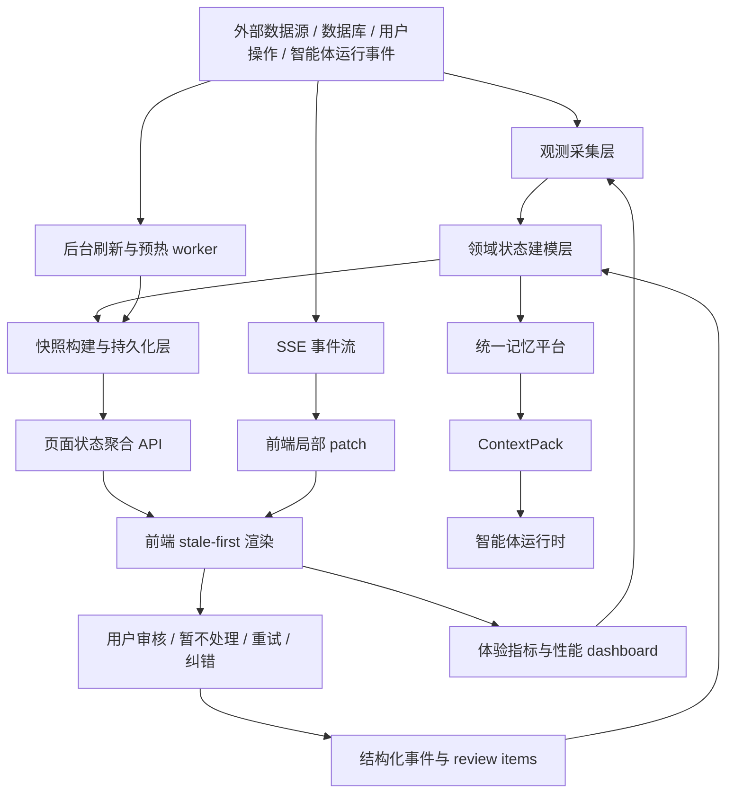
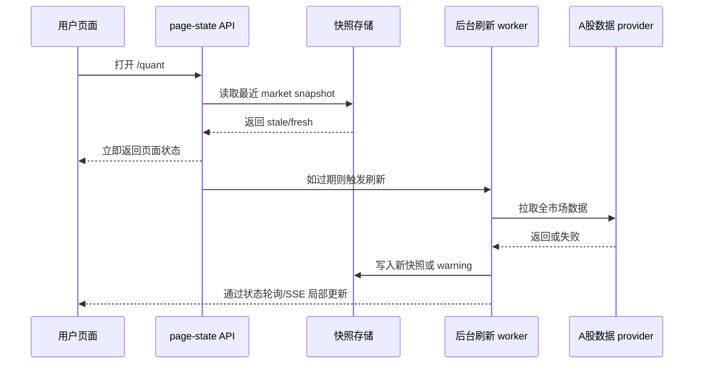
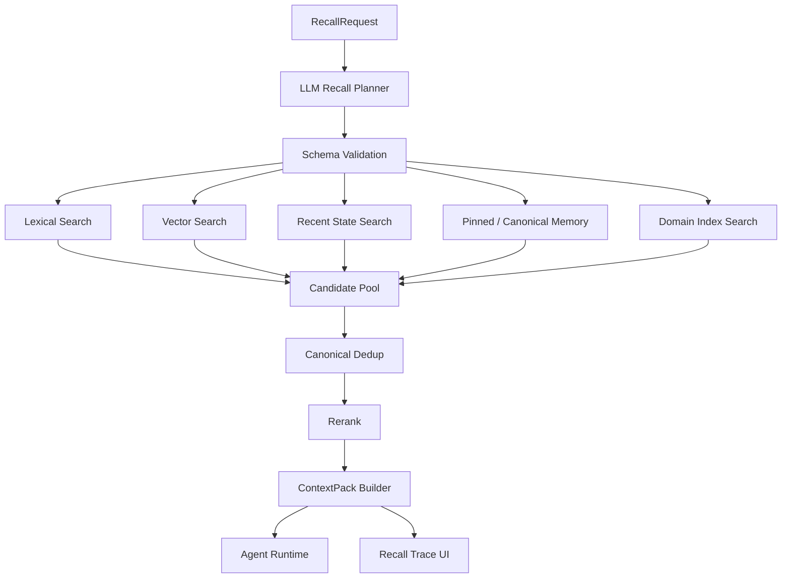

# 客户体验与平台响应架构 V3 技术方案

## 0. 方案定位

本文面向 Zhiyu 当前平台的客户体验问题，给出一套可执行、可验收、可持续维护的系统性技术方案。

当前问题不是“某个接口慢”这么简单，而是页面、接口、后台任务、SSE 事件、统一记忆、智能体上下文和量化数据源之间没有形成稳定的响应闭环。用户感受到的是页面切换卡顿、等待不透明、重复刷新、上下文过重、模型调用成本高、数据源慢时整页被拖住、需要处理的问题无法在平台内闭环。

本方案的目标不是单纯加缓存，而是把平台改造成：

```text
后台持续观测
  -> 领域状态建模
  -> 快照持久化
  -> 页面 stale-first 渲染
  -> 慢源异步刷新
  -> SSE 局部 patch
  -> 体验指标闭环
  -> 用户审核和纠错
```

遵循项目工程原则：

> 先观测，再建模；先闭环，再自动；先边界，再行动；先稳定，再智能。

## 1. 当前问题总结

### 1.1 用户感知问题

用户现在感受到的体验差主要来自以下场景：

| 场景 | 现象 | 用户感受 |
| --- | --- | --- |
| 页面切换 | 进入页面后等待多个接口完成 | 像整个系统很重 |
| 量化工作台 | 全市场数据冷启动会拖住页面 | 明明账户信息可以先看，却被市场慢源阻塞 |
| 智能体车间 | 列表、详情、dashboard、memory、source、outbox、loop 混在同一大页面中 | 首屏和 tab 切换不稳定 |
| SSE 事件 | 一个小事件可能触发 summary、dashboard、panel 多路重拉 | 页面抖动，请求风暴 |
| 记忆召回 | 需求方不知道召回了什么、为什么进入上下文 | 结果不可解释，成本不可控 |
| 智能体上下文 | 历史事件、原始消息、旧记忆、重复摘要可能混入 prompt | 模型响应慢、成本高、判断发散 |
| 待处理项 | 有些“需要处理”无法在页面处理，或暂不处理后仍显示 | 用户觉得平台逻辑不闭环 |
| 错误和降级 | 慢源失败时缺少明确 stale、refreshing、warning 表达 | 用户不知道是坏了、慢了，还是旧数据可用 |

### 1.2 工程根因

| 根因 | 当前表现 | 影响 |
| --- | --- | --- |
| 首屏接口过重 | 首屏承担完整 dashboard、事件日志、记忆、资料源、全市场数据 | 最慢源拖住整个页面 |
| 快慢数据未分层 | 账户、持仓、自选股和全市场数据被同一 loading 控制 | 可先展示的数据被迫等待 |
| 快照层不够稳定 | 部分页面仍依赖实时聚合和事件日志推导 | 冷启动慢，失败不可恢复 |
| 缓存语义分散 | SWR、内存缓存、page-state、direct snapshot 各自为政 | fresh/stale/refreshing/error 表达不一致 |
| SSE 刷新粒度过粗 | 局部事件仍可能触发 panel API 或 summary 重拉 | 请求放大，体验抖动 |
| 上下文入口分散 | workshop memory、brain memory、interaction events、raw messages 多路进入 | 成本高，重复信息多 |
| 待处理项事件化 | 需要处理状态从事件日志临时推导 | 关闭、暂不处理、已处理语义不稳定 |
| 观测闭环不足 | 有 smoke 和 dashboard，但还缺 tab/action 级指标和告警 | 回归不容易及时发现 |

## 2. 总体目标

### 2.1 产品目标

1. 页面切换后 1 秒内出现可用内容。
2. 慢数据源不阻塞快数据展示。
3. 有旧快照时先展示旧快照，并明确标注 freshness。
4. 单个模块失败不导致整页不可用。
5. 用户能看懂当前数据是否新鲜、后台是否刷新、哪个 provider 失败。
6. 智能体只消费和任务相关的最小充分上下文。
7. 记忆召回必须可解释、可追踪、可去重、可评估。
8. 平台提出的“需要处理”必须能在页面处理；不能处理仍显示为需要处理应视为 bug。

### 2.2 工程目标

| 指标 | 目标 |
| --- | --- |
| page-state 首屏 API p95 | < 500ms |
| 热缓存读取 p95 | < 150ms |
| tab 切换可见反馈 | < 300ms |
| 外部慢 provider | 不阻塞首屏 |
| 超过 800ms 的接口 | 必须有结构化耗时日志 |
| 超过 3s 的用户可见操作 | 必须有阶段进度或旧快照兜底 |
| 后台刷新失败 | 保留最近成功快照并显示 warning |
| 智能体上下文 | 默认由统一记忆平台生成 ContextPack |
| 待处理项 | 结构化存储、可关闭、可审核、可回放 |

## 3. 目标架构

### 3.1 架构总览



### 3.2 分层职责

| 层 | 职责 | 禁止事项 |
| --- | --- | --- |
| 观测采集层 | 拉取外部数据、读取 DB、接收运行事件、记录 provider 和耗时 | 直接阻塞页面首屏 |
| 领域状态建模层 | 把原始事件转成账户、市场、车间、Loop、记忆、待处理项等结构化状态 | 临时从长事件日志拼页面主状态 |
| 快照层 | 保存最近可用状态，标注 fresh/stale/refreshing/warning | 旧快照无标识地伪装成新数据 |
| page-state API | 给首屏返回轻量、足够可用的页面状态 | 返回长事件、全量记忆、完整工具输出 |
| 前端渲染层 | 旧数据优先显示，局部刷新，局部错误 | 一个全局 loading 控制所有模块 |
| SSE patch 层 | 对稳定 id 的事件做本地局部更新 | 信息不足时伪造长期状态 |
| 统一记忆平台 | 根据需求方意图生成召回参数、召回、去重、排序、打包 ContextPack | 让各智能体自行拼接历史 |
| 审核层 | 把需确认、需处理、服务异常、权限边界结构化 | 只在事件流里临时推导待处理状态 |
| 观测指标层 | 记录 API、页面、tab、动作、provider 的耗时与失败 | 只靠人工体感判断变慢 |

## 4. 核心设计一：页面状态快照

### 4.1 快照元信息

所有页面级快照统一带上元信息：

```ts
type SnapshotMeta = {
  hit: boolean;
  stale: boolean;
  refreshing: boolean;
  generatedAt: string | null;
  fetchedAt: string | null;
  expiresAt: string | null;
  source: "snapshot" | "live" | "fallback";
  warnings: Array<{
    code: string;
    message: string;
    provider?: string;
    detail?: string;
  }>;
};
```

### 4.2 读取策略

```text
fresh 快照可用
  -> 立即返回 fresh

fresh 过期但 stale 可用
  -> 立即返回 stale
  -> 标记 refreshing=true
  -> 后台刷新

没有任何快照
  -> 短超时尝试实时构建
  -> 超时后返回局部 pending 或明确错误

刷新失败
  -> 保留最近成功快照
  -> 写入 warning / lastError
  -> 页面局部展示降级状态
```

### 4.3 首屏 API 边界

首屏 API 只返回足够让页面可用的数据：

- 列表摘要。
- 当前选中对象摘要。
- 最近一次成功快照。
- 模块刷新状态。
- 必须立即处理的 review items 摘要。

首屏 API 不返回：

- 长事件日志。
- 全量记忆。
- 全量 source 正文。
- 完整工具输出。
- 大段模型回复历史。
- 全市场实时扫描结果。

目标接口：

```text
GET /api/page-state/quant
GET /api/page-state/workshop
GET /api/page-state/workshop/[id]/summary
GET /api/page-state/memory
GET /api/page-state/loops
```

## 5. 核心设计二：量化工作台响应优化

### 5.1 问题判断

量化系统里，市场温度、成交额、市场宽度、行业热度必须来自全市场数据，不能用单个自选股池代替。但全市场数据天然慢，不能成为页面首屏同步依赖。

### 5.2 数据分层

| 数据域 | 示例 | 响应策略 |
| --- | --- | --- |
| accountState | 模拟盘账户、持仓、订单、成交 | 快路径，优先展示 |
| watchlistState | 自选股、关注标的快照 | 快路径，优先展示 |
| marketState | 市场温度、成交额、宽度、行业热度 | 全市场快照，stale-first，后台刷新 |
| providerState | a-stock-data、fallback provider 状态 | 只影响对应模块 warning |

### 5.3 接口设计

```ts
type QuantPageState = {
  account: QuantPaperAccount | null;
  watchlist: QuantWatchlistItem[];
  marketSnapshot: QuantMarketOverview | null;
  dashboard: QuantDashboard | null;
  refresh: {
    account: RefreshJobStatus | null;
    market: RefreshJobStatus | null;
  };
  meta: SnapshotMeta;
};
```

建议接口：

```text
GET /api/page-state/quant
GET /api/quant/paper/account
GET /api/quant/dashboard
POST /api/quant/dashboard/refresh
GET /api/quant/dashboard/status
```

### 5.4 后台刷新

量化全市场刷新应从“页面请求触发并等待”改为“页面触发任务并读取最近快照”：



### 5.5 验收标准

1. 冷启动打开 `/quant`，账户和持仓区域 1 秒内可见。
2. 全市场 provider 慢 30 秒时，账户和自选股不受阻塞。
3. 有旧市场快照时，市场模块显示旧数据和刷新状态。
4. 全市场刷新失败时，不把自选股数据伪装成全市场数据。
5. 所有 provider 失败都带 provider/detail/warning。

## 6. 核心设计三：智能体车间响应优化

### 6.1 当前边界

智能体车间是长期控制器，不是单轮聊天窗口。页面不应该每次打开都重新计算整个世界状态。

车间页面应分为：

| 模块 | 首屏是否必须 | 数据来源 |
| --- | --- | --- |
| workshop list | 必须 | `/api/page-state/workshop` |
| selected summary | 必须 | `/api/page-state/workshop/[id]/summary` |
| dashboard | 非必须 | 懒加载 + 快照 |
| work model | 非必须 | 懒加载 |
| memories | 非必须 | 统一记忆召回/列表 API |
| sources | 非必须 | sources API |
| outbox | 非必须 | outbox API + SSE patch |
| review items | 重要但轻量 | `workshop_review_items` |
| loop detail | 按需 | loop detail API |

### 6.2 前端拆分方向

`workshop-client.tsx` 目前承担过多职责，后续应拆成：

```text
WorkshopShell
  -> WorkshopSidebar
  -> WorkshopSummaryPanel
  -> WorkshopDashboardPanel
  -> WorkshopWorkPanel
  -> WorkshopReviewPanel
  -> WorkshopMemoryPanel
  -> WorkshopSourcePanel
  -> WorkshopOutboxPanel
  -> WorkshopLoopPanel
  -> useWorkshopLiveEvents
  -> useWorkshopPanelCache
```

拆分原则：

1. shell 只关心选中车间、首屏摘要和布局。
2. 每个 panel 自己管理 loading/error/cache。
3. SSE 事件先进入统一 live refresh policy，再决定本地 patch 或 panel refresh。
4. tab 未打开时不拉取重数据。
5. 已加载 panel 保留旧数据，刷新时不清空。

### 6.3 SSE 刷新策略

SSE 事件分三类：

| 类型 | 示例 | 策略 |
| --- | --- | --- |
| timeline-only | agent_text、tool_result、source_checked | 只追加事件，不刷新 summary |
| panel-only | memory_written、source_added、outbox_draft、tool_error | 只刷新或 patch 对应 panel |
| summary-impacting | loop_run_completed、workshop_agent_change_applied、run_failed | 更新 summary/dashboard/review |

对于稳定 id 的事件，优先本地 patch：

```text
outbox_* -> patchOutboxListFromEvent
memory_written / memory_reviewed -> patchMemoryListFromEvent
source_added -> patchSourceListFromEvent
loop_run_* -> 后续 patchDashboardLoopFromEvent
```

保守规则：

1. 事件里有稳定 id 才 patch。
2. 事件表达了最小 UI 状态才 patch。
3. 信息不足时走 panel API，不伪造对象。
4. patch 成功后从 refresh plan 移除对应 panel，避免重复请求。

### 6.4 待处理项结构化

所有“需要处理”必须进入 `workshop_review_items` 主状态表。

建议模型：

```ts
type WorkshopReviewItem = {
  id: string;
  workshopId: string;
  kind:
    | "agent_change"
    | "watchlist_proposal"
    | "loop_blocker"
    | "permission_boundary"
    | "service_error"
    | "outbox_blocker";
  status: "pending" | "approved" | "rejected" | "dismissed" | "superseded";
  title: string;
  body: string;
  sourceEventId: string | null;
  groupKey: string | null;
  metadata: Record<string, unknown>;
  createdAt: string;
  updatedAt: string;
};
```

页面动作语义：

| 动作 | 含义 | 是否重跑 |
| --- | --- | --- |
| 通过 | 用户允许控制动作进入下一步 | 可能 |
| 驳回 | 用户否决该提案 | 不重跑原动作 |
| 暂不处理 | 用户知道此问题，但当前不想处理 | 不重跑 |
| 关闭同类 | 对同类服务异常批量 dismiss | 不重跑 |
| 重试 | 用户显式要求重新执行 | 需要新任务或新事件 |

验收规则：

1. 页面显示的 pending item 必须有可执行动作。
2. 暂不处理后，该 item 不应继续显示为 pending。
3. 原始事件不删除，审计可回放。
4. 结构化主状态优先于事件 fallback。

## 7. 核心设计四：统一记忆平台与上下文治理

### 7.1 目标

最终记忆平台不是“多类记忆列表”，而是一个统一的状态估计与召回服务。

需求方不直接拼 prompt，也不直接扫描多张记忆表，而是向记忆平台上报：

```ts
type MemoryRecallRequest = {
  requester: {
    platform: "workshop" | "loop" | "chat" | "quant" | "interaction_processor";
    agentId?: string;
    workshopId?: string;
    loopId?: string;
  };
  situation: {
    currentState: string;
    taskGoal: string;
    userIntent?: string;
    constraints?: string[];
    timeWindow?: {
      from?: string;
      to?: string;
    };
  };
  budget: {
    maxItems: number;
    maxTokens: number;
  };
  output: {
    format: "context_pack" | "citations" | "debug_trace";
  };
};
```

记忆平台负责：

1. 理解需求方当前属于什么平台。
2. 判断当前状态下要完成什么事。
3. 生成召回参数。
4. 多路召回。
5. 去重和归一。
6. 排序。
7. 生成 ContextPack。
8. 返回 recall trace 供页面解释。

### 7.2 大模型生成召回参数

自动生成召回参数应使用大模型理解能力，但必须有结构化输出和边界约束。

```ts
type RecallPlan = {
  intent: string;
  scopes: Array<"user" | "workshop" | "loop" | "market" | "interaction" | "project">;
  memoryKinds: Array<
    | "fact"
    | "preference"
    | "decision"
    | "strategy"
    | "constraint"
    | "event_summary"
    | "tool_learning"
  >;
  queries: Array<{
    text: string;
    weight: number;
    filters: Record<string, unknown>;
  }>;
  timeWindow?: {
    from?: string;
    to?: string;
    decay?: "none" | "mild" | "strong";
  };
  negativeFilters: string[];
  maxItems: number;
  maxTokens: number;
};
```

约束：

1. LLM 只生成召回计划，不直接决定最终注入 prompt 的内容。
2. 召回计划必须被 schema 校验。
3. 超出权限 scope 的召回请求必须被拒绝。
4. denied 优先于 allowed。
5. 每次召回写 trace，支持复盘。

### 7.3 多路召回与去重

召回链路：



去重优先级：

1. canonical memory id。
2. source event id。
3. semantic hash。
4. entity + time + action 三元组。
5. 文本相似度。

### 7.4 原有记忆系统评估

| 来源 | 后续定位 | 处理 |
| --- | --- | --- |
| brain memories | 统一记忆主平台 | 保留并增强 canonical、recall trace、ContextPack |
| workshop memory | 车间局部记忆入口 | 降级为 brain memory 的写入/查询视图 |
| interaction memory | 原始交互理解结果 | 作为记忆原始观测和候选，不直接长期注入 |
| raw messages | 不可改写原始观测 | 只做证据源，不直接进入 prompt |
| loop context window | 运行时短期状态 | 保留为短期工作记忆，长期依赖 brain memory |
| tool outputs | 工具证据 | 结构化摘要后才可进入长期记忆 |

### 7.5 ContextPack 输出

```ts
type BrainContextPack = {
  requestId: string;
  summary: string;
  memories: Array<{
    id: string;
    kind: string;
    content: string;
    relevance: number;
    confidence: number;
    source: string;
    reason: string;
  }>;
  constraints: string[];
  openQuestions: string[];
  excluded: Array<{
    id: string;
    reason: string;
  }>;
  trace: {
    plan: RecallPlan;
    routeHits: Record<string, number>;
    dedupedCount: number;
    finalTokenEstimate: number;
  };
};
```

验收标准：

1. 智能体和车间默认切到 Brain ContextPack。
2. 旧 workshop memory 不再单独拼进 prompt。
3. 用户能在统一召回页面看到 recall plan、命中来源、去重原因。
4. 同一事件产生多类记忆时，最终通过 canonical id 去重。
5. 每次 agent 调用能追溯上下文来自哪些记忆。

## 8. 核心设计五：前端体验规范

### 8.1 Loading 规则

禁止：

- 一个页面级 loading 控制所有模块。
- 刷新时清空旧数据。
- 慢接口阻塞已可展示区域。
- 后台错误弹成阻塞式全页错误。

要求：

- 首次无数据才显示骨架屏。
- 有旧数据时显示旧数据 + 局部刷新标识。
- 每个 panel 独立 loading/error。
- 动作按钮只锁定相关按钮，不锁整页。
- 页面上明确显示上次刷新时间和数据状态。

### 8.2 页面切换

推荐策略：

1. 侧边栏 hover 或进入视口时预取目标 page-state。
2. 切换页面时优先展示上次快照。
3. 返回页面时保留 tab、滚动位置、选中车间。
4. tab 首次打开懒加载，之后保留缓存。
5. 使用轻量 client probe 记录 route_visible_ms、route_duration_ms、initial_navigation_ms。

### 8.3 错误表达

| 错误类型 | 页面表现 | 用户动作 |
| --- | --- | --- |
| 阻塞错误 | 没有任何可用数据，显示主错误 | 重试或返回 |
| 降级错误 | 某 provider 失败，但有旧快照 | 继续使用，局部刷新 |
| 背景错误 | 后台刷新失败 | 查看详情、重试、暂不处理 |
| 需审核错误 | 需要用户确认权限或边界 | 通过、驳回、暂不处理 |

## 9. 可观测性与性能闭环

### 9.1 API 耗时日志

所有关键接口统一记录：

```ts
type ApiTimingLog = {
  event: "api_timing";
  route: string;
  operation: string;
  ms: number;
  cacheHit?: boolean;
  stale?: boolean;
  refreshing?: boolean;
  provider?: string;
  workshopId?: string;
  status: "ok" | "error" | "degraded";
  warningCount?: number;
};
```

### 9.2 页面体验事件

前端采集：

- route_visible_ms。
- route_duration_ms。
- initial_navigation_ms。
- tab_switch_ms。
- action_feedback_ms。
- panel_refresh_ms。

### 9.3 性能 dashboard

`/ux-performance` 应长期展示：

1. API hot-path latest/p50/p95/p99/max。
2. 页面体验 path + metric 聚合。
3. 最近 N 次窗口筛选。
4. 超阈值数量。
5. 最慢 provider。
6. 本地 smoke 报告路径。

后续升级：

1. 增加 tab/action 级指标。
2. 增加长期持久化表，而不只依赖本地 JSONL。
3. 增加阈值告警。
4. CI 中加入 smoke 阈值回归。

## 10. 数据与接口改造清单

### 10.1 已具备或应继续强化的表

| 表/存储 | 用途 | 后续方向 |
| --- | --- | --- |
| `page_state_snapshots` | 页面快照持久化 | 增加更多 page-state 类型和 TTL 策略 |
| `workshop_review_items` | 待处理项主状态 | 增加重试、分组原因、异常聚合 |
| `brain_memories` | 统一记忆主体 | 增强 canonical、source trace、质量评分 |
| `workshop_events` | 审计和回放 | 不再作为页面主状态实时计算源 |
| `.ux-smoke/history.jsonl` | 本地性能趋势 | 后续迁移到正式指标表 |
| `.ux-smoke/page-events.jsonl` | 页面体验事件 | 后续迁移到正式指标表 |

### 10.2 建议新增或完善的数据模型

```ts
type RefreshJobStatus = {
  key: string;
  status: "idle" | "running" | "success" | "failed";
  lastStartedAt: string | null;
  lastFinishedAt: string | null;
  lastSuccessAt: string | null;
  lastError: string | null;
  durationMs: number | null;
};
```

```ts
type RecallTrace = {
  requestId: string;
  requester: string;
  recallPlan: RecallPlan;
  routeStats: Array<{
    route: string;
    query: string;
    hitCount: number;
    durationMs: number;
  }>;
  dedup: {
    before: number;
    after: number;
    reasons: Record<string, number>;
  };
  finalTokenEstimate: number;
  createdAt: string;
};
```

```ts
type PageExperienceEvent = {
  path: string;
  metric: "route_visible_ms" | "route_duration_ms" | "tab_switch_ms" | "action_feedback_ms";
  valueMs: number;
  source: "browser";
  createdAt: string;
};
```

## 11. 分阶段实施计划

### Phase 0：现状固化和指标基线

目标：先知道哪里慢、哪里重复刷新、哪里上下文过重。

任务：

1. 固化 UX smoke 和 `/ux-performance`。
2. 补 tab/action 级页面体验事件。
3. 给 page-state、dashboard、memory search、quant provider 打统一 timing。
4. 对 agent 调用记录 context token profile。
5. 对 SSE 事件记录 refresh plan 和实际请求数。

验收：

1. 能看到每条热路径 p50/p95/p99。
2. 能看到每次 agent 调用的上下文来源和 token 占比。
3. 能定位一个 SSE 事件触发了哪些请求。

### Phase 1：体验止血

目标：先让页面不被慢源拖住。

任务：

1. 量化页面拆 loading，账户和市场分离。
2. 全市场数据使用快照 + 后台刷新。
3. 车间首屏只读 page-state。
4. tab 数据懒加载并保留旧数据。
5. SSE panel-only 策略覆盖 memory/source/outbox/review。
6. 对稳定 id 事件增加本地 patch。

验收：

1. `/quant` 冷启动 1 秒内可见账户区域。
2. `/workshop` 冷启动 1 秒内可见列表和选中摘要。
3. memory/source/outbox 事件不再默认重拉 summary。

### Phase 2：状态快照化

目标：页面主状态从事件实时计算迁移到快照和结构化主状态。

任务：

1. 强化 `page_state_snapshots` TTL、stale、warning 语义。
2. workshop dashboard、loop summary、review items 写入结构化快照。
3. 后台刷新 worker 接管慢计算。
4. 写操作后局部 invalidate，而不是整页重拉。
5. service_error 支持重试、同类关闭、原因聚合。

验收：

1. 外部 provider 慢或失败时页面仍可用。
2. 待处理项全部可在页面关闭或处理。
3. 后台刷新失败有 lastError 和最近成功时间。

### Phase 3：统一记忆平台收口

目标：智能体上下文默认从统一记忆平台消费。

任务：

1. 需求方按 platform/state/taskGoal 上报召回请求。
2. LLM Recall Planner 生成结构化召回参数。
3. 多路召回、canonical 去重、rerank、ContextPack 输出。
4. workshop memory、interaction memory 降级为 Brain 的写入/视图。
5. agent runtime 切换到 Brain ContextPack。
6. 统一召回页面展示 recall trace。

验收：

1. 同一事件产生多类记忆时只进入一个 canonical ContextPack。
2. 每次 agent 调用可解释上下文来源。
3. 大段原始历史默认不进入 prompt。
4. memory search p95 稳定在目标阈值内。

### Phase 4：前端模块化和请求收敛

目标：降低大组件重渲染和局部失败放大的风险。

任务：

1. 拆分 `workshop-client.tsx`。
2. 抽出 `useWorkshopLiveEvents`。
3. 抽出 `useWorkshopPanelCache`。
4. 为 dashboard/loop 增加本地 patch。
5. 侧边栏和页面导航增加 page-state 预取。
6. 重构空态、旧快照、刷新中、降级 warning 的统一组件。

验收：

1. 切 tab 不触发无关 panel 重渲染。
2. SSE 高频事件下请求数可控。
3. 页面视觉不再大面积闪烁。

### Phase 5：长期观测和自动化回归

目标：体验退化能被自动发现。

任务：

1. 将 UX smoke 接入 CI 或本地 preflight。
2. 建立长期指标表。
3. 设置阈值告警。
4. 建立 provider 健康面板。
5. 建立模型调用上下文质量报告。

验收：

1. 慢接口回归能在测试或 dashboard 中出现。
2. 页面体验 p95 变差能定位到页面、tab、动作。
3. agent 上下文膨胀能定位到来源。

## 12. 优先级建议

### P0：立即做

1. 继续收敛 SSE 请求风暴，补 loop/dashboard 本地 patch。
2. 补 tab/action 级前端体验指标。
3. 量化全市场刷新彻底后台化，确认市场指标只来自全市场快照。
4. agent 调用上下文 profile 可视化，定位无用上下文来源。
5. 待处理项动作闭环，确保所有 pending 都可处理或关闭。

### P1：短期做

1. 拆分 `workshop-client.tsx` 的 panel 状态。
2. 统一 page-state 快照元信息。
3. 建立 refresh job status。
4. 统一记忆 RecallRequest 和 RecallPlan。
5. memory/workshop/loop 接入 ContextPack。

### P2：中期做

1. 后台 worker 接管 dashboard、market、memory recall 预热。
2. 正式指标表替代本地 JSONL。
3. provider 健康面板。
4. 记忆 canonical 合并和质量评分。
5. CI 性能阈值。

## 13. 风险与降级

### 13.1 stale 数据风险

风险：用户看到旧数据并误以为是最新。

处理：

1. 页面必须显示 generatedAt / lastSuccessAt。
2. 关键控制动作必须服务端二次校验。
3. stale 数据只能用于观察，不直接驱动真实资金、外部发送、删除、配置变更等动作。

### 13.2 本地 patch 状态不完整

风险：SSE 事件信息不足，前端 patch 出错误状态。

处理：

1. 只有稳定 id + 最小状态完整时 patch。
2. patch 只更新局部字段。
3. 信息不足时保留 panel API refresh。
4. 关键状态仍以后端主状态为准。

### 13.3 缓存一致性

风险：写操作后用户短时间看到旧状态。

处理：

1. 写操作返回最新局部状态。
2. 写后强制 refresh 对应 summary 或 panel。
3. stale 快照保留但标记 refreshing。

### 13.4 记忆召回误召

风险：大模型生成错误召回计划或召回无关记忆。

处理：

1. RecallPlan 必须 schema 校验。
2. 权限 scope 硬校验，denied 优先。
3. ContextPack 带 reason 和 source。
4. 页面提供 recall trace。
5. 用户纠错写回召回质量反馈。

## 14. 测试方案

### 14.1 单元测试

1. page-state stale/fresh/refreshing 语义。
2. quant cache 和 provider warning。
3. workshop live refresh policy。
4. SSE 本地 patch。
5. review item 状态转换。
6. Brain recall planner schema。
7. ContextPack 去重和 token 截断。

### 14.2 集成测试

1. 全市场 provider 慢 30 秒，`/quant` 首屏仍可用。
2. workshop dashboard 慢 5 秒，`/workshop` 首屏仍可用。
3. SSE 高频 memory/source/outbox 事件不触发 summary 风暴。
4. 暂不处理 review item 后不再显示 pending。
5. agent 调用只消费 ContextPack，不直接拼全量历史。

### 14.3 性能 smoke

继续覆盖：

```text
pnpm --filter web smoke:ux
```

关键路径：

```text
/api/page-state/quant
/api/page-state/workshop
/api/page-state/workshop/[id]/summary
/api/page-state/workshop/[id]/summary?refresh=1
/api/quant/paper/account
/api/quant/dashboard
/api/memory/search
/api/workshops/[id]/dashboard
/api/ux-performance
```

### 14.4 手工验收

1. 冷启动进入 `/quant`。
2. 冷启动进入 `/workshop`。
3. 切换车间。
4. 切换 review/memory/source/outbox tab。
5. 触发一条服务异常并暂不处理。
6. 输入“盘中交易”做统一记忆召回，查看 recall plan 和 trace。
7. 模拟 provider 失败，确认页面仍可用。

## 15. 投资人视角表达

可以把本次改造概括为：

> Zhiyu 正在从“每次打开页面临时计算状态”的原型系统，升级为“后台持续观测、状态快照化、智能体按需消费记忆、用户可审核控制动作”的稳定智能工作台。

对业务价值的表达：

1. 响应更快：用户先看到可用状态，慢数据后台补齐。
2. 成本更低：智能体不再读取大量无关历史，而是消费统一记忆平台给出的 ContextPack。
3. 更可信：每个状态有来源、时间、warning 和审计记录。
4. 更安全：权限边界、待处理项和关键动作在平台内闭环。
5. 更可扩展：新增智能体、量化数据源或记忆类型时，不再把复杂度塞进页面和 prompt。

## 16. 当前已落地基础

截至本方案整理时，项目已经具备以下基础：

1. 已有 page-state 快照能力。
2. 已有 `/api/page-state/quant`。
3. 已有 `/api/page-state/workshop`。
4. 已有 `/api/page-state/workshop/[id]/summary`。
5. 已有 UX smoke 脚本和本地历史报告。
6. 已有 `/ux-performance` 性能观察页面。
7. 已有页面级前端体验事件采集。
8. 已有 `workshop_review_items` 结构化待处理项。
9. 已有 memory/source/outbox/review 的 SSE 局部刷新策略。
10. 已有 outbox、memory、source 的部分本地 patch。
11. 已有统一记忆平台和 Brain ContextPack 的初步实现基础。

## 17. 下一步建议

下一轮最应该继续推进：

1. 补 `loop/dashboard` SSE 本地 patch，继续减少车间页面请求风暴。
2. 做 agent context profile 可视化，直接定位无用上下文来源。
3. 把智能体和车间的记忆入口切到 Brain ContextPack。
4. 给统一召回补正式 recall trace 存储。
5. 拆分 `workshop-client.tsx`，降低长期维护成本。
6. 把量化全市场刷新彻底 worker 化，并暴露 provider 状态。

最终验收口径：

```text
页面先可用
慢源不阻塞
旧快照可解释
事件局部更新
待处理可闭环
记忆统一召回
上下文最小充分
性能持续可观测
```
