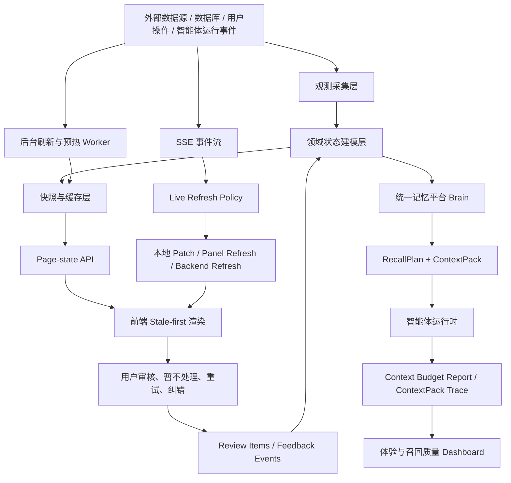

# 客户体验与平台响应架构 V4 详细技术方案

## 0. 方案定位

本文是 Zhiyu 平台“客户体验与响应速度改造”的长期技术方案。它承接现有 `customer-experience-response-architecture-plan.md`、`customer-experience-response-architecture-v3.md`、统一记忆平台方案和近期代码落地结果，用于指导后续继续改造。

本方案的核心判断是：当前体验问题不是单个接口慢，而是页面首屏、慢数据源、SSE 刷新、智能体上下文、统一记忆召回、待处理闭环和观测指标没有形成稳定控制系统。改造目标不是简单压低成本，也不是粗暴限制上下文，而是让平台只把“当前任务需要的、可解释的、可追溯的、最小充分上下文”交给智能体，同时让页面永远优先展示可用状态。

工程原则沿用项目总原则：

> 先观测，再建模；先闭环，再自动；先边界，再行动；先稳定，再智能。

## 1. 总体目标

### 1.1 用户体验目标

- 页面切换后 1 秒内出现可用内容，不因某个慢源导致整页空白。
- 有旧快照时先显示旧快照，再后台刷新，并明确标注 freshness。
- 慢数据源只影响对应模块，不阻塞账户、自选股、车间摘要等快路径。
- 智能体车间不再像单轮聊天页面，而是长期控制台：能看到运行状态、异常、待处理项、最近运行、上下文体检和记忆召回依据。
- 统一记忆平台成为智能体长期记忆的默认入口，需求方不再各自拼接 raw messages、interaction memory、workshop memory 和历史事件。
- 用户能看懂“为什么召回了这些记忆、为什么省略/拒绝了另一些记忆、哪些上下文占用了最多 prompt”。
- 平台提出的“需要处理”必须能在页面上处理；不能处理但仍展示为需要处理，应视为 bug。

### 1.2 工程目标

| 目标 | 验收标准 |
| --- | --- |
| 首屏轻量化 | 主页面 page-state 热路径 p95 < 500ms |
| 缓存快照化 | 热缓存读取 p95 < 150ms，stale 可用时不白屏 |
| 慢源后台化 | 全市场量化数据、长事件聚合、重记忆召回不阻塞首屏 |
| SSE 局部更新 | 小事件优先本地 patch，不触发整页请求风暴 |
| 上下文治理 | 每次智能体运行写入 context budget report 和 ContextPack trace |
| 记忆收口 | 智能体默认消费 Brain ContextPack，legacy memory 只做 evidence/fallback |
| 待处理闭环 | review item 结构化存储，支持确认、暂不处理、关闭、重试 |
| 可观测 | `/ux-performance` 能看到 API、页面、tab、上下文、召回质量趋势 |

## 2. 当前状态与已落地基础

当前项目已经具备一批基础能力，后续应基于这些能力继续收口，而不是另起炉灶。

### 2.1 已落地能力

- `GET /api/page-state/quant`：量化页 page-state 快照入口。
- `GET /api/page-state/workshop`：车间列表 page-state 快照入口。
- `GET /api/page-state/workshop/[id]/summary`：车间摘要 page-state 快照入口。
- `GET /api/page-state/loops`：Loop 页面轻量 page-state。
- `.ux-smoke` 和 `GET /api/ux-performance`：UX smoke、历史趋势、页面体验指标。
- `/ux-performance` 页面：展示接口和页面体验趋势。
- `/api/memory/search`：默认已切为 Brain-only 快路径；legacy raw message fallback 需要 `includeLegacyMemory=true` 显式开启。
- `workshop_review_items`：把 loop blocker、permission boundary、service error 等结构化为可处理事项。
- `workshop-live-refresh-policy`：把 SSE 事件分为 local patch、panel refresh、backend refresh 等策略。
- `Brain ContextPack`：统一记忆召回的输出模型，包含 selected、omitted、denied、warnings、evidence refs。
- `summarizeBrainContextPackForTrace`：把单次召回的 ContextPack 写入运行事件，支持页面下钻。
- `traceQuality`：召回质量报告已能聚合 ContextPack trace，展示 selected/omitted/denied、无证据选中、canonicalKind 和原因分布。
- `traceQualityByRequester`：召回质量报告已能按 requester 拆分 ContextPack trace，定位哪个 Work/调用方更常产生重复、省略、拒绝或无证据上下文。
- 车间 dashboard 的 `contextCost.sectionStats`：按 prompt section 聚合上下文体检。

### 2.2 仍然存在的关键缺口

- 部分页面和 panel 仍然以大组件承担过多职责，尤其是 `workshop-client.tsx`。
- ContextPack trace 已经能看单次详情，并已进入长期召回质量报告和 requester 级拆分；后续还需要继续按 loop/run 维度拆分，并把高频质量问题转成可处理事项。
- page-state、SWR、本地内存缓存、snapshot 缓存语义仍需统一。
- 量化全市场数据后台刷新还需要更强的 job/status 可观测。
- 智能体和车间的所有记忆读取路径还需要继续切到 Brain ContextPack；统一记忆搜索默认路径已先切为 Brain-only，显式 legacy sources 已具备 source-level 状态、耗时、结果数、warning 数、单 source 局部重试、单 source 结果过滤和分源折叠；Brain 路径已返回 ContextPack trace 摘要并在页面展示，人工召回页已支持 append-only 反馈，后续继续补长期质量聚合。
- review item 需要扩展更多来源，确保所有“需要处理”都有页面动作。
- UX 指标需要从 smoke 扩展到真实 tab/action 级别，形成回归门禁。

## 3. 目标架构



架构核心是把“原始观测、领域状态、页面快照、智能体上下文、用户反馈”分层，而不是让页面或智能体在运行时临时拼接一切。

## 4. 分层设计

### 4.1 观测采集层

职责：

- 采集外部 provider 数据，例如 A 股行情、全市场热度、行业热度、模拟盘账户。
- 读取数据库里的 workshop、loop、event、memory、outbox、review item。
- 接收智能体运行事件、工具调用结果、错误和降级信息。
- 记录每个慢源的 provider、耗时、错误、fallback、数据时间。

边界：

- 观测层允许慢，也允许失败。
- 观测层失败不能直接导致首屏不可用。
- 所有降级必须保留 `provider/detail/warning`。

### 4.2 领域状态建模层

职责：

- 把原始数据转成页面和智能体能消费的稳定状态。
- 把长事件流转成摘要、计数、最近变化、待处理项。
- 把记忆候选、长期记忆、权限边界、用户纠错转成 ContextPack。
- 把异常和 blocker 转成 review item。

典型模型：

- `QuantPageState`
- `WorkshopPageState`
- `WorkshopSummaryPageState`
- `WorkshopDashboard`
- `LoopRunSummary`
- `WorkshopReviewItem`
- `BrainRecallPlan`
- `BrainContextPack`
- `BrainContextTraceSummary`
- `ContextBudgetReport`

### 4.3 快照与缓存层

统一快照元信息：

```ts
type SnapshotMeta = {
  hit: boolean;
  stale: boolean;
  refreshing: boolean;
  generatedAt: string | null;
  fetchedAt: string | null;
  expiresAt: string | null;
  source: "snapshot" | "live" | "fallback";
  warnings: Array<{
    code: string;
    message: string;
    provider?: string;
    detail?: string;
  }>;
};
```

读取策略：

1. fresh 快照可用：立即返回。
2. fresh 过期但 stale 可用：立即返回 stale，并触发后台刷新。
3. 无任何快照：短超时尝试实时构建，超时后返回局部 pending。
4. 刷新失败：保留最近成功快照，写入 warning 和 lastError。

写入策略：

- 写动作只失效相关快照，不清空整页状态。
- 高风险动作不能依赖 stale 快照，必须重新读取服务端最新状态校验。
- 快照用于展示和辅助判断，不直接代表控制动作的最终依据。

### 4.4 Page-state API 层

Page-state API 是首屏入口，只返回“足够让页面可用”的轻量数据。

目标接口：

```text
GET /api/page-state/quant
GET /api/page-state/workshop
GET /api/page-state/workshop/[id]/summary
GET /api/page-state/memory
GET /api/page-state/loops
```

首屏 API 应返回：

- 列表摘要。
- 当前选中对象摘要。
- 最近成功快照。
- 局部模块刷新状态。
- 需要立即处理的 review item 摘要。

首屏 API 不应返回：

- 长事件日志。
- 全量记忆。
- 全量 source 正文。
- 完整工具输出。
- 大段模型历史回复。
- 全市场实时扫描结果。

### 4.5 前端渲染层

前端原则：

- 有旧数据就先显示旧数据。
- 后台刷新不清空旧 UI，只显示局部刷新状态。
- 每个 panel 独立 loading/error，不使用单一页面级 loading 控制所有模块。
- tab 首次打开可以懒加载，但再次切回必须复用上次结果。
- 错误分为阻塞错误、降级错误、后台刷新错误。
- 用户能看到数据新鲜度、刷新中、降级 warning 和最后成功时间。

## 5. 量化工作台改造方案

### 5.1 问题判断

量化页的慢源主要来自全市场数据：市场温度、成交额、市场宽度、行业热度。这些指标必须来自全市场，不能用自选股替代。但全市场扫描天然慢，不能成为首屏同步依赖。

### 5.2 数据分层

| 数据域 | 示例 | 响应策略 |
| --- | --- | --- |
| accountState | 模拟盘账户、持仓、订单、成交 | 快路径，优先展示 |
| watchlistState | 自选股、关注标的、快速行情 | 快路径，优先展示 |
| marketState | 市场温度、成交额、市场宽度、行业热度 | 全市场快照，stale-first，后台刷新 |
| providerState | a-stock-data、fallback provider 状态 | 只影响对应模块 warning |

### 5.3 接口设计

```ts
type QuantPageState = {
  account: QuantPaperAccount | null;
  watchlist: QuantWatchlistItem[];
  marketSnapshot: QuantMarketOverview | null;
  dashboard: QuantDashboard | null;
  refresh: {
    account: RefreshJobStatus | null;
    market: RefreshJobStatus | null;
  };
  meta: SnapshotMeta;
};
```

需要继续强化：

- `GET /api/page-state/quant`：读最近快照，stale 可用时立即返回。
- `POST /api/quant/dashboard/refresh`：触发全市场刷新任务，不同步等待全量完成。
- `GET /api/quant/dashboard/status`：返回后台刷新状态、lastSuccessAt、lastError、provider。
- `GET /api/quant/paper/account`：保持快路径，不依赖完整 dashboard。

### 5.4 安全边界

- stale market snapshot 只能用于展示和分析提示。
- 模拟下单必须重新读取账户、持仓、价格、交易日状态。
- 真实券商下单默认禁止，除非未来单独建立真实资金边界。
- 市场 provider 降级必须暴露 provider/detail/warning，不能伪装为完整数据。

### 5.5 验收标准

- 打开 `/quant` 时，账户和持仓 1 秒内可见。
- 全市场 provider 慢或失败时，账户、自选股、订单不受阻塞。
- 有旧市场快照时，市场模块显示 stale 和刷新中。
- 全市场刷新失败时页面仍可操作，并显示 provider warning。
- 市场温度、成交额、市场宽度、行业热度明确标记 `scope=full_market`。

## 6. 智能体车间响应改造方案

### 6.1 问题判断

车间页目前承担了列表、详情、dashboard、events、loops、memory、sources、outbox、boundary、tools、SSE、表单和动作等多种职责。任何慢接口都可能放大为整页卡顿。

### 6.2 目标结构

```text
WorkshopPageShell
  WorkshopSidebar
  WorkshopHeader
  WorkshopOverviewPanel
  WorkshopDashboardPanel
  WorkshopLoopsPanel
  WorkshopReviewPanel
  WorkshopTimelinePanel
  WorkshopMemoryPanel
  WorkshopSourcesPanel
  WorkshopOutboxPanel
  WorkshopBoundaryPanel
  WorkshopToolsPanel
  useWorkshopLiveEvents
  useWorkshopPanelCache
```

Shell 只负责：

- 当前选中 workshop。
- 当前 tab。
- 全局操作状态。
- SSE 事件分发。
- 首屏摘要。

每个 panel 自己负责：

- 数据 key。
- stale 数据。
- 局部 loading。
- 局部 error。
- 局部刷新。

### 6.3 SSE 刷新策略

事件先进入 `workshop-live-refresh-policy`，再决定动作：

| 事件类型 | 默认动作 |
| --- | --- |
| outbox 状态变化 | 本地 patch outbox list |
| memory 写入/更新 | 本地 patch memory list 或局部刷新 memory panel |
| source 更新 | 本地 patch source list |
| loop_run_started | 本地 patch loop/dashboard |
| loop_run_completed | 本地 patch loop/dashboard，必要时刷新 dashboard |
| loop_run_failed | 刷新后端状态并同步 review item |
| permission_boundary | 生成/刷新 review item |
| service_error | 生成 service_error review item |

禁止：

- 小事件触发整页 reload。
- SSE 到来时清空旧 panel 数据。
- 信息不足时伪造长期状态。

### 6.4 待处理项闭环

`workshop_review_items` 是“需要处理”的唯一页面入口，不再从事件日志临时推导页面主状态。

Review item 来源：

- `loop_blocker`
- `permission_boundary`
- `service_error`
- `outbox_confirmation`
- `agent_change_proposal`
- `memory_candidate_review`
- `watchlist_proposal`

Review item 动作：

- `resolve`：已处理。
- `dismiss`：用户认为不需要处理。
- `snooze`：暂不处理，到期前不再阻塞。
- `retry`：重新触发对应任务或刷新。
- `open_source`：查看来源证据。

语义要求：

- “清空提示”不是删除事实，而是告诉平台“我不想处理这个事项，或我已经线下处理但不想重跑”。
- 点了“暂不处理”后，该事项不能继续出现在需要处理列表中，除非 snooze 到期或产生新的 source event。
- 任何不能在页面上处理却显示为需要处理的事项，按 bug 处理。

## 7. 统一记忆平台与上下文治理方案

### 7.1 核心判断

项目的核心问题之一不是“模型贵”，而是大量无用、重复、来源混杂的历史信息进入上下文。合理上下文输入输出不应该被成本限制，但必须由任务需求驱动。

统一记忆平台的目标是：

```text
需求方上报任务状态和意图
  -> 记忆平台理解需求
  -> 生成 RecallPlan
  -> 多路召回
  -> 权限过滤
  -> canonical 去重
  -> ContextPack 输出
  -> 智能体消费
  -> 写入 trace 和反馈
```

需求方不直接查询 `brain_memories`、`workshop_memories`、`interaction_memories`、raw messages 或 RAG chunks。需求方只表达当前自己是谁、处于什么状态、要做什么事。

当前 `/api/memory/search` 的产品策略：

- 默认只搜 Brain canonical memory，作为统一记忆页和 smoke 的快路径。
- raw message semantic fallback 需要 `includeLegacyMemory=true` 显式开启。
- Insights、Knowledge、Interactions、Graph 仍可作为用户显式选择的 legacy discovery/evidence/derived index。
- cache key 区分 Brain-only 与 legacy fallback，避免不同语义结果混用。

### 7.2 MemoryRequest 契约

```ts
type MemoryRequest = {
  requester: {
    platform: "workshop" | "loop" | "chat" | "memory_page" | "mcp_tool";
    requesterId: string;
    role?: string;
    userId: string;
  };
  runtime: {
    state:
      | "planning"
      | "observing"
      | "executing"
      | "reviewing"
      | "blocked"
      | "degraded"
      | "awaiting_approval";
    currentTask: string;
    pendingAction?: {
      kind: "read" | "write" | "trade" | "send_message" | "review" | "configure";
      risk: "low" | "medium" | "high";
    };
  };
  query: {
    userText: string;
    intent?: string;
    entities?: string[];
    timeWindow?: string;
  };
  constraints: {
    maxItems: number;
    maxPromptTokens: number;
    requireEvidenceForHighRisk: boolean;
  };
};
```

### 7.3 RecallPlan 生成

RecallPlan 应优先使用大模型理解任务需求生成，但必须有规则 fallback。

LLM planner 输入：

- requester 平台和角色。
- runtime 状态。
- 当前任务文本。
- pending action。
- 已知实体和风险等级。
- 可用 memory taxonomy。
- 权限边界摘要。

LLM planner 输出：

```ts
type BrainRecallPlan = {
  mode: "llm" | "rule_fallback";
  routes: Array<{
    kind:
      | "pinned_boundary"
      | "recent_correction"
      | "exact"
      | "keyword"
      | "vector"
      | "entity_graph"
      | "evidence_read";
    query: string;
    ownerTypes: string[];
    memoryTypes: string[];
    canonicalKinds: string[];
    limit: number;
    reason: string;
  }>;
  ranking: {
    preferFreshness: boolean;
    preferEvidence: boolean;
    forceBoundary: boolean;
    dedupeByCanonicalGroup: boolean;
  };
  promptBudget: {
    maxItems: number;
    maxTokens: number;
  };
};
```

规则 fallback：

- 高风险动作强制召回 boundary、recent correction、current state。
- `executing` 状态优先召回 boundary、commitment、state。
- `reviewing` 状态优先召回 lesson、evidence、历史决策。
- `blocked/degraded` 状态优先召回 blocker、fallback、用户纠错。

### 7.4 多路召回与去重

推荐召回通道：

| 通道 | 用途 |
| --- | --- |
| pinned_boundary | 权限边界、禁止项、硬规则 |
| recent_correction | 用户最近纠错 |
| exact | owner、scope、subject、canonicalKind 精确匹配 |
| keyword | 任务词、实体词、标签 |
| vector | 语义相似 |
| entity_graph | 实体关系扩展 |
| evidence_read | 读取支持证据摘要 |

去重原则：

- 同一个 source event 派生的多类记忆不能同时作为主事实进入 prompt。
- 默认只允许一个 canonical long-term memory 进入 ContextPack。
- 派生物进入 `derivedRefs`、`evidenceRefs` 或 `omitted`。
- denied 优先级高于 allowed；语义再相关也不能越权。

### 7.5 ContextPack 输出

```ts
type BrainContextPack = {
  interfaceVersion: "memory-context.v1";
  selection: {
    selectedCount: number;
    omittedCount: number;
    deniedCount: number;
    promptTokenEstimate: number;
  };
  items: Array<{
    id: string;
    memoryType: string;
    canonicalKind?: string;
    canonicalGroupId?: string;
    subject: string;
    content: string;
    score: number;
    reasons: string[];
    evidenceRefs: string[];
    warnings: string[];
  }>;
  omitted: Array<{
    id: string;
    reason: string;
  }>;
  denied: Array<{
    id: string;
    reason: string;
  }>;
  warnings: string[];
};
```

### 7.6 上下文体检

每次智能体运行必须写入：

- 总 prompt token 估算。
- 各 section token/char。
- 最大 section。
- 超阈值 section。
- ContextPack selected/omitted/denied。
- 召回 routes 和 planner mode。
- fallback reason。

车间 dashboard 已显示 `sectionStats`，后续需要继续做：

- 按 agent/loop 聚合最常超限 section。
- 按记忆来源聚合最常 omitted/denied 的原因。
- 把重复召回、过期召回、无证据召回转成 recall quality issue。
- 对高风险任务显示 evidence coverage。

## 8. 记忆系统收口策略

### 8.1 记忆分类原则

长期可召回主事实应进入 Brain Memory。其他系统按职责降级：

| 来源 | 后续定位 |
| --- | --- |
| Brain memory | 长期记忆主事实源 |
| Workshop memory | 车间领域 evidence/fallback，逐步迁移或映射到 Brain |
| Interaction memory | 微信/交互理解候选，确认后进入 Brain |
| Raw messages | 不可改写原始观测，只作为 evidence |
| RAG chunks | 知识资料 evidence，不是用户长期记忆 |
| Graph relations | 辅助扩展和去重，不直接塞 prompt |
| Snapshots | 当前状态加速层，不替代长期记忆 |

### 8.2 不动旧数据，改后续入口

用户已经明确：当前重点不是动旧数据，而是让后续记忆能作为长期记忆被正确收口。因此改造顺序是：

1. 新写入走 Brain canonical admission。
2. legacy 读取路径包装成 adapter。
3. 统一召回先走 Brain ContextPack。
4. legacy 结果只能作为 fallback/evidence。
5. 页面显示来源语义，避免混合来源被误认为同级长期记忆。
6. 后续再做旧数据迁移和清理，不作为当前阻塞项。

## 9. 体验观测与质量报告

### 9.1 UX 指标

需要持续观测：

- 页面首屏可用时间。
- tab 切换可见反馈时间。
- API p50/p95/p99/max。
- cache hit/stale hit/miss。
- 后台刷新成功率。
- provider 错误率和耗时。
- SSE 事件导致的刷新次数。
- 每次用户动作触发的请求数。

已落地基础：

- `apps/web/scripts/run-ux-performance-smoke.cjs`
- `.ux-smoke/latest.json`
- `.ux-smoke/history.jsonl`
- `GET /api/ux-performance`
- `/ux-performance`
- `UxPageMetricsProbe`

后续增强：

- tab/action 级指标。
- 每个 panel 的加载和刷新指标。
- smoke 结果作为回归门禁。
- 把慢接口自动关联到最近代码变更或 provider。

### 9.2 召回质量报告

需要从单次 ContextPack trace 演进为长期质量报告：

- selected Top memory/source。
- omitted Top reason。
- denied Top reason。
- duplicate canonical group 统计。
- empty recall rate。
- fallback planner rate。
- evidence coverage。
- 用户反馈 outcome。

质量报告不用于限制上下文，而是用于发现：

- 哪些记忆分类不合理。
- 哪些来源重复进入候选。
- 哪些高风险任务缺少 evidence。
- 哪些智能体仍绕过统一记忆平台。

当前已落地：

- 单次 `brain-context-trace.v1` 已能在 run/loop 详情中下钻。
- `traceQuality` 已把 ContextPack trace 聚合到 workshop memory recall quality 报告中。
- 页面已能展示 trace 数、selected/omitted/denied、无证据选中数、warning 数、canonicalKind 分布和 selected/omitted/denied 原因。
- `traceQualityByRequester` 已能按 requester 展示问题较重的调用方及其主要原因。

后续继续：

- 按 loop、run 和具体任务类型继续分组展示 trace quality。
- 将重复、过期、无证据、高风险缺 boundary 等模式升级为 review item 或 memory stewardship issue。
- 将用户反馈 outcome 和 trace reason 关联，判断是召回范围、排序、分类、证据还是权限边界问题。

## 10. 分阶段实施计划

### Phase 1：首屏和慢源继续收口

目标：

- 完成 page-state 语义统一。
- 强化量化全市场后台刷新状态。
- 确保 `/quant` 和 `/workshop` 没有慢源阻塞首屏。

主要任务：

- 审查所有主页面是否优先读 page-state。
- 把重 dashboard 和长事件列表从首屏拆出。
- 为全市场刷新补 job/status/lastError。
- 给 page-state 响应统一 `SnapshotMeta`。

验收：

- UX smoke 通过。
- `/quant` 慢 provider 不阻塞账户区域。
- `/workshop` 首屏不拉全量 memory/source/outbox。

### Phase 2：车间 panel 化和 SSE 精准刷新

目标：

- 降低 `workshop-client.tsx` 的职责集中度。
- 所有 SSE 事件都有明确 refresh policy。
- 小事件优先本地 patch。

主要任务：

- 拆分核心 panel。
- 把请求状态移入 panel hooks。
- 补齐 local patch 测试。
- 对无法 patch 的事件保留最小 panel refresh。

验收：

- loop/outbox/memory/source 事件不触发整页刷新。
- 切换 tab 保留旧数据。
- panel 错误不影响其他 panel。

### Phase 3：统一记忆平台成为默认召回入口

目标：

- 智能体、车间、Loop、MCP 工具默认消费 Brain ContextPack。
- legacy memory 降级为 adapter/fallback/evidence。

主要任务：

- 审查所有 memory_read 工具。
- 把 `workshopSearchMemory`、`searchUnifiedMemory`、loop context 统一到 MemoryRequest。
- LLM planner 生成 RecallPlan，规则 fallback 保底。
- ContextPack trace 写入所有运行事件。
- 页面提供 trace 下钻。

验收：

- 任意智能体运行能看到 recall plan 和 selected/omitted/denied。
- 高风险任务强制召回 boundary 和 evidence。
- legacy 结果不再作为同级长期记忆直接进入 prompt。

### Phase 4：上下文质量和召回质量闭环

目标：

- 不靠“预算限制”压上下文，而是靠任务理解、分类、去重和证据质量优化上下文。

主要任务：

- 聚合 ContextPack trace 到 recall quality report。
- 展示 sectionStats 趋势。
- 标记重复、过期、无证据、高风险缺 boundary 的召回。
- 增加用户反馈入口：有用、无关、过期、重复、缺证据。

验收：

- 车间 dashboard 能看到上下文体检和召回质量。
- 能定位“哪个 section/来源导致上下文过长”。
- 能定位“哪些记忆经常被 omitted/denied/duplicate”。

### Phase 5：长期自动化和回归门禁

目标：

- 让体验退化能被自动发现。
- 让后台预热、快照刷新、召回质量形成闭环。

主要任务：

- UX smoke 接入本地验证脚本。
- 关键接口超阈值写结构化事件。
- provider 失败率高时展示 dashboard warning。
- 定期生成 recall quality 和 context quality 报告。

验收：

- 新增慢接口能在 `/ux-performance` 被发现。
- 页面体验指标有历史趋势。
- 召回质量退化能定位到来源、分类或 planner。

## 11. 风险与降级

| 风险 | 处理 |
| --- | --- |
| 快照过期导致用户误判 | UI 明确 stale，写动作强制重新校验 |
| 后台刷新失败 | 保留 last success，显示 provider warning |
| LLM planner 不稳定 | 规则 fallback，记录 planner mode 和 fallback reason |
| legacy 迁移影响现有能力 | 先 adapter/fallback，不急于删除旧数据 |
| SSE patch 信息不足 | 局部 panel refresh，不伪造状态 |
| 上下文体检只看成本 | 指标表达从 cost 改为 context quality 和 task sufficiency |
| review item 误关闭 | 保留 source event、audit event，可从来源重新生成 |

## 12. 验收命令

每轮核心改造后至少运行：

```text
pnpm --filter web tsc --noEmit --pretty false
pnpm --filter web smoke:ux
```

按改造范围补充运行：

```text
pnpm --filter web exec vitest run tests/unit/workshop-live-refresh-policy.test.ts
pnpm --filter web exec vitest run tests/unit/workshop-review-items.test.ts
pnpm --filter web exec vitest run tests/unit/brain-context-pack.test.ts
pnpm --filter web exec vitest run tests/unit/brain-recall-quality.test.ts
pnpm --filter web exec vitest run tests/unit/quant-page-state.test.ts
pnpm --filter web exec vitest run tests/unit/workshop-summary-page-state.test.ts
pnpm --filter web exec vitest run tests/unit/unified-memory-search.test.ts tests/unit/memory-search-cache.test.ts
```

### 12.1 最新落地记录：统一记忆 source-level 状态

- `UnifiedMemorySearchOutput.sourceStatuses` 已落地，显式选择 Brain、Insights、Knowledge、Interactions、Graph 时，每一路都会返回 `ok/degraded/unavailable`、耗时、结果数、warning 数和语义标签。
- `/memory` 页面已展示每个 source 的状态和耗时，用户可以区分是 canonical Brain 召回正常、legacy discovery 降级，还是 evidence source 不可用。
- 默认 Brain-only 快路径保持不变，`includeLegacyMemory=true` 才启用 raw message fallback；source-level 状态不会把 legacy 慢源重新带回默认热路径。
- 本轮验证通过：统一记忆搜索相关 18 项单测、`pnpm --filter web tsc --noEmit --pretty false`、`pnpm --filter web smoke:ux`。最新 measured hot-path 中 `/api/memory/search` 为 `72ms`。

### 12.2 最新落地记录：统一记忆单 source 局部重试

- `/memory` 页面已支持对单个 source 执行局部重试，重试 Brain、Insights、Knowledge、Interactions、Graph 中任一路时，不清空其它 source 的结果。
- 局部重试只替换被重试 source 的结果、warning 和 status，并重新按 similarity 合并排序。
- 每个 source 的重试按钮有独立 loading 状态，避免把某个 legacy source 的失败扩大为整页 loading。
- 本轮验证通过：`pnpm --filter web tsc --noEmit --pretty false`、`pnpm --filter web smoke:ux`。最新 measured hot-path 中 `/api/memory/search` 为 `17ms`。

### 12.3 最新落地记录：统一记忆单 source 结果过滤

- `/memory` 页面已支持在结果区按 source 过滤，用户可以只看 Brain、Insights、Knowledge、Interactions 或 Graph 的召回结果。
- 过滤只使用当前页面已有结果，不新增接口请求，不影响默认 Brain-only 快路径。
- 单 source 局部重试后，过滤项计数、顶部结果数和列表内容会跟随合并结果同步更新。
- 本轮验证通过：`pnpm --filter web tsc --noEmit --pretty false`、`pnpm --filter web smoke:ux`。最新 measured hot-path 中 `/api/memory/search` 为 `15ms`。

### 12.4 最新落地记录：统一记忆分源折叠

- `/memory` 页面在“全部”结果视图下已按 source 分组，并支持每组独立折叠/展开。
- 分组头展示 source label、结果数和 source 状态，便于用户先看 canonical Brain，再按需展开 legacy discovery、evidence source 或 graph。
- 单 source 过滤视图仍保持直接列表，避免多余层级。
- 本轮验证通过：`pnpm --filter web tsc --noEmit --pretty false`、`pnpm --filter web smoke:ux`。最新 measured hot-path 中 `/api/memory/search` 为 `23ms`。

### 12.5 最新落地记录：统一记忆 Brain ContextPack trace 下钻

- `/api/memory/search` 在 Brain memory 搜索路径已返回 `contextTrace`，复用 `summarizeBrainContextPackForTrace`，包含 selected/omitted/denied、canonical kind、重复 canonical 分组、evidence 和 warning 摘要。
- `/memory` 页面已展示 `BrainTracePanel`，用户能在人工召回页看到 Brain 这一路为什么选中、省略或拒绝记忆。
- trace 是有界摘要，不把完整长期记忆正文额外展开进页面 payload；本轮 smoke 中 `/api/memory/search` 响应体约 `9KB`，热路径为 `68ms`。
- 本轮验证通过：统一记忆相关 18 项单测、`pnpm --filter web tsc --noEmit --pretty false`、`pnpm --filter web smoke:ux`。

### 12.6 最新落地记录：统一记忆人工召回反馈

- 已新增 `POST /api/memory/recall-feedback`，把人工召回页反馈写入现有 `feedback` 表，使用 `source=memory_recall` 和 `systemInfo.kind=memory_recall_feedback` 标识。
- `/memory` 的 `BrainTracePanel` 已提供有用、无关、过期、缺记忆、范围错、缺边界反馈按钮。
- 反馈是 append-only 观察事件，`automaticPolicyChange=false`，不会自动修改记忆、权限、profile 或 prompt。
- 本轮验证通过：`memory-recall-feedback-route.test.ts` 2 项、`pnpm --filter web tsc --noEmit --pretty false`、`pnpm --filter web smoke:ux`。最新 measured hot-path 中 `/api/memory/search` 为 `64ms`。

### 12.7 最新落地记录：平台级 recall feedback 纳入质量报告

- 已新增 `listMemoryRecallFeedback`，按 `source=memory_recall` 从现有 `feedback` 表读取统一记忆召回页提交的人工反馈。
- `inspectWorkshopMemoryRecallQuality` 已把 workshop event feedback 与平台级 recall feedback 合并进入 `buildBrainRecallQualityReport`，使 `feedbackOutcomes` 和 observability assessment 能消费 `/memory` 页反馈。
- `coverage` 已拆分 `workshopFeedbackEvents` 与 `platformFeedbackEvents`，让质量报告能说明反馈来自车间事件还是统一召回页。
- 平台级反馈解析兼容对象和 JSON 字符串形态的 `systemInfo`，避免不同数据库驱动下反馈被静默漏掉。
- 本轮验证通过：`workshop-memory-recall-quality.test.ts` 与 `memory-recall-feedback-route.test.ts` 共 3 项、`pnpm --filter web tsc --noEmit --pretty false`、`pnpm --filter web smoke:ux`。最新 measured hot-path 中 `/api/memory/search` 为 `105ms`，响应体约 `9KB`。

### 12.8 最新落地记录：召回质量问题进入需要处理闭环

- 已新增 `memory_recall_quality` review item kind，把长期召回质量报告中的问题接入现有“需要处理”列表。
- `buildWorkshopReviewItemsFromMemoryRecallQuality` 会把缺召回/范围过窄、排序或范围错误、过期、无证据选中、trace warning、重复 canonical group 转为有限的治理事项。
- `syncWorkshopMemoryRecallQualityReviewItems` 按 `metadata.issueKind` 幂等 upsert；最新报告不再出现的问题会被 `superseded`，避免旧问题长期悬挂。
- `/api/workshops/[id]/memory-recall-quality` 已开启同步，并返回 `reviewItemSync`，同步失败会暴露状态但不阻断质量报告读取。
- 本轮验证通过：`workshop-review-items.test.ts`、`workshop-memory-recall-quality.test.ts`、`memory-recall-feedback-route.test.ts` 共 12 项、`pnpm --filter web tsc --noEmit --pretty false`、`pnpm --filter web smoke:ux`。最新 measured hot-path 中 `/api/memory/search` 为 `158ms`。

### 12.9 最新落地记录：召回质量治理动作建议可见化

- `memory_recall_quality` review item 的 metadata 已新增 `recommendedActions`、`evidenceHints` 和 `blockedActions`。
- 不同问题类型现在会给出不同治理建议：缺召回、排序/范围错误、过期、无证据选中、trace warning、重复 canonical group 分别对应不同证据线索和禁止动作。
- 车间 review 列表已对 `memory_recall_quality` 展示 issue kind、信号数、`no automatic policy change`、推荐动作、证据线索和 guardrails。
- 本轮仍保持边界：页面不提供自动修复按钮，不自动修改记忆、权限、recall profile 或 prompt。
- 本轮验证通过：`workshop-review-items.test.ts`、`workshop-memory-recall-quality.test.ts`、`memory-recall-feedback-route.test.ts` 共 12 项、`pnpm --filter web tsc --noEmit --pretty false`、`pnpm --filter web smoke:ux`。最新 measured hot-path 中 `/api/memory/search` 为 `89ms`。

### 12.10 最新落地记录：召回质量治理动作确认闭环

- `PATCH /api/workshops/[id]/review-items` 已新增 `confirm_memory_recall_governance`，只允许确认当前 `memory_recall_quality` item 的 `recommendedActions` 中已有动作。
- 确认后写入 `memory_recall_governance_action_confirmed` workshop event，并记录 `automaticPolicyChange=false`。
- 确认后 review item 标为 `approved`，metadata 保留原始 issue/advice/evidence，再追加 governanceAction 和 resolution 审计信息。
- 页面已在每条推荐动作旁展示 `Confirm` 按钮；这只是确认记录，不自动修复记忆或改权限。
- 本轮验证通过：`workshop-review-items-route.test.ts`、`workshop-review-items.test.ts`、`workshop-memory-recall-quality.test.ts`、`memory-recall-feedback-route.test.ts` 共 14 项、`pnpm --filter web tsc --noEmit --pretty false`、`pnpm --filter web smoke:ux`。最新 measured hot-path 中 `/api/memory/search` 为 `68ms`。

### 12.11 最新落地记录：确认动作生成可审核治理提案

- 确认 `memory_recall_quality` 的推荐动作后，系统会生成 `memory_recall_governance_proposed` 事件。
- 新增 `memory_recall_governance_proposal` review item kind，把上述事件投影成新的 pending 审核事项。
- 治理提案携带 sourceReviewItemId、sourceConfirmationEventId、issueKind、issueCount、governanceAction、evidenceHints、blockedActions 和 `automaticPolicyChange=false`。
- 该提案目前只形成审核对象，不执行记忆合并、降级、刷新或权限变更；后续再补 apply/reject 和回滚审计。
- 本轮验证通过：`workshop-review-items-route.test.ts`、`workshop-review-items.test.ts`、`workshop-memory-recall-quality.test.ts`、`memory-recall-feedback-route.test.ts` 共 15 项、`pnpm --filter web tsc --noEmit --pretty false`、`pnpm --filter web smoke:ux`。最新 measured hot-path 中 `/api/memory/search` 为 `64ms`。

### 12.12 最新落地记录：治理提案 approve/reject 审计决议

- `PATCH /api/workshops/[id]/review-items` 已新增 `resolve_memory_recall_governance_proposal`。
- approved 写入 `memory_recall_governance_proposal_approved`，rejected 写入 `memory_recall_governance_proposal_rejected`。
- 决议事件记录 proposalReviewItemId、proposalEventId、proposalId、sourceReviewItemId、issueKind、governanceAction、reason、resolvedBy、`executionMode=audit_only` 和 `automaticPolicyChange=false`。
- 页面已在治理提案项上提供 `Approve audit` 与 `Reject`；Approve 仍只代表审核通过和审计记录，不执行底层记忆变更。
- 本轮验证通过：`workshop-review-items-route.test.ts`、`workshop-review-items.test.ts`、`workshop-memory-recall-quality.test.ts`、`memory-recall-feedback-route.test.ts` 共 17 项、`pnpm --filter web tsc --noEmit --pretty false`、`pnpm --filter web smoke:ux`。最新 measured hot-path 中 `/api/memory/search` 为 `19ms`。

### 12.13 最新落地记录：approved 治理提案生成 dry-run change plan

- approved 的 `memory_recall_governance_proposal` 会生成 `memory_recall_change_plan_proposed` 事件；rejected 不生成计划。
- 新增 `memory_recall_change_plan` review item kind，把 dry-run plan 投影成新的 pending 审核事项。
- change plan 包含 planKind、dryRunSteps、rollbackPlan、evidenceHints、blockedActions、`executionMode=dry_run_plan`、`requiresOwnerApproval=true` 和 `automaticPolicyChange=false`。
- 当前计划只描述可审核步骤，不执行记忆合并、降级、刷新、证据挂接或权限变更。
- 本轮验证通过：`workshop-review-items-route.test.ts`、`workshop-review-items.test.ts`、`workshop-memory-recall-quality.test.ts`、`memory-recall-feedback-route.test.ts` 共 18 项、`pnpm --filter web tsc --noEmit --pretty false`、`pnpm --filter web smoke:ux`。最新 measured hot-path 中 `/api/memory/search` 为 `73ms`。

### 12.14 最新落地记录：dry-run change plan 审核与回滚审计

- `memory_recall_change_plan` 已支持 approved/rejected 决议，入口为 `/api/workshops/[id]/review-items` 的 `resolve_memory_recall_change_plan`。
- approved 会写入 `memory_recall_change_plan_approved`，并额外写入 `memory_recall_change_plan_rollback_audit_recorded`；该审计明确 `appliedMemoryMutation=false` 和 `rollbackRequired=false`，防止用户误以为已经改写长期记忆。
- rejected 会写入 `memory_recall_change_plan_rejected`，关闭待处理项，但不会生成回滚审计事件。
- 页面已展示 change plan 的 dryRunSteps、rollbackPlan、evidenceHints、blockedActions，并提供 `Approve plan` / `Reject plan`。
- 本轮验证通过：`workshop-review-items-route.test.ts`、`workshop-review-items.test.ts`、`workshop-memory-recall-quality.test.ts`、`memory-recall-feedback-route.test.ts` 共 20 项、`pnpm --filter web tsc --noEmit --pretty false`、`pnpm --filter web smoke:ux`。最新 measured hot-path 中 `/api/memory/search` 为 `78ms`。

### 12.15 最新落地记录：召回质量按 loop/run 拆分

- `buildBrainRecallQualityReport` 已新增 `traceQualityByLoop` 和 `traceQualityByRun`，用 ContextPack trace 的 omitted/denied/noEvidence/warning 计算 issueScore。
- workshop event 中的 ContextPack trace 现在会带入 `workshopId`、`loopId`、`runId`、`loopRunId`，用于定位具体持续任务或单次运行的问题。
- Recall quality 页面卡片已展示 top loops 和 top runs，只暴露聚合分数、trace 数和首要原因，不暴露记忆正文。
- 本轮验证通过：`brain-recall-quality.test.ts`、`workshop-memory-recall-quality.test.ts`、`workshop-review-items-route.test.ts`、`workshop-review-items.test.ts` 共 24 项、`pnpm --filter web tsc --noEmit --pretty false`、`pnpm --filter web smoke:ux`。最新 measured hot-path 中 `/api/memory/search` 为 `30ms`。

### 12.16 最新落地记录：feedback outcome 与 trace reason 关联诊断

- ContextPack trace 输入已带 `contextLogId`，用于把用户反馈和一次具体召回精确关联。
- `buildBrainRecallQualityReport` 已新增 `feedbackTraceDiagnosticsByLoop` 和 `feedbackTraceDiagnosticsByRun`；未匹配 `contextLogId` 的反馈只进入全局 outcome，不归因到 loop/run。
- 诊断结果输出 feedback outcome 分布、diagnosticScore、feedbackCount 和匹配 trace 的质量摘要，帮助判断问题是召回过宽、过窄、无关、遗漏、过期还是边界错误。
- Recall quality 页面卡片已展示 `feedback x loops` 和 `feedback x runs`，仍只展示聚合信息，不展示记忆正文。
- 本轮验证通过：`brain-recall-quality.test.ts`、`workshop-memory-recall-quality.test.ts`、`workshop-review-items-route.test.ts`、`workshop-review-items.test.ts` 共 26 项、`pnpm --filter web tsc --noEmit --pretty false`、`pnpm --filter web smoke:ux`。最新 measured hot-path 中 `/api/memory/search` 为 `16ms`。

### 12.17 最新落地记录：feedback+trace 诊断进入治理待办

- `memory_recall_quality` review item 已新增 `feedbackTraceDiagnostics` metadata，记录 top loops/runs、diagnosticScore、feedbackCount、topOutcomes 和 topReason。
- 诊断会按 issueKind 过滤后进入对应待办：missing/scope、ranking/scope、freshness、no-evidence、trace warnings、duplicate canonical groups 分别只吸收相关证据。
- 当待办有 loop/run 诊断时，推荐动作会前置“为受影响 loop/run 形成去重治理提案”，证据线索包含 `feedbackTraceDiagnosticsByLoop`、`feedbackTraceDiagnosticsByRun` 和 `contextLogId`。
- 页面已在 Memory recall quality 待办详情中展示 `Feedback diagnostics`，但仍不自动合并记忆、挂证据、放宽权限或改 prompt。
- 本轮验证通过：`workshop-review-items.test.ts`、`brain-recall-quality.test.ts`、`workshop-memory-recall-quality.test.ts`、`workshop-review-items-route.test.ts` 共 26 项、`pnpm --filter web tsc --noEmit --pretty false`、`pnpm --filter web smoke:ux`。最新 measured hot-path 中 `/api/memory/search` 为 `17ms`。

### 12.18 最新落地记录：具体诊断治理动作进入提案链路

- 基于 `feedbackTraceDiagnostics` 的推荐动作已从泛化建议升级为带 scope 的动作，例如针对具体 loop 生成 deduplicated governance proposal。
- `memory_recall_quality` metadata 新增 `governanceActionDetails`，包含 actionKind、issueKind、affectedLoops、affectedRuns、`requiresOwnerApproval=true` 和 `automaticPolicyChange=false`。
- 用户确认具体动作后，`governanceActionDetail` 会进入 `memory_recall_governance_action_confirmed`、`memory_recall_governance_proposed`、approved 决议事件和后续 dry-run change plan。
- 本轮仍只传递诊断上下文，不执行真实记忆合并、证据挂接、权限变更或 prompt 改写。
- 本轮验证通过：`workshop-review-items.test.ts`、`workshop-review-items-route.test.ts`、`brain-recall-quality.test.ts`、`workshop-memory-recall-quality.test.ts` 共 27 项、`pnpm --filter web tsc --noEmit --pretty false`、`pnpm --filter web smoke:ux`。最新 measured hot-path 中 `/api/memory/search` 为 `70ms`。

### 12.19 最新落地记录：一键确认首个诊断治理动作

- Memory recall quality 待办详情已新增 `Top diagnostic action` 和 `Confirm top`。
- `Confirm top` 只确认当前待办的首个带 scope 诊断治理动作，复用 `confirm_memory_recall_governance`，不新增越权路径。
- 这是“一键审核”的第一阶段：不做跨待办批量确认，不绕过 owner approval，不执行真实记忆变更。
- 本轮验证通过：`workshop-review-items.test.ts`、`workshop-review-items-route.test.ts`、`brain-recall-quality.test.ts`、`workshop-memory-recall-quality.test.ts` 共 27 项、`pnpm --filter web tsc --noEmit --pretty false`、`pnpm --filter web smoke:ux`。最新 measured hot-path 中 `/api/memory/search` 为 `75ms`。

### 12.20 最新落地记录：跨待办批量确认同类诊断动作

- `/api/workshops/[id]/review-items` 已新增 `confirm_memory_recall_governance_batch`。
- 批量确认以当前 `memory_recall_quality` 待办为 anchor，只处理相同 issueKind、且存在 `governanceActionDetails` 的 pending 待办，默认最多 5 个。
- 页面已新增 `Confirm same kind`，仅在存在 `Top diagnostic action` 时显示。
- 每个被批量确认的待办仍单独写审计事件和 pending 治理提案，不批量 approve 提案，不执行真实记忆变更。
- 本轮验证通过：`workshop-review-items-route.test.ts`、`workshop-review-items.test.ts`、`brain-recall-quality.test.ts`、`workshop-memory-recall-quality.test.ts` 共 28 项、`pnpm --filter web tsc --noEmit --pretty false`、`pnpm --filter web smoke:ux` 重跑通过。最新 measured hot-path 中 `/api/memory/search` 为 `32ms`。

### 12.21 最新落地记录：dry-run change execution planned

- approved 的 `memory_recall_change_plan` 会生成 `memory_recall_change_execution_planned` 事件，位于 approval event 和 rollback audit event 之间。
- execution planned 记录 executionId、planId、planKind、issueKind、governanceActionDetail、dryRunSteps、evidenceHints、blockedActions，并明确 `executionState=planned`、`canExecuteAutomatically=false`、`appliedMemoryMutation=false`。
- rollback audit 和 review item resolution metadata 都记录 executionPlanEventId，便于回放 approval -> execution planned -> rollback audit。
- rejected change plan 不生成 execution planned 或 rollback audit。
- 本轮仍不执行真实记忆变更；它只是未来安全可回滚执行器的审计前置层。
- 本轮验证通过：`workshop-review-items-route.test.ts`、`workshop-review-items.test.ts`、`brain-recall-quality.test.ts`、`workshop-memory-recall-quality.test.ts` 共 28 项、`pnpm --filter web tsc --noEmit --pretty false`、`pnpm --filter web smoke:ux`。最新 measured hot-path 中 `/api/memory/search` 为 `32ms`。

### 12.22 最新落地记录：统一记忆来源语义说明

- `/memory` 页面新增“记忆来源语义”说明区，明确 Brain canonical 是长期记忆主事实入口，legacy discovery 是发现与兜底，evidence source 是资料或原始证据，derived index 是关系索引，fallback evidence 是降级证据。
- `UnifiedMemorySearchOutput.resultKind` 已从固定 `legacy_discovery` 改为动态语义：`canonical_context`、`mixed_context`、`legacy_discovery` 或 `empty`。
- 默认 Brain-only 搜索会返回 `canonical_context`；同时选择 Brain 与 legacy/evidence 来源时返回 `mixed_context`；只有 legacy/evidence 来源时才返回 `legacy_discovery`。
- `/memory` 召回结果顶部展示本次 `resultKind`，让用户能区分本次召回到底是长期记忆主入口、混合证据，还是纯 legacy/evidence 发现。
- MCP unified-memory fallback 对象同步补齐 `sourceStatuses` 并使用 `resultKind=empty`，避免工具侧把“无需 legacy fallback”误标成 legacy discovery。
- 本轮验证通过：`unified-memory-search.test.ts` 14 项；`pnpm --filter web tsc --noEmit --pretty false`；`pnpm --filter web smoke:ux`。最新 measured hot-path 中 `/api/memory/search` 为 `74ms`。

## 13. 完成定义

本方案完成不是“文档写完”，而是以下事实成立：

- 页面首屏依赖 page-state 快照，慢源不阻塞首屏。
- 主要 panel 有独立 stale/loading/error。
- SSE 小事件不触发请求风暴。
- Review item 覆盖所有平台提出的需要处理事项，并能在页面处理。
- 智能体默认消费统一记忆平台的 ContextPack。
- 每次运行有上下文体检和召回 trace。
- 用户能从页面看到上下文过长的具体来源，而不是只看到“超预算”。
- 召回质量能长期聚合，指导记忆分类和召回策略优化。
- UX smoke 和单元测试能保护核心路径不回退。
