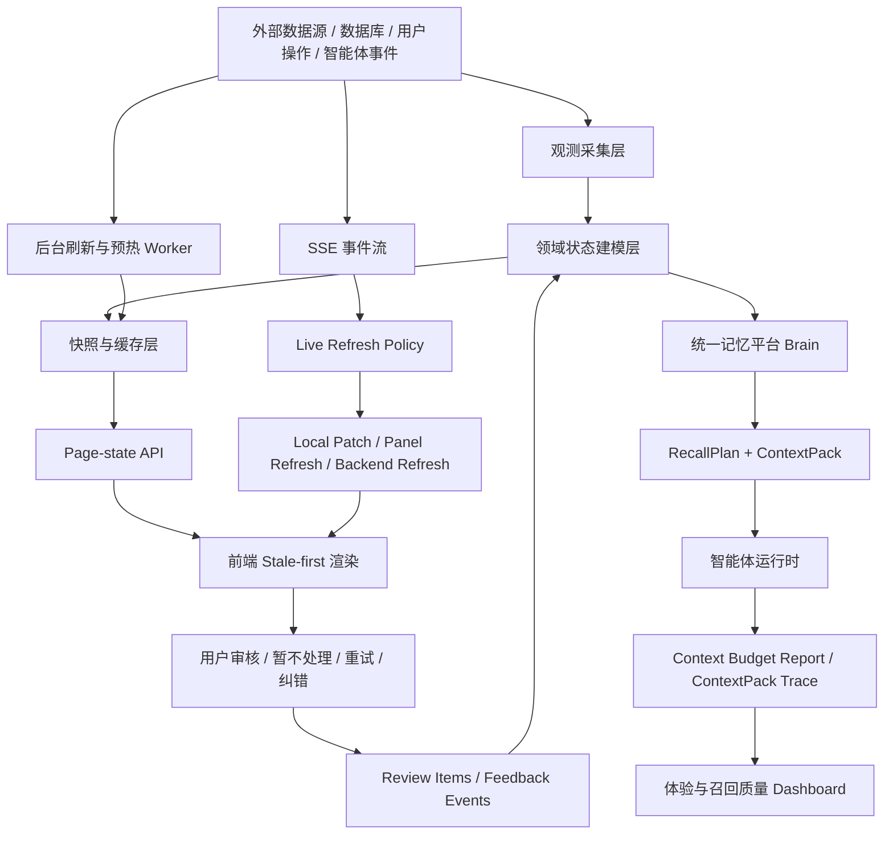
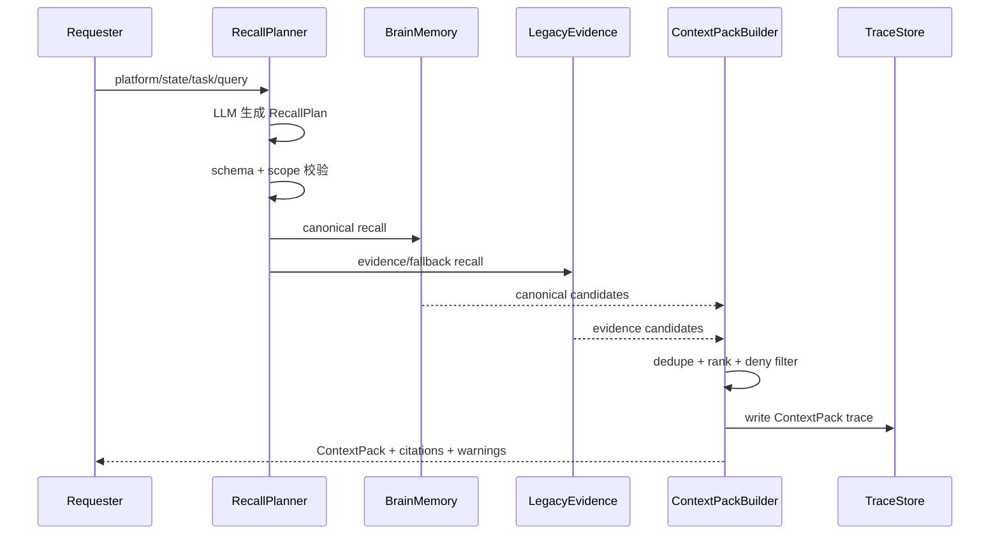

# 客户体验与平台响应架构 V5 详细技术方案

## 0. 方案定位

本文是 Zhiyu 平台下一阶段体验与响应速度改造的执行方案。它承接已有的 V3/V4 方案、统一记忆平台方案、上下文治理方案和近期已经落地的 page-state、缓存、UX smoke、Brain ContextPack、review item 能力。

本方案的核心判断是：当前体验差不是单点接口慢，而是页面、量化数据源、智能体车间、统一记忆、后台刷新、SSE、待处理事项和观测指标没有形成稳定闭环。用户看到的是页面切换慢、等待不透明、数据源失败拖垮整页、智能体上下文过长、记忆召回不可解释、需要处理的事项无法闭环。

本方案遵循项目总原则：

> 先观测，再建模；先闭环，再自动；先边界，再行动；先稳定，再智能。

## 1. 总目标

### 1.1 产品目标

- 页面切换后 1 秒内出现可用内容，不因为某个慢源导致整页空白。
- 快数据优先展示，慢数据异步刷新，旧快照可用时先展示旧快照。
- 用户能清楚看到数据是否新鲜、是否刷新中、哪个 provider 降级、最近一次成功时间是什么。
- 智能体车间像长期控制台，而不是单轮聊天页：状态、Loop、待处理、记忆、边界、运行 trace 都能被稳定查看。
- 智能体默认只消费统一记忆平台生成的 ContextPack，不再各自拼接 raw messages、旧 memory、长事件流和工具输出。
- 所有“需要处理”的事项必须在平台上可处理；不能处理但仍显示为需要处理，应视为 bug。
- 优化目标不是粗暴限制成本，而是让上下文输入合理、必要、可解释、可追踪。

### 1.2 工程目标

| 目标 | 验收标准 |
| --- | --- |
| 首屏轻量化 | 主页面 page-state 热路径 p95 < 500ms |
| 热缓存读取 | p95 < 150ms |
| 慢源后台化 | 全市场数据、长事件聚合、重召回不阻塞首屏 |
| 前端 stale-first | 有旧数据时不清空 UI，只显示刷新状态 |
| SSE 局部刷新 | 小事件优先 local patch，不触发整页请求风暴 |
| 上下文治理 | 每次智能体运行都有 context budget report 和 ContextPack trace |
| 记忆收口 | Brain canonical memory 是长期记忆主入口，legacy 只作 evidence/fallback |
| 待处理闭环 | review item 支持确认、暂不处理、重试、关闭、审计 |
| 可观测性 | smoke 和内部诊断工具能保护核心路径；`/ux-performance` 不作为当前前台产品线 |

## 2. 当前问题拆解

### 2.1 用户可感知问题

- 页面切换后出现整页 loading 或多块内容同时闪动。
- 量化页账户、持仓、自选股本可以快速展示，但被全市场数据和 dashboard 聚合拖慢。
- 智能体车间页面承载过多职责，列表、详情、dashboard、events、loops、memory、sources、outbox、review items、SSE 互相影响。
- tab 切换缺少旧数据兜底，用户感觉每次都像重新打开页面。
- 慢接口失败后，页面缺少“旧快照可用、后台刷新失败、某 provider 不可用”的清晰表达。
- 统一记忆、旧 workshop memory、interaction memory、历史事件、raw messages 可能重复进入上下文，导致模型调用变慢、变贵、判断变散。
- 记忆召回虽然已经开始接入 Brain ContextPack，但部分入口仍存在 legacy 语义不清、来源不透明、质量反馈没有完全闭环的问题。
- 平台提出的“需要处理”如果没有对应页面动作，会让用户无法闭环。

### 2.2 工程根因

| 根因 | 表现 | 影响 |
| --- | --- | --- |
| 首屏接口过重 | 首屏承担完整 dashboard、长事件、全量 memory/source | 最慢源拖住整页 |
| 快慢数据未分层 | 账户、自选股和全市场扫描混在一起 | 可先展示的内容被慢源阻塞 |
| 快照语义不统一 | SWR、内存 cache、DB snapshot、no-store 并存 | fresh/stale/refreshing/error 表达不一致 |
| 后台刷新不可见 | 缺少 lastSuccessAt、lastError、provider、job status | 用户不知道是慢、坏、还是旧数据可用 |
| SSE 刷新过宽 | 小事件触发大范围 refetch | 请求风暴和页面抖动 |
| 记忆入口未完全收口 | 多套 memory/read model 并行进入 prompt | 上下文过长、去重困难、成本增加 |
| 待处理事项事件化 | 从事件临时推导“需要处理” | 清空、暂不处理、已处理语义不稳定 |
| 观测闭环不足 | 有 smoke，但真实 tab/action 级指标不完整 | 回归难以及时发现 |

## 3. 被控对象、观测、状态与控制动作

### 3.1 被控对象

本方案的被控对象不是单个接口，而是“用户可感知的交互响应系统”，包括：

- `/quant` 量化工作台。
- `/workshop` 智能体车间。
- `/memory` 统一记忆召回页。
- `/loops` 长期任务页。
- 内部 UX smoke 与诊断工具。
- 全局侧边栏、导航、会话状态。
- 智能体运行时上下文构建链路。
- 统一记忆召回链路。
- review item 待处理闭环。

### 3.2 观测输入

- API 耗时、状态码、错误类型、provider、fallback、warning。
- 页面加载、tab 切换、用户动作耗时。
- page-state snapshot 命中、stale、refreshing、lastSuccessAt、lastError。
- SSE 事件类型、触发面板、刷新范围。
- 智能体运行的 context budget report。
- Brain RecallPlan、ContextPack、selected/omitted/denied trace。
- 用户对记忆召回的反馈。
- review item 的创建、确认、暂不处理、重试、关闭、回滚审计。

### 3.3 状态存储

状态必须分层保存：

| 状态层 | 用途 | 示例 |
| --- | --- | --- |
| 原始观测 | 不可改写事实 | provider response、微信消息、tool result、workshop event |
| 领域状态 | 从事实建模出的稳定状态 | accountState、marketState、WorkshopDashboard、LoopRunSummary |
| 快照状态 | 页面快速读取 | page_state_snapshots、dashboard cache、quant cache |
| 智能体上下文 | 单次运行输入投影 | ContextPack、context budget report |
| 反馈状态 | 用户纠错和闭环 | recall feedback、review item resolution |

### 3.4 控制动作

- 返回 page-state 快照。
- 触发后台刷新。
- 局部刷新 panel。
- 本地 patch UI。
- 生成/更新 review item。
- 生成 RecallPlan。
- 构建 ContextPack。
- 对低质量召回生成治理建议。
- 对治理建议生成 dry-run change plan。
- 对高风险动作进行权限边界校验。

所有控制动作必须满足：

- 幂等：重复执行不会产生重复副作用。
- 可审计：写事件或 trace。
- 可回滚：至少能解释变更来源和受影响对象。
- 可降级：失败后保留旧状态和 warning。

## 4. 目标架构



核心思路：

- 页面不直接依赖原始事件、完整 dashboard 或慢外部源。
- 首屏只读 page-state。
- 慢源通过后台刷新写快照。
- SSE 先经过刷新策略，再决定 local patch、panel refresh 或 backend refresh。
- 智能体默认通过 Brain ContextPack 消费记忆，不再自行拼历史。
- 用户反馈和处理动作写回结构化事件，进入下一轮状态建模。

## 5. 深模块设计

### 5.1 PageState 模块

接口：

```ts
type PageStateRequest = {
  page: "quant" | "workshop" | "workshop_summary" | "memory" | "loops";
  userId: string;
  entityId?: string;
  refresh?: boolean;
};

type PageStateResult<T> = {
  data: T | null;
  meta: SnapshotMeta;
  panels: Record<string, PanelStatus>;
};
```

职责：

- 读取最近可用快照。
- 判断 fresh/stale。
- 必要时触发后台 refresh。
- 将 warning、provider、lastSuccessAt、lastError 返回给前端。

不做：

- 不返回长事件日志。
- 不返回全量 source 正文。
- 不返回全量 memory。
- 不执行高风险控制动作。

### 5.2 SnapshotStore 模块

接口：

```ts
type SnapshotMeta = {
  hit: boolean;
  stale: boolean;
  refreshing: boolean;
  generatedAt: string | null;
  fetchedAt: string | null;
  expiresAt: string | null;
  source: "snapshot" | "live" | "fallback";
  warnings: Array<{
    code: string;
    message: string;
    provider?: string;
    detail?: string;
  }>;
};
```

读取策略：

1. fresh 可用：立即返回。
2. stale 可用：立即返回 stale，并触发后台刷新。
3. 无快照：短超时尝试实时构建，超时后返回局部 pending。
4. 刷新失败：保留最近成功快照，并写 warning。

写入策略：

- 写动作只失效相关快照，不清空整页状态。
- 快照用于展示和辅助判断，不作为高风险动作最终依据。
- 所有降级必须保留 provider/detail/warning。

### 5.3 RefreshJob 模块

接口：

```ts
type RefreshJobStatus = {
  key: string;
  status: "idle" | "queued" | "running" | "success" | "failed";
  startedAt: string | null;
  finishedAt: string | null;
  lastSuccessAt: string | null;
  lastError: string | null;
  provider?: string;
  staleSnapshotAvailable: boolean;
};
```

职责：

- 去重同类刷新任务。
- 记录刷新心跳和结果。
- 支持手动 refresh。
- 支持页面读取 job status。

优先落地任务：

- `quant.full_market_snapshot.refresh`
- `workshop.dashboard.refresh`
- `workshop.summary.refresh`
- `memory.recall_quality.refresh`
- `ux.smoke.collect`

### 5.4 BrainMemory 模块

接口：

```ts
type MemoryRecallRequest = {
  requester: {
    platform: "workshop" | "loop" | "memory_page" | "quant" | "chat";
    state: string;
    task: string;
    userId: string;
    workshopId?: string;
    loopId?: string;
    runId?: string;
  };
  query: string;
  desiredFormat: "context_pack" | "citations" | "debug_trace";
};

type MemoryRecallResult = {
  recallPlan: BrainRecallPlan;
  contextPack: BrainContextPack;
  trace: BrainContextTraceSummary;
};
```

职责：

- 用大模型理解需求方上报的 platform/state/task/query。
- 生成结构化 RecallPlan。
- 多路召回。
- 去重、排序、边界过滤。
- 输出 ContextPack。
- 写 recall trace。

边界：

- 大模型只生成召回计划，不直接决定最终注入 prompt 的内容。
- RecallPlan 必须经过 schema 校验。
- 超出 requester scope 的召回必须 denied。
- legacy memory、interaction memory、raw message 只作为 evidence/fallback，不作为长期记忆主入口。
- Brain canonical memory 是长期记忆主事实。

### 5.5 ContextPackBuilder 模块

职责：

- 将召回结果转成智能体可消费的最小充分上下文。
- 输出 selected、omitted、denied、warnings、evidence refs。
- 不把大段原文默认注入 prompt。
- 原文通过 evidence reader 或工具按需读取。

目标输出：

```ts
type BrainContextPack = {
  selected: BrainMemorySelection[];
  omitted: BrainMemoryOmission[];
  denied: BrainMemoryDenied[];
  warnings: string[];
  evidenceRefs: string[];
  trace: BrainContextTraceSummary;
};
```

### 5.6 ReviewItem 模块

职责：

- 所有“需要处理”统一进入 review item。
- 页面只从 review item 判断待处理，而不是临时扫描事件。
- 支持确认、暂不处理、重试、关闭、查看详情。
- 高风险治理动作先 dry-run，再人工确认。

必须覆盖的类型：

- `loop_blocker`
- `permission_boundary`
- `service_error`
- `outbox_confirmation`
- `agent_change_proposal`
- `memory_candidate_review`
- `memory_recall_quality`
- `memory_recall_governance_proposal`
- `memory_recall_change_plan`

语义：

- 暂不处理：用户明确表示当前不处理，不应继续显示为阻塞。
- 清空提示：用户不想处理这个提示，或已经改了但不想重跑；必须写 resolution event。
- 重试：只适用于有重跑价值、成本可接受、时间窗口仍有效的事项。
- 不能处理但仍显示为需要处理：bug。

## 6. 量化工作台改造

### 6.1 数据分层

| 数据域 | 示例 | 响应策略 |
| --- | --- | --- |
| accountState | 模拟盘账户、持仓、订单、成交 | 快路径，优先展示 |
| watchlistState | 自选股、关注标的、快速行情 | 快路径，优先展示 |
| marketState | 市场温度、成交额、市场宽度、行业热度 | 全市场快照，stale-first，后台刷新 |
| providerState | a-stock-data、fallback provider 状态 | 只影响对应模块 warning |

### 6.2 接口设计

```text
GET /api/page-state/quant
GET /api/quant/paper/account
GET /api/quant/dashboard
POST /api/quant/dashboard/refresh
GET /api/quant/dashboard/status
```

`/api/page-state/quant` 返回：

```ts
type QuantPageState = {
  account: QuantPaperAccount | null;
  watchlist: QuantWatchlistItem[];
  marketSnapshot: QuantMarketOverview | null;
  dashboard: QuantDashboard | null;
  refresh: {
    account: RefreshJobStatus | null;
    market: RefreshJobStatus | null;
  };
  meta: SnapshotMeta;
};
```

### 6.3 缓存与预取

| 数据 | Fresh TTL | Stale 保留 | 刷新方式 |
| --- | --- | --- | --- |
| paper account | 5s-10s | 1min-5min | 请求时短超时刷新 |
| watchlist quotes | 10s | 1min | 请求时短超时刷新 |
| full market snapshot | 5min | 30min-2h | 后台预热 + 手动刷新 |
| sector heat | 10min | 60min-2h | 后台 worker |

### 6.4 边界

- 市场温度、成交额、市场宽度、行业热度必须标记 `scope=full_market`。
- 全市场数据慢或失败时，不允许用自选股数据伪装。
- stale market snapshot 只用于展示和分析提示。
- 模拟下单必须重新读取账户、持仓、价格、交易日状态。
- 真实券商下单默认禁止，除非未来建立独立真实资金边界。

## 7. 智能体车间改造

### 7.1 页面拆分

目标结构：

```text
WorkshopPageShell
  WorkshopSidebar
  WorkshopHeader
  WorkshopOverviewPanel
  WorkshopDashboardPanel
  WorkshopLoopsPanel
  WorkshopReviewPanel
  WorkshopTimelinePanel
  WorkshopMemoryPanel
  WorkshopSourcesPanel
  WorkshopOutboxPanel
  WorkshopBoundaryPanel
  WorkshopToolsPanel
```

Shell 只负责：

- 当前选中 workshop。
- 当前 tab。
- 首屏 summary。
- SSE 连接。
- 全局动作入口。

每个 panel 自己负责：

- 数据 key。
- stale 数据。
- 局部 loading。
- 局部 error。
- 局部 refresh。

### 7.2 SSE 刷新策略

| 事件类型 | 默认动作 |
| --- | --- |
| outbox 状态变化 | local patch outbox |
| memory 写入/更新 | patch memory 或刷新 memory panel |
| source 更新 | patch source list |
| loop_run_started | patch loop/dashboard |
| loop_run_completed | patch loop/dashboard，必要时刷新 dashboard |
| loop_run_failed | 刷新 backend 状态并同步 review item |
| permission_boundary | 生成/刷新 review item |
| service_error | 生成 service_error review item |

禁止：

- 小事件触发整页 reload。
- SSE 到来时清空旧 panel 数据。
- 信息不足时伪造长期状态。

### 7.3 待处理闭环

页面上所有“需要处理”都必须有动作：

- 查看详情。
- 确认已知。
- 暂不处理。
- 重试。
- 关闭。
- 转为治理建议。
- 执行 dry-run change plan。

处理后必须写事件，并从 active review item 中消失或变成 resolved 状态。

## 8. 统一记忆与上下文治理

### 8.1 记忆分层

| 类型 | 定位 | 后续策略 |
| --- | --- | --- |
| Brain canonical memory | 长期记忆主事实 | 保留并增强 |
| legacy workshop memory | 历史读模型/局部入口 | 降级为 evidence/fallback |
| interaction memory | 原始交互理解候选 | 作为观测和候选，不直接长期注入 |
| raw messages/events | 原始事实 | 只作证据，通过引用读取 |
| loop context window | 短期工作记忆 | 保留，但长期事实依赖 Brain |
| tool outputs | 工具证据 | 摘要后才可进入长期记忆 |

### 8.2 召回流程



### 8.3 LLM 生成召回参数

需求方必须上报：

- 自己属于什么平台。
- 当前状态是什么。
- 要完成什么任务。
- 查询文本是什么。
- 有哪些 workshop/loop/run/user scope。

大模型负责理解需求并生成：

- task intent。
- topic。
- memory kinds。
- time window。
- entities。
- required evidence。
- forbidden scopes。
- output format。

大模型不负责：

- 越权访问记忆。
- 直接决定最终注入 prompt 的内容。
- 静默忽略 denied。
- 修改长期记忆。

### 8.4 ContextPack 输出原则

- 默认只输出结构化摘要和引用。
- 对每条 selected memory 给出 selected reason。
- 对 omitted memory 给出 omitted reason。
- 对 denied memory 给出 denied reason。
- 冲突记忆不能静默选择，必须进入 warning 或 review。
- 同一事件产生多类记忆时，通过 canonical id 和 evidence refs 去重。

## 9. 前端体验策略

### 9.1 Stale-first 渲染

页面渲染策略：

1. 有快照：立即显示快照。
2. 快照 stale：保留 UI，显示刷新中。
3. 局部失败：只在对应模块显示 warning。
4. 无任何数据：显示局部 skeleton。
5. 高风险动作：点击时重新读最新服务端状态。

### 9.2 预取策略

- 侧边栏 hover 或进入视口时预取目标 page-state。
- 进入 `/workshop` 后预取当前 workshop summary。
- tab 首次打开懒加载，之后保留缓存。
- 页面空闲时预热 `/api/page-state/quant`、`/api/page-state/workshop`、`/api/page-state/loops`。
- 预取只读轻量快照，不触发重型全市场扫描。

### 9.3 UI 状态语言

统一状态：

- fresh：最新。
- stale：旧数据可用。
- refreshing：后台刷新中。
- partial：部分字段降级。
- failed：模块失败但页面可用。
- blocked：需要用户处理。

页面必须展示：

- 最后成功时间。
- 当前刷新状态。
- provider warning。
- 是否使用旧快照。
- 处理动作。

### 9.4 Navigation-first 页面切换规则

页面切换的产品语义必须从“等待数据完成”改为“先进入目标工作台，再局部刷新数据”。

硬性规则：

1. 普通一级页面导航不得使用全屏/悬浮 loading 阻塞用户。
2. `loading.tsx` 只能作为极短暂的框架兜底，不能承载业务数据等待。
3. 一级页面必须先渲染稳定 Shell：标题、主布局、主要操作入口和空态区域。
4. 业务数据加载只能影响对应 panel/card/list，不允许清空整页。
5. 有旧快照时先显示旧快照，并用 `stale/refreshing/warning` 表达刷新状态。
6. 无旧快照时显示局部空态或局部 skeleton，而不是整页等待。
7. 慢源必须后台化；页面不能因为全市场、长事件、重召回等慢源而无法进入。

本轮落地：

- `(chat)/loading.tsx`、`workshop/loading.tsx`、`workspace/loading.tsx`、`inbox/loading.tsx` 已改为不渲染阻塞式 skeleton。
- `/quant` 已移除 `initialLoading` 整页等待；账户和全市场分别以局部状态展示。
- `/workshop` 已移除首屏 `WorkshopLoadingShell` 提前返回；车间框架先出现，列表区域自行表达加载中/空态。

## 10. 可观测性与验收

### 10.1 指标

| 指标 | 采集位置 |
| --- | --- |
| API latency | route wrapper / smoke |
| page ready time | UX probe |
| tab switch time | client probe |
| cache hit/stale/refreshing | page-state meta |
| provider latency/error | quant provider / memory provider |
| SSE refresh action | live refresh policy |
| context section size | context budget report |
| memory recall quality | Brain trace quality |
| review item resolution | review item events |

### 10.2 Dashboard

内部体验诊断工具可保留展示：

- 最近 smoke 结果。
- 热路径 API p50/p95。
- 慢源列表。
- stale 命中率。
- 后台刷新失败率。
- 页面/tab 体验指标。
- 上下文 section 占比。
- 记忆召回质量趋势。
- 未闭环 review item 数量。

### 10.3 验收命令

常规验收：

```bash
pnpm --filter web tsc --noEmit --pretty false
pnpm --filter web exec vitest run tests/unit/workshop-review-items-route.test.ts tests/unit/workshop-review-items.test.ts tests/unit/brain-recall-quality.test.ts tests/unit/workshop-memory-recall-quality.test.ts
pnpm --filter web smoke:ux
```

新增或修改量化模块时补充：

```bash
pnpm --filter web exec vitest run tests/unit/quant-cache.test.ts tests/unit/quant-page-state.test.ts
```

新增或修改记忆召回时补充：

```bash
pnpm --filter web exec vitest run tests/unit/brain-recall-planner.test.ts tests/unit/unified-memory-search.test.ts tests/unit/brain-context-pack.test.ts
```

新增或修改 workshop 页面刷新时补充：

```bash
pnpm --filter web exec vitest run tests/unit/workshop-live-refresh-policy.test.ts tests/unit/workshop-page-state-cache.test.ts tests/unit/workshop-summary-page-state.test.ts
```

## 11. 分阶段落地计划

### Phase 1：体验观测收口

目标：先看清楚慢在哪里。

任务：

- 完善 `/ux-performance` 的 page/tab/action 指标。
- 所有主页面 page-state 增加统一 meta。
- 慢源 provider 记录 latency、warning、lastError。
- smoke 固化为本地和 CI 可运行脚本。

验收：

- 能定位每个主页面最慢接口。
- 能看到 stale 命中和后台刷新失败。
- smoke 能持续输出趋势。

### Phase 2：首屏 page-state 与快照统一

目标：页面先可用。

任务：

- 统一 PageStateResult。
- 统一 SnapshotMeta。
- 让 `/quant`、`/workshop`、`/loops` 首屏只依赖 page-state。
- 慢源只通过 panel 或后台任务刷新。

验收：

- 首屏 page-state 热路径 p95 < 500ms。
- 有旧快照时不白屏。
- 慢源失败不拖垮整页。

### Phase 3：量化慢源后台化

目标：全市场数据正确但不阻塞。

任务：

- 建立 full market snapshot。
- 增加 refresh job/status。
- 将市场温度、成交额、市场宽度、行业热度全部标记 full_market。
- provider 降级字段级可见。

验收：

- `/quant` 冷启动不等待完整全市场扫描。
- 全市场刷新失败时账户和自选股仍可操作。
- 页面明确显示旧快照和 provider warning。

### Phase 4：Workshop 页面深模块拆分

目标：车间变成稳定控制台。

任务：

- 拆分 WorkshopPageShell 和各 panel。
- 每个 panel 独立 loading/error/refresh。
- SSE 经过 live refresh policy。
- review item 成为待处理唯一入口。

验收：

- tab 切换复用旧数据。
- 小事件不触发整页 refetch。
- 所有需要处理项都有页面动作。

### Phase 5：统一记忆收口

目标：智能体只通过 Brain ContextPack 消费长期记忆。

任务：

- 所有 workshop/loop memory 读取改为 Brain ContextPack。
- legacy memory 只作 explicit evidence/fallback。
- `/memory` 页面展示 canonical/evidence/fallback/source semantics。
- RecallPlan 由大模型生成，但必须 schema 校验和 scope 校验。
- 每次召回写 trace。

验收：

- 智能体调用可追溯使用了哪些 memory。
- 同一事件产生多类记忆时通过 canonical id 去重。
- selected/omitted/denied 在页面和质量报告中可见。

### Phase 6：召回质量治理闭环

目标：从“看见问题”走向“可治理”。

任务：

- 聚合 recall feedback。
- 识别重复、无证据、过期、denied 过多等模式。
- 生成 governance proposal。
- 生成 dry-run change plan。
- 人工确认后再进入真实执行器。
- 真实执行器必须具备 rollback audit。

验收：

- 低质量召回能形成 review item。
- 用户能批准/拒绝治理建议。
- change plan 默认 dry-run。
- 真实 mutation 有审计和回滚记录。

## 12. 风险与降级

| 风险 | 处理 |
| --- | --- |
| 缓存导致旧数据误用 | 高风险动作重新读最新服务端状态 |
| provider 不稳定 | stale-first + warning + lastSuccessAt |
| 后台刷新堆积 | refresh job 去重和超时 |
| SSE 事件过多 | live refresh policy 限流和局部 patch |
| 记忆召回误选 | selected/omitted/denied trace + feedback |
| LLM 生成 RecallPlan 不稳定 | schema 校验 + deterministic fallback |
| 用户误以为旧数据是最新 | UI 明确 fresh/stale/refreshing |
| review item 不能处理 | 视为 bug，必须补动作或不再标为 active |

## 13. 当前优先级建议

第一优先级：

- 完成所有主页面 page-state 统一 meta。
- 让 `/quant` 的全市场数据完全后台化。
- 让 `/workshop` 的 review item 闭环稳定，不再从事件临时推导。
- 把智能体和车间的记忆读取全部切到 Brain ContextPack。

第二优先级：

- 拆分 `workshop-client.tsx`，降低页面级状态耦合。
- `/memory` 页面已明确展示 canonical memory、legacy discovery、evidence source、derived index 和 fallback evidence 的区别；后续继续补 cache/snapshot 与 ContextPack 消费路径的更细粒度 trace。
- 建立 refresh job/status 页面。
- 暂停前台 UX 指标产品化，保留 smoke 作为内部验收工具。

第三优先级：

- 召回质量治理从 dry-run 进入受控真实执行器。
- 建立定时预热和工作日交易时段刷新策略。
- 将体验指标纳入 CI 门禁和日常巡检。

## 14. 最终验收口径

平台改造完成后，用户体验应变成：

- 打开页面先看到可用状态，而不是等所有数据源完成。
- 慢数据源在哪里、是否旧数据、是否刷新失败，一眼可见。
- 智能体运行前拿到的是有边界、有证据、有 trace 的 ContextPack。
- 用户能处理平台提出的每一个“需要处理”事项。
- 任何自动化动作都可观测、可审计、可暂停、可纠错。
- 成本下降是上下文合理化的结果，不是牺牲任务质量的前提。

## 15. 最新落地记录

### 15.1 统一记忆来源语义说明与动态 resultKind

本轮已完成：

- `/memory` 页面新增“记忆来源语义”说明区，解释 Brain canonical、legacy discovery、evidence source、derived index 和 fallback evidence 的职责边界。
- `/api/memory/search` 的 `resultKind` 已从固定 `legacy_discovery` 改为动态返回 `canonical_context`、`mixed_context`、`legacy_discovery` 或 `empty`。
- 默认 Brain-only 召回会明确返回 `canonical_context`，Brain 与其他来源混合时返回 `mixed_context`。
- `/memory` 结果顶部展示本次 `resultKind`，帮助用户判断本轮召回实际消费的是长期记忆主入口还是 legacy/evidence。
- MCP unified-memory fallback 对象补齐 `sourceStatuses`，并把无 legacy fallback 的空结果标记为 `empty`。

验证结果：

```bash
pnpm --filter web exec vitest run tests/unit/unified-memory-search.test.ts
pnpm --filter web tsc --noEmit --pretty false
pnpm --filter web smoke:ux
```

结果：

- `unified-memory-search.test.ts`：14 项通过。
- TypeScript：通过。
- UX smoke：通过。
- 最新 measured hot-path：`/api/page-state/quant` 53ms、`/api/page-state/workshop` 71ms、`/api/quant/paper/account` 68ms、`/api/quant/dashboard` 54ms、`/api/memory/search` 74ms、`/api/page-state/workshop/[id]/summary` 426ms、`/api/page-state/workshop/[id]/summary?refresh=1` 76ms、`/api/workshops/[id]/dashboard` 26ms。

后续重点：

- 设计安全可回滚的真实记忆执行器。
- 继续拆分 `workshop-client.tsx`。
- 将冷路径较慢的 workshop summary 首次构建纳入后台预热和快照刷新策略。

### 15.2 WP3：收缩车间上下文展示

本轮属于 WP3：Workshop Shell + Panels 拆分前的页面减负小步，只调整 `/workshop` dashboard 的可见上下文区域。

已完成：

- 原“上下文体检”大块收缩成“当前上下文”小卡片。
- 首页只展示当前智能体车间最近一次 context report 的 estimated prompt tokens。
- 移除首页上的最大来源、section 明细、占比条和超限次数，避免上下文体检占据过多空间。
- 不修改上下文生成、Brain ContextPack、召回质量报告和 review item 治理链路。

验证：

```bash
pnpm --filter web exec vitest run tests/unit/workshop-dashboard.test.ts
pnpm --filter web tsc --noEmit --pretty false
pnpm --filter web smoke:ux
```

结果：

- `workshop-dashboard.test.ts`：7 项通过。
- TypeScript：通过。
- UX smoke：通过。
- 最新 measured hot-path：`/api/page-state/workshop` 89ms、`/api/page-state/workshop/[id]/summary` 32ms、`/api/workshops/[id]/dashboard` 35ms。

## 16. 后续工作包边界

为了避免后续改造继续变成黑盒，后续所有实现按工作包推进。每次开始改造前必须声明本次属于哪个工作包、触碰哪些页面和后端模块、不触碰哪些模块、验收命令是什么。除非修复明确阻塞，否则一次只推进一个工作包。

### WP1：Workshop 冷路径预热与快照刷新

目标：

- 解决 `/api/page-state/workshop/[id]/summary` 首次构建偏慢的问题。
- 让用户打开车间详情时优先读最近 summary 快照，后台刷新慢聚合。

包含：

- `workshop summary page-state`。
- summary cache/snapshot。
- 后台 warmup。
- summary refresh 状态。

不包含：

- 不拆 `workshop-client.tsx` 大组件。
- 不改记忆执行器。
- 不改量化全市场数据。

主要入口：

- 页面：`/workshop` 详情页。
- API：`/api/page-state/workshop/[id]/summary`。
- 代码：`apps/web/lib/workshops/summary-page-state.ts`、`apps/web/lib/workshops/page-state-warmup.ts`、`apps/web/app/api/page-state/workshop/[id]/summary/route.ts`。

验收：

```bash
pnpm --filter web exec vitest run tests/unit/workshop-summary-page-state.test.ts tests/unit/workshop-page-state-warmup.test.ts
pnpm --filter web tsc --noEmit --pretty false
pnpm --filter web smoke:ux
```

### WP2：Refresh Job / Status 统一

目标：

- 给后台刷新提供统一状态模型。
- 让页面知道某个慢源是 running、success、failed，还是 stale snapshot 可用。

包含：

- refresh job key。
- running/success/failed 状态。
- lastSuccessAt、lastError、provider、staleSnapshotAvailable。
- 页面状态展示。

不包含：

- 不改具体业务算法。
- 不做真实记忆 mutation。
- 不拆 workshop 页面。

主要入口：

- 页面：`/quant`、`/workshop`、未来 refresh status panel。
- API：`/api/quant/dashboard/status`、后续 workshop refresh status。
- 代码：`apps/web/lib/page-state/snapshots.ts`、`apps/web/lib/quant/page-state.ts`、`apps/web/lib/workshops/*cache*`。

验收：

```bash
pnpm --filter web exec vitest run tests/unit/quant-page-state.test.ts tests/unit/workshop-page-state-cache.test.ts
pnpm --filter web tsc --noEmit --pretty false
pnpm --filter web smoke:ux
```

### WP3：Workshop Shell + Panels 拆分

目标：

- 降低 `workshop-client.tsx` 的状态复杂度和重渲染范围。
- 让每个 panel 独立拥有 loading/error/refresh/stale 状态。

包含：

- Workshop shell。
- Review panel。
- Loops panel。
- Memory panel。
- Sources panel。
- Outbox panel。
- Dashboard panel。
- live refresh 分发。

不包含：

- 不重新设计记忆召回算法。
- 不改量化接口。
- 不做真实记忆执行。

主要入口：

- 页面：`/workshop`。
- 代码：`apps/web/app/(chat)/workshop/workshop-client.tsx`，以及后续拆出的 panel 文件。

验收：

```bash
pnpm --filter web exec vitest run tests/unit/workshop-live-refresh-policy.test.ts tests/unit/workshop-review-items.test.ts tests/unit/workshop-loop-detail.test.ts
pnpm --filter web tsc --noEmit --pretty false
pnpm --filter web smoke:ux
```

### WP4：真实记忆执行器

目标：

- 在用户批准 dry-run change plan 后，安全地执行长期记忆变更。
- 每次执行必须可审计、幂等、可回滚。

包含：

- execution lock。
- execution request。
- pre-change snapshot。
- memory mutation。
- post-change audit。
- rollback audit。
- execution status。

不包含：

- 不由大模型直接修改数据库。
- 不自动放宽权限。
- 不自动删除原始观测。
- 不绕过 review item 审批。

主要入口：

- 页面：`/workshop` Review 的 memory governance 区，未来可独立为 `/memory/governance`。
- API：`/api/workshops/[id]/review-items` 后续 execution action。
- 代码：`apps/web/lib/brain/*`、`apps/web/lib/workshops/review-items.ts`、`apps/web/app/api/workshops/[id]/review-items/route.ts`。

验收：

```bash
pnpm --filter web exec vitest run tests/unit/brain-repository.test.ts tests/unit/brain-service.test.ts tests/unit/workshop-review-items-route.test.ts tests/unit/workshop-review-items.test.ts
pnpm --filter web tsc --noEmit --pretty false
pnpm --filter web smoke:ux
```

### WP5：量化全市场慢源后台化

目标：

- 市场温度、成交额、市场宽度、行业热度继续保持全市场口径，但不阻塞首屏。

包含：

- full market snapshot。
- provider latency/error。
- stale-first 展示。
- dashboard refresh status。

不包含：

- 不改真实交易边界。
- 不让自选股数据伪装成全市场数据。
- 不改记忆系统。

主要入口：

- 页面：`/quant`。
- API：`/api/page-state/quant`、`/api/quant/dashboard`。
- 代码：`apps/web/lib/quant/*`、`tools/quant-service/app/provider.py`。

本轮落地：

- `tools/quant-service/app/provider.py` 已将 full-market overview 从 dashboard 热路径拆出：
  - 有全市场缓存时直接返回 `market_scope=full_market`。
  - 无缓存或缓存过期时，只触发 `quant_full_market_overview` 后台刷新，不同步等待 AkShare 慢源。
  - dashboard 临时返回 `market_scope=watchlist_fallback` 时必须带 `market_warning/provider_error`，不能伪装成全市场数据。
  - 后台刷新成功后清理 dashboard 缓存，让下一次读取自动带上新的全市场快照。
- `tools/quant-service/app/main.py` 新增：
  - `GET /market/overview/status`：查看 `in_progress/cached/stale/last_success_at/last_error`。
  - `POST /market/overview/refresh`：手动触发全市场慢源后台刷新。
- `apps/web/lib/quant/client.ts` 和 `/api/quant/dashboard/{status,refresh}` 已接入 Web 侧代理，后续页面和智能体不需要直接访问 8766。

验收：

```bash
pnpm --filter web exec vitest run tests/unit/quant-cache.test.ts tests/unit/quant-page-state.test.ts
pnpm --filter web tsc --noEmit --pretty false
pnpm --filter web smoke:ux
```

### WP6：UX tab/action 级指标

目标：

- 当前暂停作为产品线推进。
- 保留接口级 smoke 和内部诊断能力，用于必要时定位体验问题。

包含：

- `smoke:ux` 回归验证。
- `/api/ux-performance` 内部诊断。
- `/ux-performance` 内部页面，不进入主导航。

不包含：

- 不优化具体业务接口。
- 不改记忆执行器。
- 不改量化 provider。
- 不继续作为当前产品前台能力扩展 tab/action 指标。

主要入口：

- 页面：`/ux-performance` 仅内部访问，不放入主导航。
- API：`/api/ux-performance`。
- 代码：`apps/web/components/ux-page-metrics-probe.tsx`、`apps/web/lib/ux-smoke/*`。

验收：

```bash
pnpm --filter web tsc --noEmit --pretty false
pnpm --filter web smoke:ux
```

## 17. 后续执行规则

- 每一轮只选一个 WP 作为主目标。
- 如果需要跨 WP，必须说明“为什么不跨不行”。
- 每个 WP 的改动必须先落在对应页面和模块，不允许顺手改无关业务。
- 每轮结束时必须说明：完成了哪个 WP 的哪一小步、验证命令、剩余风险、下一步建议。
- 文档记录必须用 WP 编号标记，便于回看。

### 17.1 WP3/WP5 体验底座落地记录：Navigation-first + PanelState

本轮属于“不动现有产品逻辑”的前端体验底座改造，目标是先把页面切换从“等待业务接口完成”改成“先进入目标工作台，再局部表达业务刷新状态”。

已完成：

- 新增 `apps/web/components/workbench/navigation-progress.tsx`，在 `(chat)` 产品区提供全局顶部轻量导航进度条。
- 导航进度条同时监听同站点 `<a href>` 点击、`history.pushState`、`history.replaceState` 和自定义 `openzhiyu:navigation-start` 事件，覆盖 Link 和部分 `router.push` 场景。
- 新增 `apps/web/components/workbench/page-scroll-restoration.tsx`，按 pathname + searchParams 保存产品区页面滚动位置，返回页面时恢复上次阅读位置。
- 新增 `apps/web/components/workbench/panel-state.tsx`，统一面板级 `loading`、`refreshing`、`stale`、`empty`、`error`、`ready` 表达。
- 新增 `apps/web/components/workbench/workbench-page-shell.tsx`，作为后续 `/workshop`、`/quant`、`/memory` 等页面逐步收口到统一页面壳的基础组件。
- `(chat)/layout.tsx` 已接入 `NavigationProgress` 和 `PageScrollRestoration`，覆盖智能体车间、量化、统一记忆、工作区等主产品页面。
- `/quant` 的账户占位和全市场快照占位已接入 `PanelState`，在数据未返回或刷新中时表达为局部状态，不阻塞整个页面进入。

本轮不做：

- 不改量化接口、量化 provider、模拟盘交易逻辑。
- 不改智能体车间运行、Loop、权限审核、记忆召回逻辑。
- 不强制重写 `workshop-client.tsx`，后续再按 panel 逐步拆分。

验收口径：

- 点击主产品导航后，用户应立即看到顶部细进度反馈，而不是不确定是否点击成功。
- 页面切换不应再依赖业务接口完成才能给出整体反馈。
- 返回长页面时，应尽量恢复之前滚动位置。
- 慢源、失败、刷新中应在具体面板内表达，不应清空整页。

后续建议：

- 将 `/workshop` dashboard、review、memory、sources、outbox 逐步接入 `PanelState`。
- 将 `/memory` 召回结果、召回过程、source filter 接入 `WorkbenchPageShell` 和面板级状态。
- 将 `/quant` 的 full-market refresh status 展示到市场面板顶部，明确 running、cached、stale、failed 和 lastSuccessAt。

### 17.2 WP3 落地记录：Workshop 面板状态接入

本轮继续推进 WP3：Workshop Shell + Panels 拆分，但仍保持“不改业务逻辑、不改接口、不改 Loop/review/memory 执行链路”的边界，只替换车间页面的局部状态表达。

已完成：

- `/workshop` 左侧车间列表的加载态、空态接入 `PanelState`。
- `sources` 面板加载态接入 `PanelState`，并补充资料为空时的面板级空态说明。
- `memory` 面板加载态、空态接入 `PanelState`，保持现有 `MemoryRecallQualitySummary` 和记忆列表渲染逻辑不变。
- `loops` 面板 dashboard 加载态、无任务空态接入 `PanelState`，任务创建区仍保持可用。
- `outbox` 面板加载态、空态接入 `PanelState`，不改变草稿预览、收件人保存、发送确认逻辑。
- `review` 面板结构化待处理项加载态、无待审核空态接入 `PanelState`，不改变“暂不处理”、治理建议确认、change plan 确认等动作。

本轮不做：

- 不拆分 `workshop-client.tsx` 的业务状态模型。
- 不改变 SSE local patch、panel refresh、review item 聚合逻辑。
- 不改变 Brain memory recall、legacy memory、outbox、Loop runtime 的任何后端行为。

验收口径：

- 车间页不再用零散文本表达加载/空态，而是用统一的面板状态语言。
- 每个 tab 的慢数据只影响该 tab 内部，不影响页面和其它面板。
- 任务创建区、审核区、待发区在对应列表加载时仍保持页面结构稳定。

验证：

```bash
pnpm --filter web tsc --noEmit --pretty false
pnpm --filter web exec vitest run tests/unit/workshop-dashboard.test.ts tests/unit/workshop-summary-page-state.test.ts tests/unit/workshop-live-refresh-policy.test.ts tests/unit/workshop-review-items.test.ts
git diff --check -- "apps/web/app/(chat)/workshop/workshop-client.tsx"
```

### 17.3 WP3 落地记录：Workshop 二级面板与弹窗状态接入

本轮继续在 WP3 范围内推进，把车间页更深一层的弹窗和二级面板状态接入 `PanelState`，仍不改变任何业务动作。

已完成：

- `interactions` 面板的消息加载态、无消息空态接入 `PanelState`。
- 交互沉淀区的无摘要/待办/长期记忆候选空态接入 `PanelState`。
- `tools` 面板的工具矩阵加载态、未选择车间空态接入 `PanelState`。
- `work` 面板的工作模型加载态接入 `PanelState`。
- 主工作记录区无记录空态接入 `PanelState`。
- `review` 面板的视频草稿审核加载态接入 `PanelState`。
- `boundary` 面板未选择车间空态接入 `PanelState`。
- Loop 详情弹窗的详情加载态接入 `PanelState`。
- Loop 详情弹窗内部的验收标准、运行记录、审批请求、关联产物、关联事件空态接入 `PanelState`。
- 完整工作记录弹窗的历史加载中和加载失败状态接入 `PanelState`，区分 `refreshing` 与 `error`。

本轮不做：

- 不改变 Loop 详情接口。
- 不改变审批请求处理、outbox preview/send、review item resolve、interaction wiki 更新逻辑。
- 不改变工具矩阵计算和边界策略保存逻辑。

验证：

```bash
pnpm --filter web tsc --noEmit --pretty false
pnpm --filter web exec vitest run tests/unit/workshop-dashboard.test.ts tests/unit/workshop-summary-page-state.test.ts tests/unit/workshop-live-refresh-policy.test.ts tests/unit/workshop-review-items.test.ts
git diff --check -- "apps/web/app/(chat)/workshop/workshop-client.tsx" "docs/plans/customer-experience-response-architecture-v5.md"
```
