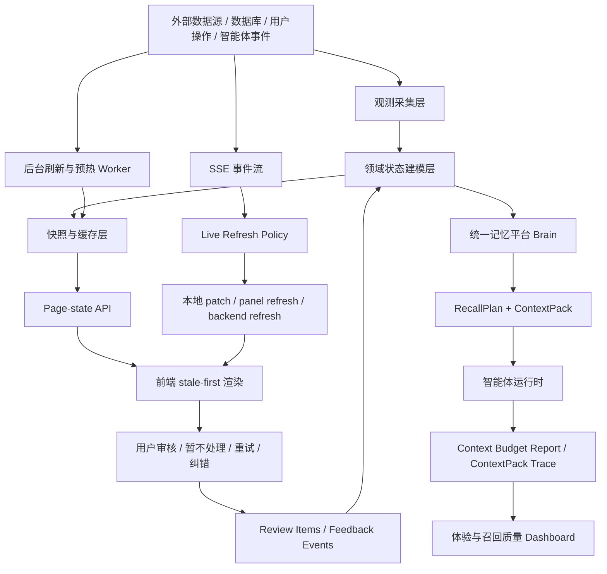

# 客户体验与平台响应速度详细技术方案

## 1. 方案定位

本文用于指导 Zhiyu 平台下一轮客户体验与响应速度改造，重点解决页面切换不流畅、首屏等待长、接口冷启动暴露给用户、慢数据源阻塞页面、智能体上下文过重、统一记忆召回不透明、后台任务状态不可见等问题。

本方案不是单点性能优化，也不是简单“加缓存”。目标是把平台从“用户打开页面时临时计算所有状态”改造成“后台持续观测、状态结构化、页面读取快照、慢源异步刷新、关键动作重新校验、用户可审核可纠错”的闭环控制系统。

工程原则沿用项目总原则：

> 先观测，再建模；先闭环，再自动；先边界，再行动；先稳定，再智能。

## 2. 当前问题判断

### 2.1 用户可感知问题

- 页面切换后容易出现空白、整页 loading 或多块内容同时闪动。
- 量化工作台的账户、自选股本来可以很快展示，但全市场数据、dashboard 聚合等慢源会拖慢首屏。
- 智能体车间页面承载内容过多，列表、详情、dashboard、events、loops、memory、sources、outbox、review items、SSE 刷新相互影响。
- tab 切换时缺少“旧数据兜底”，用户感觉每次都在重新打开页面。
- 错误、降级、缓存命中、后台刷新状态表达不统一，用户分不清“旧数据但可用”和“系统不可用”。
- 统一记忆、历史事件、raw messages、workshop memory、interaction memory 仍可能在不同入口重复进入上下文，导致模型调用变慢、成本变高、判断变散。
- 平台展示的“需要处理”如果没有对应页面动作，会让用户产生无法闭环的焦虑，这类情况应按 bug 处理。

### 2.2 工程根因

| 根因 | 表现 | 影响 |
| --- | --- | --- |
| 首屏接口过重 | 页面直接读取完整 dashboard、长事件列表、完整历史 | 冷启动慢，首屏不可控 |
| 快慢数据混合 | 账户快路径被全市场慢源拖住 | 用户认为整个系统慢 |
| 缓存语义分散 | SWR、内存 cache、snapshot、no-store 并存 | fresh/stale/refreshing/error 不一致 |
| 快照层不足 | 页面仍依赖实时聚合和原始事件 | 切换页面时缺少旧状态兜底 |
| SSE 刷新过宽 | 小事件触发大范围 refetch | 页面抖动，请求风暴 |
| 记忆入口未完全收口 | 多套记忆和历史信息直接拼 prompt | 上下文过长，召回不可解释 |
| 观测闭环不足 | 有 smoke，但真实页面行为和慢源状态还不完整 | 难以判断优化是否有效 |

## 3. 被控对象与边界

本方案的被控对象不是单个接口，而是“用户可感知的交互响应系统”。

页面对象：

- `/workshop` 智能体车间控制台。
- `/quant` 量化工作台。
- `/memory` 统一记忆召回页面。
- `/loops` 长期任务兼容视图。
- `/ux-performance` 性能观察台。
- 全局侧边栏、导航、会话状态。

接口对象：

- `/api/page-state/quant`
- `/api/page-state/workshop`
- `/api/page-state/workshop/[id]/summary`
- `/api/page-state/loops`
- `/api/quant/dashboard`
- `/api/quant/paper/account`
- `/api/workshops/[id]/dashboard`
- `/api/workshops/[id]/loops/[loopId]/detail`
- `/api/memory/search`
- `/api/ux-performance`

状态对象：

- 页面首屏快照。
- 量化账户、持仓、订单、自选股快照。
- 全市场温度、成交额、市场宽度、行业热度快照。
- 车间摘要、dashboard、Loop 最近运行、事件摘要。
- 待处理事项 `workshop_review_items`。
- Brain RecallPlan、ContextPack、ContextPack trace。
- 智能体 context budget report。
- 慢源刷新 job/status。

安全边界：

- 快照用于展示，不直接作为高风险控制动作的最终依据。
- 下单、真实资金、外部发送、配置修改、删除等动作必须重新读取服务端最新状态并经过权限边界校验。
- `denied` 优先于 `allowed`，任何工具权限和 prompt 权限都不能绕过边界。
- 降级数据必须暴露 `provider/detail/warning`，不能伪装成完整数据。

## 4. 目标体验与验收指标

### 4.1 用户体验目标

- 页面切换 1 秒内展示可用内容。
- 有旧快照时先显示旧快照，再后台刷新。
- 慢源失败只影响对应模块，不拖垮整页。
- tab 切换 300ms 内显示旧数据、空状态或局部骨架，不清空整页。
- 用户能看到数据新鲜度、后台刷新状态、降级原因、最后成功时间。
- 智能体运行页面能看到上下文来源、记忆召回依据和待处理事项。
- 所有“需要处理”都有明确动作：确认、暂不处理、重试、关闭、转人工或查看详情。

### 4.2 技术指标

| 指标 | 目标 |
| --- | --- |
| 主页面 page-state 热路径 | p95 < 500ms |
| 热缓存读取 | p95 < 150ms |
| 首屏无快照冷路径 | 1s 内返回可用骨架或局部 pending |
| tab 切换 | 300ms 内出现旧数据或局部状态 |
| 慢源接口 | 不阻塞首屏，必须有 job/status |
| SSE 小事件 | 不触发整页 refetch |
| `/api/memory/search` 默认路径 | Brain-only，p95 < 500ms |
| 智能体上下文 | 每次运行有 sectionStats 和 ContextPack trace |
| UX smoke | 本地可重复运行并落盘历史报告 |

## 5. 目标架构



核心思想：

- 页面不直接依赖原始事件、全量 dashboard 或慢外部源。
- 页面首屏只读 page-state。
- 慢源通过后台刷新写快照。
- SSE 先经过刷新策略，再决定局部 patch 还是后台刷新。
- 智能体默认通过 Brain ContextPack 消费记忆，不再各自拼接历史。
- 用户反馈和处理动作写回结构化事件，进入下一轮状态建模。

## 6. 分层设计

### 6.1 观测采集层

职责：

- 采集外部 provider 数据，例如 A 股全市场数据、行情、行业热度。
- 读取数据库中的 workshop、loop、event、memory、review item、outbox、source。
- 记录智能体运行事件、工具调用结果、模型错误和降级信息。
- 记录每个慢源的 provider、耗时、错误、fallback、数据时间。

要求：

- 允许慢，也允许失败。
- 失败不能直接导致首屏不可用。
- 降级必须结构化暴露，不允许静默吞掉。
- 观测事实不可改写，理解结果和快照可以重建。

### 6.2 领域状态建模层

职责：

- 把原始事实转成页面和智能体可消费的稳定状态。
- 把长事件流转成摘要、计数、最近变化、待处理事项。
- 把记忆候选、权限边界、证据、用户需求转成 ContextPack。
- 把异常和 blocker 转成 review item。

核心模型：

- `QuantPageState`
- `QuantMarketSnapshot`
- `WorkshopPageState`
- `WorkshopSummaryPageState`
- `WorkshopDashboard`
- `LoopRunSummary`
- `WorkshopReviewItem`
- `BrainRecallPlan`
- `BrainContextPack`
- `BrainContextTraceSummary`
- `ContextBudgetReport`

### 6.3 快照与缓存层

统一快照元信息：

```ts
type SnapshotMeta = {
  hit: boolean;
  stale: boolean;
  refreshing: boolean;
  generatedAt: string | null;
  fetchedAt: string | null;
  expiresAt: string | null;
  source: "snapshot" | "live" | "fallback";
  warnings: Array<{
    code: string;
    message: string;
    provider?: string;
    detail?: string;
  }>;
};
```

读取策略：

1. fresh 快照可用：立即返回。
2. fresh 过期但 stale 可用：立即返回 stale，并触发后台刷新。
3. 无快照：短超时尝试实时构建，超时后返回局部 pending。
4. 刷新失败：保留最近成功快照，写入 warning 和 lastError。

写入策略：

- 写动作只失效相关快照，不清空整页状态。
- 高风险动作不依赖 stale 快照，必须重新读取最新状态。
- 快照用于展示和辅助判断，不代表控制动作的最终依据。

### 6.4 Page-state API 层

Page-state API 是页面首屏入口，只返回“足够让页面可用”的轻量状态。

目标接口：

```text
GET /api/page-state/quant
GET /api/page-state/workshop
GET /api/page-state/workshop/[id]/summary
GET /api/page-state/loops
GET /api/page-state/memory
```

首屏 API 应返回：

- 列表摘要。
- 当前选中对象摘要。
- 最近成功快照。
- 模块刷新状态。
- 待处理事项摘要。
- freshness 和 warnings。

首屏 API 不应返回：

- 长事件日志。
- 全量记忆。
- 全量 source 正文。
- 完整工具输出。
- 大段模型历史回复。
- 全市场实时扫描结果。

### 6.5 前端渲染层

原则：

- 有旧数据就先显示旧数据。
- 后台刷新不清空旧 UI，只显示局部刷新状态。
- 每个 panel 独立 loading/error，不使用整页 loading 控制所有模块。
- tab 首次打开可以懒加载，再次切回必须复用上次结果。
- 错误分为阻塞错误、降级错误、后台刷新错误。
- 用户能看到数据新鲜度、刷新中、降级 warning 和最后成功时间。

建议抽象：

```ts
type PageStateResult<T> = {
  data: T | null;
  meta: SnapshotMeta;
  isLoading: boolean;
  isRefreshing: boolean;
  error: Error | null;
  refresh: () => Promise<void>;
};
```

## 7. 量化工作台改造方案

### 7.1 问题判断

量化页的慢源主要来自全市场数据：市场温度、成交额、市场宽度、行业热度。这些指标必须来自全市场，不能用自选股替代。但全市场扫描天然慢，不能成为页面首屏同步依赖。

### 7.2 数据分层

| 数据域 | 示例 | 响应策略 |
| --- | --- | --- |
| accountState | 模拟盘账户、持仓、订单、成交 | 快路径，优先展示 |
| watchlistState | 自选股、关注标的、快速行情 | 快路径，优先展示 |
| marketState | 市场温度、成交额、市场宽度、行业热度 | 全市场快照，stale-first，后台刷新 |
| providerState | a-stock-data、fallback provider 状态 | 只影响对应模块 warning |

### 7.3 接口设计

```ts
type QuantPageState = {
  account: QuantPaperAccount | null;
  watchlist: QuantWatchlistItem[];
  marketSnapshot: QuantMarketOverview | null;
  dashboard: QuantDashboard | null;
  refresh: {
    account: RefreshJobStatus | null;
    market: RefreshJobStatus | null;
  };
  meta: SnapshotMeta;
};
```

需要强化：

- `GET /api/page-state/quant`：读取最近快照，stale 可用时立即返回。
- `POST /api/quant/dashboard/refresh`：触发全市场刷新任务，不同步等待全量完成。
- `GET /api/quant/dashboard/status`：返回后台刷新状态、lastSuccessAt、lastError、provider。
- `GET /api/quant/paper/account`：保持快路径，不依赖完整 dashboard。

### 7.4 全市场数据策略

- 市场温度、成交额、市场宽度、行业热度必须标记 `scope=full_market`。
- 全市场扫描写入独立快照，不阻塞账户和自选股。
- provider 失败时展示上一次成功快照和 warning。
- 如果 fallback provider 只覆盖部分字段，字段级标记 `partial=true`。

### 7.5 安全边界

- stale market snapshot 只能用于展示和分析提示。
- 模拟下单必须重新读取账户、持仓、价格、交易日状态。
- 真实券商下单默认禁止，除非未来单独建立真实资金边界。
- provider 降级必须暴露 provider/detail/warning。

## 8. 智能体车间改造方案

### 8.1 问题判断

车间页面当前承担列表、详情、dashboard、events、loops、memory、sources、outbox、boundary、tools、SSE、表单和动作等多种职责。任何慢接口都可能放大为整页卡顿。

### 8.2 目标结构

```text
WorkshopPageShell
  WorkshopSidebar
  WorkshopHeader
  WorkshopOverviewPanel
  WorkshopDashboardPanel
  WorkshopLoopsPanel
  WorkshopReviewPanel
  WorkshopTimelinePanel
  WorkshopMemoryPanel
  WorkshopSourcesPanel
  WorkshopOutboxPanel
  WorkshopBoundaryPanel
  WorkshopToolsPanel
  useWorkshopLiveEvents
  useWorkshopPanelCache
```

Shell 只负责：

- 当前选中 workshop。
- 当前 tab。
- 全局操作状态。
- SSE 事件分发。
- 首屏摘要。

每个 panel 自己负责：

- 数据 key。
- stale 数据。
- 局部 loading。
- 局部 error。
- 局部刷新。

### 8.3 SSE 刷新策略

事件先进入 `workshop-live-refresh-policy`，再决定动作。

| 事件类型 | 默认动作 |
| --- | --- |
| outbox 状态变化 | 本地 patch outbox list |
| memory 写入/更新 | 本地 patch memory list 或局部刷新 memory panel |
| source 更新 | 本地 patch source list |
| loop_run_started | 本地 patch loop/dashboard |
| loop_run_completed | 本地 patch loop/dashboard，必要时刷新 dashboard |
| loop_run_failed | 刷新后端状态并同步 review item |
| permission_boundary | 生成或更新 review item |
| service_error | 生成 service_error review item |

禁止：

- 小事件触发整页 reload。
- SSE 到来时清空旧 panel 数据。
- 信息不足时伪造长期状态。

### 8.4 待处理闭环

`workshop_review_items` 是“需要处理”的唯一页面入口，不再从事件日志临时推导页面主状态。

Review item 来源：

- `loop_blocker`
- `permission_boundary`
- `service_error`
- `outbox_confirmation`
- `agent_change_proposal`
- `memory_candidate_review`
- `runtime_config_conflict`

Review item 必须支持：

- 查看详情。
- 确认已处理。
- 暂不处理。
- 重试。
- 关闭。
- 关联原始事件。
- 记录处理人、处理时间、处理原因。

“暂不处理”的语义：

- 用户确认当前不想处理这个问题。
- 用户可能已经在线下修改，但不想重跑。
- 当前任务不在合适时间段，重跑有成本。
- item 状态应从 active 进入 snoozed/ignored/resolved-by-user，不应继续出现在“需要处理”主计数中。

## 9. 统一记忆与智能体上下文改造方案

### 9.1 问题判断

成本高和响应慢的核心不是“预算限制”，而是上下文输入不合理。原始历史、重复记忆、低价值事件、大段 source 正文和过宽工具列表不能无差别进入 prompt。

智能体需要的不是更多上下文，而是最小充分、可解释、可追溯、与任务相关的 ContextPack。

### 9.2 统一入口

所有智能体、车间、Loop、工具规划默认通过 Brain 记忆平台消费记忆。

需求方上报：

```ts
type RecallRequest = {
  requester: {
    type: "workshop" | "loop" | "chat" | "tool" | "page";
    id: string;
  };
  task: {
    intent: string;
    currentState: string;
    userGoal?: string;
    timeWindow?: string;
    riskLevel?: "low" | "medium" | "high";
  };
  constraints: {
    maxItems?: number;
    allowedKinds?: string[];
    deniedKinds?: string[];
    requireEvidence?: boolean;
  };
};
```

Brain 负责：

- 使用大模型理解需求。
- 生成召回参数。
- 多路召回。
- 去重和合并。
- 权限过滤。
- 证据绑定。
- 输出 ContextPack。
- 写入 trace。

### 9.3 ContextPack 输出

```ts
type BrainContextPack = {
  selected: BrainMemoryCandidate[];
  omitted: BrainMemoryCandidate[];
  denied: BrainMemoryCandidate[];
  warnings: BrainContextWarning[];
  trace: {
    recallPlanId: string;
    requester: string;
    generatedAt: string;
    selectedCount: number;
    omittedCount: number;
    deniedCount: number;
    evidenceRefs: string[];
  };
};
```

原则：

- `selected` 才能进入 prompt。
- `omitted` 可用于调试和质量报告，不进入 prompt。
- `denied` 不进入 prompt，并且优先级高于任何 allowed。
- 无证据记忆默认不能进入高风险任务 prompt。
- raw messages 只能作为 evidence/fallback，不作为默认长期记忆入口。

### 9.4 `/api/memory/search` 产品化

默认行为：

- 默认只查 Brain canonical memory。
- legacy raw message fallback 需要 `includeLegacyMemory=true` 显式开启。
- 明确展示 cache hit/stale。

需要继续强化：

- 每个 source 返回耗时、状态、结果数、warning 数。当前已落地 `sourceStatuses`。
- legacy sources 失败时页面展示为 source-level degraded/unavailable，不让用户误以为统一召回整体失败。当前 `/memory` 页面已展示每路 source 状态。
- 搜索结果支持滚动、分源折叠、ContextPack trace 下钻。

目标输出：

```ts
type UnifiedMemorySearchOutput = {
  query: string;
  sources: UnifiedMemorySearchSource[];
  results: UnifiedMemorySearchResult[];
  warnings: UnifiedMemorySearchWarning[];
  sourceStatuses: Array<{
    source: UnifiedMemorySearchSource;
    status: "ok" | "degraded" | "unavailable";
    elapsedMs: number;
    resultCount: number;
    warningCount: number;
  }>;
  cache?: {
    hit: boolean;
    stale: boolean;
  };
};
```

当前落地状态：

- 默认 Brain-only 快路径已落地。
- `includeLegacyMemory=true` 显式打开 raw message 语义兜底已落地。
- `sourceStatuses` 已落地，支持 `ok/degraded/unavailable`、`elapsedMs`、`resultCount`、`warningCount`。
- `/memory` 页面已展示 source-level 状态。
- `/memory` 页面已支持单 source 局部重试，重试某一路时只替换该 source 的结果、warning 和 status，不清空其它来源结果。
- `/memory` 页面已支持单 source 结果过滤，过滤只消费当前结果，不新增接口请求。
- `/memory` 页面在“全部”结果视图下已支持按 source 分组折叠。
- `/api/memory/search` 已在 Brain 路径返回 `contextTrace`，`/memory` 页面已展示 Brain ContextPack trace 摘要和 selected/omitted/denied 下钻。
- `/memory` 页面已支持对 Brain trace 提交 append-only 召回反馈，反馈写入 `feedback` 表，`automaticPolicyChange=false`。
- 平台级 recall feedback 已通过 `listMemoryRecallFeedback` 接入 `inspectWorkshopMemoryRecallQuality`，与 workshop event feedback 一起进入 `buildBrainRecallQualityReport`。
- 质量报告 `coverage` 已区分 `workshopFeedbackEvents` 和 `platformFeedbackEvents`，便于判断反馈闭环覆盖来自车间内运行还是统一召回页。
- 召回质量问题已接入现有 `workshop_review_items`，使用 `memory_recall_quality` kind 表达缺召回/范围过窄、排序或范围错误、过期、无证据选中、trace warning、重复 canonical group 等治理事项。
- `/api/workshops/[id]/memory-recall-quality` 已在报告生成时同步 review items，并返回 `reviewItemSync`；同步失败不阻断报告读取。
- `memory_recall_quality` review item 已结构化携带 `recommendedActions`、`evidenceHints` 和 `blockedActions`，页面会展示推荐动作、证据线索和 guardrails，但不自动修复。
- 页面和 API 已支持确认 `recommendedActions` 中的召回质量治理动作；确认会写 `memory_recall_governance_action_confirmed` 事件并把 review item 标为 `approved`，但仍不自动修改记忆、权限、recall profile 或 prompt。
- 确认治理动作后会生成 `memory_recall_governance_proposed` 事件，并投影为 `memory_recall_governance_proposal` pending review item，形成“确认方向 -> 生成可审核提案”的闭环。
- `memory_recall_governance_proposal` 已支持 approve/reject 审计决议：approved/rejected 都会写 workshop event，标记 review item 状态，并保留 `executionMode=audit_only` 与 `automaticPolicyChange=false`。
- approved 的治理提案会生成 `memory_recall_change_plan_proposed` dry-run 计划事件，并投影为 `memory_recall_change_plan` pending review item；计划包含 dryRunSteps、rollbackPlan、evidenceHints、blockedActions、`executionMode=dry_run_plan` 和 `automaticPolicyChange=false`。
- `memory_recall_change_plan` 已支持 approve/reject：approved 写 `memory_recall_change_plan_approved` 和 `memory_recall_change_plan_rollback_audit_recorded`，rejected 写 `memory_recall_change_plan_rejected`；两条路径都保持 `appliedMemoryMutation=false` 和 `automaticPolicyChange=false`。
- 车间页面已展示 change plan 的 dry-run steps、rollback audit、evidence hints 和 guardrails，并提供 `Approve plan` / `Reject plan`，避免“需要处理”停留在无法处理的状态。
- 质量报告已新增 `traceQualityByLoop` 和 `traceQualityByRun`，能按 loop/run 定位高 omitted、denied、noEvidence、warning 的召回问题；页面只展示 top loops/runs 的聚合分数和首要原因。
- 质量报告已新增 `feedbackTraceDiagnosticsByLoop` 和 `feedbackTraceDiagnosticsByRun`，通过 `contextLogId` 精确关联 feedback outcome 与 ContextPack trace reason；页面展示 `feedback x loops/runs` 的 outcome 分布、诊断分和首要原因。
- `memory_recall_quality` 待处理项已吸收匹配 issueKind 的 `feedbackTraceDiagnostics`，把 top loops/runs、outcome、reason 和诊断分作为治理线索展示给用户。
- `memory_recall_quality` 待处理项已新增 `governanceActionDetails`，具体治理动作会携带 affectedLoops/affectedRuns 进入确认事件、治理提案和 dry-run change plan。
- Memory recall quality 待处理项已支持 `Confirm top`，一键确认当前待办首个具体诊断治理动作，继续复用 owner approval 和审计链路。
- Memory recall quality 待处理项已支持 `Confirm same kind`，可按 anchor issueKind 批量确认最多 5 个同类、且带 `governanceActionDetails` 的 pending 待办；每个待办仍单独写审计事件和 pending 治理提案。
- approved 的 `memory_recall_change_plan` 已新增 `memory_recall_change_execution_planned` 事件，形成 approval -> execution planned -> rollback audit 的审计链；该记录明确 `canExecuteAutomatically=false` 和 `appliedMemoryMutation=false`。
- `resolveWorkshopReviewItem` 已保留原 metadata 再追加 resolution，避免处理后丢失原始问题证据。
- 最新 UX smoke measured hot-path 中 `/api/memory/search` 为 `32ms`，响应体约 `9KB`。
- 后续继续补 legacy/canonical 解释，以及安全可回滚的真实记忆执行器。

### 9.5 上下文体检

每次智能体运行写入：

- prompt section 名称。
- 每段 token/char 估算。
- 来源。
- 是否可缓存。
- 是否来自 Brain ContextPack。
- 是否重复。
- 是否过期。
- 是否缺少证据。

页面展示：

- 最重 section。
- 重复来源。
- raw history 占比。
- memory selected/omitted/denied。
- requester 级召回质量趋势。

## 10. 后台刷新与预热

### 10.1 启动预热

启动后预热：

- `/api/page-state/quant`
- `/api/page-state/workshop`
- `/api/page-state/loops`
- 最近使用 workshop 的 summary。
- 量化账户快照。
- 最近一次全市场 market snapshot。

预热规则：

- 不阻塞开发服务器启动。
- 有状态页展示预热中、成功、失败。
- 失败不影响页面打开，只写 warning。

### 10.2 后台刷新任务

统一 job/status：

```ts
type RefreshJobStatus = {
  key: string;
  status: "idle" | "running" | "success" | "failed";
  startedAt: string | null;
  finishedAt: string | null;
  lastSuccessAt: string | null;
  lastError: string | null;
  provider?: string;
  warning?: string;
};
```

适用对象：

- 全市场数据刷新。
- workshop dashboard 重建。
- memory recall quality 聚合。
- UX smoke 采样。
- page-state 快照 warmup。

## 11. 可观测与性能闭环

### 11.1 已有基础

- `apps/web/scripts/run-ux-performance-smoke.cjs`
- `apps/web/.ux-smoke/latest.md`
- `GET /api/ux-performance`
- `/ux-performance`
- 页面体验事件采集。
- API hot-path 趋势。

### 11.2 需要补齐

- 真实 tab/action 级别指标。
- 每个 page-state 的 cache hit/stale/miss 趋势。
- 每个慢源的 provider time。
- SSE 事件触发的 panel refresh 次数。
- 记忆召回 source-level 状态。
- ContextPack trace 质量趋势。
- review item 从产生到处理的闭环时长。

### 11.3 回归门禁

本地必须能运行：

```bash
pnpm --filter web smoke:ux
pnpm --filter web tsc --noEmit --pretty false
pnpm --filter web exec vitest run tests/unit/quant-page-state.test.ts tests/unit/workshop-page-state-cache.test.ts tests/unit/memory-search-cache.test.ts tests/unit/unified-memory-search.test.ts
```

失败规则：

- page-state 热路径超过阈值，应阻止合并或至少要求说明。
- 首屏 API 引入全量事件、全量 source、全量 raw messages，应视为架构回归。
- “需要处理”没有页面动作，应视为产品闭环 bug。
- 高风险动作使用 stale 快照作为最终依据，应视为安全 bug。

## 12. 分阶段实施计划

### Phase 1：响应快路径收口

目标：用户进入主页面时先看到可用内容。

任务：

- 继续完善 `/api/page-state/quant`。
- 继续完善 `/api/page-state/workshop`。
- 继续完善 `/api/page-state/workshop/[id]/summary`。
- 默认使用 stale-first 客户端封装。
- 量化账户和全市场 dashboard 解耦。

验收：

- `/quant` 1 秒内展示账户和旧市场快照。
- `/workshop` 1 秒内展示车间列表和摘要。
- tab 切换不清空旧内容。

### Phase 2：慢源后台化

目标：慢数据不阻塞页面。

任务：

- 全市场数据刷新改为 job/status。
- workshop dashboard 重建后台化。
- memory legacy sources 明确 source-level 状态、局部重试入口、结果过滤、分源折叠、Brain ContextPack trace 下钻和 append-only 反馈入口。
- provider warning 产品化。

验收：

- 慢源失败时页面仍可操作。
- 用户看到 lastSuccessAt、lastError、provider。
- UX smoke 中主页面热路径稳定低于阈值。

### Phase 3：车间拆分与 SSE 局部刷新

目标：车间成为稳定长期控制台。

任务：

- 拆分 `workshop-client.tsx` 中高耦合 panel。
- 所有 panel 使用独立 data key 和局部刷新。
- SSE 事件通过 live refresh policy。
- 小事件本地 patch，大事件局部 refresh。

验收：

- loop/memory/source/outbox 小事件不触发整页 refetch。
- 切换车间 300ms 内有旧快照或摘要。
- panel 错误不拖垮整页。

### Phase 4：统一记忆与上下文治理

目标：智能体默认消费 Brain ContextPack。

任务：

- 车间和 Loop 记忆读取切到 Brain ContextPack。
- raw messages 降级为 evidence/fallback。
- 每次运行写 ContextPack trace。
- 每次运行写 context budget report。
- 召回质量按 requester、loop、run 维度聚合。

验收：

- 智能体 prompt 不直接拼大段 raw history。
- 页面能解释 selected/omitted/denied。
- 用户能看到上下文最重来源。

### Phase 5：待处理闭环与体验门禁

目标：用户能处理平台提出的问题，性能回归能被发现。

任务：

- 扩展 review item 来源。
- 完善暂不处理、关闭、重试语义。
- UX performance 加入真实页面 action 指标。
- 本地 smoke 和单测进入固定验证清单。

验收：

- 所有“需要处理”都有页面动作。
- 暂不处理后不再占用主计数。
- `/ux-performance` 能看到 API、页面、tab、记忆召回、review item 闭环趋势。

## 13. 风险与降级方案

| 风险 | 处理方式 |
| --- | --- |
| 过度缓存导致旧状态误导用户 | 明确 freshness；高风险动作重新读取最新状态 |
| 后台刷新失败 | 保留最近成功快照，展示 warning 和 lastError |
| 拆分车间页面引入状态不一致 | 先抽 data hooks，再拆 UI panel，逐步迁移 |
| 统一记忆切换影响智能体效果 | Brain ContextPack 与 legacy 路径影子对比，逐步切换 |
| source-level 状态过多导致页面复杂 | 默认折叠，异常时展开 |
| smoke 指标波动 | 保存历史样本，看 p50/p95/p99，不只看单次 |

## 14. 完成定义

本方案完成不以“写完缓存”为准，而以用户体验闭环为准：

- 主页面打开和切换有稳定可用内容。
- 慢源不会拖垮整页。
- 旧快照、新鲜度、刷新中、降级原因可见。
- 智能体上下文来自统一记忆平台，且可解释可追溯。
- 用户能处理所有平台提示的“需要处理”。
- 性能、召回质量、上下文体检能在页面和 smoke 中持续观察。

最终形态是：Zhiyu 不再像一组临时计算页面，而像一个长期运行的智能控制台。后台持续观测和建模，前台稳定展示可用状态，智能体只拿任务需要的最小充分上下文，用户始终知道系统现在在做什么、为什么慢、哪里降级、下一步能怎么处理。
