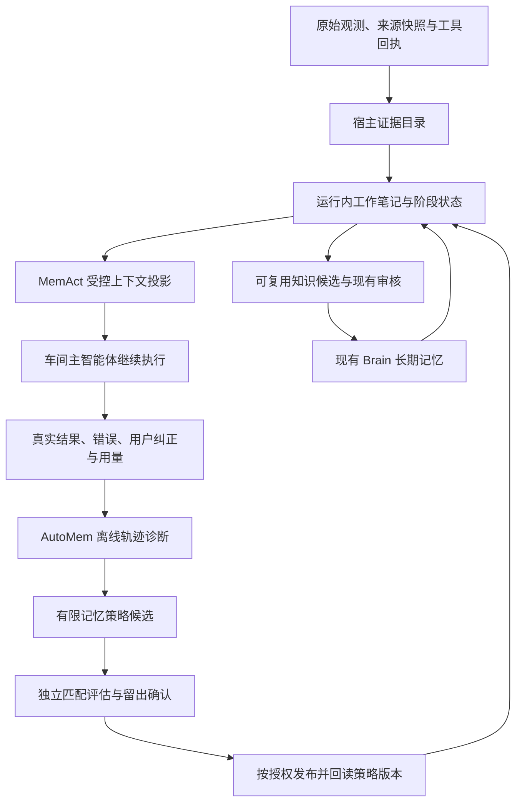

# Memory as Action 与 AutoMem 联合实现方案

日期：2026-10-13。状态：源码和论文已核对，方案已保存；本次没有修改业务代码、训练模型、启动实验、改变车间配置或部署。本文中的新接口、策略字段和阶段能力均为拟新增，不能视作已经实现。当前生产装载证据仍引用 10 月 10 日记录，没有补做今日生产核查。

本文按此前阅读的 Memory as Action 与 Stanford 的 AutoMem: Automated Learning of Memory as a Cognitive Skill（2607.01224）设计；不与同名的 2608.14621 记忆架构搜索论文混用。

## 1. 两篇如何组合

建议采用“执行时维护工作记忆，执行后改进记忆策略”的两层闭环，继续复用现有 Brain 的长期治理和 Loop 状态。

| 来源 | 借鉴部分 | 联合实现的位置 |
| --- | --- | --- |
| [Memory as Action / MemAct](https://arxiv.org/html/2510.12635v3#S3) | 把工作上下文编辑作为可选动作；Prune&Write；完整历史与实际输入分开 | 单 run 内有来源的状态维护、正文投影、恢复和真实请求检查 |
| [Stanford AutoMem](https://arxiv.org/html/2607.01224v1#S2) | LOG/PLAN 记忆使用流程；轨迹驱动的结构优化；可选记忆专员训练 | 工作笔记的组织与检索，离线候选生成、匹配评估和版本选择 |
| 项目已有系统 | 原始观测、权限、来源、长期记忆审核、纠错、依赖与 Loop checkpoint | 两个闭环的共同底座，不另建自动事实库或并行权限体系 |

这是工程组合方案。MemAct 的 SFT/DCPO 训练与 AutoMem 的 LoRA 记忆专员不是同一种训练方式，不能靠增加 prompt 称作完成两篇训练复现。AutoMem [局限](https://arxiv.org/html/2607.01224v1#S6)中的跨 episode 持久记忆仍是未来方向；两篇不能替代本项目的长期记忆治理。

## 2. 系统结构与职责

单个车间仍然只有一个业务控制器。LOG 和 PLAN 首先由同一个模型在受控阶段执行；离线诊断器只负责候选，不执行车间业务动作。以后如采用记忆专员，它只是内部记忆服务，不能获得交易、外发、调度或跨车间写入权限。

三个状态载体明确分开：

1. 原始来源与完整 transcript：不可被模型摘要覆盖。保留来源身份、原文 hash、覆盖范围、时间、provider/detail/warning。
2. 本轮工作记忆：继续使用 facts、hypotheses、openQuestions、nextAction，增加明确的来源版本和失效关联。大规模笔记可扩展为有上限的 run notebook，按稳定键检索与修订；文件式视图由宿主服务提供，不给模型任意文件系统权限。数据库/快照持久化工作笔记也不等于长期知识被激活，更不等于可以精确恢复 SDK 会话。
3. Brain 与 Loop：可复用知识沿用候选/审核/纠错；跨轮进度沿用 checkpoint。新一轮重新检查权限、来源新鲜度和依赖版本，不直接注入上一轮全部正文。

## 3. 先修当前已证明的阻断

[10 月 10 日真实匹配验证](../verification/memory-as-action-matched-proof-2026-10-10.md)中，四轮完整 Read 都因 assistant 含 thinking 被整组保留；成本目标任务主动 read 一次却得到空目录。今日源码仍保留这个规则。当前 update 的证据身份又依赖同一可裁剪 catalog，使“保留原文”同时限制“给工作笔记引用原文”。

### 3.1 拆开两种资格

拟新增宿主 `evidenceCatalog`，登记真实工具观测的身份、来源、hash/span、覆盖范围、时间、scope、状态和警告；再由独立 `projectionCandidates` 判断正文是否能从下一次输入中移出。

- 能引用观测不等于其内容已经核实。未核验外部材料只能支持“该来源报告了什么”，不能被模型自标为 verified。
- 成功且身份明确的只读证据可以支持本轮笔记，即便该原文仍须固定保留。
- 错误、拒绝、审批、控制指令、业务动作回执继续保留，不被投影或冒充事实。
- 目录返回具体阻断原因，例如 mixed_assistant、redirect_unverified、fallback_warning、incomplete_pair；用户和模型不再只能看到一个无法解释的空数组。

### 3.2 保留消息协议，仅投影合格正文

保留完整 assistant thinking/text、toolCall、toolResult 身份及配对；对满足严格来源与只读条件的结果正文，使用显式宿主占位，附原文身份、hash、警告和恢复入口。模型摘要作为独立工作状态存在，不能伪装成原工具的完整返回。

完整 SDK transcript 与原文快照不改写。审计持久化成功后才提交新状态，并在最后 provider 请求边界检查实际投影。restore 恢复同一结果内容，不重新执行 Read 或任何业务工具。先用真实 provider 验证占位协议是否被接受；不能仅凭 SDK messages 变短称作成功。

生产网页的目的地址未核验和 fallback 警告仍是独立限制。不得删除 thinking、伪造 finalUrlVerified、吞掉来源警告或全局扩大可裁剪名单来获得实验通过。

## 4. 执行时的 LOG / PLAN 闭环

建议在子问题完成、新来源覆盖完成、纠正到达或上下文预算压力出现时触发；不在每个工具结果后固定新增一次模型调用。

1. **观测入账。** 宿主记录真实新结果及证据目录；原始事件不改写。
2. **LOG。** 模型先查询已有相关笔记，决定不写、新增或按稳定键修订，分开事实、假设、未决问题、失败路径和下一步；不重复追加相同结论。
3. **宿主校验。** 校验 scope、证据、来源状态、expectedVersion、commandId、条目/字符/调用预算；记录拒绝理由或编辑审计。来源对应不代表自动完成语义核验。
4. **PLAN。** 按当前子目标读取必要笔记和获准 Brain 条目，补缺原文；需要时提出正文投影，由宿主执行。任务动作继续经过原权限和审核机制。
5. **反馈。** 核对后续阶段是否使用了正确状态、是否遗漏证据、是否重复读取或行动、是否被用户纠正、最终验证是否通过；实际 token/缓存/时延计入，包括整理和恢复的额外调用。

开始时只增加一个有限的 `memoryPolicyVersion`，拟包含工作状态格式、笔记去重键、LOG 触发条件、检索范围/排序、摘要与读取预算；实际 run 固定记录版本和 hash。运行中不自动热切换候选，也不把失败后的长 prompt 叠加当学习。

## 5. 执行后的 AutoMem 改进闭环

复用已有 Harness evolution 的 `work.memory-profile` 和 `work.context-policy` 组件、提案、候选版本与评估契约，不重建生产自修改器。

### 可修改与不可修改范围

第一阶段每个诊断批次最多两个候选，每个候选围绕一个可证伪原因，例如重复事实去重、子目标检索或阶段触发。只允许改变记忆格式、索引、提示、检索与预算等明确列出的记忆策略参数。

角色使命、业务目标、工具权限、denied、审核规则、来源核验和报告标准为保护项。诊断器不得直接修改这些内容，也不得修改线上代码。发现宿主代码缺陷时形成可审阅工程变更，经过开发测试和既有发布流程。

### 真实证据链

读取获准的本车间轨迹与来源索引，按失败片段追溯到完整因果序列；必要正文按权限读取。跨车间质量管家现有的聚合遥测权限不因此扩大。轨迹至少关联：run/Loop 身份、有效模型与策略版本、观测新鲜度、笔记操作、投影前后真实请求、来源引用、拒绝/错误、独立验证和用量。

不要拿最终分数代替定位。候选需写出“条件 X 下，策略 Y 应改善行为 Z；出现反例 C 则失败”，并列回滚版本。用开发场景选择候选，用隔离的留出场景作最终确认；优化器不能读取留出题目、金标准或失败正文后针对它反复调参。

### 当前需要补的能力

现有默认 `builtin-deterministic-v1` 只做固定 fixture 的确定性检查；[run-capture](../../apps/web/lib/harness-evolution/run-capture.ts)的 tokenUsage 仍为空。这些是可复用基础设施，不能称为已经进行真实轨迹学习或模型效率验证。

需要增加真实隔离 memory-scenario executor：冻结授权来源、模型、业务工具和预算，接入现有 Pi Harness，记录实际 provider 输入、SDK usage、记忆动作及独立答案支持核对。缺失用量标未知，不以字符估 token；候选开发/评估成本单独记录，不能从生产节省中隐去。

评估通过后仍需实际策略绑定与加载回读。当前提案 approve/materialize/begin_evaluation 不等于生产已装载；新激活路径应复用已有版本化命令和发布保护，记录 active/candidate policy hash，并可恢复旧绑定。已有活跃 run 使用原版本；后续 run 在授权范围内使用新版本。paused/archived Loop 保持原状态。

## 6. 长期记忆与来源转换

本轮 workingMemory 的 toolCallId 不能直接成为可长期回溯的证据。拟增加宿主转换器，将可复用 claim 映射到真实 sourceEventId、快照 hash、原文 span/window 和来源版本，再进入现有 Brain admission / workshop proposal。

必须显式提供每条 claim 的来源，不使用“最近几条事件”替代支持关系。当前 [mcp-tools](../../apps/web/lib/workshops/mcp-tools.ts)的 sourceEventIdsOrRecent 是旧候选路径的便利兜底；新转换器不能依赖此兜底激活知识。

模型理解保持 candidate，激活沿用真实主人授权、当前版本、来源确认和审核回执。来源被纠正、过期或撤销时，利用已有依赖机制使受影响理解失效；工作笔记和新策略引用的版本也必须重新核对。source pin 不等于 verified，模型自评分不代替审核。

## 7. 接缝与实施顺序

| 阶段 | 优先文件/现有模块 | 拟新增能力 | 验收门槛 |
| --- | --- | --- | --- |
| I：宿主底座 | [host-working-memory](../../packages/ai/src/agent/runtime/host-working-memory.ts)、[Pi adapter](../../packages/ai/src/agent/runtime/pi-harness-adapter.ts) | 证据与投影目录拆分、可恢复正文占位、明确阻断原因 | thinking/协议配对/警告保留；审计失败不提交；幂等/版本冲突；原文精确恢复且不重放工具 |
| II：本轮记忆技能 | [working-memory-policy](../../apps/web/lib/workshops/working-memory-policy.ts)、[run-prompt](../../apps/web/lib/workshops/run-prompt.ts)、[executor](../../apps/web/lib/workshops/executor.ts)、[Native executor](../../apps/web/lib/loops/native-executor.ts) | 版本化 LOG/PLAN、去重/索引/阶段触发；可选有界 notebook | 同一权限下真实形成有来源的非空状态，后续阶段实际消费；没有重复行动或静默降级 |
| III：外层改进 | [harness-evolution](../../apps/web/lib/harness-evolution/component-registry.ts)、[evaluation-service](../../apps/web/lib/harness-evolution/evaluation-service.ts) | 真实隔离执行器、轨迹诊断、有限候选与留出确认 | 同条件质量和硬边界通过；包括整理成本的实际用量可核对；失败版本保留 |
| IV：长期与生产闭环 | [Brain admission](../../apps/web/lib/brain/memory-update-admission.ts)、[memory review](../../apps/web/lib/brain/memory-review.ts)、[dependencies](../../apps/web/lib/brain/memory-dependencies.ts)、现有版本化命令 | 精确来源晋升、策略激活/加载回读/回滚、桌面审核 | 主人审核与角色边界不变；加载身份一致；真实生产任务和桌面状态可对账 |
| V：条件成熟再训练 | 独立训练/部署项目 | 自有可训练模型上的记忆专员，或 MemAct 联合策略训练 | 干净训练数据、独立留出、行为收益和包括推理开销的对照；不是本轮实现条件 |

当前 API 模型不能由本项目直接更新权重。阶段 I–IV 能实现论文启发的工程机制，不能声称复现 SFT/DCPO/LoRA。若采用专员，需要重新检验消息协议、工具路由和效果；不在宿主阻断仍存在时先增加调用次数。

## 8. 控制、恢复和桌面审核契约

| 工程问题 | 联合方案要求 |
| --- | --- |
| 被控对象 | 内层为单 run 的工作状态与下一请求正文投影；外层为限定车间下一版本的记忆策略 |
| 观测新鲜度 | 每次保留 observedAt、来源版本、覆盖范围及 provider/detail/warning；旧记忆不能冒充当前事实 |
| 状态可追溯 | 原始事实、工作理解、编辑命令、执行结果分别保存；记录 scope、runId、策略 hash、证据身份与版本 |
| 控制动作 | LOG/检索/投影/恢复、长期候选、策略候选各有边界；commandId 幂等、expectedVersion 冲突、审计先行 |
| 安全边界 | denied 优先；宿主保护项不可被候选改变；工作笔记不授予外部动作或跨车间权限 |
| 反馈使用 | 后续阶段核验、用户纠正、真实来源支持、重复读取/行动、拒绝和完整用量用于下一批诊断，不自动改生产 |
| 异常与降级 | 索引/模型/来源/审计失败明确暴露；保留上版状态。恢复不等于动作成功，模型摘要不等于原文 |
| 人工接管 | 桌面现有车间运行详情、记忆候选与 Harness 提案页提供审核/纠错；暂停沿用车间/run/Loop 控制入口 |
| 页面理解 | 显示已保存/待审核/已装载版本、目录为空原因、实际写入/投影/恢复次数、来源警告、最近评估与失败；未触发不显示成功 |
| 回滚与重复风险 | 恢复旧策略绑定只影响后续 run；当前 run 恢复原投影，不重放业务动作；外部既有动作仍须单独对账 |

跨进程精确恢复完整 SDK transcript 没有当前实现保证。如后续需要，须单独定义原始快照存储、权限、完整性和恢复协议，不能把持久化一段工作状态说成恢复成功。

## 9. 如何证明两篇组合有用

先完成安全与协议底座，再在相同底座做四臂消融：A 基础记忆策略且不投影正文；B 增加 MemAct 投影；C 使用 AutoMem 优化的组织/检索策略但不投影；D 同时启用两者。各臂长期 Brain、业务目标、权限、来源快照、基础模型、预算及判定规则固定；治疗因素差异明确封存。后来增加专员是新的独立对照因素。

场景包括长材料跨子目标、旧/新来源冲突、用户中途纠正、空检索、重复信息、来源降级、拒绝动作、审计失败与恢复。错误笔记、遗漏引用、旧事实控制行动、重复动作、边界丢失先判失败，再比较实际调用/缓存/token/时延；结果应能追踪到“观测 → 笔记 → 下一次真实输入 → 后续引用/核验”。

第一轮有限试点先比较修后基础与联合候选，再在预算允许的下一批做完整四臂及重复样本；不能用单个成功样例判普遍收益。每轮预先保存任务数、重复数、调用/输出/时间上限和停止条件；不根据失败追加补考或向优化器暴露留出。若实际裁剪、语义质量或总用量改善未出现，记 inconclusive 或候选失败，保留基线和原证据。

### 本次交付状态

- 已分析、已保存：论文分工、真实源码接缝、阻断、实施次序及验收契约。
- 未实施：新的证据/投影目录、LOG/PLAN 策略、外层真实执行器、策略激活绑定和训练。
- 未执行：本轮模型对照、生产切换、桌面新功能验收。旧验证不改写为新方案效果。
