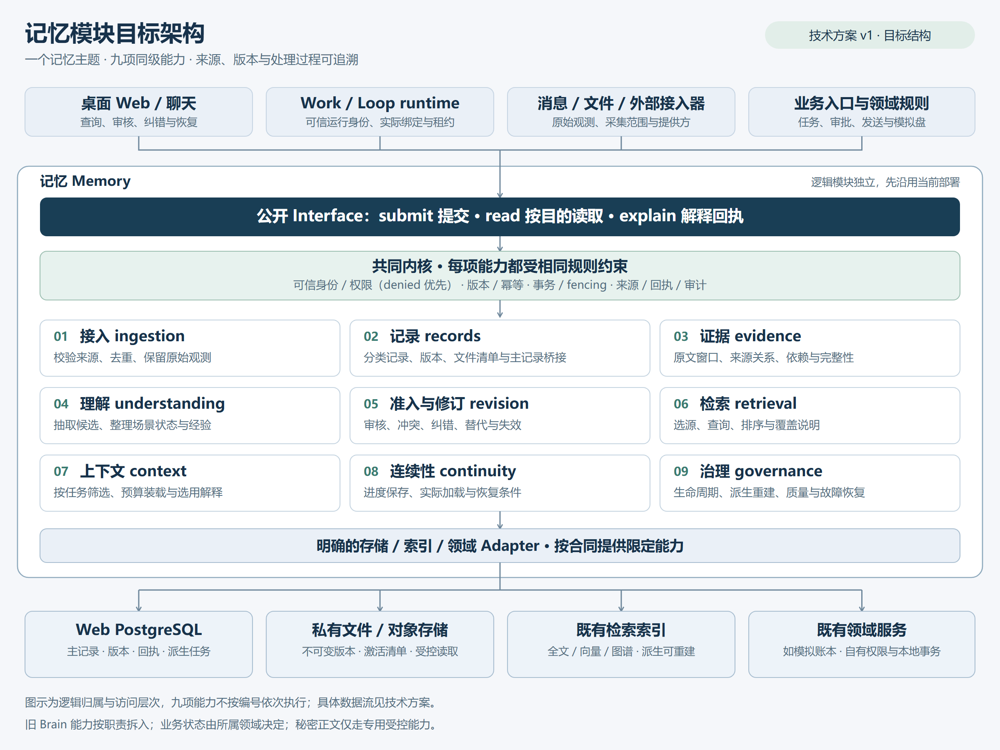
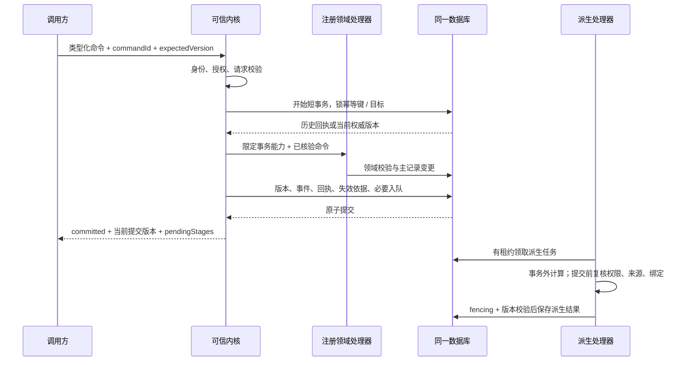

# 记忆模块技术方案

后续跨项目拆分设计见 [通用记忆三层方案](../architecture/general-memory-split-2026-10-21.md) 与 [接入协议草案](../reference/general-memory-protocol-v1.md)。该设计在独立分支推进；本文的 T1–T6 历史实施记录保留，不代表通用包已经发布。

日期：2026-10-20。版本：`memory-module-plan.v1`。状态：T1 观测、T2 理解 / 任务 / 场景、T3 准入 / 审核 / 修订 / 依赖失效、T4 查询 / 召回 / ContextPack、T5 文件 / 连续性 / 独立精确 reader 与 T6 剩余入口 / 固定来源收口的核心闭环均已实现，并完成隔离 PG、开发及正式生产产物验收；T2–T6 完成真实桌面缩放与键盘操作验证。T6 通过 181 套回归、2177 项测试及完整类型检查；197 个实际闭包 root 不再依赖 Brain，55 个旧 Brain 文件仅显式兼容转发。来源目录有界，未注册入口拒绝或明确降级，外部领域保留控制权；不声明任意输入全覆盖。未执行日常数据库迁移，未主动重启日常实例；详见 [T1 验收](../verification/memory-module-t1-2026-10-20.md)、[T2 验收](../verification/memory-module-t2-2026-10-20.md)、[T3 验收](../verification/memory-module-t3-2026-10-20.md)、[T4 验收](../verification/memory-module-t4-2026-10-20.md)、[T5 验收](../verification/memory-module-t5-2026-10-20.md)、[T6 验收](../verification/memory-module-t6-2026-10-20.md)。

依据：[记忆模块设计思路](./state-memory-core-design-2026-10-20.md)、[领域术语](../../CONTEXT.md)、[工程原则](../architecture/engineering-cybernetics-guiding-principles.md)、[现有数据归属](../reference/memory-data-authority.md)。本文细化模块合同、存储协议和实施批次；不改变既有审核、角色和业务主记录权威。示例均为虚构数据。

交付包括本技术方案、[架构图 PNG](../architecture/diagrams/memory-module-architecture-2026-10-20.png)、[可编辑 SVG](../architecture/diagrams/memory-module-architecture-2026-10-20.svg)及 [Mermaid 源文件](../architecture/diagrams/memory-module-architecture-2026-10-20.mmd)。架构图表示目标结构，现有覆盖见第 13 节。

## 1. 控制目标

### 1.1 技术决策

1. 以 `apps/web/lib/memory/` 为唯一记忆 Module 归属，先采用模块化单体，沿用现有 Web 后端和数据库部署。
2. 保留接入、记录、证据、理解、准入修订、检索、上下文、连续性、治理九项明确能力。Brain 的实现逐项拆入对应能力，目标结构中取消 Brain 总包。
3. 用较小的公开 Interface 承接提交、四类读取和回执解释；内部用明确的 Seam 分开存储、业务规则和算法，提供可定位的处理记录。
4. 保留结构化业务表与领域事务，文件和远程服务分别使用可恢复协议。精确读取不依赖模型或搜索索引。
5. 先保持旧 ID、引用、已保存配置和表名的含义，再逐项切换调用者；实际业务写入始终只有一个权威 writer。

### 1.2 成功条件与范围

一个已接入对象应能通过统一合同完成保存、当前读取或历史证据读取、发现、获准上下文使用、纠错及生命周期管理；不支持的能力显式声明。例如没有历史正文的旧任务，不能承诺读出其过去版本。

范围覆盖所有应用持久化数据的治理与受控存取，按域分批接入。身份根、密钥提供方、连接和进程基础能力保持底层依赖；秘密正文只能由获准专用能力取用，不暴露给通用记忆 Interface。临时缓存登记权限、TTL 和主记录依赖，采用轻量路径。当前仅优化桌面 Web 及必要后端。

首版不新增独立分布式平台，不默认部署新向量库，不迁移全部私人数据，不开展移动端或原生客户端专项重构。后续扩大索引或部署须有真实需求、匹配评估和回退方案。

## 2. 被控对象

### 2.1 类别与权威

| 记录类别 `RecordKind` | 主记录 / 初期承接 | 权威与写入规则 | 历史支持 |
|---|---|---|---|
| observation | `interaction_events`、`brain_observations`、raw-message store、采集快照 | 来源接入器追加；可靠外部 ID 去重，原文纠错用新事件 | 原始版本可读时提供，否则明确缺口 |
| business_state | task / work item / review / outbox / paper ledger 等 | 注册的领域命令及对应事务 | 由领域 Adapter 声明，不由目录推断 |
| interpretation | 现有 `brain_memories` 的理解、偏好、经验、约束等 | 候选、审核、修订、替代与适用性 | 复用已存在修订链，逐链校验 |
| knowledge_artifact | 文档、Wiki、Insight、附件、交付文件 | 资料作者或获准处理器；版本清单与验收分开 | 固定文件 / 文档版本支持 |
| continuity | workingMemory、业务检查点、run snapshot | 同一 Work / Loop 的运行合同和实际装载证明 | 保存版本可读；恢复仍需重新授权 |
| configuration | Work / Loop / Harness 等配置 | 领域配置命令与审核、生效合同 | 复用配置版本与实际 run snapshot |
| action_audit | 命令、审核、发送尝试、执行结果、失败恢复 | 实际处理器追加；禁止由模型自述制造执行成功 | 事件和回执回看，不自动重放外部动作 |

类别说明记录是什么；九项能力说明怎样处理。向量、全文、图谱、摘要、L2、ContextPack 属于承载、索引或派生投影，必须引用其来源版本。

### 2.2 本轮核对的关键现状

- `lib/memory` 已有 raw-message PG / SQLite、向量 Adapter、统一搜索及缓存，不能当作空目录。
- Brain `repository.ts` 还调用 context / workshop-memory，包含候选查询、投影及日志；须按函数拆开，不能整文件搬到 records。
- Brain 修订用 `bmrv1:…` 内容状态令牌，可能生成新行 ID；Work 命令使用整数版本，模拟账户使用自己的版本。版本暂不统一为一个整数。
- 盘点时 Interaction task 没有独立 revision 列；T2 代码及隔离验收已补列、全 writer 与数据库栅栏，日常库尚未迁移。已有状态投影事务不能被拆成异步两次提交。
- 当前模拟盘 `/paper/v2` 由独立凭证和账本事务管理。Web 显示缓存不是严格 current 读取来源。
- 文件当前先上传再保存元数据，失败后尽力清理；实际 Blob Adapter 使用公开访问，接入敏感文件前需完成私有化或受控读取替换。

这些是源码核对结果，不代表读取了日常数据库或核验了生产进程装载。

## 3. 观测输入

### 3.1 接入合同

接入器生成 `ObservationEnvelope`：

```ts
type ObservationEnvelope = {
  source: { namespace: string; externalId: string; version?: string };
  occurredAt: string | null;
  observedAt: string;
  payload: RegisteredObservationPayload;
  integrity: { digest?: string; completeness: "complete" | "partial" | "unknown" };
  provider: string;
  warnings: string[];
};
```

`namespace`、payload schema 和接入器能力由服务端注册；JSON 请求不能自选主记录表、存储位置或用户归属。host 补入可信主体、会话 / Work / Loop / run 身份与实际绑定。来源发生时间、观察时间和写入时间分别保存，缺失时不猜测。

去重键使用已确认的 `(owner, source namespace, externalId, source version)`；有可靠消息身份时不以正文相同合并。无可靠外部身份时生成独立接入 ID，重复采集的关系标 unknown，不能把内容哈希当独立来源身份。

### 3.2 理解输出与反馈输入

理解能力读取确定来源版本，输出 `CandidateDraft`：候选类型、内容、parent versions、根来源覆盖、未决问题、模型 / 规则版本、适用范围、建议期限。它只表达解释与估计，准入由 revision 决定。工作进度的 facts / hypotheses / nextAction 保留各自使用语义。

反馈分用户纠错、领域状态变化、运行实际使用、采纳 / 验收和系统故障。反馈只提供后续评价或修订依据，不自动修改权限、召回策略或其他 Work 的配置。

## 4. 状态模型

### 4.1 总体架构图



图中九项能力同级，受共同内核约束。底部 Adapter 只承接明确的存储或领域协议，没有“Brain Adapter”包住全部旧实现。图示为逻辑归属，调用顺序见第 6 节；基础内核不回调上层九项能力。

### 4.2 身份、版本与主记录

```ts
type RecordRef = { kind: RecordKind; id: string };
type VersionRef = { record: RecordRef; revision: string };
type AuthorityLocator = {
  namespace: string;
  entityId: string;
  nativeVersion: string;
};
```

- `RecordRef` 指向逻辑对象，稳定于物理行和后端。租户归属由可信上下文及数据库验证，不相信客户端传来的 owner。
- `VersionRef` 指向该逻辑对象的确定版本，`revision` 是不透明令牌，只能由所属 Adapter 解析和比较。
- `AuthorityLocator` 定位领域主记录或确定正文版本，保存在受控记录中，客户端不能传入任意 locator 覆盖。
- 修订产生新行时，显式命令关系把新旧物理身份映射到逻辑对象。历史回填只有在来源、归属和修订关系均核验后才归并；同名、同正文、canonical 分组本身均不足以归并。

现有 `bmrv1`、Work 整数、模拟盘账户版本先由 Adapter 编解码保留语义；hash 令牌只做相等校验，禁止用大小比较推断先后。

### 4.3 状态维度分别保存

| 维度 | 例子 | 不推出的结论 |
|---|---|---|
| 记录生命周期 | active / archived / tombstoned / purge_pending / purged | active 不等于事实正确 |
| 领域状态 | task completed、outbox sent_confirmed | 不等于运行完成或模型报告完成 |
| 审核状态 | candidate / approved / rejected / superseded | approved 不等于行动授权 |
| 依赖有效性 | current / stale / denied / unknown | unknown 不等于全局适用 |
| 派生进度 | pending / running / succeeded / blocked / failed | 保存成功不等于索引或装载成功 |

历史记录即使可读，仍可能不适合当前任务。精确 current 返回权威当前版本；历史 evidence 返回指定版本。缺少不可变历史正文时返回 `unsupported/historical_version_unavailable`，不能以现在的正文填补旧回执。

## 5. 控制器 / 智能体角色

### 5.1 目录与实现职责

```text
apps/web/lib/memory/
  index.ts, contracts.ts                 显式公开入口与版本化合同
  kernel/                               身份、权限、事务、版本、幂等、回执
  ingestion/                            可信来源接入、去重、窗口处理
  records/                              分类记录、版本定位、文件清单
  evidence/                             来源读取、谱系、实际窗口、依赖
  understanding/                        抽取、场景估计、摘要、经验候选
  revision/                             准入、审核、冲突、纠错、替代
  retrieval/                            查询路由、候选、排序、有限重试
  context/                              适用性、信息缺口、预算与 ContextPack
  continuity/                           保存、实际加载与恢复条件
  governance/                           队列、生命周期、质量与恢复用例
  adapters/{postgres,artifacts,indexes,domains}/
```

按真实闭环逐个创建实现，不提前生成全部空目录。每项能力有自己的 Interface 和合同测试；公开 `index.ts` 只显式导出调用方需要的用例，不通配导出 DAO 和所有内部类型。

| 能力 | 输入 → 输出 | 不能承担 |
|---|---|---|
| ingestion | 可信来源封装 → 原始记录与接入回执 | 自行批准理解 |
| records | 注册类型命令 / 引用 → 版本与受控正文 | 在 DAO 内组装 ContextPack |
| evidence | 确定来源版本和窗口 → 实际证据与缺口 | 凭相似文本补造谱系 |
| understanding | 获准证据 → 候选和状态估计 | 自己给候选确认生效 |
| revision | 候选 / 主人修订 + 当前版本 → 准入与失效回执 | 修改交易账本、放宽授权 |
| retrieval | 获准目的和过滤条件 → 线索、路由、覆盖 | 通过排名确定事实成立 |
| context | 本次任务 + 已获准线索 → 上下文与选用依据 | 扩大读取权限或隐藏失败 |
| continuity | 运行证明 + 检查点 → 保存 / 加载回执 | 调度、启动或冒充运行身份 |
| governance | 受控维护命令 / 变更事件 → 处理状态与恢复 | 在只读健康查询中同步审批事项 |

### 5.2 依赖方向

`API / 工具 / runtime → 显式用例入口 → 对应能力 → kernel 与声明端口 → Adapter`。

kernel 不导入九项能力；records 不导入 understanding、retrieval、context；理解只输出候选，revision 不回调理解完成自审；retrieval 返回线索，context 组织装载。治理通过注册的处理端口调度重建，不调用旧总 service。Work / Loop runtime 仍决定执行和保存时机，continuity 只验证其实际证明。

业务领域提供注册的内部命令处理器，获得限定的事务 / 领域能力，保留状态机和审核规则；它与对外领域入口分开，避免递归调用记忆入口。进程启动组合依赖，禁止把任意运行时函数或 SQL 从 HTTP / 模型参数传入。

## 6. 控制动作与工具矩阵

### 6.1 公开 Interface

```ts
interface MemoryClient {
  submit<C extends RegisteredCommand>(command: C): Promise<CommandOutcome<C>>;
  read<Q extends MemoryReadQuery>(query: Q): Promise<ReadOutcome<Q>>;
  explain(query: ExplanationQuery): Promise<ExplanationOutcome>;
}

type MemoryReadQuery =
  | { purpose: "current"; ref: RecordRef; afterReceipt?: string }
  | { purpose: "evidence"; ref: VersionRef; range: EvidenceRange }
  | { purpose: "discover"; query: string; filters?: DiscoveryFilters; cursor?: string; limit?: number }
  | { purpose: "recall"; taskIntent: string; needs?: InformationNeed[]; maxTokens?: number };
```

按命令 / purpose 提供可判别返回类型，不用任意 `save(any)` / `read(any)`。服务端用可信 Web session、接入器注册或运行租约分别构造 client。TypeScript 品牌类型只防误用，实际权限仍在运行时验证；构造入口不暴露给模型，外部请求 schema 拒绝 owner、grant、lease 和任意 project 绑定注入。

任务场景和绑定从已保存配置及实际 run snapshot 解析。模型可表达信息需求和检索词，不能通过它们指定更高权限。

服务端类型注册明确到下列合同；实际处理函数仅在部署代码的组合入口提供：

```ts
type TypeContract = {
  namespace: string;
  kind: RecordKind;
  purposes: ReadonlyArray<MemoryReadQuery["purpose"]>;
  authorize: DomainAuthorizationPort;
  current: AuthorityReader;
  historical?: ImmutableVersionReader;
  version: { equal: VersionEquality; compare?: AuthorityVersionComparison };
  commands: ReadonlyArray<RegisteredCommandHandler>;
  lifecycle: LifecyclePolicy;
};
```

授权端口按类别调用对应领域的现行策略。现有 Brain grants 仅在其原有授权语义内承接理解类记录，不能因为接入统一内核就扩大为任务、文件、账户等所有领域的权限。

### 6.2 命令合同与返回

注册命令至少声明：`kind`、payload schema、可调用主体、目标记录类别、事务模式、本领域审核要求、expectedVersion 规则、执行器、回执格式及是否可能有外部效果。

首批命令集合从 `observation.append` 开始，随后接入 `interpretation.propose/review/revise`、领域 `task.transition`、`artifact.begin/seal/activate`、`checkpoint.save` 和治理命令。每次只暴露角色实际获准的子集。

所有可重试命令带 `commandId`；修改命令带从真实读取取得的 `expectedVersion`。创建使用稳定业务唯一约束；允许的盲追加由类型合同明确声明。请求摘要覆盖命令类型、目标、业务 payload、预期版本、来源和绑定，采用版本化稳定序列化；不包含每次都变化的 traceId / 当前时间，不保存明文密钥。

幂等查找键为 `(owner, command namespace, commandId)`，同时绑定调用主体和目标。任何主体取回历史回执前都重新授权；同 ID 不同业务摘要返回 conflict。已经提交的命令在重复调用时返回历史回执，不再次执行，也不因主记录后来变化而篡改旧结果。

```ts
type OutcomeMeta = {
  traceId: string;
  receiptId?: string;
  contractVersion: string;
  implementationVersion: string;
  policyVersion: string;
  provider: string;
  detail: string;
  warnings: string[];
  coverage: Coverage;
};
```

读取区分 `ok / empty / denied / not_found / unsupported / unavailable / degraded`；提交区分 `committed / pending / conflict / rejected / unknown_outcome`。`committed` 表示权威提交已有可核验回执，后续索引等列在 `pendingStages`。超时但不能判断是否提交时返回 unknown_outcome，不能映射成未提交或直接换 ID 重做。

`afterReceipt` 在所属 Adapter 校验回执归属并读到相同或更新的权威版本；无法证明先后或提供读己之写保证时返回明确未满足，不伪称满足。hash 版本需要权威修订链或重新读回，不使用字典序比较。

### 6.3 本地写入事务



锁按确定目标顺序获取。必要事件、目录、失效依据和派生入队与主变更同事务，失败全部回滚。对于持久化接收 / 预处理命令，接收阶段可先独立提交 pending；随后执行事务失败时仍保留可查询的失败记录，但不得留下半个业务结果。

事务前授权只作预检。所有本地业务 submit 在提交事务内取得对应权限 guard 的共享锁并重新校验当前策略 / epoch，再执行领域变更；撤权更新同一 guard 并取得排他锁。两者由数据库确定先后，防止等待目标锁期间已经撤权的旧命令继续提交。guard 与目标锁采用固定顺序，跨多个 scope 时先排序；历史回执的读回也复核当前访问权。

网络、模型、文件上传、跨服务请求不在数据库事务中；不在事务作用域启动未等待的工作。复用现有 transaction scope 时验证所有 DAO 确实使用注入的连接；raw-message 的独立连接未经证明不能纳入同事务承诺。

### 6.4 四类读取与关键算法

| 目的 | 执行路径 | 明确保证 |
|---|---|---|
| current | 校验对象权限 → authority Adapter 精确读取 → nativeVersion / asOf → 读取回执 | 不用记忆摘要、展示缓存或旧目录版本替代当前主记录 |
| evidence | 校验版本引用 → 解析唯一 locator → 校验权限 / 完整性 → 读取窗口 → 回执 | 不把请求范围当已读范围，不以重新抓取网页替代旧快照 |
| discover | 当前权限过滤 → 注册索引查询 → 对返回元数据再授权 → 游标结果 | 主人可找异场景历史内容；标记 discovery_only / applicability_unknown |
| recall | 可信任务绑定 → 授权候选 → 适用性与依赖 → 按需主记录 / 证据核验 → 排序预算 → 最终复核 → ContextPack | 只装载适合当前任务的获准内容，并返回排除 / 缺口 / 降级 |

ContextPack 分开 `currentStates`、`historicalEvidence`、`interpretations`、`constraints`、`openQuestions`；每项含 `VersionRef`、使用语义、新鲜度、读取回执。业务完成、已发送、审批通过等判断必须有 current 主记录引用。预算不足裁剪正文仍保留关键安全约束、来源指针和截断原因；不把裁剪解释为没有该事项。

依赖遍历使用明确 parent versions，拒绝回边自证；别名必须解析到同一实际来源才分组。读取和依赖展开有服务器配置的大小 / 深度 / 时间预算，超限输出 incomplete / dependency_unverified；自动装载或行动不能把未核验的关键依赖视作 current。首批复用既有规则评分和索引，扩展 hybrid retrieval 另做匹配评估。

### 6.5 文件协议

`initiated → uploading → sealed → active`；可清理阶段原子竞争到 `deleting → deleted`，清理失败为 `cleanup_failed` 可重试。

1. 先持久化上传意图、owner、随机不可猜测对象键、manifest version、预计配额和幂等命令。
2. 事务外上传至私有对象；校验大小、摘要、媒体类型，sealed 后对象不可覆盖。
3. 激活事务锁定 manifest，CAS 从 sealed 到 active；同事务提交业务引用、正式配额、提交回执与解析 / 索引入队。
4. 清理器先 CAS 取得 deleting，再删除物理对象；不能只按文件年龄直接删除。激活与清理竞争同一版本，只有一个成功。
5. 迟到上传复核 manifest fencing；旧意图已经 deleting 时，不能封存或激活，只进入清理。
6. 读取必须经过 active 清单、当前权限与完整性检查。需要严格撤权的敏感文件每次 GET / range 请求都走鉴权代理，不把可直接访问对象存储的签名 URL 当作即时撤权机制。其他类别只有在明确允许有界授权窗口时才可签发短期 URL，并将其剩余有效期计入撤权 pending；敏感文件不得使用长期公开 URL。

上传暂存与正式配额分别追踪；重试不重复扣减。恢复任务以 manifest 和对象键对账，不能把孤儿对象当已交付成果。当前 provider 若不支持所需私有读取，须先替换 Adapter，再接入敏感类别。

### 6.6 远程领域命令

Web 先保存调用意图 / commandId → 事务外调用远端 → 远端在自己的事务中校验角色、审核、版本并提交账本与回执 → Web 保存权威回执引用。

连接中断时保持 unknown_outcome，使用相同原 commandId 查询远端。只有远端权威地证明没有生效且允许重试时才重发同一业务命令；远端需支持持久化回执与重放查询。Web 目录 / 派生延迟用远端事件游标对账，current 仍直接读远端。无共同快照时逐对象返回版本和 asOf，不宣称全域同一时刻。

## 7. 边界与审核

### 7.1 授权与能力

可信身份 → 操作授权（denied 优先）→ 读取目的 → 适用性与有效性 → 内容 / 元数据输出。授权分别覆盖 read / reference / write / review / lifecycle，复用现有已生效规则，新增类别默认拒绝未声明能力。

记录类型注册表是部署代码，不接受模型动态注册。常规主人操作沿用已有授权；外发、交易、删除、配置生效仍走领域审核。历史记忆、过去审批、confidence 或 active 状态均不授予本次操作权。

主人发现与自动任务装载分开；精确 evidence 不因缺当前项目绑定而自动隐藏有权查看的历史来源。任务绑定从 host 获得，缺失或冲突返回 unknown，不能由项目名称或模型参数补造。

### 7.2 撤权与派生失效

本地权限变更更新 `policyEpoch`；源更新保存 nativeVersion 及失效依据。已经接入的本地 writer 在同事务更新 guard，自动派生提交和关键读取在短事务内复核版本 / epoch。旧直写尚未关闭的类别只能标部分覆盖，不承诺完整即时失效。

新正文展开、ContextPack 输出、异步提交和业务动作重新验证当前授权与来源。上下文交给模型的调用在出站 admission 点记录版本及授权裁决；撤权阻止其后的新 admission，已经放行且无法中止的请求标 in_flight。记录已外发范围，不能承诺收回已交给用户或外部模型的内容。

跨服务撤权带授权代次 / fencing，远端在自己的提交事务序列中校验。Web 先停新调用，撤权保持 pending，直到远端确认新代次已生效、旧能力不能再提交才宣布完成。缺少该协议的 Adapter 不进入要求强撤权的自动动作路径。

派生索引异步重建，最新权限与关键依赖的检查不等待重建完成；被撤权或已删除对象的索引标题、命中数、正文都不能经另一路径泄露。无完整历史谱系的对象保留 unknown；所有依赖需要核验并不能借旧摘要确认当前事实。

### 7.3 清除与恢复

软停用、可恢复删除、不可逆清除使用不同命令和回执。清除先关闭读取 / 装载，再按依赖清理正文、附件、索引、缓存和派生；失败保留 purge_pending / 失败原因。审计与墓碑仅保存必要无正文信息，不能把清除内容复制到审计表。

备份控制维护不随业务快照回退的最小清除 / 撤权清单。恢复库先隔离，重放足够新的控制清单、清理派生、复核存储权限后再开放。清单不可得则禁止删除前快照直接上线；备份保留期未届满不能宣称物理清除完成。恢复也不能重新授权、发送消息或重放交易。

恢复另设动作写栅栏：先废除旧 run / job capability 并提升恢复 fencing 代次，再按远端权威回执或完整事件补齐“备份切点至恢复栅栏”期间的外部效果及本地命令关联。相关自动动作在对账完成前保持暂停，不能重新生成 ID 把已发送 / 已成交工作再做一次。Adapter 无法提供足够完整的恢复窗口时，保持该域待核验并进入人工对账；不能仅凭恢复库显示 pending 就判定从未执行。

## 8. 反馈与评价

每次请求保留目的、类别、调用者类型、合同 / 实现 / 策略版本、trace、outcome、provider、coverage 和延迟。处理阶段保留安全引用和原因，遥测不记录原查询、私人正文或密钥；解释详情按当前权限逐次读取，不能凭 traceId 绕权。

| 指标 | 定义与使用 |
|---|---|
| 接入覆盖 | 能力 × 类别 × API / 工具 / runtime 调用者的实际路径及流量，含 legacy 未接入分母 |
| 提交可靠性 | committed / unknown_outcome、冲突、幂等命中、最老 pending 与恢复时长 |
| current 保证 | 权威读取覆盖、afterReceipt 未满足次数、展示缓存误用次数 |
| 证据完整性 | 返回内容具有确定版本、实际窗口与读取回执的比例，缺口另列 |
| 派生状态 | 目标版本 / 已处理版本、积压、过期依赖被拦截、超限未核验 |
| 召回效果 | 各 purpose 下 empty / denied / omitted / degraded、采纳、纠错；不合并错误分母 |
| 运行连续性 | 已保存、实际加载、因来源 / 绑定 / 期限拒绝继承、恢复结果 |

现有全用户召回样本可以作为聚合信号，不能直接作为某 Work 的健康分母；resolved root groups 只表示明确同源分组，不是独立证据数或准确率。

实施前记录匹配环境的基线；策略变更用相同任务 / 来源快照 / 工具权限 / 模型条件对照评估，保留失败版本与可复现证据。权限、幂等和证据完整性为硬门槛；延迟与成本预算根据基线确定，不把未测数字写成已达 SLA。

## 9. 异常、扰动和降级

### 9.1 派生任务执行协议

新增共用派生任务只管理已接入能力；现有 Interaction processing jobs 等先通过 Adapter 复用，避免重复运行同一工作。

任务 `queued → running → succeeded`，可转 `retry_wait / blocked / failed / cancelled / superseded`。Postgres 使用短事务 `FOR UPDATE SKIP LOCKED` 领取，更新 `leaseOwner / leaseToken / leaseUntil / attempt`；事务外执行；提交时再次匹配 token、源版本、绑定和当前权限。旧 worker 不能在租约被接管后写入。

外部索引先写入版本化键，复核通过后才切换受控当前指针；旧 worker 产生的孤立索引版本不会成为当前记录。派生事件按待处理状态领取；不能把全局自增 eventId 最大值当作完整消费游标，因为分配序号和事务提交顺序可能不同。远端游标只有在 provider 明确保证完整性时使用。

首版建议执行参数作为显式配置：并发 2、租约 60 秒、心跳 15 秒、自动重试最多 5 次，间隔 5 秒 / 30 秒 / 2 分钟 / 10 分钟；长调用须心跳与超时。它们是待实施的起始配置，需按隔离故障测试与容量基线校正。远程动作 unknown_outcome 转对账任务，不能按普通计算失败重放。

### 9.2 失败处理

| 异常 | 结果与恢复 | 人工入口 |
|---|---|---|
| 模型或索引不可用 | 原文保存及精确 current 仍可用；受影响阶段 pending / degraded | 查看失败阶段、暂停该派生、重试 |
| 数据库提交 / 必要审计失败 | 不确认业务提交；按命令 ID 回查 | 回执页显示未提交或待确认 |
| 远端成功但本地超时 | unknown_outcome，按原 ID 对账 | 查看远端查询结果，受控接管 |
| 源改版 / 撤权 / 场景切换 | 拒绝迟到提交与自动装载，必要时重建上下文 | 查看影响来源与未继承原因 |
| 文件缺失或摘要不符 | 不提供正文，标 incomplete / unavailable，保留恢复记录 | 修复来源或重传新版本 |
| 积压 / 来源过大 | 有界批次、背压和配额；不静默截断为成功 | 暂停接入或派生、查看覆盖与容量 |
| 断网或进程重启 | 按命令、manifest、job token 恢复，重复领取受 fencing 约束 | 恢复进度、失败原因及下次尝试 |

未完成获准查询不能返回 empty；denied 不能回退到更宽 legacy 来源；摘要不能冒充原文。内部错误保留脱敏诊断与关联信息，对无权主体不泄露记录是否存在。

## 10. 页面可观测性

### 10.1 桌面 Web 与 HTTP 接入

保留 `/memory` 为唯一主题，拟以 `view=overview/current/understanding/artifacts/continuity/process` 切换板块；记录详情和回执详情可深链。任务、车间、微信、文件、模拟盘页面保留原业务流程，共享来源 / 版本 / 处理进度组件。

| 拟议入口 | 用途与要求 |
|---|---|
| `POST /api/memory/commands` | schema 白名单命令；可信 Web 身份；返回提交阶段和回执 |
| `POST /api/memory/read` | 四种 purpose 的可判别 schema；按目的不同保证，不允许请求自带 owner / grant |
| `GET /api/memory/records/[id]` | 有权详情，类别、版本、来源、有效性和关联；业务 current 仍调用 authority Adapter |
| `GET /api/memory/receipts/[id]` | 当前授权下查看命令或读取解释，必要内容重新检查权限 |
| `GET /api/memory/health` | 只读指标和恢复状态；不在 GET 创建 / 同步审批项 |

以上是目标路由，实施中分批新增；现有 `/api/memory/search` 等保留兼容，但不得用同一 URL 静默改变返回含义。上传仍用现有 multipart 入口，其内部接入 artifact 命令与清单协议；不通过 JSON 传整个大文件。当前页面本地状态不会因为统一主题强制每个操作都绕一次网络存储。

### 10.2 用户可理解的处理状态

统一详情显示“原文已保存 → 理解待处理 → 候选待审 → 生效版本 → 索引状态 → 哪次实际使用过”，每步可展开依据；不同类别只显示适用阶段。当前任务可显示“已完成，第 8 版；相关摘要待更新”。

操作包括审核、修改、归档、删除、查看影响、暂停接入 / 理解 / 使用、恢复和按原命令重试。危险操作按既有领域审核展示，避免重复确认；恢复操作说明实际范围。失败、等待审核、等下次运行和等外部结果分开呈现。

无权标题 / 命中数不能显示；屏幕加载失败可单独重试，健康查询失败不能阻塞主记录列表。桌面覆盖 1024 及常用宽度、窗口缩放、键盘、焦点、可读性；移动端验收后置。

### 10.3 工具与 runtime

模型工具只开放目的明确的子集，例如 `memory_discover`、`memory_read_current`、`memory_read_evidence`、`memory_recall`、`memory_propose`，具体命名与旧工具兼容映射一并实施。审核、清除、配置和外部动作按角色分别注册，不把通用 submit 直接暴露成任意命令执行器。

Web Chat、Work executor、Loop native-executor、MCP 与 native 工具全部登记真实入口；自动 context 的调用者也必须迁移，不能只把显式搜索工具换名。

## 11. 数据模型

### 11.1 复用与新增的分工

既有业务表继续保存正文和业务约束：`interaction_*`、`brain_*`、`workshop_*`、`loop_*`、文件 / RAG 和模拟账本等。现有 Work 命令与 Brain 修订回执通过 Adapter 作为权威回执复用，不改成一张通用命令表，不重复执行。

新增公共表只保存共享身份、控制协议和跨层关系。下列为目标逻辑表，按阶段添加对应最小集合，不要求首批一次部署全部。

| 逻辑表 | 核心字段 | 唯一键 / 约束 |
|---|---|---|
| `memory_records` | id、owner_id（用户）、owner_type / owner_key（Work 等归属）、kind、authority_namespace / stable_id、policy_scope_ref、privacy_class、binding_ref、current_revision、history_mode、lifecycle、policy_epoch、guard_version、descriptor_version | PK `(owner_id,id)`；唯一 `(owner_id,authority_namespace,stable_id)`；目录不复制领域当前状态 |
| `memory_record_aliases` | owner_id、namespace、external_id、record_id、可选 version_locator | 唯一 `(owner_id,namespace,external_id)`；歧义拒绝猜测，旧 ref 可解析 |
| `memory_record_revisions` | owner_id、record_id、revision_token、authority_locator、digest、observed_at、read_capability、evidence_manifest_ref | 唯一 `(owner_id,record_id,revision_token)`；locator 不意味着历史正文实际存在 |
| `memory_provenance_edges` | owner_id、child record/version、parent record/version、relation、derivation_version | 复合外键保持 owner；边唯一；写入做循环与授权校验 |
| `memory_operations` | owner_id、namespace、command_id、actor_binding、target、request_hash、expected_version、phase、authority_receipt_ref、safe_result、error、timestamps | 唯一 `(owner_id,namespace,command_id)`；编排账本，既有领域回执仍权威 |
| `memory_events` | owner_id、event_id、aggregate_id、aggregate_seq、operation_ref、event_type、safe_refs、time | 唯一 `(owner_id,aggregate_id,aggregate_seq)`；必要事件与状态同事务 |
| `memory_read_receipts` | owner_id、id、trace_id、purpose、version refs、实际 range、provider、coverage、policy / implementation version、as_of | 精确已读范围；正文不重复落遥测；读取也不能因此递归审计 |
| `memory_jobs` | owner_id、id、kind、target/version、dedupe_key、policy / binding、status、attempt、lease token/until、next_attempt、error、cursor | 唯一 `(owner_id,dedupe_key)`；条件索引待领取状态与时间 |
| `memory_artifact_manifests` | owner_id、id、upload_operation、object_key / version、digest、size、media_type、phase、manifest_version、quota_receipt | upload intent 幂等；版本 CAS；对象键私有，不成为公开 URL |
| `memory_revocation_barriers` | owner_id、id、scope、policy_epoch、remote_namespace、remote_ack、phase、error | 同一授权代次与远端目标唯一；确认前 pending |

`TypeContract` 和 capability 注册保留在版本化部署代码中，避免一开始再造可被模型写入的类型配置数据库。清除 / 撤权恢复清单的备份控制副本必须独立于被恢复的业务快照，不能仅依赖上述表的旧快照。

### 11.2 当前业务版本与历史正文

记录目录是安全定位 / 处理元数据，严格 current 查询始终读取所属领域。跨服务目录保存同步游标和观测时间，不能提升为账本。无需给已有原始观测复制一份新正文。

没有并发版本的可变领域对象在接入写入阶段需明确补齐：例如 Interaction task 建议新增 `revision bigint`，所有状态写路径在迁移栅栏内切到“检查旧版 → 更新 revision”的同事务命令。未完成全 writer 切换前只提供现状读取及弱覆盖标识，不能承诺 expectedVersion 已硬化；不能仅以 updatedAt 当可靠并发版本。

不可变原文继续使用原始版本定位。可变业务历史按领域增历史表 / 版本事件并保存必要正文，或明确 `history_mode=none`。严禁用一张通用 JSON 表兜住全部业务对象，严禁把目录 locator 冒充历史快照。

逻辑身份和版本的回填需要显式映射报告：已核验同一逻辑对象、独立记录、歧义未合并、来源不可读。Brain 新行修订的映射以真实修订命令 / 链和身份校验为依据；不能根据名称或文字相似合并。

### 11.3 来源关系与同事务约束

来源边保留确定 parent version；镜像和别名不制造独立证据。通用派生图按逻辑对象收集依赖，带版本检查循环和并发写保护。边访问和展开均做权限检查；旧缺口单列，不做隐式补读扩大 scope。

发布后的版本及来源边不可重新改写。新派生版本引用已提交的 parent versions；同批多个新版本需先做拓扑检查、再原子发布，禁止引用尚未确定的未来版本。循环检查基于确定版本图，逻辑对象的跨版自我归纳也不能增加独立证据数；有界检查不能完成时不把它批准成已核验谱系。

同库主状态更新时同步更新 guard 和入队。异步派生提交锁定必要 guard，复核源版本、权限 epoch 和绑定后 CAS 提交，防止计算期间来源变化。拓扑重建可以异步推进；对自动使用的依赖检查不能等待一张过期投影自己变新。

### 11.4 容量与索引

目录、任务队列与回执按 owner 分区查询；主要索引为 owner + type/lifecycle/updated_at、operation 唯一键、job 状态与 next_attempt、provenance parent/child version、alias 精确键。大正文 / 文件不放入日志或队列 payload，使用受控引用。

默认发现分页 20、服务器上限 100；证据展开采用固定版本上的有界窗口，续读凭绑定该版本的游标。上下文预算和来源展开上限由服务器配置并返回实际 coverage，不静默截断。高频心跳和采样按流 / 批登记，不要求每条内部字段写额外创建全球目录记录。

## 12. 测试与验收

### 12.1 合同与故障矩阵

| 层次 | 场景 | 必须证据 |
|---|---|---|
| Interface 合同 | 四种 purpose、支持历史 / 不支持历史、空 / 拒绝 / 失败 | 精确结果语义、正确 provider、来源与版本、无隐式扩大 scope |
| 身份与权限 | 伪造 owner、项目、grant，跨 Work 引用，已撤权解释回执 | 拒绝正文与元数据泄露；拒绝不触发宽回退 |
| 幂等并发 | 同 ID 重试、同 ID 改内容、两个命令改同版本、旧租约迟到 | 单一业务效果、冲突与可核验回执 |
| 隔离 PG | 主记录 / 审计 / 必要入队任一点故障、任务 → L2 | 原子提交或完整回滚，不依赖单元 mock 断言 |
| 派生失效 | 计算时改源、撤权、项目切换、依赖超限 | 迟到提交被拒，自动装载缺口显式，旧记录不复活 |
| 文件 | 上传 / 封存 / 激活杀进程，激活与清理并发，配额重试 | 不出现假成果，不重复扣费，孤儿有恢复路径 |
| 远端领域 | 成功后断网、本地关联失败、撤权 barrier 竞争 | 按原 commandId 对账，无重复发送 / 下单，pending 状态真实 |
| 备份恢复 | 删除前快照、缺新控制清单、缓存 / 索引旧正文 | 上线前应用清除 / 撤权；证据不足拒绝开放 |
| 恢复后的外部效果 | 备份后已发送 / 已成交，但本地 intent 丢失、旧 run 仍活着 | 提升恢复栅栏，旧凭证失效；权威窗口对账前不恢复自动动作、不生成新 ID 重做 |
| 权限与下载时序 | submit 等锁时撤权先提交；签名 URL 尚未到期时撤权 | 同一权限 guard 决定提交先后；严格类别每次 GET 鉴权，有界窗口类别的 pending 真实 |
| 调用者迁移 | Chat、Work、Loop、API、MCP、native、兼容入口 | 相同 fixture 权限 / 身份 / 来源等价，运行实际装载新实现 |
| 桌面流程 | 找到记录、展开证据、审核、纠错、失败重试、暂停恢复 | 状态可懂、键盘与窗口可用，健康失败不阻塞主列表 |

测试通过调用方实际跨越的 Interface 验证，不以目录存在、源码字符串匹配或模型自评分替代行为。影子对比只读同一权威结果，绝不执行两次真实业务命令。模型参与评估时对齐模型条件和预算，证据不足结论为 inconclusive。

### 12.2 阶段记录

每批记录：代码 / 合同 / schema 版本、环境、fixture 数据摘要、实施差异、测试结果、实际装载证明、降级及回退证据、遗留清单。开发使用针对性验证，完整业务阶段和最终交付保留必要生产验收；不用未授权真实发送、资金或私人数据变更充当测试。

本文成稿时只验证了文档与图纸。本节仍是各批次验收要求；T1 的实际程序 / 隔离运行验证见配套验收，其结论不能外推到日常生产效果或后续全部能力。

## 13. 分阶段落地计划

### 13.1 批次、代码承接与退出条件

| 批次 | 实施范围 | 主要承接 | 退出条件 |
|---|---|---|---|
| T0 基线与盘点 | 能力 × 类别 × 调用者覆盖清单、schema / 权限 / 事务 / 性能基线、回退点 | 所有 Brain 导出、既有 memory 与 runtime 真实入口 | 区分已实现、缺失、历史不明；无私人正文复制 |
| T1 原始观测闭环 | 最小合同 / kernel、来源追加、记录与确定证据读取；至少一个真实 API 直接切新入口 | observation service / DAO、evidence reader / lineage；保留原表及 ref | 写入一次、重复安全、授权窗口正确；旧路径显式转发，实际装载可证明 |
| T2 理解与状态 | Interaction 接入 / processor、L1 / L2 状态估计、任务版本与同事务投影 | `scenario-state-store`、`scenario-task-projection`、任务服务 | 上一版 + 增量、完成不重开、并发 / 回滚 / 迟到批次可验证 |
| T3 准入修订 | 候选、审核、主人修订、版本映射与依赖失效 | admission / review / revision / dependencies、工作记忆晋升 | 旧审核语义保留；新修订逻辑身份稳定，源变更不被旧派生覆盖 |
| T4 查询与上下文 | 四目的查询、ContextPack、统一发现与主记录 reader，分开健康只读与维护 | unified-search、planner / retry / context、Chat / Work / Loop prompt 入口 | 当前状态权威、主人发现与自动装载分清，无 scope 绕过，真实运行采用新入口 |
| T5 文件与连续性 | 私有文件清单协议、文档 / 产物版本、检查点保存与加载 | 上传 / 下载、working-memory continuity、business checkpoint / run snapshot | 激活清理互斥、配额一致、绑定变化阻断错误继承 |
| T6 入口与来源收口 | 剩余 Brain 实现退出、固定来源目录与精确准入、恢复治理、规范 HTTP 和桌面入口 | 既有领域主记录 / 事件 / 审核账本、Memory 回执、实际 runtime | 列出的已存来源可证明；未知本地正文拒绝；远端观测明确时点；旧 Brain 仅兼容转发，领域控制器保留动作权威 |
| T7 本地来源与执行闭环 | 主人导入文件快照、Work 明确文件绑定、旧计划来源恢复、受控非 Pi Web 出站、构建产物保留 | files / artifacts、plans、exact-use / dispatch、真实 Web agent 宿主与构建入口 | 无绑定不读正文；源 / 权限 / 物理内容变化阻断；旧计划不伪造历史证明；审批不重复启动；受控 SDK 的实际网络出口先审计；保留最近两套且不停止日常实例 |

每批都包含本批必要的观测、治理和页面状态，不能等到最后才补失败解释。目录不一次创建、表不一次全上、历史不一次全导入。较大批次按独立闭环继续拆分。

### 13.2 T1 可实施变更清单

1. 新增 `memory/contracts.ts` 与 `kernel/{identity,access,transaction,errors}.ts` 的实际最小实现。先从现有 execution-lease 拆出只依赖数据库 / 基础类型的纯 lease fence 与共享错误分类；保留错误构造器身份与 fencing 语义。kernel 使用该低层端口，不能简单注入仍导入 Brain dependencies / write-guard 的整个旧文件。业务来源依赖检查留在上层用例，解除间接循环。
2. 新增 `ingestion/observations.ts`、`records/observations.ts`、`adapters/postgres/observations.ts`，迁移 observation 用例与对应 SQL；禁止整搬 repository。
3. 新增 `evidence/{references,reader,lineage,time}.ts` 及受限来源 Adapter；迁移确定引用解析、已读窗口与来源分组。
4. 原 Brain observation / evidence 导出保留逐项兼容转发，至少一个真实 observation API 改用新入口；现有引用和数据库表不变。
5. 复用已有事件 / 回执能满足的部分；必要时只添加 T1 用到的 schema。公共目录 / 来源关系等扩展按实际需要分批加入，不能把未注册所有对象包装成全面覆盖。
6. 完成同 fixture 对照、隔离 PG 事务 / 幂等 / 越权 / 故障验证及桌面真实入口验收，再开始 T2。

### 13.3 拆解与兼容映射

| 旧位置 | 目标职责与注意事项 |
|---|---|
| Brain `service.ts` | 按 observation、revision、retrieval、context、snapshot、access 用例逐项拆，不保留新的总 service |
| Brain `repository.ts` | 表 DAO / row mapper → records；候选查询 → retrieval；ContextPack 及其日志投影 → context；kernel 只接通用安全审计 DTO / 存储端口，不接收 ContextPack 类型 |
| Brain evidence / dependencies | evidence；现有依赖仅覆盖限定实体，逐类扩展而非宣称通用谱系已成 |
| Brain update / review / revision | revision；保留原令牌、回执、提案审核和身份校验 |
| `lib/memory` raw stores / indexes / search | records 与对应 storage / index Adapter、retrieval；保留真实后端差异 |
| Interaction normalizer / processor / scenarios | ingestion / understanding；业务 task 状态机保留领域，存储获得受控事务能力 |
| Workshop / Loop memory / checkpoint | context / continuity；executor / runtime 保留执行、租约和调用时机 |
| feedback / quality / backfill / retention | governance；读报告与写维护分开，保留有界批处理和恢复证据 |

迁移后的依赖只允许“旧调用者 → 兼容入口 → 新能力”；已迁能力禁止导入任何旧 Brain 实现路径，包括 index、service、repository、canonical 等深路径，不能用局部导入隐藏反向依赖。旧配置键、`brain_*` 表与 ref 格式先保留解析，未来更名需要独立兼容迁移。兼容层仅适配参数 / 数据格式，不能继续持有旧业务实现。

### 13.4 已有入口中的专项修正

- `/api/memory/search` 和 Chat 搜索当前混合发现与 ContextPack，按 purpose 拆分后显式兼容返回，不仅改名。
- 当前场景列表是有界扫描，新增精确 current reader 需按可靠场景 key 从主记录取最新版本；列表不能充当精确读取证明。
- 模拟盘账户展示可能使用缓存，current 改走权威 `/paper/v2` reader；页面可继续显示带观测时间的缓存。
- 证据 / 文件下载分别接入确定版本和实际窗口回执；知道 ref 或 URL 不等于授权。
- 召回质量 GET 当前可同步 review items，改为只读 report；同步行为移到显式治理命令或获准后台任务。

T4 实际出站保护覆盖经 recall coordinator 登记的 canonical memory 选择。T5 在此基础上把记忆、观测、状态快照的独立精确 reader 和受管文件文本 reader 接入真实使用登记；未先被召回的已登记 ID 也须在每次新的 Pi 逻辑请求前复核。文件出站复核清单和原 evidence 回执，不宣称逐次重读磁盘正文。未注册 RAG、本地工作区路径、原始业务事件与历史对话仍没有全量保障，剩余覆盖与总入口退出归入 T6，不能称为所有 prompt 数据的出站验证。公开 ContextPack 的兼容字段 `maxTokens` 实际采用序列化 UTF-8 字节预算，不承诺任意 provider 的 token 上界或完整 prompt / tools 预算。

### 13.5 切换与回退

按域执行“受控 writer 接入 → 影子只读对照 → 切 reader → 停冗余写 → 观察 → 退出兼容”。所有 writer 带迁移 epoch / 栅栏，禁止旧写路径在切换后更新同一对象。回退先停止自动写、核对已提交版本，再恢复兼容 reader / 已对齐 writer；不回滚历史事件，不自动恢复撤销权限，不重放外部副作用。

CI / 依赖规则逐步限制外层直接 import 数据库、对象存储、文件写能力及 Brain 总入口；例外有责任人和退出条件。运行覆盖用入口版本、调用量和真实装载回执证明，不能只统计迁了多少文件。

备份恢复或安装状态回退必须使旧运行、任务租约和远端能力失效；复用执行租约的单调 fencing 语义，或在恢复控制面提升新的安装 / 恢复代次并确认远端阻断。不得从旧快照恢复一个较小 token 后允许旧 worker 继续提交。拿不到足够新的 fencing 控制状态时，恢复保持隔离。

最终完成标准：产品只保留“记忆”主题；九项能力可单独解释和验证；新增存储无未登记绕行；业务主记录不被理解覆盖；所有异步 / 跨存储状态真实可见；旧 Brain 只剩必要历史格式或已清零兼容入口。

### 13.6 T5 实施落点

文件协议采用 `pending / sealed / active / deleting / deleted`，清单、命令与读取回执由 0165 迁移提供；正文由明确配置的私有本地 provider 承担，IO 前后复核清单，不在长事务内等待磁盘。配额同时考虑已激活文件与未完成预留，未保存附件可在主人清单中看到；清理故障保留原命令恢复意图。原对象位置的零字节退休栅栏与同 key 临时正文清理阻止旧上传重新发布正文。旧公开地址没有自动迁移、不能即时撤回；无受管清单的兼容下载 / 导入明确失败。当前 204800 字节权益政策保持原值。

连续性、通用状态快照和运行快照实际实现进入 `memory/continuity`，中性记录与版本进入 records，SQL 进入 PG adapter。继承必须匹配真实宿主配置、角色、工具、场景、策略、模型和协议，来源同时满足当前版本及权限。旧裸 summary、自由 stateJson 与 stateJson.loopSpec 不能覆盖当前正式配置；无法核验的旧事实 / 假设 / 下一动作清除，只保留带原因的问题。业务 checkpoint 同样只提供问题恢复投影。

主人 `/memory` 新增文件与连续性区域，能上传、固定字节读取、下载、真实分页以及恢复未完成清理。连续性检查只投影已有 runtime 回执，分开保存、准备输入与观察用量，不执行 Work 或模型，不因无记录显示健康。Work 文件权限暂未建立正式绑定，仍拒绝以同 userId 冒充主人。

验收记录见 [T5 文件与连续性闭环](../verification/memory-module-t5-2026-10-20.md)。这是 T5 阶段的完成边界；后续入口与来源收口已在 T6 实施，见下节。日常迁移与实例装载仍须区分于隔离程序验证；保留历史兼容路径，不把实现退出写成旧表名和格式已物理删除。

### 13.7 T6 实施落点

剩余纠错草稿、自动更新政策、文档更新与 canonical 治理分别进入 revision / governance；SQL 进入 PG adapter，中性版本、映射与错误进入 records / kernel。旧 Brain 的 55 个源码文件只保留显式兼容转发；旧表名、历史类型和配置键保留兼容含义。Work 终态与快照复用原领域事务，mirror 仅补缺失记录，不能覆盖已修订或退休记忆。

主人 handler 进入规范 `/api/memory`，18 个旧 Brain 路由只转发同一实现，桌面页面使用规范入口。写请求有界解析并校验字段，拒绝客户端注入主人和额外权威。来源覆盖 GET 只投影有界能力目录与已有回执，不自动扫描全库、运行任务或制造健康状态。精确读取窗口同时绑定内容摘要与完整版本，续读失败清除旧正文，重新核验后从首窗恢复。

固定 sources 目录接入真实 Work / Loop、Interaction、历史会话与消息、平台记录和 RAG 元数据 / 正文；已有 canonical、观测、快照、私有 artifact 保留专用凭据。Work 使用真实租约、当前保存的能力与范围；工具名称与执行策略共用 MCP 末段和大小写归一化，显式禁止优先于允许。原始观测、读取时状态、控制配置和派生内容分别表达，TTL 在实际锁获取后按当前时钟判断。每次支持的 Pi 逻辑请求前重新核验真实来源、权限和必要回执。

RAG 是保存的解析文本；若有受管 artifact 原件映射，则把同主人 active 清单及完整 ref 纳入版本，原件清理后阻断使用但保留历史 chunk。没有受管映射的旧文本不能伪装为原件证明。Work 文件仍缺正式来源绑定；本地路径、未隔离 shell、无凭证缓存内容、非 Pi Web 路径和旧计划 execute 不以裸正文绕过，返回明确缺口及恢复方向。外部行情、网页和远端账本只表达当时观测，领域控制器仍负责当前读取、审批和动作。

本轮验收与限制见 [T6 入口与来源收口](../verification/memory-module-t6-2026-10-20.md)。程序验证、隔离装载、日常部署和长期业务效果分别记录，不把有限来源目录写成任意输入或全量历史均已覆盖。

### 13.8 T7 本地文件、保存计划与受控 Web 出站

本节在 T6 的明确缺口上继续实施，不改变九项同级记忆能力，也不恢复 Brain 总服务。文件属于证据 / 记录生命周期，计划属于保存的控制提案；真实动作、审批执行、租约与业务终态继续由领域和 Web agent 宿主负责。工程侧构建保留规则独立于记忆数据生命周期。

**本地文件。** 主人通过真实所属 Chat 的 taskId 和相对路径导入，不能把 workDir、绝对路径或 URI 当权限。导入核对管理根、各级链接、硬链接、打开文件身份、前后大小和时间及实际 SHA-256，保存为私有受管快照。`memory_file_import_receipts` 记录 pending / recorded 和稳定命令，重复相同命令不重新解释原文件。原件后来变化不自动更新已导入快照，须重新导入并审核绑定。

Work 正式文件来源由主人显式绑定真实 Work / 已启用 file source / active artifact 版本，带 `read` / `convert` 权限、到期时间及 CAS revision；绑定与撤销写同事务命令回执。相同 userId、工具 allowlist、虚拟 inputs 路径或旧缓存文本都不能代替绑定。读取和转换在真实运行租约、当前工具 / 场景 / Work 权限下读取私有对象，实际字节摘要与清单一致后才写读取及准入回执；转换产物是另一个可追溯 artifact，不编辑原文件。后续出站先在短 SQL 事务外准备实际对象核验，再在事务内复核原版本、权限、TTL 与审计；物理正文被替换、删除、撤权或审计失败均不得继续发出旧正文。

**保存计划。** `memory_plan_records` 保存追加版本、真实输入 observation、来源准入回执、task / workDir、有效期及 parent version；`memory_plan_commands` 保存命令请求摘要、结果版本及执行状态。生成和执行不继续依靠旧 native plan 的裸 prompt。执行前核对主人、固定 `mplan1` 版本、当前来源与上下文绑定；批准和 `running` claim 在同一事务完成，同 commandId 重试及换 commandId 都不能重复启动已批准版本。执行流的终态单独登记，不能把批准当作动作成功。

旧 native plan 只可由主人检查；历史来源缺失明确为 unknown。恢复要求固定 legacy version、新输入、最多 62 条当前来源回执及明确确认，重验回执后保存新的待批准提案，不回填或虚构旧来源证明。为新输入和计划本身留出登记容量；实际批量登记仍受总容量约束，容量、权限或审计失败一起回滚批准与 claim。`/memory/plans/[planId]` 展示当前版本、来源数、有效期与执行反馈，支持复制版本、稳定命令重试、撤销及 ready 版本显式执行；缺真实 task 不能执行，approved / revoked / 来源故障不显示可重新启动。

**非 Pi Web。** 仅开放实际安装和接线的受控 Claude SDK 路径；Work / Loop 的旧 Claude adapter 仍 unsupported。SDK 使用独立配置 / 会话目录、空内置文件和 shell 工具、受限宿主 MCP 工具及不持久化的运行会话；真实 provider 凭据留在父进程，SDK 只收到本地代理令牌。每个允许的 Anthropic Messages / count_tokens 物理请求，包括重试与 SDK 内部请求，都通过父进程来源复核、权限 / 版本检查和审计后再转发；不是只靠工具事件或进程启动前检查。未知协议、工具或不支持的输入明确拒绝。该路径不宣称操作系统 sandbox、任意 SDK 出口覆盖或已放行请求可撤回。

**构建空间。** 统一 Windows retention 租约在正式 Web、review、发行和中央隔离 HTTP 生命周期之前申请名额，成功或失败后再次收敛。总数为两套，活跃日常产物也计入；两个名额都被占用时明确阻断，不杀已有进程。删除限定生成根和已核对的项目专用外部 target，先归档日志 / 回执并校验摘要；junction 不作为递归入口。旧验收成功事实保留，retirement manifest 单独标记产物回收。非 Windows 尚未启用该删除执行器。

发行多投影只按最新有效租约关联；后续单独重建一个投影会取消旧组，不能把旧 installer 隐藏成同套新产物。发行前显式声明版本化的 currentPayload，既有准备目录须有匹配的生成 marker；准备阶段的已有投影、当前 stage 和同套名额语义写入回执，完成或失败后回收旧 payload。

服务端构建在 Next source-asset NFT 阶段提前排除私人状态与生成产物目录，覆盖普通 Web / review 和 Windows 发行；只在最终产物清单阶段排除已经太迟。运行时临时目录的安全校验继续保留，构建不能为了静态分析而扫描或打包用户 Temp。

自动建议中未准入的旧 insight / profile 入口先停止读取及模型生成，以固定建议和可见警告显式降级；旧洞察模型理解与压缩在 prompt / 模型 / 领域变更前明确拒绝。不因它们没有调用主 agent 就允许旧正文旁路，也不把这次有限收口写成所有业务 AI 已统一治理。

T7 已完成隔离验收：201 个测试 suite / 2310 passed / 4 既有 skipped，全量类型检查零诊断；构建追踪 3 项、Windows retention 10 项通过。真实开发 17 组，以及全新生产构建和同样闭环共 18 组通过，覆盖实际 PostgreSQL、owner HTTP、已安装 Claude SDK 0.2.117 与桌面 1440 / 1024、键盘操作。源码、测试、日志与截图摘要及保留的真实失败见 [T7 验收记录](../verification/memory-module-t7-2026-10-20.md) 与 [机器证据](../verification/evidence/memory-module-t7-2026-10-20.json)。最终仅保留活跃日常 65 和本轮生产 15 两套构建。状态为 `accepted_isolated_only`：日常数据库未迁移、日常实例未切换，合成模型上游不代表真实外部模型或长期业务效果。

### 代码核对锚点

- [DB 事务范围](../../apps/web/lib/db/client.ts)、[Work 命令](../../apps/web/lib/work-runtime/database-command.ts)、[命令账本](../../apps/web/lib/work-runtime/command-ledger.ts)。
- [旧 service 兼容入口](../../apps/web/lib/brain/service.ts)、[旧 repository 兼容入口](../../apps/web/lib/brain/repository.ts)、[Memory 修订版本](../../apps/web/lib/memory/revision/version.ts)、[Memory 依赖检查](../../apps/web/lib/memory/revision/dependency-check.ts)。
- [现有统一搜索](../../apps/web/lib/memory/unified-search.ts)、[raw store](../../apps/web/lib/memory/raw-message-store.ts)、[Interaction 同事务场景保存](../../apps/web/lib/interactions/scenario-state-store.ts)。
- [Work executor](../../apps/web/lib/workshops/executor.ts)、[Loop 实际绑定](../../apps/web/lib/loops/business-checkpoint-runtime.ts)。
- [上传](../../apps/web/app/api/files/upload/route.ts)、[实际 Blob Adapter](../../packages/storage/src/adapters/vercel-blob.ts)、[模拟盘 client](../../apps/web/lib/quant/paper-client.ts)、[模拟账本](../../tools/quant-service/app/paper_ledger.py)。

### 日常库与桌面部署闭环（2026-10-21）

已从隔离验证推进到真实 `openzhiyu` 日常库和 3515 桌面：停写备份恢复 / 摘要验证 → 7 项迁移及幂等复跑 → 修正版 16 替换旧实例 → 真实模型读取与逐请求出站登记 → 页面审核执行、结果落库及重复批准拒绝 → 旧格式样本恢复撤销。原 stopped worker 保持停止，Work / Loop 运行数未增；原启动入口接管，当前构建仅保留 15 / 16。验收中修复共享官方 Go 会话路由与已挂载独立 reader 的只读分类。具体失败、证据、回退方式、桌面 hydration 告警和尺寸覆盖限制见 [日常生产验收](../verification/memory-module-t7-daily-production-2026-10-21.md)。
