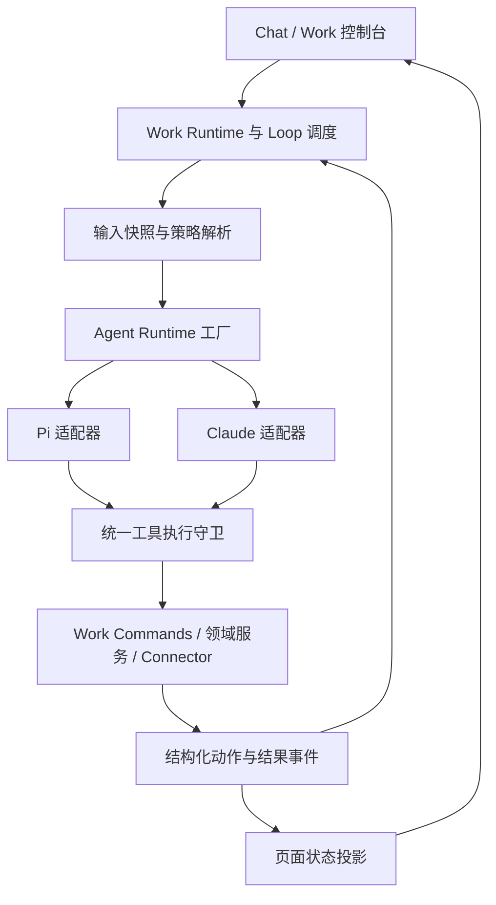

# Pi Agent 执行引擎迁移方案

更新日期：2026-09-13。状态：方案已更新，实施待开始。本文交付迁移设计，未安装 Pi、未切换运行时、未执行模型对照测试。文中的字段、接口、文件和指标如标注“拟议”，均不是已实现能力。

已锁定源码：`a25934656eed295f997ab8cf0d69a516b83fabd9`；GitHub 标签：`snapshot/pre-pi-2026-09-13`；实施分支：`zhiyu-pi`。该提交是源码快照，不是本轮重新完成生产验收的声明，也不包含本机凭证、数据库和生成媒体。当前运行服务继续使用现有引擎。

## 阅读与实施入口

本文是架构总方案，以下文件补充具体实施步骤，阶段编号统一使用 P0—P6：

| 文件 | 用途 |
|---|---|
| [01：执行契约与数据设计](pi-agent-migration/01-runtime-contract.md) | 模块边界、配置解析、事件、会话、工具与恢复契约 |
| [02：分阶段文件修改清单](pi-agent-migration/02-implementation-workbook.md) | 每阶段改哪些文件、交付物、依赖、回测和退出条件 |
| [03：回测与回退手册](pi-agent-migration/03-validation-and-rollback.md) | 测试分层、业务场景、生产验收、故障注入与回退操作 |
| [阶段记录模板](pi-agent-migration/records/template.md) | 每阶段完成后记录实际通过、失败、跳过和遗留事项 |
| [本次方案核对记录](pi-agent-migration/records/2026-09-13-plan-review.md) | 仅文档和源码核对的证据，不代替业务回测 |
| [Pi 官方能力核对](../research/pi-agent-runtime-assessment.md) | 已查证能力、发布版本与仍需实测事项 |

## 1. 控制目标

将 Zhiyu 的智能体执行底座逐步迁移到 `pi-agent-core + pi-ai`，使模型接入、上下文组装、工具执行和事件反馈由项目明确控制。保留现有 Work Runtime、Loop 调度、原始观测、Brain、审批、outbox 和量化服务作为业务权威状态。

迁移目标：

- Work 与 Loop 可选择执行引擎，业务控制逻辑不依赖 Claude SDK 的对象形状。
- 工具可见性、动作审批、租户和角色权限在执行端硬化，`denied` 优先于 `allowed`。
- 每轮运行可追溯输入、配置、工具动作、结果、故障和恢复过程。
- 相同模型下先验证行为兼容，再评估不同模型；不将模型更换的效果归因于框架。
- 逐批切换并保留退出路径，最终减少 Claude 专属适配与维护负担。

第一阶段使用 `pi-agent-core + pi-ai` 嵌入现有服务端执行路径。文件密集型交互任务在 P0 比较 `pi-coding-agent` SDK 的复用收益，P5 只有完成资源加载和工具控制验证后才可采用；不在首批引入第二套会话、插件和工具默认行为。已有 SDK 会话不做跨引擎原样恢复。

本轮范围是桌面 Web 的车间、Loop、Chat 及必要后端链路。`/api/native/agent` 虽名为 native，实际被 Web Chat 调用，属于迁移范围；原生客户端专项与手机端体验继续后置。目标是最终让该范围内的活跃执行入口默认使用 Pi，而不是只安装一个包。完整去除全仓 Claude SDK 是 P6 的独立退出检查，保留入口必须如实登记。

框架迁移不自动更换 LLM，也不更换 DashScope/Wan 视频模型。多智能体协作作为后续增量：本次明确宿主委派契约和权限限制，先验收单智能体等价执行，不将完整角色编排系统设为迁移前置。

依据与优先级：

1. [工程控制论原则](../architecture/engineering-cybernetics-guiding-principles.md)。
2. [控制架构契约](../architecture/zhiyu-control-architecture-contract.md)：Chat 是人工控制台，Work 是长期控制器，Loop 归属 Work。
3. [Work Runtime 收紧方案](work-runtime-tightening-plan.md)。
4. [审查整改台账](2026-09-06-review-remediation/README.md)：复用其身份、事务、外发恢复、后台生命周期契约。
5. [Pi 能力核对笔记](../research/pi-agent-runtime-assessment.md)。

本次能力核对以官方发布版本和对应源码为准，详见能力核对笔记。原 `badlogic/pi-mono` 当前跳转到 `earendil-works/pi`，发布包已使用 `@earendil-works/*`。实施前必须锁定实际依赖、Node 要求和 API；资料核对不等于已在本项目安装验证。

## 2. 被控对象与现状

被控对象是一次 Work/Loop/Chat 执行中的“模型生成 → 工具请求 → 受控执行 → 结果反馈”过程。Pi 的 agent loop 是单次执行内的循环，不接管 Zhiyu 的长期 Loop。

### 2.1 已观察到的接入点

| 位置 | 当前职责与耦合 | 迁移处理 |
|---|---|---|
| `packages/ai/src/agent/types.ts` | 已有 `IAgent`、`AgentMessage`；参数含 Claude 风格权限和 MCP 对象 | 保留公共消息兼容层，新增中立契约；SDK 参数下沉到适配器 |
| `apps/web/lib/ai/extensions/agent/claude/index.ts` | 模型配置、CLI 进程、技能同步、附件、MCP、消息转换 | 保留 Claude 适配器，分批提取可复用逻辑 |
| `apps/web/lib/workshops/executor.ts` | 直接 `createClaudeAgent`，组装上下文、工具和事件 | 改从运行时工厂取得引擎；继续由宿主维护运行状态 |
| `apps/web/lib/loops/native-executor.ts` | 直接 `createClaudeAgent`，连接动作策略、审批和 trace | 使用相同工厂和执行守卫；保留 Loop 验证与续跑语义 |
| `apps/web/lib/workshops/mcp-tools.ts` | 大量业务工具直接通过 Claude SDK `tool()` 定义 | 按工具族抽取中立定义与 handler；不重写业务规则 |
| `apps/web/lib/ai/mcp/tools/*` | Chat/Loop 业务工具以 SDK MCP server 暴露 | 同一中立工具定义分别适配 Claude 与 Pi |
| `apps/web/lib/agent-tools/{types,registry,matrix}.ts` | 已有风险、能力、运行作用域、审核入口 | 复用并补齐执行绑定；避免另造权限目录 |
| `apps/web/lib/ai/runtime/register-plugins.ts` 与 native API | 注册 Claude 插件、暴露交互能力 | 后续接入 Pi，并使能力发现与实际工具一致 |
| `apps/web/lib/cron/executor.ts` | 兼容拒绝桩，执行抛出 `LoopMigrationRequiredError` | 保留拒绝语义，不借迁移重新开放孤立 cron |
| `tools/ai-release-video-agent/src/index.mjs` | 独立导入 Claude SDK | 单独验收，未迁移前不得宣称仓库已完全去除 Claude |

代码处于持续修改中，以上是方案编写时的入口清单。实施 P0 需重新扫描，固定基线提交和未提交变更摘要，不依赖本文行号。

### 2.2 需要先解决的兼容性问题

- `IAgent` 有 `run/plan/execute/stop`，不能只实现 `run` 就在所有入口宣称可用。
- `AgentOptions` 的 `customMcpServers` 目前可携带 SDK 专属对象，不是通用远程 MCP 配置。
- 当前不同执行路径使用不同的 `permissionMode`；Claude 的 `allowedTools` 也不等同于严格工具白名单。迁移不能机械复制这些字段。
- `AgentMessage.done` 只代表输出流结束；运行成功必须由终态和业务验证共同判定。
- 原生工具名、MCP 前缀、前端工具卡、策略中的动作名需统一映射，不能因改名绕过历史禁止规则。

## 3. 观测输入

每次启动通过 Work Runtime 获得不可变的本轮输入快照，至少包含：

- `userId/workId/workVersionId/loopId/runId` 与触发来源。
- 原始观测 `sourceEventIds`、时间窗、采集时间、数据新鲜度和授权范围。
- Brain ContextPack 引用、召回策略版本、证据来源、缺口与降级说明。
- 已解析的工具目录、策略版本、模型配置、上下文预算、运行预算。
- 既有未完成动作、待审批请求、前轮验证结果与需核对的外部结果。

运行前检查来源权限和必需输入。缺失或过期时进入阻塞/降级，不让模型自行假设最新状态。量化新鲜度沿用市场时区与交易日规则；不能按自然日差简单拒绝周末行情。

只读对照使用同一份脱敏观测快照。对有潜在隐式写入的查询先审计：当前接口名称或 HTTP GET 不能单独证明无副作用。影子运行只能使用录制结果或隔离服务，不能把真实工具执行两遍。

## 4. 状态模型

### 4.1 三类状态分开存储

| 状态 | 权威所有者 | Pi 的角色 |
|---|---|---|
| 原始消息、行情证据、文件元数据 | 观测服务 | 只读消费或引用，不能改写事实 |
| Work/Loop、审批、记忆、订单、outbox | 项目领域服务和 Work Runtime | 提交受控请求，不直接更新表 |
| 模型消息、工具调用上下文、压缩摘要 | 运行时会话存储 | 可保存、裁剪和恢复，不能替代业务台账 |

首批 Work/Loop 保持每轮新建执行上下文的思路，从业务状态与 ContextPack 重建输入。会话存储用于同引擎续跑和诊断，不把整个历史不断追加到 prompt。

### 4.2 执行状态契约

以下是拟议的内部执行状态，实施时映射到既有 WorkRun/LoopRun 状态，不直接塞进原字段而不修改读写方：

```text
queued -> running -> succeeded | failed | cancelled | blocked
                  -> waiting_approval -> 新 attempt 重新检查后继续
                  -> reconciling -> succeeded | failed | blocked
```

- 正常结束要求：模型流已结束、工具结果已落地、必需业务验证已通过。
- `waiting_approval` 保存动作意图后释放本次执行资源，不跨进程长时间等待内存 Promise。
- `reconciling` 表示外部动作可能已发生，需要凭回执或查询核对；不能立即重试。
- `cancelled` 只保证不再派发新动作，不承诺撤销已经发送的外部请求。
- `runId` 表示业务运行，`attemptId` 表示一次执行尝试，`actionIntentId` 表示一个逻辑动作；三者不能混用。
- 心跳、租约、fencing token 沿用整改 06/09 的统一实现。Pi 不额外创建调度器或第二把互不关联的锁。

## 5. 控制器与运行时接口

### 5.1 目标结构



图中统一守卫是目标状态。Claude 内置 shell 等工具不能因绘入图中就视为受控：无法逐次经过守卫或有效隔离的工具，在该业务运行配置中必须禁用。

### 5.2 拟议契约

扩展现有抽象，避免把 Pi 类型传播到业务和页面。以下是中立设计示意，不是上游 SDK 的 API：

```ts
type AgentRuntimeKind = "claude" | "pi";

interface ResolvedRuntimeConfig {
  runtime: AgentRuntimeKind;
  sdkVersion: string;
  providerId: string;
  modelId: string;
  credentialRef: string;
  policyVersion: string;
  toolCatalogVersion: string;
}

interface RuntimeCapabilities {
  images: boolean;
  nativePdf: boolean;
  sameRuntimeResume: boolean;
  planning: boolean;
  subagents: boolean;
  externalMcp: boolean;
}
```

`createAgentRuntime()` 在服务端解析配置，返回兼容 `IAgent` 的实例与能力信息。引擎类型、LLM provider、模型 ID 分开，不能把 `provider = pi` 当作模型服务商。凭证只由服务端解析，事件和前端不存 API key、带认证参数的 URL 或完整环境变量。

运行时选择来自版本化 Work 配置。Loop 默认继承所属 Work；显式覆盖必须经过相同的配置审核和能力检查。旧配置缺字段时选择 Claude，并记录配置来源。非法值、无凭证、不支持的能力必须启动前明确失败，不静默改用其他模型。

运行开始即固定配置快照；同一 run 的重试、审批恢复和 worker 接管都不切换引擎。引擎回退仅影响新 run。旧 run 无法继续时先关闭或保留为待核对，再建立带 `supersedesRunId`（拟议）的新 run，继承原动作账本引用；不得把未知动作当作未执行。

### 5.3 消息与生命周期映射

| Pi 事件/控制点 | 项目输出 | 必须满足的行为 |
|---|---|---|
| agent 启动 | `session` + runtime-start 事件 | 保存引擎、版本、attempt 与配置来源 |
| 文本增量 | `text` | 仅追加 delta，不能把累计内容重复追加 |
| 完整工具参数到达 | `onToolUseSeen` / 工具调用准备事件 | 半截 JSON 不参与鉴权或执行 |
| 工具开始/完成 | `tool_use/tool_result` | 使用稳定调用 ID，配对成功、拒绝、异常和取消 |
| 模型 usage | 用量记录 | 原始 token 分类与归一字段并存；未知成本为 null |
| agent 结束/异常 | 终态事件，再结束输出流 | `done` 不覆盖 error，不代表领域验证成功 |

业务副作用前的策略判断和动作登记必须在执行函数内 `await` 完成，不能依赖 UI 订阅回调“恰好先处理”。流式事件只用于观察时，也不能承担唯一审计屏障。

## 6. 控制动作与工具矩阵

### 6.1 中立工具定义

以现有 `AgentToolDescriptor` 和 matrix 为基础增加可执行绑定。工具包含：稳定 `id`、显示名、JSON Schema、服务端校验函数、handler、capabilities、risk、scope、confirmation、effect 类型、超时和并发约束。

工具参数只保留一个业务校验来源。现有 Zod schema 通过适配转换为所选 Pi 版本接受的形式；需验证 optional/default、union、enum、嵌套对象、额外字段和工具结果结构。不能只比较 schema JSON 长得相似。

提取流程：业务 handler/校验 → 中立工具目录 → Claude MCP wrapper / Pi native tool wrapper。内部业务工具优先直接注册给 Pi，不为保留 MCP 形式额外启动本地服务器；已有外部 MCP 使用独立 client bridge，处理连接、授权、超时、取消、重连和资源关闭。

### 6.2 执行动作分类

| 工具族 | 首批迁移策略 | 必需边界 |
|---|---|---|
| 时间、来源列表、授权记忆读取 | 第一批 | 用户身份、Work scope、结果脱敏 |
| 网页/知识检索、行情读取 | 第二批 | 网络目标限制、超时、新鲜度、provider/detail/warning |
| 内部草稿、理解结果、记忆候选 | 第三批 | 来源事件、可追溯、幂等、只写本 Work |
| 记忆晋升、配置与自选股调整 | 按既有控制契约 | 证据校验和对应审核；不能因旧 handler 可直写而继承绕过 |
| 模拟盘订单/撤单 | 第四批 | 当前自选股权限、账户约束、交易规则、动作台账 |
| 微信发送、发布等外部动作 | 最后迁移 | 收件人/目标、审批、回执、未知结果恢复 |
| 文件读写、shell、子智能体 | Chat 专项 | 路径隔离、进程控制、权限继承；无等价能力时保留 Claude |

禁止角色混用：自选股猎手维护候选和调整提案；操盘交易员仅消费获准的当前自选股执行模拟交易。全局 prompt 和技能不能扩大角色工具集。

工具名采用稳定业务 ID，单独维护 Claude MCP 前缀与 Pi 名称的别名映射。先规范化名称再匹配策略，策略不能因前缀、大小写或别名改变而漏判。未知工具默认不注册且拒绝执行。

### 6.3 并发规则

本次核对的 Pi 0.85.1 支持并行工具执行且默认并行，依据见发布版能力笔记。首批明确选择串行，保证基线容易比较；后续只为独立只读工具开启受限并行。写操作仍需业务资源锁与幂等，串行模式本身不能解决多 run 并发和进程重启。

读账户后下单、创建草稿后外发等依赖动作不能放进无依赖顺序保障的并行批次。审批阻塞或预算耗尽后停止新派发；已经开始的请求进入取消/核对路径。

## 7. 边界与审核

### 7.1 每次工具执行的强制路径

```text
参数解析与校验
 -> 服务端身份、目标 Work 和配置版本校验
 -> 工具可见性、角色、记忆域、资源 scope 检查
 -> denied 优先；检查 requiresApproval；默认拒绝未知权限
 -> 观测新鲜度、运行预算、取消状态、租约有效性检查
 -> 持久化动作意图与幂等认领
 -> 再检查可执行条件，调用领域服务
 -> 持久化结果/回执与审计事件
 -> 返回模型可消费结果
```

可见工具集是第一层边界，执行守卫是第二层。模型传入的 `userId`、`workshopId`、权限字段不能取代宿主身份；模型、prompt、工具返回文本和插件不能批准自身动作。策略变更后按当前权限复核，收紧立即生效；旧版本审批不能扩大新版本权限。

不能只把 `canUseTool` 换成 Pi hook。两种引擎都应调用相同的执行守卫，SDK hook 作为额外接入点。对 Claude 自动批准工具及内置工具的覆盖需单独验证。[Claude 权限语义](https://code.claude.com/docs/en/agent-sdk/permissions)

当前 `work-runtime/execution-guard.ts` 主要检查取消和租约，不是完整的工具授权器。`workshops/mcp-tools.ts` 的公共 handler wrapper 另有 owner、边界变更与工具权限检查；提取工具时必须保留。P1 即需要只读工具的完整授权检查，不能等到 P2 才鉴权。名称为“草稿”的工具也可能自动发送，按最终副作用分类。

### 7.2 审批与恢复

复用 `loops/approval*.ts`、Work review 和 outbox 审核入口。待审批记录绑定：动作意图 ID、规范化参数 hash、目标资源、Work/policy 版本、证据引用、有效期和申请来源。

批准后由宿主认领原动作，重新检查身份、权限、租约、输入新鲜度和动作是否已完成，再按原参数执行。参数变化、新目标、新策略风险或证据过期要求重新审核。模型不得凭“用户已同意”的文字再次生成一个未绑定的外发动作。

同一 Pi 会话仍可用时可恢复上下文；会话丢失则以审批记录、动作结果和业务快照启动新 attempt。执行原动作后的结果只反馈给模型做后续推理，不让模型再执行一次原动作。

新动作派发要求有效租约，但宿主记录既有动作的晚到回执不要求原 producer 继续持租。沿用 `settleOutboxAttempt()` 的核对语义：核验 owner/attempt/回执关联后仅更新旧动作结果，不授权重发。回退期间仍需保留宿主核对模块。

### 7.3 shell、扩展和文件访问

业务 Work 首批不开放通用 shell，不自动加载用户目录中的 Pi 扩展，也不依赖运行目录作为安全沙箱。读取文件需验证真实路径、符号链接/Windows junction 和允许根目录；写入必须经过受控文件工具。需要执行不可信代码时复用项目 sandbox/worker 边界，否则此能力不可用。

技能由现有加载器按批准范围提供，记录技能版本。技能可贡献说明和资源引用，不能自行加载高权限执行代码。Pi 的可扩展性不等于已具备操作系统隔离。[Pi Coding Agent 说明](https://github.com/earendil-works/pi/blob/main/packages/coding-agent/README.md)

## 8. 反馈与评价

每次运行记录输入快照、工具授权决策、动作结果、模型用量、领域验证结果和用户修正。反馈进入现有 Work/Harness 评估系统；不把模型自述“完成了”当成完成证据。

先比较同模型、同输入、同工具，再单独比较其他 provider/model。记录不同提示词、压缩策略和 SDK 版本产生的差异；无法控制的因素写入结论限制。

拟议首轮验收门槛：

| 指标 | 门槛/处理 |
|---|---|
| 越权、绕过审批、重复副作用 | 所有确定性故障用例为 0；出现一次即阻断该类写操作切换 |
| 工具调用与结果、run 终态 | 故障矩阵中 100% 可配对/可解释，不存在静默成功 |
| 任务正确性 | 固定 30 个代表案例，每引擎各 3 次；记录原始成功数。初始容忍差为成功率下降不超过 5 个百分点，样本不足不作推广结论 |
| 性能 | 同设备/网络分冷暖启动记录 p50/p95；初始要求 p95 完整任务时延不高于 Claude 基线 20%，否则说明原因并暂停扩量 |
| 成本 | 记录真实 usage 与计价版本；成本缺失不按 0。首批不以降本作为安全验收替代项 |
| 恢复与可观测性 | 审批、崩溃、失租、取消、未知外发都有明确状态、责任模块和用户入口 |

这些是实施时的目标，不是当前测量结果。样例文本质量由事先定义的业务验收规则判断；评审有争议时保留证据并人工复核。

## 9. 异常、扰动、降级和回退

| 故障 | 处理规则 |
|---|---|
| 模型 429/网络超时 | 有上限退避，统一在宿主记录 attempt；避免 Pi 与宿主嵌套重试造成倍增 |
| 不支持模型/附件/schema | 启动前能力检查失败；明确列出不支持项 |
| 工具结果截断 | 原始结果受控存储，返回摘要和引用并标注截断；不能让摘要丢掉降级警告 |
| 数据源过期或降级 | 保留 provider/detail/warning，按领域策略阻塞相关动作 |
| 进程崩溃/失租 | 新 worker 用统一认领规则恢复；旧 worker 不再派发写动作；在途请求核对结果 |
| 审计或动作登记写入失败 | 停止新副作用；已发出但无法记账的动作进入核对，不能显示成功 |
| 外发超时但可能已送达 | 标记未知结果，查询回执或人工核对，禁止自动换引擎重发 |
| 用户取消 | 传播 AbortSignal，停止新调用、关闭流和连接；已产生副作用保留事实 |
| API key 失效 | 明确认证错误并阻塞，不从其他用户或本机隐式凭证回退 |

### 9.1 回退流程

1. 暂停目标 Work 的新运行，记录回退原因和当前配置版本。
2. 等在途 run 结束或取消；核对已认领、已发送、未知结果动作和待审批请求。
3. 保留新的业务台账、事件和会话引用。只切换引擎配置，不回滚领域数据或数据库 schema。
4. 通过版本化配置将后续运行切回仍兼容新执行守卫的 Claude 适配器。
5. 用只读检查验证状态投影、下次唤醒和动作去重，再恢复调度。

不恢复旧写入逻辑来绕过新增 guard。外部消息与发布不能承诺撤销；纠错只能按对应领域支持的补偿操作并重新授权。已有 Pi transcript 保留为历史，不交给 Claude 原样 resume。

冻结标签是源码恢复点，不是新增 schema 后可直接部署的兼容回退包。灰度前需准备能够读写新快照格式和既有业务台账的 Claude 兼容构建，并演练恢复。禁止用 `git reset --hard` 或恢复旧数据库来实现运行引擎回退。

## 10. 页面可观测性与人工接管

沿用 Work 页面与审批面板，页面读取 projection/snapshot，不直接订阅 Pi 内部状态作为事实。新增必要信息：

- 正常视图：当前运行/等待审核/核对中/失败/已暂停，最近运行、下次唤醒、心跳及可执行的下一步。
- 调试详情：执行引擎、SDK 版本、provider/model、attempt、输入快照、工具目录版本、降级和用量。
- 审核卡：具体动作、目标、参数摘要、证据、风险、有效期及当前策略是否仍允许。
- 故障卡：失败阶段、是否已发生副作用、能否安全重试、核对入口。
- 控制入口：暂停后续运行、取消当前运行、审批/拒绝、纠正输入、受审配置切换。

浏览器断开不等于后台 Work 被取消；Chat 的断线策略由交互入口明确决定。后台运行归属整改 09 的生命周期实现，不能把 Pi 长任务绑定到前台 SSE 存活。

## 11. 数据模型与代码落点

### 11.1 拟议运行记录

复用 `workshopRuns`、`loopRuns`、`loopStates`、审批与事件表，以及现有 `work_harness_snapshots` / `RunEvidenceBundle`。先补齐实际执行配置与快照一致性、hash/缓存身份和格式版本，再判断是否需要最小 attempt 关联记录，不建立 Pi 专属业务权威表。唯一性和并发约束所需字段必须使用可索引列，不能仅埋在 JSON。

| 记录 | 拟议信息 | 约束 |
|---|---|---|
| Runtime config snapshot | runtime、sdkVersion、provider、model、policyVersion、toolCatalogVersion、预算 | 同一 run 的所有 attempt 固定；无凭证明文 |
| Execution attempt | attemptId、runId、序号、状态、时间、终止原因、会话引用 | 同一 run 的序号唯一，关联唯一业务 owner |
| Action intent/receipt | actionIntentId、规范化工具 ID、输入 hash、dedupeKey、审批引用、结果/回执 | 复用统一动作台账；认领需事务/CAS；不能一套 Pi 一套 Claude |
| Runtime event envelope | eventId、attemptId、sequence、toolCallId、sourceEventIds、payloadRef | 序号可恢复、事件可去重、权限继承业务对象 |
| Session checkpoint | runtime/格式版本、模型、消息引用、未完成调用、压缩来源 | 只用于上下文恢复，必须先核对业务动作 |

`dedupeKey` 基于业务动作身份与版本生成，在安全重试中保持不变；不能只用 provider 的 toolCallId、随机 attemptId 或参数 hash。合法的两笔相同数量委托需要不同业务动作 ID；同一动作的重试必须复用 ID。外部服务不支持幂等且无法核对时，不宣称 exactly-once。

观测、模型输出、动作意图和执行结果分别记录。敏感输入按现有授权与保留策略存储，普通日志只放脱敏摘要和引用；不存隐藏思维链作为审计依据。

### 11.2 存储迁移规则

- 按现有支持矩阵维护 schema、迁移和真实存储测试：使用 PostgreSQL 的车间路径必须用 PostgreSQL 验证；两种后端共有结构同时维护。SQLite 不支持的路径继续明确拒绝，不借迁移扩张平台支持范围。
- 先新增兼容字段/记录，再写入、核对和切读；不为 SDK 会话另建业务数据库。
- 老历史无法确认 runtime/version 时标记 unknown 或 legacy-unverified，不把历史版本猜写成当前版本。
- 备份、迁移批号、回填数量与失败清单入记录；支持新数据后的旧版本程序不得直接恢复写入。
- 使用 Pi 会话后端前确认其版本和存储特性；必要时只把它用于 transcript，并保持业务数据所有权独立。[Pi 核心会话说明](https://github.com/earendil-works/pi/blob/main/packages/agent/README.md)

### 11.3 建议文件修改顺序

以下新增路径为拟议；发现等价模块时扩展现有实现：

1. `packages/ai/src/agent/types.ts`：中立配置、能力与终态契约，保留兼容层。
2. `apps/web/lib/agent-tools/types.ts` 与工具注册目录：补齐 handler、schema、effect 与别名映射。
3. `apps/web/lib/ai/runtime/agent-factory.ts`：解析配置、能力预检、固定运行快照。
4. `apps/web/lib/ai/extensions/agent/pi/{index,event-mapper,model-config}.ts`：Pi 核心适配，延迟加载服务端依赖。
5. `apps/web/lib/ai/runtime/tool-executor.ts`：适配统一身份、策略和动作执行服务；不复制整改包的事务实现。
6. `apps/web/lib/workshops/mcp-tools.ts` 与 `apps/web/lib/ai/mcp/tools/*`：按工具族提取，共享两个 wrapper。
7. `apps/web/lib/workshops/executor.ts`、`apps/web/lib/loops/native-executor.ts`：改用工厂和一致事件，不改变业务完成定义。
8. Work Runtime 配置命令、schema、页面 projection：版本化切换、审计、诊断信息。
9. plugin 注册、native agent/providers/password API、技能/附件/会话路径：Chat 专项迁移。
10. cron、独立视频工具与残留 SDK 引用：逐一登记、迁移或明确保留。

## 12. 测试与验收

确定性故障测试只用隔离数据库、临时账号/目录和伪模型/微信/行情/交易 adapter；真实模型验证另用有预算的隔离运行。未配置测试依赖时快速失败，不能退回日常服务。当前 `apps/web/package.json` 的 `build` 不执行数据库迁移，只有 `build:with-migrations` 显式先迁移；验收默认纯构建，迁移脚本单独连接隔离数据库。构建与验收使用独立产物目录，避免覆盖正在运行的产物。

| 编号 | 场景 | 必测结果 |
|---|---|---|
| PI-01 | 同时存在 allowed/denied；MCP 别名；未知工具 | denied 优先、规范化一致，handler 未执行 |
| PI-02 | 假造身份、跨 Work 记忆写、Chat 越权 | 服务端身份为准，目标契约拒绝，记录原因 |
| PI-03 | 半截参数、多段文本、乱序工具完成 | 无半截执行、无重复文字，调用结果配对 |
| PI-04 | 必需数据缺失、降级、周末行情 | 显式质量状态，按交易日和领域策略判断 |
| PI-05 | 审批批准/拒绝/过期/参数改变/策略收紧 | 原动作绑定，必要时重审，不重复执行 |
| PI-06 | 执行前崩溃、执行后落库前崩溃、失租 | 真实存储/独立进程恢复；已完成不重做，未知结果核对 |
| PI-07 | 取消与工具启动竞争、浏览器断开 | 停止后续派发，后台归属正确，在途结果可解释 |
| PI-08 | 两 worker 同时认领、同意图多次恢复 | 事务保障唯一执行资格，重复请求返回既有结果 |
| PI-09 | 超时但外发成功、回执晚到 | 进入核对，晚到回执可关联，不自动重发 |
| PI-10 | 模型失败、工具失败、数据库失败、空结果 | error/终态一致，不能因收到 done 标成成功 |
| PI-11 | 重试预算、token 预算、工具数限制、上下文压缩 | 有限终止，重试不倍增，证据引用可追溯 |
| PI-12 | Windows 路径、junction、中文、文件写入 | 无越界，中文往返正确，取消清理有效 |
| PI-13 | 会话重启、损坏、不兼容版本、跨引擎切换 | 明确阻塞或重建，不错误 resume、不重复动作 |
| PI-14 | 同模型固定案例对照 | 保存原始统计、错误分类与产物，满足第 8 节门槛 |
| PI-15 | 灰度、回退、待审批动作、未完成 run | 配置版本清楚，旧动作保留，新 run 才切换 |
| PI-16 | Chat plan/execute、图片/PDF、用户提问、外部 MCP | 有等价行为或能力预检阻止；不支持不能静默丢弃 |

复用并扩展现有 `loop-approval*`、`workshop-boundary-loop-policy`、`workshop-outbox-boundary`、`agent-runtime-error` 等测试。确定性逻辑使用伪模型；并发、唯一性、重启必须用真实临时 SQLite/PostgreSQL 与独立进程，不能仅靠 mock。

每个实施批次记录：基线提交、SDK 精确版本、命令、测试环境、通过/失败/跳过、故障证据、性能样本及遗留项。类型检查、相关测试、隔离构建和必要页面检查均通过后才标为已验收。本文仅做文档检查，不执行这些业务验收。

## 13. 分阶段落地计划

### P0：固定基线与依赖决策

交付：当前 SDK 引用清单、锁定版本的 Pi 能力矩阵、测试数据集、基线运行证据及整改依赖状态。

核对 Pi 发布包与 license、Node/ESM、Windows、服务端打包、provider 接入方式。以已安装版本实测工具钩子、取消、事件、schema 与持久化；不支持预期 API 时在本阶段调整适配策略。确认业务工具每类最小代表集，标注可疑“只读”接口。

退出条件：依赖能在隔离目录安装和运行；基线失败与迁移新增失败可区分。阶段不修改默认引擎。

### P1：中立契约与只读 Pi 适配器

交付：工厂、能力声明、事件映射、最小只读工具目录和同源 Claude wrapper；现有调用保持默认 Claude。

在固定快照上验证 Pi 的文本、工具、usage、取消和失败语义。只迁移一个低风险 Work 的只读分析路径，不开放真实写入。P1 不以所有工具重构完成为前提。

退出条件：PI-01/02/03/04/07/10/11 基础用例通过，读路径对照可重复，生产未切换。

### P2：统一动作守卫与持久化恢复

交付：两个引擎共用的执行守卫、身份/别名处理、动作台账适配、审批续跑、运行事件与状态投影。

依赖整改 01 测试隔离、05 身份边界、06 命令/Loop/事件事务的相关契约验收。按照既有审批路径落实参数绑定和恢复，不另建 Pi 专属审批表。先用隔离内部写入验证，再逐步开放草稿与有审计的候选状态。

退出条件：PI-01—08、10—13 对本阶段工具全部通过；普通 Work 与 Loop 的等价工具执行边界一致。

### P3：只读 Work 与内部写入灰度

交付：按 Work ID 的确定性选择、版本化切换入口、运行详情、暂停与回退演练。

顺序：录制输入对照 → 指定一个 Work → 扩大到多个已验收 Work。每批至少观察一个完整业务周期；有交易日约束的任务不能只跑周末就验收。运行使用独立背景生命周期前需满足整改 09 对应门槛。

退出条件：PI-14/15 通过，第 8 节指标达标，所有失败有分类和状态；出现越权、重复副作用或静默成功立即停止扩量。

### P4：模拟盘与外发工具

交付：模拟订单、outbox 和发布工具的 Pi 绑定及真实存储故障验收。

模拟盘依赖整改 03/08 的数据质量与账户事务；外发依赖整改 07 的未知结果恢复。只连接隔离模拟环境验收故障，不向真实联系人制造重复发送。各工具族独立放行，未满足依赖的工具继续停留在既有引擎或不可用状态；已有缺陷不能靠保留 Claude 视为安全。

退出条件：PI-05/06/08/09/15 全部通过，角色边界与领域服务规则不变，未知外发恢复演练有证据。

### P5：Chat 与剩余执行入口迁移

交付：交互提问、plan/execute、技能、附件、文件工具、外部 MCP、会话和前端工具卡的能力清单与迁移结果。

对 Pi 核心未覆盖的能力逐项选择：宿主实现、引入受控的 coding-agent SDK，或暂时保留 Claude。原生 PDF 不支持时可使用经验证的文本提取并显式提示信息损失；不能假装与原生多模态等价。子智能体如需实现，继承父级权限上限、预算和审计归属，不能自行加载更多工具。

退出条件：PI-16 与相关回归通过；native API、cron 和独立工具的状态全部登记，无“界面可选但运行不支持”的能力。

### P6：默认切换与 Claude 退役

交付：新建 Work 默认 Pi，保留有限期兼容配置；完成全仓 SDK 引用审计后再判断是否删除依赖。

删除前逐项确认：所有在用入口完成迁移或已下线；无待恢复 Claude run；旧会话仍可查看；没有业务 handler 依赖 SDK 类型；支持矩阵和部署产物通过验收；回退窗口关闭有明确记录。保留原始历史和审计数据。

不因包安装成功或单个 Work 跑通就删除 Claude。无需长期支持的兼容层在退役时移除，避免双引擎永久维护。

### 实施台账

| 阶段 | 当前状态 | 验收记录 |
|---|---|---|
| P0 基线与版本 | 源码快照已完成；依赖试装、运行基线待实施 | 本次方案核对记录 |
| P1 只读适配 | 待实施 | — |
| P2 守卫与恢复 | 待实施 | — |
| P3 低风险灰度 | 待实施 | — |
| P4 模拟盘与外发 | 待实施 | — |
| P5 Chat 与剩余入口 | 待实施 | — |
| P6 默认切换与退役 | 待实施 | — |

建议首个实施批次只完成 P0 + P1 的一个代表 Work。以可复现的只读闭环证明适配成立，再逐步开放控制动作；整体工期在 P0 清单和发布版本验证后估算。

## 14. 一手资料

- [Pi agent core](https://github.com/earendil-works/pi/blob/main/packages/agent/README.md)：事件、工具钩子、上下文转换、取消与执行模式。
- [Pi AI](https://github.com/earendil-works/pi/blob/main/packages/ai/README.md)：模型服务商、消息和工具协议。
- [Pi Coding Agent SDK](https://github.com/earendil-works/pi/blob/main/packages/coding-agent/docs/sdk.md)：可选会话、资源和工具能力。
- [Pi Coding Agent](https://github.com/earendil-works/pi/blob/main/packages/coding-agent/README.md)：内置能力边界与扩展方式。
- [Claude Agent SDK](https://code.claude.com/docs/en/agent-sdk/overview)、[权限](https://code.claude.com/docs/en/agent-sdk/permissions)：现有集成行为与兼容核对。

资料用于能力依据；本文的状态、接口、测试门槛和阶段安排是针对 Zhiyu 的设计建议。实施记录应补充锁定版本或提交的永久链接。
