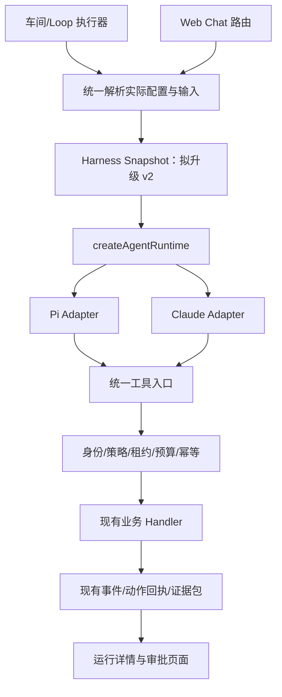

# Pi 迁移：执行契约与数据设计

日期：2026-09-13。基线：`a259346`，分支：`zhiyu-pi`。本文全部新增接口和字段均为拟议设计，未安装或运行 Pi。

上位约束：[总方案](../pi-agent-migration-plan.md)、[控制架构契约](../../architecture/zhiyu-control-architecture-contract.md)、[工程原则](../../architecture/engineering-cybernetics-guiding-principles.md)。

## 1. 技术选择

| 选择 | 决定 | 原因及代价 |
|---|---|---|
| Work / Loop 引擎 | 优先嵌入 Pi agent core + Pi AI | 宿主已有长期状态与工具，只替换单轮模型/工具循环；需自行维护上下文裁剪、恢复和工具桥接 |
| Web Chat | 复用同一中立接口；P0 对比 core 与 coding SDK，P5 确定实现 | 当前 Chat 有文件、技能、附件、plan/execute，不能因 Work 跑通就宣称等价 |
| Claude | 保留为阶段性 Adapter | 对照与兼容回退使用；在用入口迁完后再退役 |
| 视频生成 | 保留现有视频服务与 Wan API | 视频模型是业务工具后端，不是 agent loop；独立视频脚本中 Claude 文本规划调用另行替换 |
| 多智能体 | 预留宿主委派契约，迁移后单独验收 | 引擎替换不同时扩大任务并行度和工具权限 |

Pi 版本与 API 依据见[发布版本核对](../../research/pi-agent-runtime-assessment.md)。依赖必须精确锁版且记录 integrity。不要同时安装旧、新命名空间来掩盖导入差异。当前本机 Node `v24.14.1`，根配置最低 `>=22.0.0`，P0 必须验证并收紧到所选 Pi 发布版的要求，覆盖 CI、worker、生产及打包运行时。

## 2. 模块与替换位置

把执行接口放在现有 `packages/ai/src/agent/`；业务配置解析、鉴权、工具绑定继续在服务端。该位置是让 Claude 与 Pi 两个 Adapter 变化、让调用方稳定的 seam，不另造一层全量透传 SDK 参数的壳。



不改变现有 Work 与 Loop 的调度归属，不把每个 Pi 实例注册成新车间。后台运行仍归 managed worker；Web 断开不终止长期任务。Chat 的断连和取消按既有交互行为单独验证。

### 2.1 小接口，宿主控制生命周期

拟议运行请求只承载必要信息：

```ts
type RuntimeRequest = {
  execution: {
    userId: string;
    workId?: string;
    loopId?: string;
    runId: string;
    attemptId: string;
    runtimeSnapshotId: string;
  };
  input: RuntimeInput;       // 中立消息、证据引用、已批准的资源
  tools: BoundToolCatalog;   // 已绑定宿主身份；不是模型传入的权限
  limits: RunBudget;
  signal: AbortSignal;
};

interface AgentRuntime {
  capabilities: RuntimeCapabilities;
  run(request: RuntimeRequest): AsyncIterable<RuntimeEvent>;
  close(): Promise<void>;
}
```

实施时先给旧 `IAgent` 提供兼容 Adapter，不一次重写所有调用者。`plan/execute/getPlan/deletePlan/stop` 的既有调用语义需要测试；Pi 暂未实现的能力应在启动前返回明确不支持，不能把 `plan()` 偷换成有写工具的普通 `run()`。外部停止由 signal 驱动，旧 `stop(sessionId)` 映射到宿主运行登记；关闭要释放订阅、模型流和 MCP 连接。

### 2.2 引擎、模型、凭证分别解析

当前 `AgentConfig.provider` 是执行框架概念，`resolveAgentModelConfig()` 则处理用户模型、tier 和环境回退。迁移后增加独立 `runtimeKind`，不要把 `pi` 写进模型服务商枚举。

拟议解析输出：`runtimeKind / sdkVersion / transportApi / providerId / modelId / reasoning / effectiveContextLimit / credentialRef / source / toolCatalogHash / policyVersion / skillsHash / contextPolicyVersion`。API key 仅在内存中按用户凭证引用解析，不能写入上述快照；不得从另一用户或隐式本机 Pi 登录态取凭证。

引擎从目标 Work 的已批准配置解析，Loop 默认继承；若实现显式覆盖，必须经过相同审核。模型配置先保持现有 `model-policy.ts` 的 tier 环境配置 → 用户配置 → 环境默认 → fallback 顺序，避免迁移时暗改模型选择。配置来源与各字段实际解析结果入快照。缺失引擎配置在迁移期仍解析为 Claude；显式无效值直接失败。后台全局开关只禁用 Pi 新认领，不把运行中的任务静默路由到 Claude。

同一业务 run 的所有 attempt 固定运行快照。模型/provider 无法使用时失败或等待处理；若需换引擎，另建有来源关联的新 run。凭证可由同一授权引用轮换，但不能借此替换服务商或扩大访问范围。

## 3. 复用现有 Harness 与运行数据

当前已经有 `work_harness_snapshots`、`WorkHarnessSnapshot`、`RunEvidenceBundle` 和捕获逻辑，不能再创建一套平行的“Pi 配置权威表”。

| 现有位置 | 当前情况 | 拟议修改 |
|---|---|---|
| `lib/harness-evolution/types.ts` | `modelRuntime` 主要记录 provider/model/reasoning | 版本化到 v2，增加实际引擎/SDK/工具与上下文配置引用 |
| `lib/harness-evolution/resolve.ts` | 从 `workshop.modelConfig` 构造运行描述 | 改为接收与 executor 共用的实际解析结果，避免与用户/tier/env 回退后的实际模型不一致 |
| `lib/harness-evolution/snapshot.ts` | component hash 不包含完整运行契约 | 保留原 componentSetHash 含义，新增 runtimeContractHash，快照复用条件同时匹配二者 |
| `lib/harness-evolution/repository.ts` | 已有快照和证据持久化 | 增量支持 v1 只读/v2 新写；补索引或约束前核对实际表结构 |
| `lib/work-runtime/run-plan.ts`、`run-output.ts` | 规划和结果 checkpoint | 引用 runtimeSnapshotId；不重复存完整业务事实 |
| `lib/work-runtime/loop-execution.ts` | 读取已保存结果并避免重新进入模型 | 保留优先重放结果的路径，不能换框架后重跑完成动作 |
| `lib/work-runtime/run-completion.ts` | 完成回执、状态和事件事务收口 | 继续作为 Work 终态写入权威，Adapter 无权自行写 completed |

实施前确认具体字段落点，不提前占数据库迁移序号。若现有数据结构不能表达 attempt 归属，允许新增最小运行尝试记录：`runId + attemptId + runtimeSnapshotId + workerId + fencingToken + status + startedAt + endedAt + transcriptRef + usage + errorCode`；它仅表示执行尝试，不建立第二套 Work/Loop 状态机。

历史快照缺字段标为 `legacy/unknown`，不要把推测的 SDK 版本补成事实。旧 hash 不批量重写；新的 hash 含 schemaVersion，防止旧、新结构误复用。

### 3.1 状态映射

以下是目标映射原则，现有状态枚举保持兼容，必要的细分原因写入已有 metadata/错误码，不随意增加数据库 status 字符串。

| 执行事实 | Work 完成入口/页面行为 |
|---|---|
| 正常输出，领域验证通过 | 通过既有完成事务写 `completed` |
| 模型或工具失败，无未知副作用 | `failed`，显示阶段及可恢复原因 |
| 用户取消且无在途不明动作 | `cancelled`；先停止派发再关闭资源 |
| 已有副作用，结果无法确认 | 沿用 `needs_review`、外发/模拟盘核对流程 |
| 需要业务审批 | 保留原审批状态与关联动作；页面跳到既有审核入口 |
| 模型流结束 | 仅结束传输，不能直接认定业务成功 |

注意 `finalizeWorkshopRun()` 已对 `effect_started` 后的非完成结果收紧为 `needs_review`。新适配器不能用“取消了”覆盖该规则。

## 4. 工具执行闭环

现有工具元数据与执行实现分离：`AgentToolDescriptor` 主要是目录，不是完整授权执行器。拟新增 binding 连接稳定工具 ID、服务端 schema、handler、允许目标、effect 分类和回执协议。

每次执行必须依次：

1. 收到完整参数后规范化工具别名，参数校验；禁止执行流式半截 JSON。
2. 从宿主取得身份、Work scope、版本、租约，重新计算当前可执行策略；先 denied，再审批，再 allowed。
3. 核对预算、取消和证据新鲜度；登记逻辑动作与幂等键。
4. 在领域写入处再次验证 fencing 和目标约束，再调用业务 handler。
5. 落结果/回执，反馈给模型和页面；结果未知进入核对。

`toolCallId` 用于模型请求配对，`actionIntentId` 用于业务幂等，两者不同。不要仅用参数 hash 当全局幂等键，否则两次合法相同订单会被错误合并；也不能每次模型重试都换动作 ID。宿主按业务命令、来源及已接受意图分配/复用稳定 ID。

工具声明可以转换成 Pi 接受的 schema，但执行时继续跑原业务校验，特别验证默认值、额外字段、枚举、联合类型和扩展改写后的参数。SDK hook 用于适配，不是唯一权限屏障。

### 4.1 不按名字猜副作用

`workshopCreateOutboxDraft` 当前可能调用 `autoSendWorkshopOutboxIfWhitelisted`。这类工具在 P3 不能因名为 draft 就视为纯内部写入：必须拆出无发送路径并测试，或整个工具留到 P4。同理，查询可触发缓存写、采集或任务启动，要逐项记录 effect 范围。

P1 对照仅允许固定快照/隔离数据上的只读工具和运行审计；不能触发真实业务写入。P4 的付费视频生成也按外部动作管理：提交前保存意图，拿到 provider taskId 后轮询同一任务。提交超时且拿不到 taskId 时，若 provider 无幂等/查重能力，标为待核对，不能自动再生成并假设只计费一次。

### 4.2 中立工具与外部 MCP

内部工具从现有 `tool()` 封装抽出 handler 与 schema，Claude 包装为 MCP tool，Pi 包装为 native tool，二者共用领域逻辑。不要把 Claude `SdkMcpServer` 对象强转后传给 Pi。

外部 MCP 使用现有 `@modelcontextprotocol/sdk` 做独立连接 Adapter：名称规范化、用户身份、工具发现、资源关闭、stdio/HTTP 超时和断连恢复。动态发现的新工具默认无权执行；重复名称拒绝或显式命名空间化。无论 external MCP、shell 还是 Skill 资源，都经过同一权限模型。

默认不开通用 shell、不自动加载 `.pi/extensions` 或用户插件。cwd 只是路径，不是沙箱；所有文件访问解析 realpath 并防 junction 越界。Windows 子进程隐藏窗口，取消时清理进程树但不杀共享服务。

## 5. 上下文、会话和事件

Work/Loop：从原始事件引用、当前业务状态和 Brain ContextPack 重建每轮输入。Brain 召回、新鲜度、召回反馈继续沿用现有链路，不因 Pi 支持更多上下文就全量塞入历史。

Chat：保留历史可读；原 Claude resume ID（若存在）只属于 Claude。当前实现主要通过 conversation/summary 重建输入，未发现 `run()` 配置 SDK resume，不能预设原有完整 SDK 恢复能力。切 Pi 时显示一次“执行引擎已变更，本轮从历史摘要和附件引用继续”，摘要带来源与生成策略版本。未完成工具调用必须先由宿主处理，不能将半截对话硬转为 Pi 消息。

当前 BaseAgent 的计划保存在实例 Map，而 Chat 路由每请求新建实例；跨请求 plan → execute 的可靠性需要 P0 复现。若确认问题，登记基线缺陷并在 P5 完成受控计划存储与 owner/版本绑定，不把旧故障算作 Pi 新增问题，也不以“保持旧行为”为由交付计划丢失。

压缩保留：当前目标、已批准边界、待审核/待核对动作、必要事实、证据引用和最近工具配对。完整原始输出受控存储，摘要不能覆盖原件。实现明确 token/context 预算，不能只依靠工具次数上限；重试与压缩成本也计入总预算。

| 中立事件 | 含义与约束 |
|---|---|
| runtime_started | 含 snapshotId、实际引擎与版本，不能含密钥 |
| text_delta | 仅增量文本；断线重读事件时按 seq 去重 |
| tool_prepared / tool_started | 参数完整并经授权后才有 started |
| tool_result | 与调用 ID 配对；保留 isError、降级说明和 artifactRef |
| usage | 模型返回的原始分类和归一统计；未知价格为 null |
| runtime_failed / runtime_cancelled / runtime_finished | 区分结束原因；领域终态另由宿主验证 |

为已有 `AgentMessage`、前端 SSE 和工具卡提供映射，先保持 UI 行为一致再增加引擎展示。消费方断开不能使审计丢失；事件队列需有容量上限，背压/溢出规则由宿主处理，禁止无限缓存文本。

## 6. 多智能体的后续接口

本次可给运行上下文预留 `parentRunId / childTaskId / delegatedRoleVersion` 的可选引用，但不默认建表或开放 subagent 工具。P1—P6 的“等价迁移”不包含未经验证的新增团队编排；旧 Task 功能若在用，P5 必须实现等价或显式保持该入口 Claude，不能静默消失。

后续协作需要宿主实现：角色定义/临时任务、子任务持久化、父子预算、取消传播、产物引用和页面进度。子权限取父权限、角色权限、任务限制的交集，且每次调用再检查最新拒绝策略。父 run 失租后整个子树停止新动作；子任务不能直接修改父 run 终态。

官方 subagent 扩展示例用于理解委派流程，不直接当业务执行器部署。独立上下文不等于数据库隔离、操作系统隔离或可靠恢复。

## 7. 本文件验收入口

P0 核实版本与实际模型解析；P1 验证事件及只读调用；P2 验证快照、权限和恢复；P5 验证 Chat 能力。每个契约通过可控输入从公共接口验证，不能只测 SDK wrapper 被调用。具体故障矩阵见[回测手册](03-validation-and-rollback.md)。
