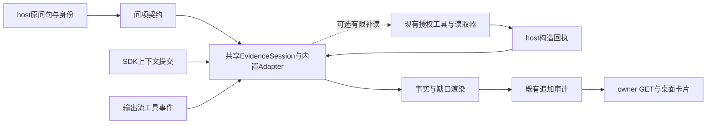

# 平台证据问答改进技术方案

日期：2026-10-04（中国时区）。当前状态：正式7.5的1948登记源码及生产review39保持。C82v4私有候选修正真实native顶层record/timeline的消费解析，原66测试文件和1243断言逐字保留；root当前完整67文件1260项及Web类型均实际通过。非作者重新执行80原CI、27原SDK和17新formatter SDK全close0，新17同属新增CI，不重复加总。此前真实native HTTP200但修复事实0的失败与清理、旧模型四凭证精确删除和永久hold原件保持。当前v4真实native/desktop/onFinish、新匹配24正文、生产构建装载重启及原100题200首答尚待执行。第53节为最新记录。

本方案承接[证据闭环原方案](D:/zhiyu/docs/plans/platform-evidence-control-technical-plan-2026-10-02.md:1)与[研究分析](D:/zhiyu/docs/research/platform-evidence-answering-research-2026-10-03.md:1)，落实原 I5 读取与 I3 最终展示的后续改进。范围为桌面 Web 的只读平台问答及必要后端，不扩展车间权限、手机端或原生客户端。

## 1. 推荐方案与控制目标

扩展现有回合级 **AnswerEvidenceSession Module**，加入平台只读契约，在现有审计、工具与流式链路中完成：

```text
可信原问句 → 必要问项 → 定向读取 → 字段交付回执
→ 作用域/业务语义判定 → 已知事实与逐项缺口 → 审计提交 → 桌面展示
```

当前首期实际支持四类契约：运行结果、消息身份、对话身份、明确来源的状态分布。各契约有自己的投影与渲染；其它关系和业务解释范围须单独验证。共享事实提交核心已提取并接入开发源码，原单 Loop 当前执行状态契约与渲染仍保持独立，兼容性由程序回归核对。

控制目标：必要字段不漏读、必要问项不漏答；未读不变成不存在；生命周期分布不变成业务有效性；预算与停止原因可观测；任何缺口都不能产生越权读取、重复动作或伪造成功。

被控对象是一次回答的证据取得和最终提交。输入为服务器保存的原问句、授权身份、工具回执、源版本、预算及实际运行终态。控制动作限于已授权读取、有界补读和最终渲染；用户业务决策、配置修改、外发、删除和交易仍走既有工具与审核机制。

## 2. 当前基线与复用范围

最近 M1／C8 八题严格完整数为 3/8→3/8，052 本次漏实质结果，056 身份改善但范围断言仍错误。它是固定八题首答对照，不是完整100题结果，也不能证明未进入补丁分支的答案变化由 C8 引起。[验收依据](D:/zhiyu/docs/verification/platform-answer-quality-followup-2026-10-03.md:135)

当前源码已经具备以下能力，方案首期不重复建表、重做聊天启动协议或新建微服务：

| 已有能力 | 实际位置 | 本次增量 |
| --- | --- | --- |
| 审计表、reserve、去重、封存、owner GET | [agent-answer-audits](D:/zhiyu/apps/web/lib/db/agent-answer-audits.ts:165) | JSONB 事件新增版本化问项/读取/判定摘要；显式扩展公开投影 |
| host 构造与实际工具正文绑定 | [pi-tool-adapter](D:/zhiyu/apps/web/lib/ai/runtime/pi-tool-adapter.ts:130) | 给平台字段、聚合与范围签发私有回执 |
| 单 Loop Session 与最终 gate | [answer-evidence-session](D:/zhiyu/apps/web/lib/ai/runtime/answer-evidence-session.ts:46) | 新平台契约复用审计/终态机制，不直接放宽原 Loop 匹配器 |
| owner 精确读、raw 分页、C8 关联身份 | [record-reader](D:/zhiyu/apps/web/lib/ai/platform-record-reader.ts:122) | whole-field 读取与服务器句柄，保留原 raw/hash/同 owner 检查 |
| coverage、统计语义、消息 parts 投影 | [answer-coverage](D:/zhiyu/apps/web/lib/ai/platform-answer-coverage.ts:38) | 将提示变成回合状态，准确标识完整字段与未读范围 |
| 10/24,000/64,000 共享预算 | [memory-read-budget](D:/zhiyu/apps/web/lib/ai/memory-read-budget.ts:23) | snapshot、成本预估、必要读优先；限额不提高 |
| 引用型 SSE 与桌面核验卡片 | [chat-context](D:/zhiyu/apps/web/components/chat-context.tsx:931) | 扩展通用问项、进度与缺口；历史从服务器回读 |

设计依据为本轮只读源码核对；保存源码、程序通过、实际装载和生产效果继续分别记录。上轮生产回读只说明当时版本，新方案没有实际生产装载证据。

## 3. Module、Interface 与接入 Seam

### 3.1 设计选择

将现有 construction/delivery、权限、审计、终态和幂等 Implementation 提取到一个共享 core，现有 exact-loop 与新增 platform-readonly 作为 host 内置 Adapter 注册。保留旧 createAnswerEvidenceSession 调用和 v1 公开契约作为相容入口，不复制一套 Platform pipeline。同一 turn 只有一个 core、一条审计队列和一次 finalize。

Live/Frozen 是数据读取的两个 Adapter；投影与 validator 共享，时间标记和 capture 覆盖分别实现。原 Loop Adapter 保持既有匹配器、字段和输出，公共 Implementation 提取须以原测试与真实兼容回放证明没有行为变化。

```ts
interface AnswerEvidenceSession {
  observe(event: HostEvidenceEvent): Promise<void>;
  beforeClose(budget: ClosingBudget): CloseDecision;
  finalize(input: FinalizeAnswerInput): Promise<PlatformAnswerDecision>;
  snapshot(): PlatformAnswerProgress;
}

type CloseDecision =
  | { action: "finish"; reason: string }
  | { action: "continue_readonly"; readHandleIds: string[];
      requirementIds: string[]; episode: 1 };
```

Interface 包含语义约束：只接受宿主事件；observe 幂等，冲突不覆盖；finalize 只执行一次，等待审计队列；closing 后不再签发新计划；snapshot 不泄露私密原文。beforeClose 初期固定 finish，补读作为独立阶段开启。

内部 Seam 注入 `SourceAdapter/AuthResolver/AuditSink/ReadBudget/Clock`，调用者不拼数据库查询、不自行判断缺席组、不维护多套 hash。SourceAdapter 只负责固定发布字段的观察；不能调用任意工具、访问任意文件或创建业务动作。



### 3.2 路由与版本兼容

新增拟议 `PLATFORM_ANSWER_MODE=off|shadow|enforce_supported`；复用已有 Loop 的 `ANSWER_EVIDENCE_MODE`，互不替代。新增 `PLATFORM_ANSWER_CONTINUATION=off|bounded`，默认 off。handle/field reader 作为相容的工具扩展单独记录版本。

contract selector 只读取 host 原问句及已验证主体：明确 source、唯一主体或明确统计维度；动作请求、无法判定主体、跨目标复合问句、未支持历史时点保留未解析条款，不强行套模板。解析上限和截断必须显式标记。模型改短 query 不能减少原问项；不用评测题号或金标选择契约。

每 turn 只选择一个最终 gate。原 exact-loop 优先保持原契约；平台契约独立匹配。不能让新旧 guard 连续改写同一答案。缺必要协同 ID、非 Pi 或 phase 调用保持 legacy/unchecked，不签发“全部已核验”。

已选中的平台只读契约从首轮起限制为现有获准只读工具，不能因工具目录里有写工具就执行写动作；continuation再收窄至必要句柄。含控制动作的问句不进入该契约，继续原命令/审核链路。

## 4. 状态模型与可信回执

### 4.1 必要问项

```ts
type RequiredFacet = {
  id: string; clause: string;
  subject: { kind: "run" | "message" | "chat" | "relation" | "population";
    source: string; id?: string };
  factKey: string; timePolicy: EvidenceTimePolicy;
  resolution: "open" | "supported" | "not_recorded" | "denied" | "unknown";
  reason?: "not_read" | "source_failed" | "version_changed" | "budget"
    | "not_captured" | "definition_missing" | "ambiguous" | "unparsed";
  evidenceIds: string[];
  presentationIncluded: boolean;
};
```

`supported` 只对被完整交付、主体/范围/时间合格的具体字段成立，不是“模型理解正确”。null、空值、未读、未发布、拒绝分别保留；null 的业务含义由字段契约决定，例如 expiresAt=null 不能直接推成过期。

必要问项与读取状态分离：字段原值未记录可如实说明；可读取却尚未读不能被“任务成功”结清；不支持的指标可回答未定义，同时仍须完成其他可读项。空问项列表或解析遗漏的状态是 unassessed，不是完整。

### 4.2 字段与范围回执

新增 `platform-evidence.v1`，不修改旧 `answer-evidence.v1` Loop 回执的含义：

```ts
type PlatformEvidenceEvent =
  | { kind: "field"; base: HostReceiptIdentity;
      authorization: AllowedAuthorization;
      source: { representation: string; contentHash: string;
        sourceHash?: string; fieldKey: string; valueHash: string };
      observation: EvidenceObservation;
      coverage: { fieldComplete: true; rawRecordComplete: boolean; scopeRef: string };
      stages: DeliveryStages }
  | { kind: "window"; base: HostReceiptIdentity;
      authorization: AllowedAuthorization; contentHash: string;
      offset: number; nextOffset: number | null;
      coverage: { fieldComplete: false; scopeRef: string }; stages: DeliveryStages }
  | { kind: "lookup"; base: HostReceiptIdentity;
      authorization: AllowedAuthorization; proofRef: string;
      result: "not_found_in_scope" | "not_captured_in_snapshot";
      stages: DeliveryStages }
  | { kind: "gap"; base: HostReceiptIdentity;
      authorization: { decision: "allowed" | "denied" | "not_checked" };
      reason: "not_read" | "source_failed" | "version_changed"
        | "withheld" | "denied"; contentHash?: never };

// HostReceiptIdentity由host签发：schemaVersion/evidenceId/turnId/toolUseId/subject。
// AllowedAuthorization包含owner/requester/policyHash/checkedAt，不能由模型填入。
// DeliveryStages区分constructed/contextCommitted/streamEmitted三个阶段。
```

SDK 与输出流两个交付阶段独立记录。host 已查询、构造成功、进入 SDK 上下文、发出工具事件都不证明用户网络端已收到或模型已正确理解。askMemory 子结果只有外层实际完整包含对应字段时，才能进入模型可用覆盖；私有 details 中有值不够。

同键同 hash 为重复观察；同键不同 hash 为冲突。跨表示不比较同一个 contentHash：native/frozen 各自绑定自己的表示版本；父 hash 不用于子记录；capture 的 sourceHash 与 decoded contentHash 分开。

## 5. 定向读取与参数句柄

### 5.1 ReadHandle Registry

在 turn 内维护短期 map，发现来源后签发不可猜的 handle，绑定用户、requester、turn、源、记录、字段、该记录表示版本、offset 和到期时间。关联句柄另保存父 source/id/hash/viaField 以证明引用来源，但 chat/child entity 仍用自己独立的 contentHash 校验；不把父版本当子版本。模型只传 handle，不传 owner、任意列名或自行拼 hash。

相容扩展现有 platformRecall，新增互斥分支：

```ts
type PlatformReadRequest =
  | { readHandle: string }
  | LegacyPlatformRecallRequest;
```

schema 与 host validator 都拒绝 readHandle 混用 query/recordRead/分页参数。Registry 保存原工具授权要求；执行仍经过既有 tool guard 和 owner 检查。句柄不是授权票，不能跨 turn/用户复用；hash 变化返回 version_changed，不能混页。旧调用者的 recordRead/sourceRead 继续支持。

句柄不必持久化成长期数据库状态。进程退出后旧 handle 不可恢复；旧 turn 保留明确缺口，需要重新查证时建立关联的新 turn，不复用旧模型会话重做动作。

### 5.2 Whole-field Reader

新增固定字段 Interface，首期仅支持：loopRuns 的 outputSummary/verificationResult/triggerReason，loops 的 name/goal/triggerConfig，chat 的 title，message 的现有短 text parts；关系身份继续复用 C8。

读取顺序：校验句柄 → 现有授权 → 固定 owner 查询 → 重算同一发布表示 contentHash → 版本一致 → 生成完整字段结果 → 现有预算 → host 回执 → SDK/输出交付。

MVP 字段响应目标为最多 8,000 序列化 UTF-16 单元，并受单包24,000和累计64,000约束；这个较小目标是新候选参数，需记录和验证。完整字段放不下则整字段留 `present_unread/field_too_large`，保留原 rawRead，不截一半 JSON 冒充已读。普通 raw 页仍保持现有8,000窗口。

超大字段分页独立后置；若实施，必须绑定同一父版本和值 hash，连续区间完整拼接才认定字段完整，验证中文、emoji、转义和超长单行。不要为了回答一个聊天标题要求读取整条72k载荷。

askMemory 可转发句柄但必须复用同一 Registry 与底层预算，不双收费。缩小底层结果使其能完整进入外层；若外层仍截取，回执保持未完整交付。预算报告分开记录底层收费字符、构造字符和外层实际发出字符。

## 6. Metric Contract 与范围判定

### 6.1 业务量和存储量分开

首期只公开已有查询能测到的 `storedStatusCount` 和明确 context 的 `selectedMemoryCount`；当前有效记忆量无定义或测量时保持 unobserved。不能把 active+verified 另命名为新有效指标。

```ts
type MetricObservation =
  | { availability: "observed"; metricId: string; definitionVersion: string;
      source: string; dimension?: string; groupValue?: string | number | boolean | null;
      scopeRef: string; observation: EvidenceObservation;
      inputCoverage: "complete_query" | "bounded_candidates" | "exact_context";
      value: number; evidenceIds: string[] }
  | { availability: "unobserved" | "denied"; metricId: string;
      definitionVersion: string | null; observation: EvidenceObservation | null;
      inputCoverage: "not_established"; value: null;
      missingReason: "definition_missing" | "observation_missing" | "permission_denied" };
```

observed 数值必须为非负安全整数、引用有效且实际完整交付；unknown/denied 不得带数字。groupValue 保留原标签、NULL和类型，不靠翻译归并。

`selectedMemoryCount` 绑定真实 contextLogId 及完整有效、去重的 selectedMemoryIds 即可计数；revision 缺失只阻断选用版本主张，不抹掉已经观测的计数。版本详情需要显式小字段投影，不能假定metadata已被读取。没有 run→context 绑定时不能升级成某次 run 的选用量，更不能标逐条已使用或事实为真。[现有选用记录](D:/zhiyu/apps/web/lib/brain/repository.ts:863)

可检索候选计数放在后续票：当前候选拉取有上限，必须标 bounded_candidates；需要在筛选后、排序前新增阶段计数，不能由 candidateCount 减 omitted/denied 推总数。canonical 去重和容量排除另列。[实际筛选](D:/zhiyu/apps/web/lib/brain/context.ts:494)

状态字典使用实际服务标签，未知值与 NULL 原样单列。running 只指持久作业状态；可领取队列按服务同一谓词和 asOf 查询；原文存在需独立 raw event 精确读。completed、filled、verified 都不能越层推导业务验收、成交账本或事实真值。

### 6.2 ScopeCoverageProof

只由 SourceAdapter 产生覆盖证明，绑定固定 queryContractId/version、requester/policy、实际谓词与过滤条件、source/维度、queryHash、读取时点或区间/captureHash、查询成功与完整性。universe 区分 owner_stored/requester_authorized/exact_context，populationCoverage 与 deliveryCoverage 分开。fullOwnerGroupQuery=true 或sum校验单独都不等于覆盖证明，必须同时匹配固定查询定义和真实执行。

```ts
type ScopeCoverageProof = {
  proofId: string; queryContractId: string; queryContractVersion: string;
  universe: "owner_stored" | "requester_authorized" | "exact_context";
  authorizationRef: string; source: string; dimension?: string;
  predicateHash: string; queryHash: string;
  observation: EvidenceObservation;
  consistency: "single_query" | "consistent_snapshot" | "sequential_reads";
  populationCoverage: "complete_query" | "exact_lookup" | "bounded_sample";
  deliveryCoverage: "complete" | "partial" | "withheld";
  captureHash?: string;
};
```

多来源 live 读取声明 sequential_reads 与各读区间，集合末尾 observedAt 不是所有源的原子asOf。需要跨源同一时点结论时使用一致快照/事务，否则范围不足；frozen 的捕获时间不能被retrievedAt替代。以下规则确定执行：

| 声明 | 必须具备 | 缺证处理 |
| --- | --- | --- |
| 指定状态计零 | 同一维度完整授权查询、组值唯一、非负整数、sum(groups)=total | 未观测，不补零 |
| 指定记录在本源未找到 | owner/requester 范围精确查询完成 | 只能说本范围未找到 |
| 原事件未被此次捕获收录 | 经核验manifest及具体event ID的capture-index覆盖/lookup | 未请求/未查则not_read；可信adapter已lookup无匹配则如实记本捕获范围未找到，不强求额外模型catalog调用 |
| 所有正文没有某信息 | 明确所问范围的完整正文交付与受支持的验证方法 | 限定已读正文；不能推出未读载荷也没有 |
| 运行实际结果 | 目标 run 的完整实质输出，而非只读 status | 缺实质输出项，不签完整 |

完整统计的零值证明只覆盖其维度，不覆盖整个平台。no-hit 搜索、有界列表、失败或未完成分页不产生全局缺失证明。全文语义否定也不能仅凭 complete=true 自动成立。

首期授权范围限于当前 Web Chat 的 owner_console 能力。后续接 Work 必须继承真实 requester 与 canReadMemory/grants，不能把 owner 统计转换为 Work 可读取全部 owner memory 的证明；模型参数不得指定 system/owner_override。[记忆入口身份](D:/zhiyu/apps/web/lib/ai/unified-memory-tool.ts:251)

## 7. 最终渲染与持久化

### 7.1 不以合法 JSON 代替语义核验

新增 `platform-answer-decision.v1`；确定性渲染数值、状态、对象身份、时间、范围和缺口。模型可选择已经注册的事实/原文片段 ID，不能自己签发数字、缺失结论或业务分类。

运行结果首版使用完整源字段中的原文要点或经验证的片段选择，显示“记录中的结果”；片段边界与版本验证只能保证引用准确，选择是否覆盖实质要点仍需独立内容验收。自由改写摘要作为单独后续能力，不把 hash、引用ID或自评分当作其语义正确证明。

Claim registry按kind选择必要事实：recorded_field需完整字段；scoped_absence需匹配范围证明与受支持查询；metric需注册定义和观察；independent_truth、action_executed、business_acceptance需各自独立回执，首版不支持就明确unknown。引用存在、status=verified、confidence高或审核已关闭均不能自动提级。

不允许在确定事实模板后附加未经核验的自由结论，从而再次出现“没有证据”“687条有效记忆”等尾句。未支持的问法保留 unchecked；已支持契约内的每条问项都有结论或具体缺口。`questionComplete`、`evidenceCoverage`、`presentationIncluded` 分开，合理 unknown 不抹去可读项的遗漏。

### 7.2 复用既有审计与 GET

新增事件：requirements_planned、field_registered、context_committed、requirement_resolved、read_phase_closed、claim_checked、continuation_started。保留现有 runtime_loaded/runtime_terminal/final_evidence/turn_* 终态名称，不再建平行提交账本。

eventKey 采用 `contractVersion:requirementId:stage:receiptId` 等稳定键；同键不同 payload 冲突。终态封存后不补造缺失事件，纠错创建新 turn 并引用原 turn。只存必要字段引用、版本、范围、预算和判定，不复制整个长消息或工具载荷。

首期复用现有 JSONB，无新增表或索引迁移。同时扩展 publicFinalEvidence decoder、buildAgentAnswerAuditSummary 的 mode/kind/version 白名单与公开类型，保留旧 v1 decoder；未知 schema 显示未核实，不能透传任意 JSONB。进度投影不绕过原terminal+final的终态公开条件；shadow/unchecked正文即使镜像一致也不获得核验标记。[当前公开投影](D:/zhiyu/apps/web/lib/db/agent-answer-audits.ts:93)

公开 GET 可增量返回 progress：phase、lastEventAt、已结清/总问项、缺口原因。它是脱敏白名单投影；runtime 仍进行且没有终态时仅称“等待终态/进度未更新”，不自动签 failed/completed。镜像正文、chat/message/turn 绑定和权限回读继续保留。

row.runtimeHash 是 reserve 的请求意图版本；实际装载依据 runtime_loaded 的 actualRuntimeHash 和最终 decision。新 loader 同时记录 contract/reader/validator/SDK 版本及模式，不把行上的旧 hash 当实际装载证明。

## 8. 可选有界补读：真实 SDK 接入与硬限制

此阶段以前述字段、账本、渲染稳定为准入前提，默认关闭。设计时核查本地 Pi SDK 0.85.1 的 before_run_end hook 与 followUp；本次项目 adapter 已接入有界策略、实际 forward fence 和工具限制并通过程序检查，但真实补读效果未达准入，Native 无可核实原输出额度时仍关闭。[本地类型契约](D:/zhiyu/node_modules/@earendil-works/pi-agent-core/dist/harness/agent-harness.d.ts:501)

### 8.1 状态与调用次数

```text
collecting → closing_check
  → 无可读缺项：finalizing
  → 有必要句柄且预算允许：continuing_readonly（至多1个episode）
  → 再次closing_check：无论是否补齐都finalizing
finalizing → 已审计提交 / 部分结果 / 明确失败
```

一个 episode 不等于一次 forward：模型通常先请求工具，再生成答案，至少需要两个请求。候选初始上限为1个 episode、额外最多2次 streamFn invocation；仍受原工具/字符/输出/总时限限制，预登记后评估。forward 不等于 HTTP 请求数，供应商/SDK重试未测到时不能假造精准HTTP计数。

before_run_end 返回 host 根据必要问项和已注册句柄生成的 followUp，不复制证据中的指令。仅补已经定位的必要字段，最多两个必要读取计划；不重新做全量 discovery、不扩大目录、不补业务控制动作。

### 8.2 提交次序与并发

不能在 tool_end 或 message_end 就标 SDK 上下文提交。本地 SDK 在 tool_end 时尚未将结果放入 transcript，toolResult 的 message_end 也早于 placement commit。新 host 回调须在 `entry_added` 且确为 toolResult、toolCallId 与完整模型正文哈希对上 host construction 后登记 context_committed；不得把源contentHash当模型正文哈希。[tool结果次序](D:/zhiyu/node_modules/@earendil-works/pi-agent-core/dist/harness/runtime/drive/tools.js:153)；[placement提交](D:/zhiyu/node_modules/@earendil-works/pi-agent-core/dist/harness/runtime/drive/tool-placement.js:208)

before_run_end 读取已提交到 SDK 上下文的字段状态，不等待外层 AsyncGenerator 消费，避免 producer/consumer 死锁。外层仍独立记录工具流事件实际发出；最终提交要求对应交付、运行与清理终态、权限及审计。queue.push 不等于客户端收到结果。

SDK listener只核对/记录回执，不调用lane等待或变更操作，不在listener内等待整轮drive结束。event bus会await listener；额外数据库等待应计入原时限，保存失败显式降级。

### 8.3 执行层限制

- 在现有 onBeforeToolUse 执行 fence：补读阶段只允许 platformRecall({readHandle}) 的本轮必要句柄；写工具、其它来源与全量扫描均拒绝，原 denied 仍优先。P3首版拒绝askMemory，因其子execute不再次经过Harness fence；若以后开放，必须在委托执行处共享同一策略，并限定domains为空、仅允许句柄、无legacy/external读。
- 在 host streamFn 调用前原子预留额外 forward 额度并检查 signal/deadline，额度不足不触达 provider。不能只在 before_request hook 抛错；本地 SDK 会捕获部分 hook 错误。
- 同批并发读取仍走共享预算；不得 reset budget、新建实例取得额外额度或绕过 askMemory 底层收费。
- 两次 forward 用完、权限撤回、审计失败、版本不稳定、超时或取消，停止并输出已支持事实与缺口；终态后不重开会话。
- host硬拒绝第三次forward会令当前SDK运行failed，不会自动变成正常完成。平台renderer可在最终权限仍允许、证据已发出且审计成功时展示保守部分事实，但保留runtime failed/预算关闭原因与questionComplete=false；turn终态仍为failed，不签completed。取消后的展示遵守既有取消交付规则，旧Loop失败时的unknown行为不变。受控stop若要产生正常终态，须另做可验证设计。
- 常规P2可以一次有界重新定位；P3不扩discovery，失效句柄直接终止，除非已经有同源注册刷新计划。
- draft 分段保存，最终只消费本次候选最终段；intermediate result 或旧 episode 的文本不能直接拼成 committed 答案。

必须先用 fake provider 验证顺序、请求次数、同批拒绝、正常闭合、hook错误和取消，再进入真实匹配模型试验。hook 的存在本身不代表该能力已经接入或有效。

## 9. 可观测、降级与桌面体验

增加预算 snapshot 和 ContextReceipt：实际配置来源、每次 invocation、reported input/output/cache usage、估算来源、字符开销、保留/省略 evidence IDs、裁剪/压缩事件、stopReason。未取得的数据填 unknown，不填0。工具字符预算与模型 token 窗口分开；本地 contextWindow 配置不冒充供应商实际上限。

| 异常 | 状态与恢复 |
| --- | --- |
| field未读/过大 | 明确缺项与可用入口；不得说字段不存在 |
| 版本变动 | 不合并页；至多一次有预算的重新定位，否则版本缺口 |
| source失败/拒绝 | provider/detail/warning与具体 blocker；不映射零值 |
| 预算耗尽 | 本回合关闭读取，拒绝后续 handler；渲染已支持项与缺口 |
| 审计失败/断流 | 不提交核验成功；原业务回执仍可核对，不重做命令 |
| 请求重发 | 复用现有 requestKey/turn；202保持运行中，不启动第二个模型 |
| 进程退出 | 无终态保持未知；查既有GET，新查证用新turn |

复用现有 answer-evidence-card，按 summary kind 渲染 Loop 或通用问项。默认展示“已核对几项、尚未核实什么、来源时间”；展开显示依据与范围，隐藏长 hash 和堆栈。shadow 明确是候选核验，不给原模型正文授予通过标记；只有 presentationIncluded 且镜像正文与服务器 committed 文本一致才显示相应事实已核对。

刷新仅 GET，不触发模型重跑。用户可取消生成、查看原业务记录、通过已有 Chat/记忆/审核入口纠错；外部动作与持久配置仍须既有审核。验收桌面窗口缩放、键盘展开、焦点、刷新、聊天切换及403/404/503恢复，不以手机专项作为门槛。

## 10. 实施票与依赖

所有新增文件名为计划，不表示已存在；已有文件链接表示当前接入位置。

| 票 | 交付与主要修改 | 依赖/完成判据 |
| --- | --- | --- |
| P0 观测与基线 | memory-read-budget snapshot；Pi usage/context记录；版本/模式快照；封存当前源、原题/事实和候选边界 | 不改回答行为；unknown准确、收费含义不变、没有隐私正文泄露 |
| P1 语义与提交 | answer-evidence-session提取共享core与内置Loop/platform adapters；新平台contract、metric/claim validators、renderer；route单gate；audit summary/decoder与现卡片；frozen工具construction callback及eval worker同core/gate接入 | 复用既有Loop与审计；063/066及范围误报反例被阻断，正常事实不全变unknown；模型对照实际进入被测契约 |
| P2 定向读 | 新 read-handle-registry/field-reader；record-reader/recall/native tool schema/memory-access/frozen adapter共用契约；原问项回合累积 | parent/child表示版本独立；052实质输出和060标题能够完整交付；预算不扩大 |
| P3 可选补读 | packages/ai运行策略Interface、pi-harness hooks/entry_added回调、streamFn硬额度、tool fence、Session beforeClose | 依赖P2；fake provider顺序与硬限制通过，再做真实模型对照；可单独关闭 |
| P4 全量与生产 | 新匹配报告、完整100、实际装载回读、桌面主流程和失败恢复、回滚记录 | 前述硬门槛通过；来源、程序、模型和生产效果分别记录 |

实施可先并行准备纯 validator 和 field reader，但候选对照顺序固定：P1→P2→P3。以最后通过的小范围版本为下一基线， rejected 的大包不能夹带；P0 telemetry 对两臂相同启用。第一阶段无需重写记忆、扩大预算、引入第二模型或改变 JEV 路由。

预估以熟悉仓库的工程师为条件：P0约0.5–1人日、P1约2–3、P2约2–3、P3约1–2、P4约1–2，评测排队/额度和生产观察另计。这是排期参考，SDK事件适配或验证失败时须调整，不能据此标进度已完成。

## 11. 测试、匹配评估与验收门槛

### 11.1 机制检查

测试跨同一 Module Interface，用真实序列化、固定 Adapter 和 fake stream 检验契约；必要时使用隔离 PostgreSQL验证现有审计事务，不能用mock冒充生产。

| 检查集 | 必须覆盖 |
| --- | --- |
| 身份/权限 | 跨owner/turn句柄、Work误用owner统计、grant失效、模型自报system、最终撤权 |
| 版本/字段 | 父hash读子、native/frozen不同表示、whole-field超长、JSON前缀、emoji/转义、冲突alias |
| 交付 | constructed未入context、tool_end早于commit、message_end早于commit、外层截断、stream未发出、SDK事件重复 |
| 范围/业务 | 完整/样本缺席组、NULL/未知标签、graph evidence已捕获而raw未捕获、failed原文存在/缺失、running无活租约 |
| 问项/渲染 | 原问句缩短、空义务、未解析条款、success替代实际产出、漏标题、自由尾句、合法fallback例外 |
| 终态/补读 | intermediate result、episode一次、forward限额、同批写工具拒绝、并发预算、abort/cleanup/审计失败、无终态/202重放 |

### 11.2 同条件行为评估

保留原100题、gold/rubric、首答与失败记录。开发不读取隐藏评估答案，不按题号实现策略。每票先预登记相关失败/近邻正常/权限/扰动题；原八题可作为首轮作用域，另纳入未用于调参的同类问法。

两臂固定原问题、owner、事实、provider/模型、时间/工具/字符/输出预算、并发及判据；本票源码、schema、mode或continuation是明确候选差异。P1、P2和P3分开评估，不把减少工具错误当完整率提升。先独立正文复核，后辅助judge，保留分歧和所有重复样本，不挑最好的一次。

原冻结worker直接运行Pi，未经过Web route/final gate，不能只改生产route后就声称八题测试了新提交契约。评测runner须接同一core/gate与frozen host construction callback，使用隔离AuditSink，绑定contract/mode/实际源，保留raw draft与最终display。两臂使用相同runner；baseline off/候选mode作为显式差异，另做legacy off与旧runner等价检查。先验证调用路径确实参与，不把未执行的新分支记为修复效果。[当前worker入口](D:/zhiyu/apps/web/scripts/run-platform-capability-eval-v2-worker.mts:77)

每个候选先一次匹配首答；需要估计波动时提前登记重复次数，可用三组八题匹配作为工程pilot，但不是通用统计门槛。稳定后登记完整新100验收，各自保存，不覆盖历史latest或首轮成绩。工作流100的未来准入仍单独验证，不自动恢复真实任务或把隔离probe移入生产。

准入与否定条件：

1. 权限、版本、审计、终态、预算及并发硬反例全通过；任何越权、重复动作、无据签发、静默失败都拒绝候选。
2. 已纳入的统计语义和范围误报为零；正常有依据结论不能被统一改为unknown。
3. 052类存在可读实质输出、060类存在可读标题时，候选必须实际取得并回答；不是仅新增正确入口。
4. 严格完整率和近邻正常表现共同改善且无已确认实质退化，成本不超硬预算；波动不足以确定时为inconclusive，不宣称提升。
5. 完整100按实际运行分母与QA/工作流分别报告；SDK完成、工具成功、内容完整、控制效果四层不混算。
6. 生产阶段分别核验BUILD、worker实际模块、actualRuntimeHash、规则/模式、审计decoder、桌面结果与失败恢复；源码保存不算生产通过。

上述试验路径还需与正式桌面至少各做一组真实只读端到端回读：确认源、已发出工具字段、最终正文、GET审计、卡片和实际版本对应。fake stream、frozen runner与生产请求分别记账，任何一层通过不替代其它层。

## 12. 上线、回滚与反馈闭环

上线顺序：有限契约shadow → 同条件独立验收 → 按已有授权和平台实际审核流程装载 → 支持意图enforce → 桌面生产观察。补读默认关闭，独立验收后再启用；不通过改JEV、换模型、放宽预算或删失败样本使候选胜出。

每票保存base/candidate source pins、规则/读器/SDK版本、实际装载证据、预登记指标、原首次结果及回滚路径。当前Loaded基线未知时先回读再记录，不用旧BUILD或审计行的请求hash代替。

触发回滚：跨主体或越权；同一回合重复业务动作；状态/范围误报；正常明确题退化；断流/审计失败被标成功；extra forward或读取预算栅栏失效。先关闭新平台mode/continuation，恢复已验收版本并回读装载；原单Loop保护、审计表、原记录和失败证据保留。配置回滚不撤销外部副作用，若已有动作必须按原回执对账。

反馈事件关联具体 requirement/evidence/ruleVersion：not_read、unparsed、unsupported_scope、metric_definition_missing、source_failed、version_changed、budget_closed、presentation_omitted。质量分析只使用授权脱敏遥测，提出有限候选；用户纠错保留来源和历史，不自动改写raw事实或自己扩大工具权限。

每阶段交付分别标记：已设计、已编辑、已保存、程序检查、真实模型效果、实际装载、生产验收、遗留项。本方案执行[工程控制论指导原则](D:/zhiyu/docs/architecture/engineering-cybernetics-guiding-principles.md:20)与[智能体变更记录](D:/zhiyu/skills/agent-evolution/references/change-contract.md:1)；首个实现目标是可核验的只读问答闭环，补读与全量推广以实际反馈推进。

## 13. 本次实施记录（2026-10-04）

用户已授权开始修改。P0–P3 的代码已接入开发工作区：共享事实提交核心、发布字段与完整 owner 统计证明、绑定回合的定向字段读、SDK 实际入上下文回执、预算及终态记录、桌面核验卡片，以及独立开关的有限补读。原题、冻结事实、隐藏评估答案、首答和历史 latest 保留；未更改 JEV 路由或生产模式配置。

第一候选程序回归为 25 文件、465/465 通过，完整 TypeScript 检查通过。但真实模型首轮对照未达准入要求：8 道开发题的正文复核完整数为 off 5/8、enforce 2/8，另两道 bounded 题为 0/2；这些是单次开发样本，不是稳定正确率。部分题没有实际进入新契约，其波动不能归因于 gate。第一候选不准据此推广，失败首答原样保存。

第二轮围绕上述真实失败收敛修复：不把长父记录未读完等同于短身份字段和已知文本未读；补读只选一个必要字段，第二次额外响应必须收尾；统计问法保持原义务和快照时点匹配；页面保留引用正文中的结构化标记。程序最终 29 文件 517/517、类型检查退出 0；五道原题首答 off/enforce 各 2/5 严格完整，另两道 bounded 为 0/2；真实补读 episode 为 0，仍不达准入。全部失败首答与操作失败保留，详见[实施验证记录](D:/zhiyu/docs/verification/platform-evidence-answering-implementation-2026-10-04.md)。

第三轮继续有限修正：v2 whole-field 包直接从已查权完整 row 取得触发 JSON 和输出摘要，保留父版本与独立值 hash；消息理解作业的词表由统计读取器和契约识别共用；原文本与触发 JSON 用安全围栏保留换行展示。原预算、权限、JEV 和语义缺口边界不变。统一程序 29 文件 563/563、完整类型检查退出 0；五道原题两臂首答复核完成，两位均为 enforce 3/5、off 1/5，但 off 的具体完整题存在分歧，未择优合并。仍未达准入。

第四轮把原问点名的状态标签建成独立问项：只有完整授权、完整交付的查询证明才能将缺席分组计零，保留 NULL 和开放 varchar 状态集合；等待的业务口径、可领取谓词与原始状态分开。否定、叙述、跨来源定义、样本/失败/拒绝等反例保留，不改 SQL、预算、权限或 JEV。统一程序 **32 文件653/653**、完整 Web TypeScript 检查退出 **0**。同五题两臂十个首答的两位独立内容复核逐题一致，off/enforce 都 **3/5**；enforce 纠正 running=等待 的误报，并真实展示范围内 failed=0，但未提高严格完整率。060 本次两臂未读标题，具体消息含义/决定解释未完成；066 的等待业务口径仍未知，不将这些题改判完整。1,005 个源文件 pin、v3 实际规则装载和交付绑定机制检查通过，但第四候选仍不推广。

第五候选已有限实现必需关联标题读取、消息理解与决定候选的原文跨度依据、已有领取必要状态空集的候选零值边界，以及正文保存的独立owner观测与有界GET恢复。统一程序为40文件800/800、完整Web类型检查退出0；实际原五题内容效果见[验证报告第12节](D:/zhiyu/docs/verification/platform-evidence-answering-implementation-2026-10-04.md)。消息语义与动作授权仍分别判断；存在候选状态时的完整业务领取数量、唯一自然等待口径及完整P4不因此完成。

第五首答复核已封存：off两位均1/5，enforce为3/5、4/5，052边界表述有分歧，060两者一致部分。实际060先抄13段原文耗尽原2200输出额度，后续JSON被截断，宿主安全拒绝但未交付理解。第六有限修正只要求同一模型紧凑输出短摘要、短决定说明和唯一短引文，原文由宿主展示，并显式区分运行记录状态与业务验收；不加forward、预算或动作权限，不放松parser。修改前第五1011源码与40测试逐项保存、零漂移，旧结果和分歧不改。模型遵守情况须重新按原义务检验。

第六统一程序40文件809/809、完整Web类型检查退出0、91关键源码冻结及测试期间零漂移。原五题两臂各一次首答与先正文后来源复核已封存，1011运行pins、原模型/协议/预算与P3 off保持，enforce两份均5/5，off为1/5、2/5并保留063分歧。060具体意义和所读范围内决定判断已答，宿主语义/动作权限未升级；允许扩大开发回归，不据五个曝光题宣称稳定正确率。接替审阅者C晚登记和额外规则字段曝光已披露，非heldout。完整100题须另锁新平台模式/补读模式，其中90题为QA、10题含隔离临时数据库/文件写的workflow，不能将全部称为只读。

P4 尚未验收：完整100题、近邻留出题、正式桌面浏览器流程、生产实际装载与回滚回读，以及真实数据库正文镜像流程均未完成。镜像程序与SWR恢复检查通过，不代替实库和浏览器验收。新平台模式和补读默认关闭；原生宿主没有可核实的同回合输出额度时，补读明确降级关闭，不授予新额度。代码保存和冻结runner的效果均不等于生产通过。

原100题匹配开发回归现已实际启动。之前三个入口失败均无题目首答，记录原样保留；已用真实只读复现定位同步源码核验后复用旧HTTP连接的重置，将私有身份GET改为独立连接、绝对10秒截止且不重试，未改变产品源码、模型或预算。两位全量内容reviewer在首答前登记原问题义务，完整100分母不因失败缩小。P4专用源码已另建，但bound prepare因postgres依赖解析到D盘拒绝，待模型阶段结束后处理独立依赖和实际浏览器验收。具体证据与限制见[验证报告第14节](D:/zhiyu/docs/verification/platform-evidence-answering-implementation-2026-10-04.md)。

上述全量运行现已闭合，两臂各99个模型回答加1个真实环境失败，固定100分母保留。独立实际机制核查未通过：输出额度观测位置过早、个别物理控制义务未完成和证据链未交付；另有核查器哈希算法假设差异与历史快照缺项，分别处理。两位内容复核正在核实际来源，不能用SDK completed或五题试验结果替代全量终判。下一轮候选须保存本轮源码和首答，按具体已证明根因有限修正，在实际SDK请求参数生成后观测输出上限，不回填旧790条未知记录；暂停及恢复结论须绑定真实物理反馈，未知运行状态不能扩成已停止。

P4依赖恢复历次失败保留，新v5隔离目录已真实通过必需TSX传递导入、原迁移和夹具，浏览器验收仍在运行。所有修正位于新私有验收环境；新模式、补读与生产推广仍关闭，真实页面、清理、视觉核查和生产实际装载分别保留验收门槛。详见[验证报告第16–17节](D:/zhiyu/docs/verification/platform-evidence-answering-implementation-2026-10-04.md)。

全量内容终判已完成：A的严格完整数off/enforce为71/100、60/100，B为72/100、66/100，环境失败仍计入每臂100分母；两份均下降，第六候选拒绝推广，具体分歧和来源更正不择优合并。P4 v5真实页面失败已清理，失败断言要求仅terminal夹具展示不存在的Loop字段，另有有限网络准入漏项；不得为过测试伪造任务状态。

第七有限修正已保存和冻结：规范单对象来源优先、未知/复合对象退回普通受控流程，明确文档统计不切换车间数量；预读结果的host构造、发出、prompt精确嵌入、实际SDK提交分层登记，缺失回调不授予SDK上下文；在真实SDK参数生成层观测输出上限，旧unknown保留；桌面中止/失败提示保留执行效果未知。最终43文件899/899、完整Web类型检查退出0及源码零漂移；这些仅是程序验证。下步以新源码绑定的独立P4桌面流程、有限同条件原题和正常近邻首答检验实际效果，再决定扩大回归；不回填旧失败，不用机制通过替代内容通过。具体证据见[验证报告第18节](D:/zhiyu/docs/verification/platform-evidence-answering-implementation-2026-10-04.md)。

独立边界复核发现普通UTF-8 hash会合并不同孤立UTF-16字符，真实本地SDK反例4红/3绿。修正前第七源码与测试字节另行保存，7.1只补工具文本逐字相等及完整prompt的JSON字符串编码hash声明；44文件906/906、完整Web类型检查退出0、验证期间零漂移。第七P4 v6只完成实际依赖准备，原件保留未运行浏览器；最终桌面与有限24首答将采用独立绑定7.1的新私有入口，不修改原100题、旧C7或评分。第六输入绑定审计的4处时间字面复制差异仍保留exit1及独立erratum，不用同一时刻改写通过。见[验证报告第19节](D:/zhiyu/docs/verification/platform-evidence-answering-implementation-2026-10-04.md)。

7.1 的首次实际 P4 v7 已失败并完整清理：独立依赖、迁移、夹具和 owner GET 通过，浏览器反复重载且尚无聊天/历史/核验 API 请求，首卡超时；初始化 localStorage SecurityError 与第三方脚本 CSP 拒绝均保留。下一步定位会话恢复与浏览器初始化，使用新私有版本和独立目录重跑，不放宽页面错误、CSP、业务动作或评分。有限 24 首答准备另因 Next 生成的两项 tsconfig include 与原 pin 不同被拒绝，只允许严格证明该派生差异并另封实际字节，不回写原 provenance。程序 906/906 与类型检查通过不替代桌面、内容或生产效果；见[验证报告第20节](D:/zhiyu/docs/verification/platform-evidence-answering-implementation-2026-10-04.md)。

已据真实Next客户端协议定位 v7 的 HMR query 误拒，新的私有版本仅修精确 id 准入、query 观测及 origin 限定初始化；浏览器恢复效果须实际验证。正式7.2只移除现有CSP禁止的无效第三方脚本注入，CSP和7.1答题算法未变；1943父文件逐字保留，全1894映射唯一layout变化，906/906与完整类型检查通过。P4和24首答将绑定新副本。REAL-094/100另封存共享运行态边界及暂停后新鲜反馈设计，37项尚未执行，复验读取和物理准入缺口分别保留；见[验证报告第21节](D:/zhiyu/docs/verification/platform-evidence-answering-implementation-2026-10-04.md)。

7.2 的实际 P4 v8 页面恢复加载、14项检查通过，但有限资产门漏放一个本地字体，整体仍failed并完整清理；后续伪缓存、保存失败和双会话草稿检查未到达。root视觉复核另发现“已核对”字段的未知原因说明错误显示为“证据尚不足”，须改中性兜底，不改核验状态。私有v9已逐字节登记211个精确字体并通过边界检查，UI草案未应用、v9未实际运行。有限24次首答的生成worker、真实导入、配置及源码纯文件准备已封存，等待root绑定后执行；保持7.2答题冻结，待模型闭合再单独修UI并重新绑定桌面验收。完整100、生产推广与094/100物理反馈仍未完成，见[验证报告第22节](D:/zhiyu/docs/verification/platform-evidence-answering-implementation-2026-10-04.md)。

有限24次首答现已实际闭合，两臂各12 completed，进程exit0、owned worker观察为0、latest未变；每臂94个未选题占位全部排除，不称跑过100题。两位独立正文初判均已封，才提供实际工具来源做终判。70次SDK参数上限2200均已观察，但NN05有10条发出/提交阶段未知，REAL004本次未装载契约；内容、机制、桌面和生产分层判断，不推广新模式。随后单独7.3只修未知reason中性文案，3实际反例红转绿，44/909、全Web types实际0、源码零漂移，答题算法同7.2。P4 v9最终绑定和实际浏览器仍待执行；共享运行态、暂停反馈及094读取覆盖另存私有patch与纯程序验证，未合入正式源码、未实测下一时槽。见[验证报告第23节](D:/zhiyu/docs/verification/platform-evidence-answering-implementation-2026-10-04.md)。

24首答两份内容终判现已封存，root独立核验119 pins与534字面锚通过；两份原题完整数off/enforce均为6/6与4/6，近邻分别2或3/6与2/6，仍拒绝7.2新模式推广，不择优合并两处分歧。下一有限候选针对已证明的问项/时间漏识别、textIndex与parts index混用、长字段重复分页成本和快照限定语误拒；processing到待处理缺业务定义，不能用新prompt或硬编码题号补数。按问项读取仍须原owner授权、父版本hash、8000窗口、10次/24000单结果/64000累计及20-tool/2200输出预算，真实构造、发出、SDK提交阶段分别留证。WF私有候选另做独立审核与隔离实库反馈，下一时槽需真实probe才能计完成。正式7.3暂冻结给P4，源码与文档审计已核实唯一UI行修改，详见[验证报告第24节](D:/zhiyu/docs/verification/platform-evidence-answering-implementation-2026-10-04.md)。

7.3 P4 v9实际exit1、17项检查通过且完整清理；新的核验说明视觉矛盾已解决，但保存503触发两次自身Next诊断POST被私有门拒绝。下一私有v10只在当前受控503窗口、精确origin/path/method及有界帧语法下合成来源映射失败响应，不将请求发给服务器，不扩业务动作；1024下方待核验卡另做真实滚动与键盘检查。WF独立实库复现未绑定command错误superseded，初版整正文保护还丢失独立已读问项，旧候选被拒绝；原REAL100隔离夹具的暂停后新槽位准入probe实际exit0，历史产物保持，清理已独立确认。修正版须分别验证不可变命令结果、新鲜反馈与真实入口的问项保留，复杂缺coverage路径及094 counted读取控制器仍保留遗留。正式后端前1943文件已逐字保存，原NN05词形漏选初判实际失败已保留，长字段交付才是该题真实缺口。各层证据见[验证报告第25节](D:/zhiyu/docs/verification/platform-evidence-answering-implementation-2026-10-04.md)。

7.3桌面v10现已功能18/18、实际exit0、隔离清理闭合，root五张截图仍发现悬浮滚动钮盖住展开记录，不能给视觉通过。7.4只把滚动钮改成输入form外的普通独立行，需新源绑定P4确认隐藏/显示时滚动区变化及无文字覆盖。QA候选中全局时间优先已被独立旧output/trigger真实回退否决，仅六个索引/问项文件保存到正式源码，同正式接口反例由2绿4红变6绿；五个unit反例和明确规则v7断言已保存，完整程序与类型待跑。时间缺口改研究固定registered whole-field handle，不扩大读预算、默认读取、P3或forwards；长字段SDK整链仍残余。WF v2 SQL虽19/19，但唯一对象、最新失败绑定与旧API六崩溃构成阻碍，v3另做有限修复/API迁移，旧件不改。新匹配首答、完整100、视觉和生产效果分层验收，见[验证报告第26节](D:/zhiyu/docs/verification/platform-evidence-answering-implementation-2026-10-04.md)。

7.4时间字段单文件现已独立审核并有限保存，使用原owner/turn/parent版本绑定；exact REAL007路径实际离线SDK三次提交、3 reads/19945 UTF16。接近64句柄容量时旧三项可用、新五项整组gap的退化证据保留，不把未知升级为完成。当前main八项与unit三文件固定，首轮915/916的旧版本断言红保存，第二轮44文件916/916、完整Web类型实际0、源码漂移为空并冻结；五个历史乱码检测字面标记只按原父hash/精确数量作例外，没有本轮源码例外。下一步按新7.4副本做桌面v11无覆盖与滚动/隐藏复验，再在原问题、模型及预算下作24首答对照；程序绿不授予模型/生产准入。NN05初次发现纳入后分页v1仍两路径失败，私有v2须完整交付不可变manifest并逐页绑定真实构造/发出/SDK提交；WF v3私有程序已封但独立复核及正式API迁移未完成。各阶段实际证据见[验证报告第27节](D:/zhiyu/docs/verification/platform-evidence-answering-implementation-2026-10-04.md)。

7.4桌面v11已真实运行，15项通过后唯一wheel80没有使scrollTop推进，整体exit1并清理；顶部/底部真实键盘操作与独立按钮行几何成立，3秒隐藏、低高度逐行文字和后续保存失败检查仍未到达。下一私有v12只增加真实稳定前提、wheel命中与有界被动时序，不改输入、阈值或正式UI。WF v3新增来源时间与跨页anchor矛盾两个P1，已拒合；v4只修两模块并封作者反例3/3、原45/45及58单元，须独立审核。长字段指定manifest路径在原预算内9次/62871 UTF16完成，但直接recordRead0仍unknown；可信目标、撤权和失败恢复接线未验收。新7.4有限24入口已纯文件prepare exit0、executionReady=false，独立实际导入和根绑定后才执行同条件首答。见[验证报告第28节](D:/zhiyu/docs/verification/platform-evidence-answering-implementation-2026-10-04.md)。

7.4桌面v12现已实际20/20、exit0、root五图视觉通过，独立行无文字遮挡，1024×720低卡30文本/30矩形遗漏0。稳定后唯一wheel80实际0→80，静默隐藏使scroller增高44px且form位置不变，再出现wheel30实际80→110；DB/HTTP/profile及owned进程清理完成，旧v11失败不改判。WF v4独立反例3/3、45常规及51边界通过，须完整认证native/worker/workflow组合与API测试迁移，12路径patch仅换行差异仍需精确复制/新pin，正式未保存。有限模型入口17/20、18/20的受阻导入保留，固定隔离配置下20/20仅证明实际模块装载，provider/identity和24首答尚待绑定与执行。证据及限制见[验证报告第29节](D:/zhiyu/docs/verification/platform-evidence-answering-implementation-2026-10-04.md)。

7.4有限入口现已独立审核并根核57封件零漂移，实际bind exit0、24首答已启动；四组各6，原问题/数据/模型/预算、P3 off和无重试保持，运行期间冻结源不改写。执行正常结束、生成与提交证据及两份独立正文分类仍待核实。分页v4独立实际重放283项和新恢复/游标/阶段反例后仅接受有限离线原型：指定路径9 reads/62871 UTF16完成，recordRead0仍unknown；正式接口、可信目标、撤权、分页facet及完整用户交付必须作为下一有限候选一起接线。当前模型对照不包含私有分页或WF组合，不将分层程序绿拼成答题通过。见[验证报告第30节](D:/zhiyu/docs/verification/platform-evidence-answering-implementation-2026-10-04.md)。

7.4匹配首答已实际退出0，唯一新experiment两臂闭合、latest字节一致，自有进程0；provider finally等待关闭后正常退出，没有额外SQL逐连接ACK。新24正文投影只含原问/最终答案及hash/长度，独立分类与机制阶段仍未计完成。下一私有分页候选采用已授权opaque句柄的互斥fieldPage接口，补前后版本、撤权、同core连续已提交页及完整用户交付，并修复近容量下新增时间字段使原句柄发布丢失的问题，原预算和unknown失败保持。WF v4九项新语义测试加作者58构成67，不重复相加计125；旧九红及缺coverage/未知并行问项unsafe draft的P1都保留，下一有限候选以partial/gap和真实提交边界处理，不伪造上下文已提交。详见[验证报告第31节](D:/zhiyu/docs/verification/platform-evidence-answering-implementation-2026-10-04.md)。

7.4机制独立checker实际exit2，71次SDK生成上限与读取预算成立，但NN02/05/06共有17项必要typed构造/发出/上下文阶段未知，不能从成功tool_result倒推权威交付，也不据此声称物理正文没有发送。A/B均先封24正文初判后再提供实际tools与原问对应冻结事实，四组六固定分母及旧判定保留，临时C不计正确率。下一候选另收紧最终授权为严格true（原同15边界6绿、私有15绿，独立验证待完成），并修复WF零已提交事实仍显示partial的状态错误；真实host/core/SDK接线完成前维持gap与unknown。分页cursor改为预算接受后才推进，拒绝/格式化异常/取消不得消费旧游标，预算接受与SDK上下文提交仍分别观测。所有私有程序结果须独立审核后才能合入，不授予模型或生产准入。证据及遗留见[验证报告第32节](D:/zhiyu/docs/verification/platform-evidence-answering-implementation-2026-10-04.md)。

## 33. 7.4独立内容终判闭合与同题历史比较

本轮A/B均先封24行正文初判，再核实际工具输出与原问对应冻结事实，来源不能补正文漏答。[A终判索引](D:/zhiyu/.runtime/checks/platform-evidence-implementation-2026-10-04/candidate74-content-review-a-final-85d903f4-62a9-4f0e-bca0-bb15a28e29ed/seal-index.json)SHA `4ef1fb7c7dfe4c377566ee23e7134f3a0b7d5b4cde39326f1df9ac097b0a5508`、[B终判索引](D:/zhiyu/.runtime/checks/platform-evidence-implementation-2026-10-04/candidate74-source-review-b-5fab9ae7-1b19-4d78-a72f-47389cc50b16/final-seal-index.json)SHA `8b673993f7c40ac7ecc3087693684aab23c65f5fb0efe0b24876c2aaf6cfc450`均已闭合。[新独立字节与锚审计](D:/zhiyu/.runtime/checks/platform-evidence-implementation-2026-10-04/candidate74-final-content-cross-audit-a-45db57ea-0d7b-4c2b-b2e9-b39ecb6241e5/actual-byte-anchor-audit.json)SHA `e39294b402157546fdcf51ddc7ad23badc6a9903971b19ff060e695aa28a89fb`实际exit0、6354 checks、failures为空：A的8个和B的63个封存成员零漂移；逐题核A的130个正文、282个来源字面锚与2个数组计数，B的194个正文及204个来源字面锚。按原UTF16位置核验，没有把ISO毫秒字面归一成秒。

每格分母固定6，C/P/I/F依次为complete/partial/incorrect/fixture_error。下表C72直接取各自原封存逐题评分，并逐题核问题字节、题组与C74相同；不重新评级、不把A/B平均成一份结论。

| 题组与臂 | A：C72 → C74，C/P/I/F | B：C72 → C74，C/P/I/F |
| --- | --- | --- |
| 原六题，off | 6/0/0/0 → 5/1/0/0 | 6/0/0/0 → 4/2/0/0 |
| 近邻六题，off | 2/3/1/0 → 3/2/1/0 | 3/3/0/0 → 3/1/2/0 |
| 原六题，enforce | 4/2/0/0 → 5/1/0/0 | 4/2/0/0 → 5/1/0/0 |
| 近邻六题，enforce | 2/4/0/0 → 2/4/0/0 | 2/4/0/0 → 2/3/1/0 |

有限改善是enforce REAL004在两份原评分中均P→C，off NN02仅A从P→C，B原来已经C。退步是off REAL007两份均C→P、off REAL051在B中C→P；B还把两臂NN01及off NN05的旧P判为I。enforce近邻完整数仍为2/6。两次评测使用不同首答，本表只比较原记录评分变化，不能把评分差直接归因于单项代码修改，也不据此宣称稳定正确率提升。

五个臂/题分歧逐项保留：两臂NN01均为A partial/B incorrect；off REAL051为A complete/B partial；off NN05为A partial/B incorrect；off NN06为A incorrect/B partial。NN01的completed与error=null不证明实际无失败，A保留已答部分，B认为核心无支持保证构成错误。off REAL051的B判定指出“仅允许读取/搜索”遗漏实际允许的内部日志和记忆动作。off NN05仍有末页扣留、错误空值被扩大为实际无错及toolGate正文7/来源8的问题，不能用事后完整事实补正文。NN06的processed、ignored、processing、seen原始数可核，业务待处理定义缺失仍unknown；不得合并ignored为已处理、把processing当待处理或杜撰pending=0。

主要剩余根因是问项和实际正文交付脱节：REAL007两臂漏结束时间，enforce NN02漏角色、聊天关联与用户决定判断，enforce NN05没有具体产出和验证结果；长字段范围与预算缺口、空错误字段的过度保证、未定义业务口径仍未解决。实际tool_result、事后冻结真值与typed/core/SDK提交分层保留，本内容审计不消除第32节的17项必要机制unknown。失败、空答、未跑不从注册分母剔除；本轮仅四组六共24个已曝光开发首答，非盲、非held-out，不代表原100题、工作流或生产效果。结论为final review closed / reject promotion，生产维持off；旧C72评分、所有失败首轮和封件均不改。

## 34. 下一分页候选的授权修复与真实冻结入口验证

[最终授权独审](D:/zhiyu/.runtime/checks/platform-evidence-implementation-2026-10-04/strict-final-authority-independent-68403a7c-c7ca-4e27-9df8-5afa2eaeb73c/seal-index.json) SHA `601726677bbd79dea16a3eabebb649691cda4294226c2fe8dadc2156ae2fe7f5`有限接受严格布尔true的一行修正：同15反例原6/15、候选15/15；285单测及原Web配置类型通过。正式核心尚未替换，未证明生产权限服务曾返回非法类型。

[原native分页独审](D:/zhiyu/.runtime/checks/platform-evidence-implementation-2026-10-04/paging-independent-88c6fcd4-bde7-4f67-802d-d776c8fe282e/seal-index.json) SHA `7cf5038fbc19afaed22e624349adb3aedd14021e3bd0a1a03e59403723af028a`拒绝合入：缓存了首次允许回调，后续新回调false、异常或非布尔值均没有执行，仍可返回正文；实际反例2/5、常规CI8/11，红件保留。[两源修复独审](D:/zhiyu/.runtime/checks/platform-evidence-implementation-2026-10-04/authority-fix-independent-0174a67a-fdef-44fc-b808-453a9f75d956/seal-index.json) SHA `cd4d5e77e6723676198d3d94874c7e62fe372ccae20dc67009dfe0a34fa92101`有限接受精确两源：永久缓存只保留owner边界，每页局部绑定本次授权回调和查询函数；5反例、356单测、57分页、16身份、15核心及相关类型均通过。拒绝先于查询且零正文，当前查询替换、并发隔离、同cursor恢复均有实际反例。该独审不替根冻结入口或真实权限服务背书。

根补齐冻结factory的互斥fieldPage请求、原预算包装、host最终授权回调，以及worker同core的句柄解析与最终权限绑定，运行身份纳入两处新模块。实际安装离线SDK、同三种断言对照，旧factory0/3 exit1、新factory3/3 exit0；完整连续页能交付全字段，缺一页SDK回执或最终撤权不标完整。原两次测试请求夹具漏operation导致零SDK调用，失败原件保留；新v3只修请求类型与选项位置，不改变断言。这里使用合成字段和脚本选择工具，不证明模型选择正确，也未解掉原NN05。原native受控路径仍9次逻辑读取、62,871 UTF16、42次注入owner查询；64,000预算只核模型正文，不能当作内部SQL总字节上限。recordRead0路径仍失败，1,129余量不具有一般性。

[根20路径私有源封件](D:/zhiyu/.runtime/checks/platform-evidence-implementation-2026-10-04/candidate75-frozen-ready-types-v3-628c2cbb-6213-4d7e-94f1-1e204b8bdcaf/source-review-seal.json) SHA `35bdded9a2aa50ce84dc24e1eda5b8fc8dcee25801ad65fb84139eff2f488e2b`保留4,611文件和原Web配置。47文件975/975运行通过；随后仅一处类型别名变更，实际TypeScript输出JS与该通过版本相同。新增分页早返回使旧普通recall字段推断可undefined，首次完整类型43红；拆分输入对应返回类型后，注入adapter继承全部overload又出现两红，均保留。新adapter只采用实际宽输入/返回契约，旧断言、权限和预算未改。[最终完整Web类型回执](D:/zhiyu/.runtime/checks/platform-evidence-implementation-2026-10-04/candidate75-frozen-ready-types-v3-628c2cbb-6213-4d7e-94f1-1e204b8bdcaf/types-fdb77257-558e-4600-a05e-a691c718321b/receipt.json) SHA `3c62a400f907e70ea5163b7044f7f640601b5cd70543fbce8e5a379a70046de0`实际exit0、4,611 pins零漂移。根冻结端口与兼容接口独审仍进行，20路径尚未正式保存，C74旧封件与生产保持原状；新评测必须另绑定实际保存版本，不能把旧C74装载身份当作C75。WF真实接线另在私有候选中继续，未纳入此分页版本。


## 35. 7.5正式保存与新装载的验收边界

本节记录第34节之后的实际动作，保留之前时间点的原记录。[冻结端口与兼容接口独审](D:/zhiyu/.runtime/checks/platform-evidence-implementation-2026-10-04/candidate75-frozen-ports-independent-a-a8829445-6806-4966-bc52-ece8ef0d2cbf/review.json) SHA `1530fcae1d4cc71d9e4d87ab4cb23b2e62c2f976c550a468f53f1cfc17874189`有限接受精确端口与类型接口；实际SDK原三例3/3，额外身份、撤权及关闭句柄反例2/2。其接受范围与两源授权修复、严格布尔核心独审合并使用，没有把被拒绝的原native分页缓存候选整体判为接受。

[正式应用回执](D:/zhiyu/.runtime/checks/platform-evidence-implementation-2026-10-04/candidate75-reviewed-source-application-8a97e8f6-dc91-4a5c-adcd-be4f07558622/application.json) SHA `b6dc8548e9b430763263a9b8b175ead9a2f68cd6be83ec2e9ce8abe086712f7c`实际exit0，状态为applied_saved_not_loaded。相对7.4保存17个源码路径、增加3个测试文件；之前1943登记文件和20条拟应用内容均保存在[恢复快照](D:/zhiyu/.runtime/checks/platform-evidence-implementation-2026-10-04/candidate75-before-main-ff5b5564-ca76-44f8-b84c-2220ebbfaa47/manifest.json)。动作前逐pin核对、逐文件原子写入、动作后1948登记pins一致，没有部署、配置或模型调用。

正式文件重新运行原断言和原Web类型范围：[47文件975/975回执](D:/zhiyu/.runtime/checks/platform-evidence-implementation-2026-10-04/candidate75-formal-run-964fefef-42b7-402e-9cd6-28eaeaff3fc4/receipt.json) SHA `a66abb45d6fe79af857a121d3a24fc6f8d1b8f2b7c275f0fad159b6717607f39`及[完整类型回执](D:/zhiyu/.runtime/checks/platform-evidence-implementation-2026-10-04/candidate75-formal-types-ec46783a-efbe-47de-b476-d709b261474a/receipt.json) SHA `f221e445398fa683edfaf711a04cc22f68b2e0eed9827b3e817dcb3eb3be3dfd`均实际exit0，1948 pins在前后均无漂移。测试报告113是Vitest报告的suite计数，实际文件数47，不能互换。

[7.5源码冻结](D:/zhiyu/.runtime/checks/platform-evidence-implementation-2026-10-04/candidate75-source-freeze.json) SHA `9222e7d054376d1d81725e090445d25af8fe60884bdf44f35d56630a17aafba0`登记103关键pins；[完整源码图](D:/zhiyu/.runtime/checks/platform-evidence-implementation-2026-10-04/candidate75-full-source-map.json) SHA `352be5b6bd04fe21b827e0ce7da81a2a2a6f98a8a0ed6ebda5f8ffb6b46d6560`为1896文件；[程序冻结](D:/zhiyu/.runtime/checks/platform-evidence-implementation-2026-10-04/candidate75-program-freeze.json) SHA `cca4a2c000df41318a6f90b6dd3484dd04014a044542500a57469cd85eb4ba0a`绑定真实测试和类型回执。没有新增UTF8损坏标记；既有标记只允许原文件原字节及原计数。7.4封件、评分、失败和机制unknown保持历史版本身份，不能再要求当前已修改源码仍匹配7.4。

新隔离桌面v13和有限对照入口正在单独准备。桌面源码集合按实际交集计算为1896正式源码加216历史桌面夹具额外文件，共2112；旧246夹具文件中30条与正式源码相交，不能直接相加，也不能把额外52个注册CI/runtime文件强加进浏览器源码图。准备和静态检查不证明运行装载；必须取得新版本实际浏览器观察、视觉、清理闭合和有限模型首答，再分别评价。WF认证partial交付及setup失败闭合仍为私有候选，不在7.5冻结版本内。生产尚未重启，默认模式和P3保持off；本阶段不承诺正确率提升或推广。

## 36. 当前装载结果与下一阶段控制目标

7.5新隔离桌面已真实20/20、五图视觉和清理闭合，[实际工作区验收](D:/zhiyu/.runtime/checks/platform-evidence-implementation-2026-10-04/p4-private-desktop-candidate75-v13-44591eaa-3605-4bc0-a40c-742a068b0855/root-c75-workspace-acceptance-c681dd86-8f1e-4d68-a9ad-400b3d99badf.json)绑定正式1948和实际C2112，原封存自身PID计数失败原件保留。根已按A/B独审绑定新运行入口并首次启动固定24个开发首答；预算、provider、题面、先原题后邻近题及每题一次保持注册条件，尚未内容终判，不替代原100题或生产验收。

下一工作流候选把“没有匹配实际证据”从partial修为unknown；证据正文、控制动作、SDK提交及审计条件仍分层。当前7.6只在私有源码中三方合并并通过56文件1088/1088、完整Web类型及独审5/41/11有限反例，C75分页和授权边界保留。扩大15实际源码类型范围纳入workflowworker.mts后，修复检查器漏读原声明，仍有34项原/新同样诊断，无新增；这不是严格检查通过。真实Loop/runtime→同core证据→SDK自动提交→审计/终端/cleanup的链路仍需独立实际验收，明确native HTTP/SSE、REAL094和真实数据库覆盖边界；不得用offline SDK、合成桌面或分类脚本补齐缺口。

本阶段保留7.5冻结，模型对照闭合前不更换来源；7.6未正式保存，生产未重启，默认和P3保持off。当前验收回执、失败原件和具体适用范围见[实施验证第36节](D:/zhiyu/docs/verification/platform-evidence-answering-implementation-2026-10-04.md)。

## 37. 已闭合首答与定向续读的下一候选

7.5固定24次模型首答已全部completed且根实际exit0，拥有进程与临时环境清理闭合，两份正文初判先封存后分别进行来源核验。机制检查0失败但保留13项required unknown；缺失实际回执不得用程序测试填补。[实际闭合及当前候选验证](D:/zhiyu/docs/verification/platform-evidence-answering-implementation-2026-10-04.md)保留原始失败和各层身份，不能把completed或0失败换算为完整正确率。

当前定向问题是模型未使用已实现的字段分页：两臂NN05仍走整字段和原记录页，均出现预算扣留。7.7私有候选给两项既有chat loopRuns字段提供明确nextRead，并在每个非末页返回精确opaque cursor请求；原顶层readHandle继续读取整字段。整字段释放前的当前授权收紧为literal true，权限撤销时不释放字段、版本信息或续读提示。控制动作仍限同owner、turn、父版本的既有两字段；不提高10次读取、24k单结果、64k总证据或8k窗口，也不把cursor进度当SDK上下文覆盖。

7.7原47文件975/975和完整原Web类型已通过；独立实际SDK反例须只从实际返回nextRead选参数，并保留旧版本无入口的失败、缺SDK回执、末次撤权、伪造cursor及作用域反例。通过该阶段后才能准备新匹配模型对照；不能将脚本自动选择续读当模型已选择。另对REAL007须修复“已返回结束时间仍漏答”的问项交付，不能用继续增大上下文处理。

7.6工作流实际服务演练单独使用新随机临时数据库、正式读取和审计服务以及实际离线SDK，验证缺core、审计存储失败、末次拒绝、已选会话和setup失败。它不覆盖native HTTP/SSE、正文镜像、真实模型策略或生产。两私有候选均未正式保存；正式7.5冻结、默认模式及P3保持off。下一轮反馈以完整问项、实际提交、source binding、停止原因和拥有资源清理为准，异常须显式unknown并保留可恢复证据。

## 38. 当前反例反馈与下一实际准入条件

7.5 A/B来源终判均闭合，两份完整数14/24，partial/incorrect分歧不合并，仍拒绝晋升。主要未完成义务包括结束时间漏答、整消息否定超读范围、长字段交付未闭合、null错误扩大解释及业务待处理定义缺失；真实SDK构造/发出/提交的13项unknown独立保留。详情及固定四组六计数见[实施验证第38节](D:/zhiyu/docs/verification/platform-evidence-answering-implementation-2026-10-04.md)。

7.7保持原budget与两字段page范围。v3通过真实22项SDK与975项旧回归后，独立源审查仍发现getter编码期间撤权和矛盾元数据省提示，必须阻断有限模型入口。源读取、版本hash与字段编码全部完成后，再按denied优先作最终literal true/registry/abort检查，输出解除getter关联的同JSON wire值。省提示只使用遍历前已检查的own plain data metadata；未知、accessor、proxy、状态/值/hash错误或时间别名矛盾均保留原五handles，不生成新事实或授权。新私有v5已原975/975及完整Web类型exit0，仍须新独立匹配源反例和实际22 SDK，不能继承v3绿色结论。

只有原975、完整原Web类型、新SDK及源安全审查同候选全部通过，才能另封实际源pins的有限24入口。入口保持原六问与六近邻、off/enforce、每题一次、原题先行、并发3、provider指纹与预算，缺跑不剔除；关闭worker/provider pool并清理本次拥有资源后，先封完整正文再作独立来源核验。文件保存、实际装载、程序结果、模型正文和生产效果继续分别记录，合成夹具最小15字符余量不作为真实NN05或一般容量保证。

7.6演练首轮错误禁止正例result，第二轮引用不存在snapshot.decision，两次exit1和临时数据库DROP/子进程关闭确认保留。新脚本须使用真实core finalize接口的透明observer及正式SQL audit renderedText/hash交叉核验，负例仍零result；不得修改产品API迎合错误夹具，不得把mock字段或局部正例当六场景通过。真实native HTTP/SSE、正文镜像与生产验收后续独立进行；当前正式7.5和P3 off保持。


## 39. 私有验证gate闭合与工作流harness计数诊断

本节追加第38节之后的证据，不回写任何历史失败、评分、unknown或P4结论。正式源码仍为7.5的1896文件与1948登记pins；7.6/7.7均未正式合入、未装载生产，默认模式和P3保持off。本次只在新的C私有目录生成两份完整UTF8文档提案，D文档原件不变。D盘0可用字节及清理问答pending不能被新C回执解释成已恢复空间；没有删除、去重或压缩原件，也没有读取凭证、启动服务或模型。

7.7 v5的cap/源反例红灯保持原判。[v6 root实际私有验证gate](C:/Users/96012/.codex/eval-sandboxes/c77-v6-root-validated-gate-adfa250b-a260-43ac-810e-40a6bfc6a1bd/root-approved-private-validation-gate.json) SHA `b11bdc08840eac8a09617871c15126e75c0375dacbdffae51bbee7878bf9b13a`绑定精确候选preparation `f5ca9f2abcbddf05a1bb43721ac21d856b390db50945e58788917322013218e6`，汇总原47文件975/975、完整原Web配置类型exit0、实际安装离线SDK22/22及源安全76/76；原78项边界复验也已由本轮独立执行保留。原143项源命令仍exit1，父级7红不被候选限定命令的通过替换。两项encoded各25,000的合成字段在同core中闭合；缺实际SDK回调仍unknown、末次当前撤权仍denied，10次读取、24,000单结果、64,000累计与8,000分页窗口预算均不增加。这里是私有程序/源边界证明，不是实际模型选择工具、真实授权服务、native HTTP/SSE、新桌面P4或生产验收；也不将合成夹具余量推广为一般容量保证。

7.6[第三次真实root演练回执](C:/Users/96012/.codex/eval-sandboxes/candidate76-v5-root-actual-rehearsal-8d13e01f-d79b-4bde-b32a-8bdc13490b2c/receipt.json) SHA `cff3edd22a771cecc4d590a5c9745fdb13525f270b0d88a3568dc970d1308d0b`实际exit1，数据库DROP获确认、fixture子进程exit0、4628原始源码pins无漂移。失败点是harness断言 `committedIndependentFacts.length>=4`：完整修复链由实际host聚合为1个 `repair_evidence` facet，含4个完整 `loopRuns:id@contentHash` 引用；5个core context receipt对应4条记录加1个运行态观察；8次实际SDK回调还包含3页timeline。运行态单独放在 `runtimeFacet`，观察到无活动关联映射仍保持当前进程活动unknown，不能把它当作第五个独立修复fact。完整聚合facet不应因数组长度1被判成缺失四条记录。

[新C v6 harness作者封件](C:/Users/96012/.codex/eval-sandboxes/c76-owned-rehearsal-author-v6-a-6bc26577-d083-4464-8912-42252330182b/seal-index.json) SHA `dae68ff8ae5924aae7c4a3673719fd42a365914c349c15ae6d14df9b3d73620a`只修私有入口断言，核四条完整内容的精确hash/调用/引用、五个core context、八个SDK回调、一个聚合facet，三个后继比较分别为无验证、异目标验证、同目标通过，即 `false/false/true`，另核运行态来源与未知问项gap。透明observer仍为 `2bad1a17f09941e99ce1276c701354eb1c381d4ad7286a50f57bb48e4f64dfa9`、core仍为 `605435ec215ec14f6a9e07e61e9b5c07450bfaa1d0cb52bc54a0e02f37ec9739`；没有修改source API、fixture或旧断言原件。SQL final/terminal的正文与hash联接、原负例零result及finally清理条件全部保留。默认/help/拒绝12项、语法检查、15项真实core纯测试和23项保存事件/实际源投影重放已过；这些不算新的DB/SDK服务执行。新v6真实执行仍pending；第三轮在计数处失败后尚未执行其后SQL联接与负例，不能补记完成。

7.5 A/B来源终判各14/24仍不提升，不平均partial/incorrect分歧，也不重评C74/C72/C6或原100题。两臂NN05没有实际模型经fieldPage完整读取输出和验证两字段、再取得真实SDK上下文闭合的证据；离线自动选nextRead的通过不补成首答已完成。24题仍是已曝光开发集，不能称盲测、held-out或稳定准确率。后续只有root独立审查精确新prepared入口、绑定实际私有源码与原题/预算/owner后才能授权运行；正文先封判、再核来源，不用事后完整事实补答。所有未执行、失败及unknown保留原分母与版本身份。


## 40. 实际审计演练、集成程序与新24次模型闭合

本节记录截至2026-10-04T07:00Z的实际结果；第39节中的C提案与D盘0空间描述属于此前时间点。D盘随后仅恢复少量可用空间，本轮文档以UTF8和逐字节备份保存，不据此声称生产构建空间已足够；四份旧测试副本的清理问答仍pending，没有按等待时间视作批准。

7.6 v6入口独审发现：正确引用仍可能搭配“所有故障均修复、当前执行器停止”的假文字，故canRootPrepare=false且没有执行v6数据库演练。新v7仅加强harness对真实四记录、三个后继、同输入/目标/哈希比较及限定结论的检查；这是测试漏测，不是当前pinned renderer实际输出该错误。[v7实际六场景回执](C:\Users\96012\.codex\eval-sandboxes\candidate76-v7-root-actual-rehearsal-7f766ee8-a08f-4a8e-94e5-7ce734f456e9\receipt.json) SHA `ee48ec263a0a279ed594fecfcfe75e2da35e81a93c72b6ef7bee71fcb7d92f7a` 已退出0：正例4个完整记录引用归并为1个repair facet，5个同core上下文、8个实际SDK回调；真实finalize返回、可见答文与SQL final_evidence/turn_completed的正文hash一致。缺core、已有selected session、审计失败、最终拒绝和core前设置失败五项控制均通过。三个stream负例没有result或提交fact，两个pre-stream控制分别验证零竞争reservation和setup_failed审计，不能称五个原生stream。运行态源故障保持unknown；物理工作流verifier通过，仍要求模型答案判断。数据库DROP获得确认、fixture child退出0、4628源及5派生文件无漂移。

审计存储失败的SQL summary仍running且没有final/terminal；运行时清理已完成，不能伪造持久终态。最终拒绝时warning正文与core持久unknown决策正文不同，正例hash闭合不能推广为负例正文镜像。实际证据盘点披露v7 helper作者参与关系，独立清理盘点只验证saved acknowledgment、字节与当前owned进程快照，不另连数据库。旧三次root真实退出1及v6 semantic 21/22红均保留。native HTTP/SSE、真实授权服务、用户答文镜像、生产和REAL094模型正确性仍分别未验证。

两项修复按封存字节集成为19个源码变更和9个CI文件，没有交叉冲突。[实际集成回归](C:\Users\96012\.codex\eval-sandboxes\c76-c77-integrated-tests-047a88e6-e4af-4790-99c5-710477c7b874\receipt.json) SHA `b0e6d187a7c024f7b187a2095598d7d29cba3069542e9c83719f1fd72d483fe1` 为56文件1088/1088；[完整Web类型](C:\Users\96012\.codex\eval-sandboxes\c76-c77-integrated-types-c12b8cf9-7a59-4a18-bc03-72c0c9f5a97a\receipt.json) SHA `3909b29d31171e3308e863a462378993908c95504cd144c53854cb515d24a250` 退出0，原配置与原成功flags不变，4628源pins无漂移。集成source为新的C私有副本；这不是正式保存、生产装载或集成模型验证。

7.7精确v6源码由根实际复制4611 pins，两份独审核实两个新worker的42 import pins（21个不同文件）及固定题目、owner、asOf、预算和零动作入口。根随后只在该新私有tuple执行原六题和近邻六题各off/enforce一次首答，共24次；[实际关闭回执](C:\Users\96012\.codex\eval-sandboxes\c77-v6-root-actual-closure-d7a6858b-e2b7-4ff9-84a9-f21f31118e83\receipt.json) SHA `9a44afec71bb0c942a6b846636905b2578e6e5f62ed19f99a2bc682395af2aeb` 确认24全部completed、根退出0、owned PID为空、provider pool await-close、两份owned环境文件删除、latest不变、source/imports匹配。没有judge、自动重试或生产晋升。该模型实验针对独立7.7 v6，不能借作19源集成模型证明。完整正文已按answer字段逐字节投影并交给A/B先正文封判、再有限来源核对；准确率与是否改善仍pending，运行completed不等于答案complete。


## 41. 7.7来源终判与7.8三个机制修复

截至2026-10-04T07:46Z，7.7的24次completed不再等于内容验证pending：[A终判](C:\Users\96012\.codex\eval-sandboxes\candidate77-content-review-a-final-3c601b6a-c719-4138-8e13-e5ffcc1fd360\summary-final.json) 为16/24完整，[B终判](C:\Users\96012\.codex\eval-sandboxes\candidate77-source-final-b-v2-7b87c1cf-7cda-4dbe-8a8c-f478481c2750\summary.json) 为14/24完整，均拒绝晋升。A首次来源助手误将snapshot joins容器输出到工具，返回被截断且未保存完整首次stdout，精确首次时间未记录；后续白名单投影和事故说明已封存，不能称零来源暴露或完全留出独立性。两位复核者未通过平均分、偏取较高分或改写历史标签消除分歧。[根实际逐字节readback](C:\Users\96012\.codex\eval-sandboxes\c77-c78-root-seal-readback-587fddbe-f4ba-47cc-9204-c3936d4e9a7d\readback.json) 核过四套封件与9378项serialized-window保护输入，issues为空。旧7.5两位复核均14/24，当前不足以认定稳定提升。

本轮被控对象是从平台原始读取到同一core模型上下文的证据交付链。输入是固定owner/asOf的原始事实及实际读取/回执；事实、构造、发出、SDK提交、最终答文各层仍分别记录。控制动作限定为本地无损装包和分页，不扩大读取次数、字符预算、权限或模型输出。denied优先，缺失/未知状态继续显式降级；输出失败不伪装成完整证据，用户审核权不变。

[整包与标量作者证据](C:\Users\96012\.codex\eval-sandboxes\candidate78-memory-whole-json-private-f956e5cd-e086-4bae-961c-956454a5d2e5\author-proof.json)：有效结构化平台JSON在实际最终序列化24k上限内逐字节完整交付，不能再硬裁12k后留下无效JSON；真正超限整包不交付，并给宿主生成的原参数直接读取入口。短且有效的startedAt/completedAt/createdAt先于大段可选摘要分配4k事实包空间，9项字段顺序与512标量上限不变，null仍是未记录。原父回归223/223和离线SDK1/1通过，重构NN02包而非未保存的原完整包这一限制保留；对子回执未持有outer模型文本hash的未知不伪造。

[序列化窗口作者证据](C:\Users\96012\.codex\eval-sandboxes\serialized-record-window-private-c5714160-3ff1-4a46-a5b3-c853689a6603\preparation.json)：仅对带有效宿主字段分页动作的初始recordRead按实际JSON总长度压到8k；保留事实/权限/handles/provenance，仅减少原始文本窗口并重新绑定offset/hash。proxy/getter拒绝和被缩短记录的shown转present_unread反例先红后绿。安装SDK的真实NN05固定事实回放从原0/5到新5/5：直接分页总61826字符、9次调用；一次旧whole-field失败回退仍能完成，两次回退仍因原10读边界停止并保持unknown。两份依赖私有业务fixture的测试和两fixture仅留私有诊断树，不纳入正式候选源码或公开CI。上述皆为程序/离线回放证据，不能等同模型答对、原生HTTP/SSE或生产效果。

合并后的新私有源码4631 pins，相对7.5为23实现及11CI变化；[根实际58文件回归](C:\Users\96012\.codex\eval-sandboxes\c78-root-combined-tests-2826365e-125c-4957-b566-43ef6c76a269\receipt.json) 为1093/1094，唯一红例是旧answer-evidence-session测试把13k结构化证据假定为12k截断；[完整Web类型](C:\Users\96012\.codex\eval-sandboxes\c78-root-combined-types-11192602-2b50-497a-8ebd-c60ab22b1d6a\receipt.json) 退出0，源码无漂移。[显式CI迁移提案](C:\Users\96012\.codex\eval-sandboxes\c78-session-test-migration-proposal-6315feb3-2c35-4f77-94d3-04912b3e1c30\proposal.json) 保留真实双重转义导致outer超过24k的unknown负例，同时增加13k整包逐字节及子回执发出正例；这属于行为契约变化，不能称原47断言全未改，也不能在实际重跑前称迁移已绿。原红、旧源码、原问答、预算和provider配置均保留。

下一步依次是新源码与CI封存、完整程序和有限入口独审、固定12题各off/enforce一次首答，共24次；不自动重试、不调用judge、不改latest。正文先判再有限来源核对。正式源码保存、实际装载、桌面Web验收和生产效果仍是独立门槛；现在均不借用旧7.5/P4结果。D盘只恢复少量空间，旧副本清理问答仍pending，无删除授权或执行。


## 42. 7.8组合回归通过与24次真实首答闭环

截至2026-10-04T08:25:20.941Z，唯一旧CI红例的显式语义迁移已经实际验证：[58文件程序回归](C:\Users\96012\.codex\eval-sandboxes\c78-v2-root-combined-tests-d7765780-048c-447f-9dcc-5f02d561f06e\receipt.json) 为1095/1095，[原完整Web配置类型检查](C:\Users\96012\.codex\eval-sandboxes\c78-v2-root-combined-types-0e55ed82-5158-4af5-90c4-f97df879703b\receipt.json) 退出0，组合4631源码pins无漂移。仍保留v1的1093/1094红证据；不声称原47文件所有断言未改。迁移增加13k整包完整交付正例，并把真正outer转义超限的unknown负例改为实际超限输入，未削弱拒绝/缺回执/审计失败。

[新独立组合SDK及计数复核](C:\Users\96012\.codex\eval-sandboxes\c78-independent-combined-sdk-coupling-1ca6e443-bc2e-4a07-9b02-9ae707432ea1\review.json) 实际39/39：7项安装SDK回放、32项纯程序检查。新增两个合成案例验证8k初读到完整JSON再到同一core的自动上下文回执，以及null完成时间的未记录状态；原5项私有SDK断言逐字节保留。5个初始handles仍符合当前保守契约，未为了根的预期改成3或制造红例。未使用人工上下文提交、外部模型或真实业务写入。两次新测试作者输入/回执预期错误也保留原红；39项不等于39项SDK，更不能当模型正确率。

[根验证门禁](C:\Users\96012\.codex\eval-sandboxes\c78-root-validated-private-gate-fe02e2a9-c3c5-4283-96a8-f3a406f7ce6f\root-approved-private-validation-gate.json) 绑定当前组合源码、程序、类型和两位新组合复核；有限入口先独审再实际prepare，再独审实际prepared输出，最后仅根显式绑定并执行。真实首答仍为原6题和邻近6题、每题各off/enforce一次，共24次；题目、模型、并发、输出和读取预算保持同条件，自动重试/judge/P3为0。[根实际闭环](C:\Users\96012\.codex\eval-sandboxes\c78-v2-root-actual-closure-90d6ac7b-a5f1-401e-a4c4-e9590a3d6152\receipt.json) 确认24个completed及子进程关闭、provider池await关闭、owned PID为0、两个受控环境副本删除、原latest与主源码未变。并未声称远端每连接关闭或计费确认。

[本轮完整答文投影](C:\Users\96012\.codex\eval-sandboxes\c78-v2-root-body-projection-fdc9ae75-5c49-4da9-8e1c-54f378b0dc15\projection-manifest.json) 仅含问题及最终answer字段，逐题保存完整正文、UTF16长度和正文hash，不把工具或来源隐藏在正文。先独立评价正文完整性并封存，再限定字段来源核对。评审者已接触旧开发题、来源或标签的适用限制必须披露；此轮不是盲测或留出集。当前尚无内容终判，不把completed当答对，不改旧评分，也不把来源原文补进缺失的答文。

[正式写回文件计划](C:\Users\96012\.codex\eval-sandboxes\c78-formal-apply-plan-20de3778-e998-4b97-b0bd-3569c3c020f0\plan.json) 已核对35条逐字节before/after与C盘备份：23实现、12CI、20新文件，约571715字节；依赖私有业务事实的两测试及fixture排除。现在只有方案与验证文档已保存，正式代码尚未写回或装载。新原生HTTP/SSE验收必须覆盖模式off的native兜底、最终授权撤销、真实SQL审计失败、onFinish保存与刷新；旧P4的零native POST结果不用于这项。桌面验收仍包括键盘、缩放、可读性和失败恢复；手机端专项后置。通过后才正式保存并进行独立生产构建、重启和回读，保留失败证据与回滚边界。


## 43. 7.8内容终判、读取预算根因与原生入口首红

截至2026-10-04T09:03:08.712Z，[两份内容终判逐字节回读](C:\Users\96012\.codex\eval-sandboxes\c78-root-content-finals-readback-4e789a91-eb2a-43fc-878c-b4db812cfc06\readback.json)通过。A为16完整、8部分；B为17完整、4部分、3错误。两份原六题各off/enforce的12次回答均完整；邻近六题两臂共12次分别只有4和5次完整。A将缺事实或错误结论计为部分，B对NULL错误状态及自造pending业务映射计为错误，另有off NN02正文整体否定是否越过已读范围的分歧，均分别保留，不平均或择优合并。原样本较7.5有改善证据，但邻近题仍不充分，不能据此宣布达标、泛化或生产可用。

本轮先封存正文判断再授权有限来源核对，但评审者知道历史开发来源或标签，不是新盲测。A在来源阶段实际看到了两题辅助程序判断字段；B首次来源投影额外包含REAL-003三个未授权字段。两份都记录范围勘误并保留原输入和输出，最终判断使用正文和授权来源锚，未用多余字段补齐答文。原程序labels和旧评分保持原封；这些暴露仍是本轮证据限制，不能重命名为独立留出评估。[B原封终判](C:\Users\96012\.codex\eval-sandboxes\c78-v2-source-final-b-c8527e14-1fb0-4108-93c5-116d68e1d892\seal-index.json)保留逐答正文、来源、工具锚及缺失义务。

[NN05实际读取预算清单](C:\Users\96012\.codex\eval-sandboxes\c78-nn05-budget-inventory-b-e5f72548-589d-4bae-85c9-43a421dd92fb\seal-index.json)把“没读完”定位到接口与读取路径：首次宽泛askMemory分别交付17202/17242 UTF16字符；两臂又耗3265字符尝试无法交付的整字段，off另有8000字符重复初读。off累计56820、enforce56860；验证记录完整源为37291字符，实际只取得13821/21281，剩余7180/7140不足请求下一8000字符页，仍受原10次/单次24000/累计64000/页8000限制。输出字段已读完，验证字段未读完。现有证据不把它归因为provider上下文上限，也不把缺SDK回执解释为一定没有发出；truncation/compaction/provider限额仍unknown。

下一有限候选7.9只在新私有源码提供严格的platform_record精确source/id和platform_field_page透传接口，复用现有owner范围、原预算、权限和事实交付契约。多义自由问句继续保守处理；一个UUID和一个表名不能证明整问只有单一读取义务。该接口尚未完成程序及真实模型对照，没有写回主项目或装载生产，不能称NN05已修好。错误来源、missing/denied、未确认交付与业务状态映射均不得升级为完整核验。

原生验收v1实际prepare首红是owned根目录作为写入父目录被误拒绝，旧封包和失败目录保留；v2有限修复后真实prepare退出0，source4631/union4844/derived4845及Next完整物理副本经独审。随后[根单次实际execute](C:\Users\96012\.codex\eval-sandboxes\c78-native-p4-root-actual-execution-393dee9c-8119-4ddf-91a3-c89787c34396\receipt.json)退出1，错误为Controlled worker inherited an unapproved environment key，发生在execute-worker进入业务函数之前，native六场景、SQL审计、onFinish及桌面20+2均尚未运行。Windows在显式spawn env之外自动补入HOMEDRIVE、HOMEPATH、LOGONSERVER、SYSTEMDRIVE、USERDOMAIN、USERNAME，keys-only真实探针确认，未记录账户字段值。新v3将仅中和这六个OS自动键并继续严格拒绝其他未知键，私有HOME/USERPROFILE/APPDATA/ZHIYU_APP_DATA_DIR不放宽；须新命名空间、新独审和新单次真实执行。

[根物理闭合](C:\Users\96012\.codex\eval-sandboxes\c78-native-v2-first-red-closure-d0e45811-a4ed-4add-a96e-42e6849ce1e9\receipt.json)只读确认outer35364/受控20548及owned标记PID为0，专属zhiyu_test_50f54d8139c34bfd9e098aaa5fa63e54库不存在、readonly已确认、SQL池关闭、results目录未创建、main1948/source4631无漂移。该检查不把原actual1改为成功。闭合检查器把自家PowerShell匹配进标记的首红也保留，后继版本仅排除检查器自身PID，未放宽对真实owned进程的拒绝。

[当前生产只读基线](C:\Users\96012\.codex\eval-sandboxes\c78-production-baseline-readback-c9deffb6-0b97-418b-a1e1-e29c3a03be93\baseline.json)确认review39的owner、BUILD_ID与服务静态产物一致，四个已知生产进程仍运行，数据库pending migrations为空。下一构建阶段40目录确实未使用，完整生产源加35条overlay的C盘构建方案已写为私有执行包；独审发现原执行回执语义交叉核验和onFinish两子场景门禁缺口，当前不能执行prepare/build。方案不自动迁移、部署或改变生产。正式35条代码写回、生产构建、重启、新版真实装载和全100题对照都未完成；只有本研究与验证文档保存到主项目。


## 44. 7.9精确读取入口、真实namespace首红与Origin验收修复

截至2026-10-04T09:44:48.222Z，7.9首版虽通过1128项程序断言，fresh实际冻结工具factory仍拒绝精确记录输入：原31项native来源加38项语料来源为69项原始、67项唯一名称，helper在去重前超过64项就返回空列表。实际同15项SDK测试12绿3红确认是接口接入缺陷。旧代码、原始退出1及三项失败全部保留；新namespace v2仅把原始/唯一名称上界设为128并追加7项通用CI，保持旧33项断言、原问句识别范围、owner和读取预算。不会截断名称、猜别名、绕过getter/proxy保护或升级denied。

[root整组程序回执](C:\Users\96012\.codex\eval-sandboxes\c79v2-root-combined-tests-eb3e64fc-9be2-4bb7-9c03-762410ba355d\receipt.json)确认59文件1135/1135，[原完整Web类型检查](C:\Users\96012\.codex\eval-sandboxes\c79v2-root-combined-types-e4e21fd2-c400-4433-88fa-035cd2b19f98\receipt.json)退出0；候选4633与主1948登记文件前后无漂移。[非作者源审](C:\Users\96012\.codex\eval-sandboxes\c79v2-independent-source-counter-v2-363e33eb-6fe4-4a3b-9adb-98870c9ca346\review.json)核实只改namespace一行和追加7项CI，38项独立纯反例通过；129项来源、混合参数及不可安全读取的描述符仍拒绝。继承的正则末尾换行语义另记非阻断观察：当前31+38生成来源不含换行，此次并未新增权限；这不是所有输入语义已穷尽的声明。评审者检查器误将正确拒绝退出1要求为0的首红也保留，新检查器只修口径。

[同15项fresh实际SDK复验](C:\Users\96012\.codex\eval-sandboxes\c79v2-independent-sdk-312fc054-fcb2-4618-83a3-4f65463f7e21\review.json)全部通过，实际factory完整保留67项唯一名称。7个合成SDK场景产生23次installed runtime自动回调，回调文本hash与下一SDK上下文逐字匹配；精确记录通过askMemory取得opaque分页动作，两合成字段13217/4254字符均由4次读取完整交付，共28954字符，原10次/单次24000/累计64000/页8000预算保持。权限撤回、错handle/cursor、终端失败、消费回执缺失继续判为未完成。这证明合成接口和SDK提交契约，不能外推为真实NN05的37291字符验证字段已读完、模型会选正确工具、全100题正确率或生产已装载。自由复合NN05问句未重写，仍不自动判成单一精确读取。

原生v3修复Windows自动环境键后，[单次真实执行](C:\Users\96012\.codex\eval-sandboxes\c78-native-p4-root-actual-execution-v3-155695cb-ab4f-4bdb-9d1b-3fe1460d78cb\receipt.json)实际启动了隔离Next、完成identity和合成夹具初始化，但首ordinary-native POST返回same_origin_required/403，断言403!==200后退出1。测试client只带Content-Type、漏Origin；正式同源保护正确拒绝，尚无六个native场景、desktop20或onFinish2通过证据，provider调用与SDK回调均为0。失败、原始83字节响应、SQL空审计及cleanup记录保留。[root物理闭合](C:\Users\96012\.codex\eval-sandboxes\c78-native-v3-http403-physical-closure-cf04421f-3636-4a91-ab90-64f0dc19870e\receipt.json)确认专属PID为0、59394端口停止、专属测试库不存在，readonly观察与池关闭已记录；不能把cleanup成功写成业务成功。Next网络ledger七条拒绝继续保留，缺stack时全部归因unknown，不因已看到遥测banner就认定七条都是遥测。

新v4只从已经验证的当前私有origin生成Origin头，不接受header override；同时显式禁用测试Next遥测，networkguard与拒绝日志保持。[v4有限修复独审](C:\Users\96012\.codex\eval-sandboxes\c78-native-p4-independent-origin-v4-review-f746a1e4-4d38-4b44-b85e-17247a87a4ec\review.json)通过，原native6/desktop20/onFinish2、SQL/core/audit/cleanup断言除新UUID外保持字节一致；该包尚未prepare或真实执行。为避免再次验收落后的7.8源，后继新v5将只把source和派生hash/count绑定到当前7.9 namespace v2，保持原场景断言，经新非作者审查后由root准备、实际执行及核对桌面画面。v4只是父机制证据，不能冒充7.9实际native验收。

[root正式文件提案](C:\Users\96012\.codex\eval-sandboxes\c79v2-formal-apply-plan-7397ea7f-a468-4003-b772-daa879c1433e\plan.json)已在C盘逐文件保存proposed及现有文件备份：38路径、25实现/13CI、22新文件、663507字节，预期主登记1948→1971。rootApproved/applyAuthorized/mainSaved均为false，D盘业务代码与生产review39仍保持。下一真实模型比较使用同一enforce_supported模式下的7.8与7.9两份源码，原六题加原近邻六题各12次共24次首答，原问句、owner/asOf、模型与预算匹配，重试/judge/latest均为0；不能把换模式与换读取接口的效果混在一起。完成后仍须[原100题协议](C:\Users\96012\.codex\eval-sandboxes\full100-execution-gap-spec-13ac68b5-cb7f-4232-aaaf-fa17c48d583d\execution-protocol-spec.json)的完整回归，区分90题只读答案与10题隔离工作流，REAL-071旧夹具ENOBUFS和owner/UUID不匹配等执行缺口不得计成模型改善。

当前生产构建提案独审的五个真实缺口单独保留：原回执语义未核、Worker可转移denial日志、子进程可覆盖readonly连接、HOME/状态根继承生产，以及多行凭证JSON转义漏脱敏。新文件提案将逐项有限修复，编译器优先不具备任何生产PG能力；root只读基线观察与编译进程权限分开。构建、正式写回、生产重启、实际装载与新版全100题效果都尚未完成，不能把源码或合成测试通过写成生产成功。


## 45. 同模式24次真实首答闭合、重复检索机制与原生v5新首红

截至2026-10-04T10:32:33.865Z，root只执行了一次新的固定源码对照：7.8基线及7.9 namespace v2均为enforce_supported，每臂原六题、原近邻六题共24次首尝试。原题字节、owner/asOf、qwen3.7-plus/anthropic-messages及provider指纹5f55、10次读取/单次24000/累计64000 UTF-16字符/8000分页/20工具调用/2200单次输出/46200累计预留上限保持，Jev替换与重试、continuation、judge及latest修改均关闭。该实验比较读取接口改动，不是off与enforce的门控效果比较，也不是全100题或新holdout。

[root实际闭合](C:\Users\96012\.codex\eval-sandboxes\c79-pair-root-actual-closure-a16c7993-3cf5-4dcf-92a8-bdb0a7b08daf\receipt.json)核实24项completed、24个实际child close事件、launcher close退出0及两臂provider pool await close；四份owned环境文件由wrapper按原hash移除。root另做[fresh Win32_Process观察](C:\Users\96012\.codex\eval-sandboxes\c79-pair-root-actual-closure-a16c7993-3cf5-4dcf-92a8-bdb0a7b08daf\physical-process-inventory.json)，prepared UUID的node进程为0，主1948登记文件和私有源码/import pins保持，实际latest路径回读匹配。生产四PID仅记录存在与创建时间，不能仅因PID存在就宣称旧进程身份不变；不声称远程供应商连接或计费ACK，也不声称答案正确。

[正文导出](C:\Users\96012\.codex\eval-sandboxes\c79-pair-root-body-projection-6d9252a8-7d01-46de-ac20-4a98d0852d23\receipt.json)每case只给id/question/answer/rawAnswer，status/close/trace/budget等另放metadata sidecar，不给内容评分器。评阅以最终answer为主，rawAnswer只用于诊断，不能补最终显示缺漏；禁止aux程序成败、coverage自评分或旧答案进入正文输入。[本轮前登记](C:\Users\96012\.codex\eval-sandboxes\c79-content-preregistration-e67f3559-1583-46e1-aace-955f1c80a324\preregistration.json)封定完整/部分/错误三类、固定24分母及限定源事实字段；明确是已曝光开发回归，保留null/unknown、pending业务口径和不同表同UUID的边界，不伪称盲评或新泛化成绩。正文结论尚未完成。

root只读取新NN05路由与预算元数据，观察到7.9将每次显式platform_record/field_page和同次domains:[platform]作为两个请求执行。指定读取后，隐式宽泛platformRecall又消费共享预算；有的JSON因外层本次24000容量不足而整包扣留，但内层读取已计入累计字符。7.9最终8次charged/62780字符、两次memory_read_output_over_budget；本轮7.8直接reader链9次charged/61822字符且未扣留。前者的首次8位expectedHash模型参数被验证拒绝，不能据原事件参数就说handler绕过了hash校验。当前证据定位到检索调度和两层交付容量，不证明供应商上下文上限或compaction是根因；model选择不同与样本随机性仍须保留。

有限7.10候选正在将domains明确为检索scope：同次显式操作已代表该domain时不再隐式追加宽泛查找；未代表的其他domain保持，reads空仍可显式宽泛查询。保持gateway局部8次、全局10次以及字符/分页/工具/输出预算，不自动补读、不把局部耗尽或denied升级为完成。真实完整字段链需要9个guarded读取，须分别检验gateway8次截断的负例和当前允许的直接platformRecall续页，不能凭较短合成字段证明全长链。两条旧CI明确要求额外平台宽泛查询，先保留原输入/断言与匹配旧接口首红，再明确迁移新候选CI；其余权限、回执、coverage和预算断言不允许降低。此处只是有限后继设计，不是新程序或模型效果已通过。

[原生v5实际首试](C:\Users\96012\.codex\eval-sandboxes\c79v2-native-p4-root-actual-execution-v5-3ea36cd8-fbca-493b-ba0f-66ffc4971531\receipt.json)已绑定7.9 exact229e和prepared49dd并实际启动两个隔离Next。ordinary-native实际200、有一次faux SDK调用且无意外partial reservation，证明Origin修复生效。随后partial-loop请求403/user_message_not_owned：测试request生成随机userMessageId，却没有先在该owned chat保存对应user消息，正式reserveAgentAnswerTurn正确拒绝，partial provider调用为0。总report的cases只在全组完成后赋值所以仍是[]；ordinary单独case-result可证明一项通过，不能把[]解释成从未运行，也不能把这一项外推为六项或partial positive proof。desktop20及onFinish2未进入。后继只修合成消息夹具，不能关闭正式用户消息归属校验或放宽授权。

[root新物理闭合](C:\Users\96012\.codex\eval-sandboxes\c79v2-native-v5-first-red-physical-closure-9aeb275e-599a-4cf0-9dc2-8ce7dde2ce62\receipt.json)核实上述失败进程已close、59123及49684无Listen、owned UUID进程为0、专属zhiyu_test库不存在，readonly观察的池已await close，候选4633/派生4847/主1948重新比对保持。未重跑原owned目录，原始exit1、55字节403、provider0和cleanup保持；物理清理成功不能写成业务成功。

[生产编译入口v2独审](C:\Users\96012\.codex\eval-sandboxes\c79v2-compiler-independent-aafa0ae6-6fd4-489e-b592-735821abf9c8\review.json)actual15子进程close0：原37保护项、10旧漏洞见证、8默认零动作、原DNS/dgram类反例4项、BASE预留空间1项及2项pending拒绝均符合断言。原五个漏洞及新增Resolver实例/dgram.Socket实例绕过、缺BASE导入的首红全保；新版本只有限补公开类守卫和正确导入。raw native/model递归闭合契约仍pending硬拒绝，canRootPrepare/Build=false；没有实际编译或生产能力变化。构建提案检查器行尾假设错误的首红也另保留，修正helper不改任何候选断言。

后续按真实闭合与正文结论选有限候选，再复验实际长链SDK、程序/完整类型、原生六项/桌面20及onFinish2、原始审计与画面；生产构建、正式保存、生产39→40重启和原100题仍未完成。旧38路径提案只是C盘可回滚文件方案，选新候选后须重新生成exact source提案，不直接套用旧38修改或宣称已装载。


## 46. 两份正文独评的分歧及7.10完整程序实际通过

截至2026-10-04T10:55:04.760Z，[A评阅](C:\Users\96012\.codex\eval-sandboxes\c79-content-review-a-2a33ede0-41c8-4336-b8df-b6096e2567a8\review.json)固定每臂12条：7.8为9完整/2部分/1错误，7.9为10完整/2部分/0错误；[B评阅](C:\Users\96012\.codex\eval-sandboxes\c79-independent-content-review-b-ec374a32-6eda-471e-812e-4b904890015a\review.json)固定每臂12条：7.8为10完整/1部分/1错误，7.9为8完整/3部分/1错误。两份独立manual decisions先各自封存，再才向root返回；不选较高分、不平均为单一正确率，也不把程序close或rawAnswer补充成用户最终answer。两者均确认NN05从完整到部分：outputSummary的9667字符均显示，但原baseline完整37291字符verification JSON在候选最终answer缺失。B另外判NN06状态总数/分布从完整到部分；A判该题两臂均部分但保留候选交付减少。NN01的完成/失败语义与NN02是否判完整条消息仍有判定分歧；原文、限定源事实与两份逐项理由均保留，不据此声称升级已成功。已曝光开发回归不等于盲评、holdout或全100题。

[7.10候选](C:\Users\96012\.codex\eval-sandboxes\candidate80-domain-scope-private-b-2ba2ad22-8e47-4c08-bd8c-75ff7c242a9e\preparation.json)只有限改变统一读取调度：同次已有明确操作代表某domain时，不再隐式追加宽泛发现；未代表的其他domain、明确宽泛reads及空reads正常保留，拒绝/失败/不可用的精确读取不会自动转为broad fallback。memory-access.v2 wire version保持，说明/schema与新scope契约一致；局部gateway8次、全局10次、24000/64000字符、8000分页、20工具/2200单输出等保持。两个既有CI原来要求重复宽泛查询，已明确迁移断言，原父62/62、候选旧契约60/62首红与新增scope匹配父3/28→候选28/28均保留。新增28项是通用接口/游标/预算/负例，不绑定私有题面；不能称原1135断言逐字未改。

[root完整测试](C:\Users\96012\.codex\eval-sandboxes\c80-root-tests-v2-6f2bcb73-857a-48aa-84f9-dc66f21da4d3\receipt.json)实际child close exit0，60文件1163/1163、failed/pending为0，源4634及主1948前后hash保持。[root完整Web类型](C:\Users\96012\.codex\eval-sandboxes\c80-root-types-be229977-66fc-42e1-9e16-c648791beeab\receipt.json)实际exit0，使用原tsconfig完整范围且incremental关闭，原配置hash保持，源4634无漂移。首次完整测试启动器因把配置搬到C盘临时目录后无法解析vitest/config而在测试前退出1、没有JSON报告；完整stdout/stderr和原输入另外保留。新的root启动器仅把该bare import改为已有D依赖的确切config.js路径，保持原alias/include/setup/options，报告缺失会落盘为错误而非伪造成功。该修正是测试基础设施恢复，不是1163中的业务断言失败，也不是候选效果评分。

作者实际长字段离线SDK五项通过；真正自动hook为AgentHarness.events.entry_added(toolResult)→onToolContextCommitted，不能冒称字面onStepFinish。非作者source/SDK正在核对9次物理读取（8 gateway及第9次已有直接host continuation）能交付完整字段，以及全部通过gateway第9次被局部8次上限拒绝时必须仍不完整。当前程序/离线SDK不证明真实模型正确回答或原生生产装载。

新的[正式文件提案](C:\Users\96012\.codex\eval-sandboxes\c80-formal-apply-file-only-plan-b1880a0e-6951-4aa4-919a-f410c12f21b1\plan.json)实际40路径=25实现+15CI、新建23、693557字节，主登记计划1948→1972。旧38提案没有既有memory-access.test.ts，当前需加入该迁移CI及新domain-scope CI，因此不是仅加一个文件的39路径。前后文件都已在C盘保留，rootApproved/applyAuthorized/mainSaved=false，未改变正式业务源或生产39。root提案器曾读取父计划不存在的files而应读entries，首红在输出/正式写入前发生，原输入和actual exit1另存，新的helper只修字段读取；不改任何业务断言。

原生后继只修真实测试夹具：6个直接native请求先在精确owned test DB/Chat参数化保存新鲜user Message_v2并durable readback；两个desktop请求依原客户端已await immediate save，再仅核验真正保存的同owner/chat/user/原prompt，不能重复INSERT或绕过归属校验。该后继仍在file-only作者阶段，未来C80模型/native gate未知必须拒绝，原v5 ordinary200及下一partial403首红/物理闭合保持。后续仍需新候选同模式真实首答、独评和原生/桌面闭合，再有限生产编译、正式保存、重启与原100题，不用7.9闭合替代7.10证明。


## 47. C80真实首答无总体改善，C81修复最后一页交接

截至2026-10-04T12:02:55.107Z，C80非作者[源码及实际SDK检查](C:\Users\96012\.codex\eval-sandboxes\c80-source-sdk-independent-da622778-17fa-413c-89a1-f4fd680726c5\review.json)通过。原60文件1163项程序及完整Web类型通过记录保持；SDK正例确实经过已安装AgentHarness自动上下文提交，并核对下一轮完整字符，不以手工回执代替真实提交。这只说明受控机制成立，不能推成真实模型完整率。

[同模式24首答实际闭合](C:\Users\96012\.codex\eval-sandboxes\c80-pair-root-actual-closure-c44e34b7-10b8-4de7-9da1-7087ab3f1add\receipt.json)使用相同owner/asOf、原12题、冻结事实、provider/model/protocol及预算，两臂均enforce_supported，各12次、每题只有一次首答；子进程关闭、两个provider pool关闭、4个临时env精确清理及源码/正式1948登记无漂移均有原始证据。已执行once claim保留，不重试或覆盖首答，没有judge、latest发布、生产重启或全100题调用。

[A正文独评](C:\Users\96012\.codex\eval-sandboxes\c80-body-reviewer-a-4218a58b-f9ab-4027-9804-a571d10e8c77\report.json)与[B正文独评](C:\Users\96012\.codex\eval-sandboxes\c80-body-reviewer-b-9ff0051c-e5c4-49df-978c-c9f6a4b0d632\report.json)各自在不知道对方结论时先封存。root逐条对照24个标签一致：C78基线9完整/2部分/1错误，C80候选同样9/2/1。配对9完整保持、2部分保持、1错误保持，不能声称总体完整率提高。两人只评分最终answer，不用rawAnswer、程序状态或工具元数据补齐答案；这仍是实名已曝光开发回归，不是blind、holdout或完整100题。NN01两臂把completed/error=null推成“没有失败”，属错误；NN02决定判断没有完整覆盖原历史文本，候选另缺聊天标题；NN05基线缺完整产出说明，候选缺完整验证结果。

[读取原因诊断](C:\Users\96012\.codex\eval-sandboxes\c80-longfield-routing-root-diagnosis-d8383b11-39dd-4e2c-9b1f-2addddfd6031\diagnosis.json)只使用原始工具与回执元数据，不从程序状态推导正文分数。C80确实读完10340字符的序列化产出字段；验证字段总37291字符，已连续读0..36201，末1090字符未读取。9次askMemory请求中只有8次实际读取，累计60353/64000字符、共享次数8/10、withheld为0；第9次请求里的句柄与游标确实来自前一次host nextRead。局部gateway的8次上限拒绝了最后一个有效续页，而共享预算仍有空间。该证据不支持“模型上下文已满”的结论，也不应把缺页说成源字段不存在。

C81只解决这个明确机制缺口：gateway耗尽后，为已签发且仍属本轮/owner的精确platform_field_page返回现有platformRecall的direct nextRead。交接本身不读取正文、不授予字段完整回执、不消耗额外物理读取次数；真正direct执行才重新核权限、源版本及共享预算，并由实际SDK上下文提交确认交付。纯路由校验复用已有registry/cursor和现有owner授权，生产与冻结factory均须接入；已知denied优先，未知、非法、过期或缺校验保留缺口。不得只让冻结测试可用而生产默认无入口。保留gateway8/shared10、单次24000/累计64000、分页8000、工具20、输出2200和P3/Jev off，无宽泛fallback、自动执行或题号特例。当前是已授权的新候选实施，尚不声明保存、程序验证、装载或模型效果已完成。

C80 native v8的[root实际文件准备](C:\Users\96012\.codex\eval-sandboxes\c80-native-v8-root-actual-prepare-51498ca8-5c91-439f-82cd-b060106ff6dd\receipt.json)退出0，[非作者实际副本核销](C:\Users\96012\.codex\eval-sandboxes\c80-native-v8-prepared-independent-5360a207-6599-4e5b-8ba0-06c4b344ce44\review.json)通过：源4634、合并4847、派生4848、runtime13+16=29与原35依赖边、9包/Next8035均匹配；原6native/20desktop/2onFinish期望保持，尚未真正执行DB/HTTP/Next/浏览器业务。v7将两个受保护MJS误当JSON的实际准备首红保留，v8只修正hash读取方式。鉴于C81将更新源，root暂停C80的后续native执行，以后必须验证最终选定源，不能把C80准备改称C81装载。

C80[编译入口文件独审](C:\Users\96012\.codex\eval-sandboxes\c80-compiler-independent-cca7b19d-70f1-4c4d-9528-69d47f82fdde\review.json)与[实际消费者反读](C:\Users\96012\.codex\eval-sandboxes\c80-compiler-independent-consumer-6d4b9abc-50ff-4ea5-8627-3c4eb69e7ad7\receipt.json)通过，84项原语义、13语法和23实际子进程close0。它只允许进入隔离开发文件准备，不代表实际build；模型/native/physical/visual未知仍不允许正式保存或生产升级。保持当前40路径C盘备份及提案、正式1948登记和生产review39。后续先对C81做红绿/完整回归/真实SDK和匹配首答，再验证当前源原生桌面、构建与实际装载，最后按既有授权重启并跑原100题。


## 48. C81v2程序与真实SDK通过，模型前合并最终C82候选

截至2026-10-04T12:42:54.749Z，C81最初版本1197项完整回归通过后，[非作者反例](C:\Users\96012\.codex\eval-sandboxes\c81-source-sdk-independent-bbe18798-3756-4c59-83d3-50383b0c0a68\review.json)实际37项仅36通过：纯路由校验在等待授权时，真实并发读取已经建立并消费了本registry的分页状态，临时校验器仍可能签发陈旧续读提示。实际direct执行继续拒绝重复读取，未证明越权泄漏，但提示不再反映当前状态。原始actual exit1及反例输入不改写。

[C81v2候选](C:\Users\96012\.codex\eval-sandboxes\candidate81-continuation-state-private-v2-b-e8b87aa3-3dbf-4553-a6bd-aede2c12c307\preparation.json)仅在该校验await之后核对原分页缓存身份，并把三项独立反例迁移到通用CI。迁移时完整类型检查曾出现两项TS2339；只补union类型收窄，原期待与失败证据保留。root[完整程序](C:\Users\96012\.codex\eval-sandboxes\c81-root-tests-ec5bb37c-d291-4910-a2ce-2c0165a3a69d\receipt.json)62文件1200/1200、[原完整Web类型](C:\Users\96012\.codex\eval-sandboxes\c81-root-types-7aba600f-7250-457f-b14b-a49ae19f36f0\receipt.json)actual exit0，子进程close均已观测，source4636/匹配C80父4634/main1948无漂移。非作者[源码与实际SDK复验](C:\Users\96012\.codex\eval-sandboxes\c81-v2-source-sdk-independent-aed3934e-daf7-4569-9d77-3259870449b6\review.json)通过原34加独立3反例的37/37及新增5/继承5 SDK场景；真正经过installed AgentHarness自动toolResult提交并验证下一上下文原字节。合成链实际9次物理读取=8 gateway+1 direct，纯交接回调不算已读或已提交。上述证明机制，不证明真实模型会选择续读或答案完整。

C80原24首答已封存，两位正文独评每臂都是9完整/2部分/1错误；没有总体完整率提升。评分之后的[NN01/NN02原因诊断](C:\Users\96012\.codex\eval-sandboxes\c80-nn01-nn02-diagnosis-b-3d6e83ec-aa5b-4ee1-81bb-fbd54b412a99\diagnosis.json)保持原标签，定位到另外两层缺口。NN01问的是workshop_runs，现有精确结果契约未覆盖，completed/error=null被自由答案推成“没有失败”；需独立车间结果契约及事实绑定，区分没有保存错误原因与业务确实无失败。NN02首次子记录已构造标题事实，但真实askMemory外层序列化超过24000，整包被扣留且模型没有得到标题子句柄；再次读取已消费父动作又被重复读取保护拒绝。这是运输与恢复问题，不能说标题本身不存在，也不能靠补造交付回执修复。

原NN02的完整parts实际71805个UTF-16字符，超过本轮累计64000上限；13个顶层text合计2060字符即使读全，也不能代替尚未读完的reasoning/tool payload来判断整个历史消息不存在主人决定。已验证的标题和已知文本应保留，而完整历史判断继续unknown/partial；不删源事实、不重写题目、不提高预算或放松原完整性要求。

root在任何C81/v2模型once claim之前决定把上述修复合入[最终C82设计](C:\Users\96012\.codex\eval-sandboxes\c82-design-b-f99a68da-2926-4ddd-8fe9-8e849cddfaaa\design.md)，只对最终选定源跑一组新的C80基线→C82候选24首答，两臂各原12题、same owner/asOf/provider/protocol/enforce_supported及原预算、concurrency3、P3/Jev off、无judge/重试。原题、原评分要求逐字保持；联合修改的整体结果不能唯一归因于某一个改动。C81/v2不会先作为中间版重启或追加模型评测，既有C80 raw/once claim/seal继续不可覆盖。

C82当前只在新C盘私有副本实施：车间结果走自身source/owner/版本与分页链；消息生产者在真实host构造之前按完整外层JSON容量只缩短已明确partial的原始前缀，保留known text、标题、provenance、hash及opaque句柄，并准确更新offset。不重放已消费父读取，不把构造误报为SDK交付；metadata本身无法容纳时仍返回明确缺口。作者generic/实际SDK、完整程序和非作者复核尚未全部完成，不声明最终C82已验收。

正式D业务源仍是1948登记、生产review39未重启。C80 native v8准备与独审只是父版文件证据，原6native/20desktop/2onFinish真实业务还未执行；编译入口也是父版file-only，不能冒充C82已构建或装载。已有C81v1的43路径/预期1974登记提案仍在C盘未应用，最终C82需按真实源重新生成精确提案。最终模型对照后仍需当前源桌面原生闭合、C盘生产构建、正式回读、按既有授权重启及原100题固定200首答回归。


## 49. 最终C82源码与真实SDK独审通过，正式保存和模型仍待验证

截至2026-10-04T13:16:49.283Z，[C82统一封存源码](C:\Users\96012\.codex\eval-sandboxes\candidate82-workshop-envelope-private-b-d8760803-2c37-492c-bc42-fed5b91d6be4\preparation.json)4639文件，相对C81v2为15实现修改和3新通用CI，原62文件/1200项断言字节保持。root[完整程序](C:\Users\96012\.codex\eval-sandboxes\c82-root-tests-59fb0ba7-57e3-4cda-8206-867d4d56e2b6\receipt.json)65文件1235/1235，[完整Web类型](C:\Users\96012\.codex\eval-sandboxes\c82-root-types-cc5b14a3-558d-4efe-b21e-e29650d90c3b\receipt.json)actual exit0，两个子进程close均真实观测；当前source4639、immediate parent4636、匹配C80基线4634、main1948四图均无漂移。原类型首红、强SDK负例首红和误放私有driver的移动前后证据保留。私有SDK driver已移出source正式图，不能进入生产复制清单。

[非作者源码与实际SDK审查](C:\Users\96012\.codex\eval-sandboxes\c82-source-sdk-independent-b94795a4-8895-403f-a1a4-1c4d1d3ea40e\review.json)与[真实封存回读](C:\Users\96012\.codex\eval-sandboxes\c82-source-sdk-independent-b94795a4-8895-403f-a1a4-1c4d1d3ea40e\actual-readback-command.json)通过。独立新generic35/35、父continuation37/37、新实际SDK17/17、继承SDK10/10全部实际child close0；观察前缀碰撞后只迁移instrumentation输出根复跑原10，不把复跑重复计入27项SDK。99自有工件、78受保护引用和四完整源码图已核。新native/frozen消息完整子包分别经过构造、outer发出、installed AgentHarness自动hook以及下一真实上下文逐字hash join，外层实际23998/24000字符；长字段正常链保持9次物理读取、纯gateway交接不读取/不补回执，分页异常继续unknown。

已知严重语义限制明确保留：旧标量host渲染使用已emitted整字段回执。两个scalar-only SDK负例实际emitted1/context0/support3/questionComplete=true；这个flag是要求覆盖，不代表模型SDK已经读到，不能将其称为全域SDK完成保证。本C82不暗改既有generic标量语义或core、不迁移原1200断言来掩盖此限制。字段分页完整聚合仍要求emitted与SDK-context交集；原消息全部parts71805超过累计64000，13已知text不代替全历史，整条消息/决定判断保持未知。正常新消息交付证明与这些负例缺口分别记录。

[root正式文件提案](C:\Users\96012\.codex\eval-sandboxes\c82-formal-apply-file-only-plan-da031818-5e16-480c-8037-dba583b3b14f\plan.json)已在C盘保存逐文件before/proposed及源hash：52路径=32实现+20CI，新建28，883208字节，登记计划1948→1977。增加29个登记键包括一个既有但先前未登记的CI，不能按28新文件简单推1976。rootApproved/applyAuthorized/mainSaved/productionChanged均false，D业务源未改、生产review39未重启。

下一匹配模型入口以C80基线e1c和C82候选2f5a重新复制源并生成各自worker，原12问题、冻结事实、owner/asOf/provider/protocol/enforce_supported/预算和concurrency3保持；只有新UUID的24次首答，无judge/重试/latest发布，先预注册原评分规约再创建once claim。源码/SDK reviewer尚未见新答卷，不担任自己的入口作者。原生native6/desktop20/onFinish2与编译入口也须绑定当前C82原raw schema/count/hash，旧C80准备、旧C81草稿或作者green都不能冒充当前装载。当前这些入口仍是文件适配，真实native业务、当前C盘生产构建、正式源回读、生产重启和原100题固定200首答尚未完成。


## 50. 首次真实 native 暴露回合身份接线缺陷；暂停旧 C82，转有限 C82v2

程序及 SDK 的通过记录保留其适用范围。当前 C82 源码在首次真实 native 运行中，ordinary-native 的单项结果记录通过；partial-loop 的请求返回 500，完整六 native、二十桌面、两 onFinish 尚未通过。整体执行实际 child close 1，第一轮日志、500 传输正文和失败结果保持原字节：[首执行](C:/Users/96012/.codex/eval-sandboxes/c82-native-v1-root-actual-execution-40e958c5-3273-4fb1-8e64-0b9850113bf9/receipt.json)。

非作者用实际源码片段做五项零 IO 复现，确认两个独立根因：[诊断](C:/Users/96012/.codex/eval-sandboxes/c82-native-first-red-diagnosis-0b0a076d-8141-4bb2-b978-8d0a802daac5/diagnosis.json)。业务源码的读取注册表采用 answerSession.turnId 或新 UUID，工具却采用 answerSession.turnId 或 partialTurnId；在无 answerSession、有 partialTurnId 时，两者不同，严格身份校验正确拒绝。有限修复将两处共用 answerSession.turnId、partialTurnId、新 UUID 顺序选出的唯一回合 ID，保留 owner 与 turn 身份检查。继承测试入口的进程库存 marker 仍指向 C78 旧命名，断言在查询前抛错；fresh native 后继改用其精确 OWNED basename，仍保留命名空间、PID、关闭、端口与 DB 边界。

Root 随后重新查询真实进程和两个端口，在已确认 HTTP child 关闭、当前 owned node/browser 进程为零、50764/49785 端口拒绝连接后，仅清理实际创建并验明身份的 zhiyu_test_c72bae0e30064d4ba32e243d3fd9ff46。数据库已从存在变为缺席，管理连接池 await close，进程库存和端口再次验证通过；无生产、源码或历史证据删除：[精确清理](C:/Users/96012/.codex/eval-sandboxes/c82-native-first-red-root-physical-closure-6876bb7e-9fa1-46a4-b256-a6dfdfb2b900/receipt.json)。清理成功不改变首轮 native 失败结论。

旧 C82 对照入口及两个实际副本、原始评分登记均保持；其 claim、output、四 env、两 env.local 当前均缺席，没有真实模型调用或绑定：[停止收据](C:/Users/96012/.codex/eval-sandboxes/c82-old-pair-file-only-hold-454cef98-a4cf-4ba3-b3dd-59b84869b696/receipt.json)。旧 C82 编译入口经真实原始消费者及 root file-prepare 已准备 2493 public 文件，2146 历史 pilot/cache 仅保护哈希；当前准备副本选择的仍是已知坏源，因此未构建：[编译副本](C:/Users/96012/.codex/eval-sandboxes/c82-compiler-root-actual-prepare-fc435e8b-dd2e-490d-8bff-64712f27d1c5/receipt.json)。C82v2 在新的私有副本中只修改回合身份接线及必要回归测试，所有旧 65/1235 与 SDK 期待、预算、数据、评分标准和源证据保留。后续必须新源码封存、完整程序与类型、非作者源码/SDK、原6/20/2实际桌面、同条件新24首答和原100题200首答分别闭合；不得将旧封件改名视为新源通过。


## 51. 回合身份修复的完整回归恢复；C82v3 当前源码与离线 SDK 有限通过

[C82v3 源码](C:/Users/96012/.codex/eval-sandboxes/candidate82v3-partial-mock-private-b-3d9b4598-2a7e-4e00-9b31-1f258618dc1c/preparation.json)在精确 a630 父副本上，仅把原 native-agent-answer-audit.test.ts 的一条完整 module mock 迁移为 partial mock，保留实际纯 resolver 导出以及原工具名、factory 替身。单条表达式逆替换后，整个旧文件 hash 精确恢复；其余源码、原业务断言和新增身份八项保持原字节：[迁移记录](C:/Users/96012/.codex/eval-sandboxes/candidate82v3-partial-mock-private-b-3d9b4598-2a7e-4e00-9b31-1f258618dc1c/fixture-migration.json)。原65文件中64个字节保持、1个测试依赖迁移，不能称65文件全部未改。

原 C82v2 完整回归实际1237/1243，六项失败全在原生回答审计套件；请求在模型启动前返回500，取消场景被 setup-failed 终态覆盖：[完整首红](C:/Users/96012/.codex/eval-sandboxes/c82v2-root-tests-919e31d9-0e3e-4d0d-ae5d-a0cbc71d93e3/receipt.json)。诊断来自原 mock 导出与 route 调用的对应关系；原 stderr 只有 Undici warning，没有捕获 missing-export 底层异常文字。旧失败和独立 changes-required 审查保留，未改为成功。

Root 在当前封存源码重新运行原完整范围：[66文件1243/1243](C:/Users/96012/.codex/eval-sandboxes/c82v3-root-tests-a93f5d70-1915-4800-9c2e-28762e6c12d6/receipt.json)、[完整 Web 类型](C:/Users/96012/.codex/eval-sandboxes/c82v3-root-types-ea78f4d2-2a9d-4c1d-973d-d29b6a60b9ce/receipt.json)均实际 child close0，signal 为 null；当前4640、父4640、C80基线4634及主1948哈希前后没有漂移。非作者在当前源码实际运行35项新业务CI、37项继承续读CI、8项身份CI，以及17个消息SDK、10个继承SDK场景；80项CI和27个不同SDK场景全部close0，并核销上述真实root原始报告：[独立审查](C:/Users/96012/.codex/eval-sandboxes/c82v3-source-sdk-independent-8455bbbf-f907-4a49-813d-b0a72809efc9/review.json)。旧捕获重算不增加场景数量，作者完整回归未代替root回归。

这些结果证明本版本的有限实现和离线交付机制，尚不代表真实模型内容评分或生产效果。两个旧标量负例仍是 emitted1/context0 的host要求覆盖，不能当成SDK已读完整；原消息全部parts71805大于累计64000，整条消息理解仍保留unknown边界。工具预算、权限、owner/turn严格检查、原问题、冻结事实和评分标准保持。

[正式变更提案](C:/Users/96012/.codex/eval-sandboxes/c82v3-formal-apply-file-only-plan-3c00ae05-e034-4e86-9d3d-7a68882a8915/plan.json)仅在C盘保留54文件的before/proposed与哈希，包含32实现、22CI、新文件29，总906941字节；未来主登记1948至1978，当前尚未正式应用。当前新native和模型入口正绑定此080b候选及真实回执；原坏源2f5a的native首执行、清理记录、模型无claim状态和未构建副本全部保留。后续真实6/20/2、同条件新24、独立正文评审、当前生产构建与装载、原100题200首答仍需分别完成。


## 52. 真实原生输出解析缺口：记录已提交，修复事实仍为空

[C82v3 原生实际执行](C:/Users/96012/.codex/eval-sandboxes/c82-native-v3-root-actual-execution-e71f4a7c-b00b-4182-ad34-0571875f735d/receipt.json)真实child close1，保留failed_retained原件。普通原生请求已通过；部分Loop请求返回HTTP200，但原断言 committedIndependentFacts.length 应为1，实际为0。控制器在该异常时尚未返回累计cases，因此总结果cases为空不能解释为普通场景未运行。后续native、desktop20和onFinish2均未到达，不称6/20/2通过。

[非作者只读诊断](C:/Users/96012/.codex/eval-sandboxes/c82-native-v3-red-diagnosis-final-bbaad2fc-8095-4c4d-b4a1-74d0be2818bd/diagnosis.json)实际回放原捕获，并核对四条完整记录及内容哈希、三段连续时间线、八个模型文本哈希和五次SDK context提交。platformRecall内部结果含data.recordRead/data.timeline，其真实native formatter向SDK输出顶层window/timeline；OwnerLoopFacetSession却继续按内部data形状读取。第一条记录因此触发owner_record_binding_mismatch，最终repairCoverage为null、修复事实为空。相关六个生产文件在当前、派生及父源码的哈希一致，是继承接线缺口被真实执行暴露。没有证据将本轮失败归为上下文容量、SDK未接收、回合身份或预算耗尽；原离线fixture直接序列化内部结果，未经过真实formatter，已有绿的适用范围保留。

下一fresh C82v4只修原生已登记record/timeline的输出归一化，支持当前顶层、fieldRead envelope及既有nested形式；仍检查owner/对象、source/id、偏移、内容哈希、连续时间线和最终SDK提交交集。新增回归必须经过真实factory.formatResult→SDK→host consumer，保留修复事实1、比较[false,false,true]、运行活跃状态unknown和整题未完成的原边界。诊断没有实施修复，本节保存时fresh源码仍在开发，不能提前登记效果。

原实际结果记录测试数据库不存在、两HTTP child已关闭、浏览器关闭和ownedCount0；独立诊断仅反读这些既有清理证据，没有伪称新查进程/端口/DB。[旧模型绑定清理](C:/Users/96012/.codex/eval-sandboxes/c82v3-pair-held-owned-env-cleanup-7d093764-d546-4bb4-880b-118e05aba834/receipt.json)另外真实新查其准备目录的owned进程为0，按路径与原哈希精确删除四个临时凭证，确认claim与答案输出仍不存在、provider池原已await关闭、两组源码与绑定原件未变。旧绑定保持永久hold，不执行新24；后续必须重新绑定fresh源码。没有新增模型调用、生产构建、正式合入或生产重启。


## 53. 修复真实输出消费解析；C82v4 当前完整程序和 SDK 有限通过

[当前源码](C:/Users/96012/.codex/eval-sandboxes/candidate82v4-native-delivered-read-private-b-54fd88a5-5b32-4ead-82b1-23c430ac9263/preparation.json)仅修改loop-owner-facet-session.ts的原生已登记record/timeline输出归一化，识别顶层、带fieldRead的recordRead envelope与原nested形式；多个声明冲突仍拒绝。source/id、owner/对象、偏移、内容哈希、版本、连续时间线、最新失败与最终SDK提交交集等既有检查保持。新增17项CI使用实际platformRecall producer和native factory.formatResult，经安装SDK的AgentHarness entry_added(toolResult)及自动onToolContextCommitted钩子，核对八条构造→发出→SDK的完整UTF16正文、SHA与独立entryId；另核顶层goal两条结果。字段页采用真实PlatformWholeFieldRead元数据，原驱动首红及真正旧消费代码的12通过/4失败都保留，不把驱动错误算源码根因。

Root在封存候选实际重新执行[67文件1260/1260](C:/Users/96012/.codex/eval-sandboxes/c82v4-root-tests-a03252d1-89ea-4841-b372-9159c530930b/receipt.json)和[完整Web类型](C:/Users/96012/.codex/eval-sandboxes/c82v4-root-types-a3862ce7-d93c-46b9-b261-3c02a1b46ac0/receipt.json)，child close0、signal null，候选4641/父4640/C80基线4634/主1948均无漂移。原66测试文件整个字节保持，新增17不削弱原1243项。[非作者当前审查](C:/Users/96012/.codex/eval-sandboxes/c82v4-source-sdk-independent-7942e90d-08bf-4728-879d-f4bad82685dc/review.json)实际执行35业务CI、37续读CI、8身份CI、17消息SDK、10继承SDK与17新formatter SDK，六组全部close0；最后17同属新增CI，不能重复算作新增34项。正常修复事实1与比较[false,false,true]、goal事实与运行活跃状态unknown、错误身份/哈希/分页/版本、遗漏record提交、最终授权拒绝和denied优先等都按原边界检查。

这些是当前私有源码和离线机制证据，尚未替代真实native HTTP/SSE、SQL保存审计及桌面页面。原两标量例仍为emitted1/context0的host要求覆盖，不能称SDK已完整读取；消息全部parts71805大于累计64000，整条消息理解仍保留unknown。真实模型内容改善没有新结果。新版原生入口与同条件模型入口正在绑定此源码；旧v3模型没有claim或答案，四临时凭证已经精确删除、原绑定永久hold，不复用为当前效果。

[正式变更提案](C:/Users/96012/.codex/eval-sandboxes/c82v4-formal-apply-file-only-plan-39d23d07-e1cc-410e-bff4-a5b9382b0895/plan.json)在C盘保留55文件before/proposed/hash，包含32实现、23CI、新文件30，总929720字节，拟由主登记1948至1979。mainSaved=false，尚未正式应用、构建装载或重启生产。后续仍按真实native6/desktop20/onFinish2及物理/视觉、固定新24及两份独立正文判定、当前生产artifact与装载、原100题200首答分别验收。
