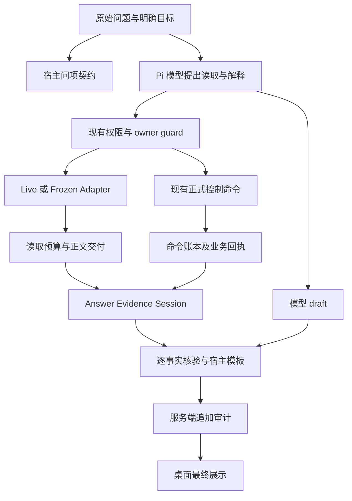

# 平台问答与控制动作证据闭环技术方案

日期：2026-10-02。状态：设计稿，尚未实施、迁移、装载或复测。

依据：[新版 100 题运行报告](../evals/platform-capability-100-v2/run-2026-10-02.md)、[逐题原因诊断](../evals/platform-capability-100-v2/diagnosis-and-remediation-2026-10-02.md)、[工程控制论指导原则](../architecture/engineering-cybernetics-guiding-principles.md)。

推荐采用小范围、分阶段的方案：先修评测读取与夹具，再为明确的关键状态问题建立“可信回执 → 确定规则 → 最终展示”的链路，随后改善检索、调用观测与 JEV 路由。复用现有权限、命令、审核和消息流；首期不引入新的模型供应商、第二个评分模型或独立微服务。

本方案中的新类型、接口、表、事件和开关均为拟议能力；现有能力会单独注明。源码核对说明当前实现，不替代生产装载与行为验证。

## 1. 控制目标

解决四类实际问题：

1. 未知、未记录或局部观测，被写成未发送、已停止、已应用、已修复等确定结论。
2. 关联对象、必要正文和用户问项没有读齐，回答却提前结束或概括全量。
3. 控制命令成功，被写成效果已经验证；缺少实际验收的工作流被辅助 judge 放行。
4. 调用故障只有笼统字符串，无法可靠定位或安全恢复。

成功标准分开计算：关键状态误报、必要事实覆盖、证据覆盖、工作流实际完成、调用完成、权限与重复动作、桌面可用性。不能用一个平均分替代这些指标。

## 2. 被控对象与首期范围

首期被控对象为桌面 Web 的 Pi 问答最终展示、读取过程、Work/Loop 命令的只读核验投影及评测基础设施。

**首个可交付版本只强约束三个有明确数据模型的场景：**

| 场景 | 受支持的结论 | 无足够证据时 |
| --- | --- | --- |
| 单个明确 Loop 的当前状态 | 配置状态；数据库观测时点的映射、租约与心跳结论 | 当前执行活性未知，不推出停止、故障原因或回答瞬间存活 |
| 单个明确 outbox 的发送结果 | 正式 attempt／resolution 支持的 sent、not_sent、unknown | 未核实，保留核对入口，不自动重发 |
| 单个审核事项及其修改 | 审核事项状态；匹配提案／命令／配置版本的保存或应用回执 | 事项关闭不能代替修改应用；装载或生产效果未查明时明确未知 |

只用名称且存在多个候选、跨主体复合问句、历史区间无法确定等情况，不强行选对象。返回已知范围与对象／时间缺口。普通自由问答可以继续使用原链路，标注其文本未经过本方案的确定事实核验；不授予“整段答案已证明正确”的状态。

第二阶段补齐关联实体／关系主张、长消息范围、持续任务观测要点；记忆有效量须复用 Brain 策略，不能用 active+verified 的状态合计冒充资格统计。

桌面使用的 `/api/native/agent` 属于必要后端链路，纳入方案。手机端、移动布局及原生客户端专项后置。真实资金、真实外发、生产删除不作为评测手段；当前模型、权限、车间职责和审核政策不因本方案扩大。

## 3. 观测输入与证据契约

### 3.1 现有能力及接入位置

| 现有位置 | 已有能力 | 本次新增责任 |
| --- | --- | --- |
| `apps/web/lib/ai/platform-record-reader.ts` | 固定发布字段、owner 过滤、关联发现、精确回读、hash 分页 | 提取受支持事实；显式记录局部覆盖与关联缺口 |
| `platform-claim-boundary.ts`、`loop-runtime-observation.ts` | 配置／历史／当前观测分层，未知活性警告 | 将明确事实转换成可展示的结论，不依赖模型复述警告 |
| `native-pi-web-chat-tools.ts`、`runtime/pi-tool-adapter.ts` | 统一预算与权限包装；工具结果已有 `details.result/trace` | 在预算及格式化成功后登记可信结构化回执 |
| `packages/ai/src/agent/runtime/pi-agent-adapter.ts` | 工具正文映射成 `output` | 保留可选结构化侧带与回执关联，不把正文输出两遍 |
| `pi-harness-adapter.ts` | tool_end、真实运行 outcome、error、done | 明确最终运行状态，区别中间消息和终态 |
| `apps/web/lib/brain/evidence-time.ts` | live／snapshot／memory 与时间资格判断 | 复用时间政策，不将 createdAt 当事实有效区间 |
| `apps/web/lib/work-runtime` | owner 范围命令、版本检查、账本、正式审核／核对 | 只读推导命令效果，不另建业务状态机 |

首期增加 `apps/web/lib/ai/answer-evidence-session.ts` 作为一个 Module。其 Interface 只有“登记回执、结束并生成展示、读取摘要”三项；事实投影、分页覆盖、主体匹配和规则选择放在内部。Live 与 frozen 两个 Adapter 满足同一契约，固定语料不冒充实时观测。

### 3.2 拟议证据类型

```ts
type EvidenceReceipt = {
  schemaVersion: "answer-evidence.v1";
  evidenceId: string;                // 宿主生成，模型不能签发
  turnId: string;
  toolUseId: string;
  subject: {
    kind: "loop" | "outbox" | "review_item" | "work" | "record";
    id: string;
  };
  source: {
    name: string;
    recordId?: string;
    contentHash?: string;            // 全文版本，存在时由来源提供
    receiptHash: string;             // 本回执 canonical payload 的 hash
  };
  authorization: {
    ownerId: string;
    requesterKind: string;
    policyHash: string;
    decision: "allowed" | "denied";
    checkedAt: string;
  };
  observation: {
    kind: EvidenceObservation["kind"]; // 复用现有 live/snapshot/memory/static
    provider: string;
    observedAt: string;
    temporalScope: "live_read" | "snapshot" | "last_persisted";
    validFrom?: string;
    validTo?: string;
  };
  availability: "read" | "withheld" | "denied" |
                "source_failed" | "version_changed";
  delivery: "observed_server" | "result_constructed" |
            "tool_result_emitted";
  coverage: {
    fields: string[];
    offset?: number;
    nextOffset?: number | null;
    totalCharacters?: number;
    recordComplete: boolean;
  };
  facts: Array<{
    key: string;
    value: unknown;
    state: "observed" | "not_recorded" | "unread" | "unknown";
  }>;
};
```

`subject.id` 是所问业务对象，`source.recordId` 是实际来源记录，两者不能混用。例如 Loop ID、run ID、Loop state ID 分别保留。`receiptHash` 与全文 `contentHash` 不要求相等；hash 只能证明版本一致性，不能证明来源真实或内容支持任意结论。

Adapter 使用现有 EvidenceObservation 的 kind 与时间格式；validFrom/validTo 只来自可信元数据，缺失值归为未提供，不补造历史有效区间。读取持久化状态的时间不能用于证明当时执行器活动。

登记顺序为：权限判定 → owner 范围读取 → 预算判断 → 正文格式化 → 对应的工具结果事件。实际进入读取但随后被预算扣留的结果，不登记为模型可见。`tool_result_emitted` 只证明上下文可获得该返回，不证明模型正确理解了它。

不能只看外层 `isError=false`：内层 `ok=false`、`version_changed`、来源失败、缺页等都要进入可用性判断。最终需要引用的范围权限若已撤销或失效，应重新依现有授权机制判断；旧 policyHash 不是永久授权。

正文是不可信来源材料，里面的指令、JSON 中自称的 verified 和引用到其他主体的 ID 不能签发新回执、扩大读取范围或改变规则。

## 4. 状态模型与持久化

### 4.1 问项、可用性、展示分别建模

复用 `apps/web/lib/brain/answer-requirements.ts`、`platform-answer-coverage.ts` 和 `snapshot-answer-checkpoint.ts` 作为问题分解与字段可用性辅助，建立有限的 RequiredFact 清单：

```ts
type RequiredFact = {
  id: string;
  subject: EvidenceReceipt["subject"];
  factKey: string;
  timePolicy: EvidenceTimePolicy;    // 复用 lib/brain/evidence-time 的类型
};

type FactResolution = {
  requirementId: string;
  state: "supported" | "not_recorded" | "unknown" | "denied";
  evidenceIds: string[];
  reason: string;
  presentationIncluded: boolean;     // 仅宿主模板能确定这项
};

type AnswerDecision = {
  schemaVersion: "answer-decision.v1";
  ruleVersion: string;
  runtimeHash: string;
  outcome: "supported_fields" | "partial" | "unknown" |
           "execution_failed" | "unchecked";
  resolutions: FactResolution[];
  renderedText: string;
  rawDraftHash: string;
  renderedTextHash: string;
};
```

问题拆解超限、存在歧义或未受支持时保留 `unresolved`，不能把少量正则匹配当作完整理解。`nextOffset=null` 表示该记录页已读完，不表示问题已经答完整。

字段语义采用小型明确规则表。例如 `lastCheckedAt=null` 为未记录检查时间；`expiresAt=null` 按现有政策表示未设置显式到期日，不能自动推为过期、无效或事实新鲜。先按这些已知反例设计，不创建全平台通用的“null 等于未知结果”替换器。

### 4.2 可信审计不能依赖客户端消息缓存

当前 `Message_v2.parts/metadata` 可以由客户端保存／upsert；`chat-context.tsx` 的流式保存还没有把新核验信息可靠保存为服务器事实。因此只把消息表当展示镜像，不当权威验证账本。

首期新增一张 PostgreSQL 表 `agent_answer_audits`，经服务器 Repository 追加：

| 列 | 用途 |
| --- | --- |
| `id uuid`、`seq bigserial` | 事件身份与持久化顺序；seq 为全局顺序，不假定每 turn 连续 |
| `owner_id uuid`、`turn_id uuid` | 每次读写强制 owner 范围 |
| `chat_id uuid`、`assistant_message_id uuid`、`work_id uuid`（可空） | 关联现有页面和正式回执；消息尚未落库时不强制 message 外键 |
| `event_key text`、`event_type text` | 稳定去重键与事件类别 |
| `request_key text`、`request_payload_hash text`（初始事件使用） | 重复请求与不同 payload 冲突检测 |
| `schema_version text`、`rule_version text`、`runtime_hash text` | 判断实际使用的契约与版本 |
| `payload jsonb`、`created_at timestamptz` | 最小证据摘要、缺口、错误、原 draft 与最终展示 |

约束：唯一 `(owner_id, turn_id, event_key)`；初始事件唯一 `(owner_id, request_key)`；查询索引 `(owner_id, turn_id, seq)`、`(owner_id, chat_id, assistant_message_id)`。同 event_key 的 payloadHash 不同应报冲突，不覆盖旧事件。Repository 不提供修改历史的方法；删除／保留遵守平台已有数据生命周期政策，不自建永久保留规则。

每 turn 的事件写入串行排队，最终提交等待队列完成。起始事件采用事务原子插入去重；相同 requestKey+payloadHash 返回已有 turn，不启动第二个模型会话。正在运行的重复请求返回 `202 application/json`，包含 turnId、running 状态及查询入口；已有终态可返回 `200 application/json` 的审计摘要。不同 payloadHash 返回 409。正常新会话仍返回 SSE。

`router/index.ts` 必须按 Content-Type／协议版本分支：202 不是执行完成，不能读空响应后调用成功 onDone；JSON 摘要按可信终态恢复展示。新协议 SSE 的 EOF 如果缺真实终态，应视为断流／未知。`fetchWithRetry` 的重发保持同一个 clientRequestId，显式新 attempt 才更换并关联旧 turn；首次失败不覆盖。

事件至少包括 `turn_started`、`evidence_registered`、`read_phase_closed`、`runtime_terminal`、`answer_committed`、`answer_failed`。事件值有自己的 schema；未知旧版本由只读兼容解析返回未核实，不猜默认成功。

回执交付阶段推进也追加新事件：event_key 包含 `toolUseId + stage`。不能用同一 event_key 修改 observed_server 为 tool_result_emitted，否则会与不可覆盖规则冲突。

原始业务记录继续由原来源保存。审计只存必要的字段、引用、hash 和当前受保护回答 draft，避免复制整份消息／文件／工具日志。draft 上限初期沿用现有守卫的 64,000 字符；溢出记录 hash、限制原因和未核实状态，不截尾后假装完整。日志和公开报告不包含凭证、认证头、私人正文。

仅在工具回执、阶段改变与终态写事件，不按 token 写数据库；单 turn 写入串行、不同 turn 互不阻塞。首期 facts 只投影明确的小型状态字段，大正文保留来源引用与覆盖，不复制进事实数组。记录审计耗时与写入失败，避免证据机制成为新的隐性等待来源。

### 4.3 请求和持久化安全前置条件

拟议新增 `chatId/clientRequestId/userMessageId/assistantMessageId` 协同字段，贯通 `chat-context.tsx → lib/ai/router/index.ts → AgentRequest`，服务端生成 canonical `turnId`。当前 router 仅把 options.chatId 转为 sessionId，未发送上述协同字段；sessionId/taskId 不能作为聊天归属证明。这些字段仅用于关联和去重，不能传入权威 verified 状态。

采用一种明确的首轮启动顺序：客户端先 `await saveMessagesToDatabase(..., { immediate: true })` 保存用户消息与 owner-chat，成功后才发 agent 请求。保存失败则保留用户输入、显示保存错误并停止启动；不能把默认 debounce 返回的 null 当成功。服务端校验已有用户消息的聊天归属，并在 reserve-turn 事务内检查／创建 assistant 空占位行、绑定 ID、追加 turn_started；不能要求尚未入库的本地 assistant ID 预先存在。首次双请求依请求去重约束和消息主键处理，任何他人聊天／消息冲突均拒绝。旧调用者缺少协同字段时只走 legacy/off 路径，不伪造可信关联。

在接入前补齐 `/api/chat/save-messages` 保存路径的显式聊天归属和现有消息归属检查；同一个消息 ID 不能被提交到其他聊天覆盖。新增 `data-answerEvidence` 内容只存 audit 引用或由服务器重建的镜像，客户端自报成功不写入可信账本。历史加载时按 owner 回读审计；镜像正文 hash 与审计不一致，不能展示“依据已核对”。

新增只读 `GET /api/native/answer-audits/:turnId` 返回该 owner 的脱敏展示摘要，raw draft 的读取另受同一 owner 校验、默认折叠。AI 工具注册表不暴露审计写入接口。

## 5. 控制器、Module 与数据流



外部调用者只接触小 Interface：

```ts
interface AnswerEvidenceSession {
  observe(receipt: EvidenceReceipt): Promise<void>;
  finalize(input: {
    terminal: "completed" | "failed" | "aborted";
    rawDraft: string;
    requirements: RequiredFact[];
  }): Promise<AnswerDecision>;
  snapshot(): { turnId: string; resolutions: FactResolution[] };
}
```

生产 Adapter 从正式结果构建回执；隔离 Adapter 从固定语料／正式隔离服务构建回执，必须保留 snapshot 和 fixture 覆盖。Session 内部通过纯规则与注入的审计 Repository 判定，不读取任意数据库列、不开放任意文件系统路径、不调用新的评分模型。

现有 `guardDirectLoopRuntimeAnswer` 在新增机制初期继续保留。新机制稳定后，在已覆盖的问句上替换其重复规则；未覆盖问句仍由原守卫处理。先替换一处重复逻辑并验证，再扩消费端，避免多层 guard 互相改写答案。

## 6. 控制动作与流式交付

### 6.1 关键问题的最终答案由宿主生成

关键场景中，工具、读取进度、权限请求和错误继续即时流式显示；模型 text/result/direct_answer 暂存为 draft，未核验的模型推理文字不作为状态事实展示。只有真实运行 completed、清理结束无终止错误、回执匹配且审计提交成功，才发已核验成功文本。失败、abort 或审计失败也必须发送安全的失败／未知终态摘要与原命令核对入口，不能让页面永久停在等待或收不到结果。

拟议在 `AgentMessage` 增加可选 `answerPhase`、终态信息及 `answer_evidence` 事件。`pi-harness-adapter.ts` 必须把 lane 的真实 outcome 传到宿主；每条 `message_end` 当前都会产生 result，不能将它当最终回答。`done` 只说明流结束，不能单独表示任务成功。

最终状态用宿主模板。例如：

> 已保存暂停配置。数据库本次没有观察到活跃执行关联，因此没有评估该 Loop 的租约和心跳；当前执行活性未知。未来新时隙准入尚未取得实际观测。

模板逐事实标注依据、时点和缺口。首期关键问题不把未经核验的自由文段附在模板后；raw draft 保留在审计中、默认不显示。普通自由回答的 `unchecked` 表示核验范围有限，不等同答错。

旧客户端忽略新增事件时仍接收同一份安全的 legacy text；新客户端渲染证据摘要。失败、abort、缓存溢出、来源拒绝或审计不可用不能伪装成已核验。已成功的业务命令仍保留其正式回执，答案提交失败不能重做该命令。

### 6.2 工作流核验复用正式命令

新增只读 Module `apps/web/lib/work-runtime/effect-observation.ts`，Interface 为：

```ts
observeWorkCommandEffect({ userId, workId, commandId })
```

它先读取 owner 范围正式命令，依据命令种类和目标推导允许核对的来源，不接受模型提供的任意来源／文件路径。返回独立投影：

```ts
type AnswerEffectObservation = {
  version: "answer-effect.v1";
  commandId: string;
  commandStatus: "queued" | "succeeded" | "failed";
  verificationScope: string;
  requiredChecks: string[];
  status: "unchecked" | "verified" | "inconclusive" | "contradicted";
  checks: Array<{
    kind: string;
    status: "confirmed" | "unknown" | "contradicted" | "superseded";
    observedAt: string;
    evidenceRefs: string[];
  }>;
};
```

该 status 是核验结果，不写回 `workshop_runs.status`、outbox 状态或命令状态。`succeeded` 只表示命令事务成功，不自动签发外部效果成功。verificationScope 与非空 requiredChecks 由受支持的 command-kind 契约确定，不能因为当前已有 checks 恰好全部 confirmed 就签发 verified。保存核验、执行活性与外部效果是不同范围；未观测的效果仍单列 unknown，页面不把“小范围已验证”显示为整体效果完成。

现有 `GET /api/workshops/:id/commands/:commandId` 加可选 `effectObservation`，保留旧 command／events 字段。GET 只生成只读投影，不在每次轮询时追加重复业务事件；答案使用投影时由 Answer Session 去重保存审计引用。

### 6.3 修正暂停接口的调度字段语义

当前 `commands.ts` 的 `applyUpdateWorkLoop` 将 `nextScheduledRunAt` 初始设为 null，只在 patch 包含 triggerConfig 时才计算并写 cursor。status-only 暂停也会返回该默认 null，它不是持久化游标已为空的证据。

兼容改动：保留旧字段并标注弃用其证据含义，新增：

```ts
type NextScheduleObservation =
  | {
      status: "read";
      source: "loop_states";
      observedAt: string;
      value: string | null;
    }
  | {
      status: "not_computed" | "unknown";
      reason: string;
      value?: never;
      observedAt?: never;
    };
```

优先在原命令事务内回读 Loop state 并标记 read；缺字段为 unknown，明确的空字段才是 value=null。只改状态不清除历史 cursor，不修改业务时钟。页面分别展示暂停准入政策和历史计划游标。

生产首期没有受控时钟的“未来新 slot 探测”，不能复制评测工具到生产。实际未来准入未观测时保持未核实；隔离 REAL-100 仍要求模型实际选择已有 probe。暂停也不能据此宣称在途执行器已经停止。

## 7. 工具矩阵、权限与审核

| 动作 | 许可来源 | 约束 |
| --- | --- | --- |
| 记录／来源／关联回读 | 现有读取权限和 owner 检查 | 固定发布源、同 hash 分页、深度／扇出／预算上限；逐次检查权限 |
| 核对命令与效果 | 已有 owner 范围 command/read 服务 | 只读投影；不能凭读回执重发写操作 |
| 暂停／取消／恢复／配置更新 | 现有正式命令、expectedVersion、commandId 与审批机制 | 原边界不变，denied 优先；恢复与新命令不能由核验器自动决定 |
| 发送核对 | 既有 outbox attempt／resolution／recovery | unknown 不变 not_sent；人工核实及 contentHash 条件保留 |
| 审计追加 | 服务器私有 Repository | 不注册 AI 写工具；客户端、引用正文和模型不能签发通过 |
| JEV 候选预取 | 现有只读工具权限 | 不增加写工具、不绕过 owner／历史时点／审核 |

保留 `RunReviewPanel` 的执行器停止确认、unknown/no_effect/effects_recorded 和待核对 outbox 阻塞；保留 `OutboxResolutionPanel` 的 unknown/sent/not_sent、hash 绑定和既有 pending resolution 恢复。使用现有“核对上次提交”、审核、暂停和纠错入口，不新增一套平行审批。

## 8. 检索、预算与反馈闭环

### 8.1 先修 frozen，再统一正式分页

第一步仅改 `scripts/lib/platform-eval-v2-frozen-tools.mts`：

- recordRead 向模型输出一份正文，结构化私有回执可以独立保留字段。
- 默认目录只返回版本、覆盖说明、数量和显式读取入口；完整目录通过版本化 `view/cursor/limit` 分页。游标绑定目录 hash；不按题号／金标预选源。
- repository_file 的 offset/expectedHash 分支真正调用连续窗口；hash 绑定完整文本，nextOffset 依据实际送达字符计算。旧 startLine 请求保留兼容，不能截尾后跳过未送达正文。

当前 `evidenceWindow(content, offset, expectedHash)` 固定 8,000 个 UTF-16 单元；正式源码 reader、native tool schema 与 askMemory 目前只有 sourceId/startLine，不能把 maxChars 当现成能力。

第二步才同步扩展 `platform-source-reader.ts`、`native-pi-web-chat-tools.ts`、`memory-access.ts` 的正式 v2 schema。若需要可变小页，给 evidenceWindow 增加可选 options 与明确的 `pageCharacters` 范围，默认仍 8,000；schema、转发和 helper 同时修改。至少测试 512／8,000 页、超长单行、中文／emoji 和末尾页。文件 bytes hash 与窗口全文 hash分别保留定义，不能混合比较。

### 8.2 预算成为有类型的状态

兼容扩展 `withMemoryReadBudget(definitions, controller?)`，不传第二参数继续原行为。拟议 Controller 提供 `snapshot()` 与 `onClosed`：

```ts
type ReadBudgetState = {
  phase: "open" | "closed";
  closedReason?: "attempts_exhausted" | "characters_exhausted";
  attemptsUsed: number;
  evidenceCharactersDelivered: number;
  remainingAttempts: number;
  remainingCharacters: number;
  maxResultCharacters: number;
};
```

首轮对照保持现有 10 次／24k／64k 限额。计数含义不改：进入 reader handler 后才消耗尝试；来源失败、超限也算尝试；schema、权限、重复或已经关闭的提前拒绝不算同一 reader 尝试。超限结果整份 withheld，不计交付字符。模型调用数、reader 尝试数、正文预算和包装后的模型可见总字数分别记录；askMemory 委托只在底层收费，避免双算。

typed 状态通过明确侧带登记，不能只新建异常类：现有 tool executor 会把异常压成字符串。权限判定仍先于预算，不能借预算状态绕过 denied。

MVP 保证关闭后**零后续 reader handler 执行**，不承诺模型零额外调用。已核对的 Pi 0.85.1 SDK 存在 `AgentLane.setActiveTools([])`，下一 generation 使用新配置，但当前 tool batch 已捕获旧工具，因此预算 guard 仍必须拦住同批后续读取。项目尚未接入这条能力。

后续用 fake provider 证明“下一请求 tools=[]、同批不再读取、可完成 final+gap”，再接入受支持的只读问答／收尾阶段。不要直接清空注册工具导致旧 active names 配置错误；不要在 `onBeforeToolUse` 抛错做正常收尾，它会取消整轮。收尾仍占原总时限与模型预算；有未完成控制动作时记录未完成并进入现有接管流程，不能自动补做。

### 8.3 关联读取按具体缺口进行

复用现有固定关联表，首期只支持题面实际询问的主／客实体、关系主张、来源事件或会话信息；深度先沿用一跳，不自动遍历整个图。模型看到 `requiredReads` 与 gap，页必须同 hash；关联读取重复 owner 检查。

名字出现在 claim 内，不足以证明外键对象身份；关系 ID 存在不代表关系内容已说明；前页只有 assistant 内容不代表后页没有转述用户决定。读不到时回答所覆盖范围，不猜全文不存在某事实。

反馈保存为 `missing_fact/unread_relation/unread_page/unsupported_claim/source_failed/budget_closed/ambiguous_scope` 等原因，关联原证据和版本。只用于诊断与候选评估，不把失败反馈直接写成长期事实或自行调整权限。

## 9. 异常、扰动与有限恢复

### 9.1 调用观测

在 `pi-harness-adapter.ts` 的现有 stream 包装和 outcome 位置增加脱敏 telemetry，并扩展 `AgentMessage` 可选错误详情与 `agent-runtime-error.ts`：

- operationId、turnId、attempt、provider host／协议／model、实际 runtimeHash。
- request_started、first_event、last_event、tool_started、tool_ended、run_terminal 的时点。
- HTTP 状态、非敏感 requestId、error.name/code、有限 cause 链和 abort 来源；SDK没有暴露的阶段明确 unavailable。
- 各层实际配置 deadline、elapsed 与 remaining；不从错误字符串反推某个固定超时。
- 工具／副作用是否尚未开始、已开始或未知；分类未知的工具不能默认只读。

原始认证、密钥、请求正文不进入 telemetry。现有 `normalizeAgentRuntimeError` 文本映射保留兼容，但 `retryable=true` 只是提示，不能单独触发恢复。

### 9.2 恢复条件

第一阶段保持当前自动重试关闭。观测完成后，有限恢复候选最多一次，仅适用于明确只读的会话、可分类瞬时传输错误、剩余总预算充足，且不存在已开始／未知副作用。取消、权限拒绝、版本冲突、来源事实冲突不重试。

动作类请求先用原 commandId 查询既有命令与回执；恢复复用原 expectedVersion／payload 机制，不新建 commandId 重做整个任务。outbox 外发不在普通自动回放白名单，继续走现有主人核实与 recovery；不能由网络错误推断未发送。

断流或重启后回读服务器 turn 审计与正式命令。终态缺失为中断／未知，不能因最后一段文字说“成功”补签完成。审计无法保存时展示明确失败或未核实；已有命令成功回执仍可在原页面核对，不执行补偿性重发。

## 10. 桌面页面可观测性

新增 `apps/web/components/message/answer-evidence-card.tsx`，以 `data-answerEvidence` 展示服务器摘要；改 `chat-context.tsx` 处理新 SSE 事件、流式／结束保存和切换聊天，改 `packages/shared/src/types.ts` 的可选 data 类型。历史回读以服务器审计为准。

普通回答不展开长证据清单。关键问题展示三行：

```text
保存状态：暂停（来源与时间）
执行观测：未知；本次未评估租约／心跳
效果核验：未来新时隙准入尚未观测
[查看依据] [查看运行记录]
```

“依据已核对”只用于具体字段，不用绿标暗示整段模型结论绝对正确。来源降级显示 provider/detail/warning；预算关闭显示哪些问项尚未完成；调用失败显示阶段或阶段未知、已发生的控制回执和原核对入口。

Work 命令区复用现有提交／核对组件，增加可选效果投影；RunReviewPanel、OutboxResolutionPanel 保留已有动作和阻塞。窗口缩放、键盘展开／关闭、焦点顺序、刷新与聊天切换均纳入验收。页面默认不展示 SDK 堆栈、hash 大段文本或规则配置。

## 11. 数据模型兼容、版本与上线方式

### 11.1 数据与协议兼容

- 审计是新增表，不改原始消息、现有命令账本或业务状态的含义。
- schema.pg.ts／schema.ts、Repository、正式 migration 和 journal 一起提交；使用当前 `pnpm db:migrate` 路径，先在隔离 PostgreSQL 验证，不用 db:push 替代审核迁移。
- 新接口字段可选；旧命令查询和 legacy text 保留。新客户端不能把缺少投影的旧数据按“已验证”解析。
- `nextScheduleObservation` 明确 read／not_computed／unknown，旧 null 不再进入新结论规则。
- 新 AgentMessage 的终态扩展先覆盖 Pi，其他 provider 不填则新 gate 不强制宣称完成；所有消费者的未知事件处理都要检查。
- public UI 类型只带可展示摘要；owner、政策细节和 raw draft 存服务端，不复制到公共报告。

### 11.2 候选装载与回退

拟议增加 `ANSWER_EVIDENCE_MODE=off|shadow|enforce_critical`，不是当前已存在开关。初始默认 off；shadow 生成审计和对照，不改展示；enforce_critical 只覆盖第 2 节白名单。来源／预算／JEV候选分别版本化，不作为一个大开关一起启用。

用现有 `buildAgentRuntimeRunSnapshot` 的 extra 记录 evidenceRuleVersion、auditSchemaVersion、readerContractVersion 与实际 mode，回读加载版本。部署后检查这些值及数据库 migration，不能仅凭文件保存宣称装载。

回退顺序：停用候选模式 → 恢复旧代码／配置版本 → 回读实际加载 → 核对未完成 turn 和原业务回执。新增审计表保留，旧读取器忽略新字段；不删除首次回答、错误或失败候选。候选回退不恢复已经过期的权限，也不撤销已发生外部动作。

立即停止候选推进的条件：跨 owner／主体读取或引用、绕过审核、未知发送被当未发送、无依据签发应用／停止／修复、丢失来源页、重复业务动作、失败流被标完成。遇到规则误伤正常明确结论，则退回该规则的小范围版本并保留反例。

## 12. 测试、评测与验收

### 12.1 先做不调用待测模型的真实契约检查

| 检查集 | 必须覆盖 |
| --- | --- |
| 回执与结论 | 错主体／错 owner／错 hash／缺页／内层 version_changed／过期权限；配置不证明活性；事项关闭不证明应用；发送未知不证明未发送 |
| 正常反例 | 有依据的成功、明确未发送、合法无 TTL、历史状态、否定句、同义表达，防止全部替换为未知 |
| 分页与预算 | 完整文本重建、超长单行、中文／emoji、目录漂移、路径越界、单正文、预算关闭后零 handler；嵌套委托不双计 |
| 流与 SDK 接入 | 中间 result、error 后 done、abort、cleanup error、缓存溢出、同批工具、下一请求 schemas 为空、收尾有 final+gap |
| 审计与请求 | 相同请求去重、不同 payload 冲突、并发事件、写失败、客户端伪造核验、跨聊天 message ID、镜像篡改和刷新回读 |
| 正式命令投影 | 丢回包、同 commandId 恢复、actor 改变、expectedVersion 冲突、目标被更新、读来源失败、在途／未知副作用 |

测试跨同一 Module Interface，使用确定性回执与 fake stream／隔离数据库。不能用纯 mocks 证明正式 API 身份、正式 DB 事务或生产显示正确。

### 12.2 先修评测，再跑候选

1. REAL-071：改成隔离 Next 服务端加载／真实 HTTP 集成进程。模型前检查 route、实际认证、测试 DB 与文件隔离；不 mock session，不以 workspace helper 冒充 API。
2. REAL-085：setup 用正式 cancelWorkRun，回读 needs_review、fenced lease 与未知 outbox 后才 ready；题面已有取消前提时不要求模型重复 cancel 或额外指定 API。
3. REAL-100：模型必须实际选择隔离 probe；验证新 slot、实际准入、无新增运行与历史保留，日志 coverage 按真实 trace 生成。生产无此受控时钟工具。
4. 049、056 名字扣点、060 标题等争议由独立内容复核接受等价表述。服务回执、模型实际可获得的证据、最终解释分别判读；085／094／100 作为 false-pass 负例。
5. 原 rubric／回答／分数不覆盖。若评分规则确需修订，签发新协议版本，对基线与候选按同一新版判读并保留原版成绩；争议未解决标 unresolved，不挑最好的一次。

### 12.3 匹配条件与阶段门槛

现有 100 题、快照、语料及失败原档保留。修正适配器后另建明确版本的新基线，记录 model／provider 协议、工具、数据、权限、预算、并发和规则 hash。四道 pilot 的旧装载 hash 缺口不补造，也不称其为严格匹配基线。

每候选先跑相关失败题及正常／边界／扰动对照，再跑完整 100 题。原第一次失败保留，恢复尝试另报。关键结论由确定规则／实际回执验证；自由内容由独立内容复核，模型 judge 只提供意见，不能单独签发通过。

首期准入门槛：

- 确定契约、身份、幂等、连续分页及流终态检查全部通过。
- 已确认关键未知误报在匹配回归中为零，正常有依据结论不被全部抹成未知。
- REAL-071／085 夹具 preflight 正确，094／100 的原失败不会被 judge 虚假放行。
- 按 90 问答与 10 工作流分别报告必要要点、额外主张、调用错误、夹具错误及效果，不承诺预先达到某个总正确率。
- 正式 API 与桌面测试完成保存／装载／结果展示／错误恢复；开发阶段针对性验证，完整阶段与最终交付保留生产验收。

### 12.4 JEV 独立实验

在 reader、gate、评分协议均固定之后比较三组：

| 组 | 改动 |
| --- | --- |
| A | routing off，使用普通 guarded tools；保留原历史时点保护 |
| B | 当前规则：任一来源 uncertain，则取消本次自动预取，保留正常 guarded 工具处理 |
| C | 对达到既有 0.8 阈值的 records／architecture 候选执行至多一次同权限预取，其余来源继续普通路径；保留 B 同版本的变更历史 applicationGuard 补充规则 |

三组固定 `BRAIN_JEV_MODE=off`、`BRAIN_JEV_TARGETED_RETRY=false`；A 的 `BRAIN_JEV_ROUTING=off`，B/C 为 `replace`。固定阈值、分类指令、数据、工具、并发和总预算。B/C 保留同版本的 applicationGuard：route 正常但 sources 为空时，变更历史意图仍可能触发 records 预取，该触发单独记录为应用规则而非 JEV 选中。timeout／invalid／abort 退回普通授权链路并显示路由原因；brain／knowledge 被选中不计作实际 platform 预取。另保留由验收方独立管理的正常桌面产品问题，避免只优化冻结题面。

评价最终必要事实覆盖、无支持主张、权限／时间边界、实际有用预取、总成本与延迟。只有预取次数增加不能发布候选；证据不足标 inconclusive，继续当前策略。JEV 不决定动作授权。

## 13. 分阶段实施与交付清单

工作量按熟悉本仓库的 1 名工程师估计，是排期参考，不是已完成进度；Next 隔离加载和 SDK 行为验证可能影响工期。完整路线预计 10–16 人日，JEV 模型对照的耗时与额度另记录。先交付 4–7 人日的可用第一阶段，其他票可并行准备。

| 阶段／票 | 主要文件与交付 | 依赖与估计 |
| --- | --- | --- |
| I1 评测可信性 | frozen-tools、workflow worker/verifier、workflow receipt judge；单正文、连续分页、071／085前置、100日志、评分争议版本记录 | 1–2 人日；后续模型对照前完成 |
| I2 可信审计与终态 | 新增 answer-evidence-session.ts、answer-evidence-contract.ts、agent-answer-audit.ts、audit GET、PG migration；pi-tool／pi-agent／pi-harness 的可选回执与终态；保存端归属检查 | 2–3 人日；先完成 fake-stream 与隔离 DB |
| I3 首个闭环场景 | 先上线单 Loop typed 模板与未知边界，再补 outbox／review；改 native agent route、router/index.ts 的请求与202/SSE分支、shared data 类型、chat-context、save-messages、answer-evidence-card | 1–2 人日；依赖 I2，首期只 enforce 单 Loop |
| I4 命令效果与调度语义 | 新增 effect-observation.ts；commands.ts 的 nextScheduleObservation；命令 GET、client-command 和现有 review 展示 | 1–2 人日；依赖 I2，不新增业务状态与生产 probe；完成前不展示效果核验通过 |
| I5 正式读取与预算 | source-reader／native schema／memory-access／evidence-window 的一致分页；预算 Controller、关联 requiredReads、经 fake provider 验证的 setActiveTools 收尾 | 2–3 人日；与 I3 分开做候选对照 |
| I6 调用观测与恢复候选 | Pi stream／错误 telemetry、runtime snapshot extra；有限只读恢复保持独立开关 | 1–2 人日；先 telemetry，再决定是否启用恢复 |
| I7 全量与桌面验收 | 新版全量报告、桌面主要流程、装载回读、回退记录；随后单独 JEV A/B/C | 2 人日左右；候选硬门槛通过后推进 |

第一阶段 I1–I3 的最小交付为：可信首轮对照条件、服务端审计、单 Loop 的事实模板、错误／未知可见、页面刷新仍可回读、现有工具和审批继续有效。outbox／review、正式通用分页、SDK收尾、恢复及 JEV 不捆绑为第一阶段的成功条件，各自保留票与实际验证状态。

首轮新聊天、用户保存失败、assistant 尚未落库、双请求重发、202 JSON 仍在运行与 SSE 缺终态，均属于第一阶段必须验证的实际流程。

每张票按 `skills/agent-evolution/references/change-contract.md` 保存基线、候选、证据、预期、反例、实际版本与回退记录。阶段结束分别记录已编辑、已保存、实际装载、程序检查、模型效果、生产验收和遗留项。任何一层尚未完成，就保留该层未完成状态。

## 14. 首批候选实施与验证记录（2026-10-02）

本次已实现 I1–I3 的最小候选链路，范围是桌面 Web、必要后端与隔离评测夹具。默认 `ANSWER_EVIDENCE_MODE=off`，未执行生产迁移、启用生产核验开关或改变 JEV 路由策略。源码、程序验证、实际模型效果与生产效果分别记录，不把编译或夹具成功换算成模型正确率。

| 票 | 本次实际状态 | 尚未完成 |
| --- | --- | --- |
| I1 | 紧凑目录、单正文、连续版本绑定分页；071 真正的隔离 HTTP 与只读 preflight；085 正式取消后的收据；100 以实际 probe 判定覆盖，程序检查通过 | 049／056／060 内容争议复核、修订协议下的匹配模型基线与候选；071 独立 verifier 的实际运行 |
| I2 | owner 绑定、追加式审计、事务占位、请求重放／冲突、真实运行与清理终态、取消收尾、审计缺口的安全失败投影已实现并经隔离数据库与回归验证 | 真实模型端到端回读与生产验收；进程死亡或全程无法写库时，缺终态仍保持未知 |
| I3 | 仅单 Loop 当前状态问项的受限事实模板；实际交付的工具证据绑定；202／SSE 恢复；可信 GET 与完整展示正文绑定；保存失败草稿恢复，桌面检查通过 | outbox／review 扩展投影；发送处理中跨聊天完成回调的真实浏览器扰动验证 |
| I5 提前完成部分 | 正式 source-reader 的完整底层文本分页、版本变化与 memory-access 参数贯通 | 预算 Controller、requiredReads 与经 provider 验证的 SDK setActiveTools 收尾 |
| I4／I6／I7 | 保留后续票，未标完成 | 命令效果与下一调度语义、完整 telemetry／恢复候选、全量模型回测、生产桌面与独立 JEV A／B／C |

本次关键边界：格式化前观察、结果构造、模型实际工具回包分别记录；没有实际交付给模型的证据不能核验。中间 result、连接结束、已保存配置不证明运行完成或目标活性。读取时没有关联映射不能推出没有租约／心跳。当前状态问题包含动作或下一调度目标时，不进入单 Loop 模板。最终还须核对当前 owner 和读权限。

UI 只保存审计引用，以 owner GET 回读状态；全文须与服务端保存的最终展示正文精确一致，才允许显示有依据的字段。合法引用搭配改写正文仍显示未核实。运行中状态表示尚无持久化终态，文案为“等待本轮证据与终态确认”；回答中断不显示为 Loop 已停止。保存用户消息失败时，不启动模型，保留当前草稿并支持立即刷新恢复。审计阶段发生缺口后，只能追加未知／失败投影，不能补造原事件或覆写已封存终态。

最终验证为 18 个文件、261 项定向检查通过；非增量 TypeScript 检查通过；17 项真实隔离 PostgreSQL 检查与 10 项真实桌面检查通过。桌面覆盖 1366／1024 宽度、键盘展开与刷新、历史回读、错误归属、正文改写、503 保存失败立即刷新恢复及双聊天草稿隔离。桌面夹具使用合成审计记录并拦截模型端点，不表示真实模型会话已经端到端通过。

隔离生产构建首次通过：Next 16.2.1 Webpack 编译、类型检查、149 个静态页生成和 tracing 完成。仅构建源码副本，未部署或启动生产服务；依赖仍解析至原 packages，已记录路径并核对前后文件哈希。原 `.next`、`tsconfig`、`next-env` 与 packages 未变。临时测试数据库、桌面 HTTP 服务和合成用户目录已清理；源码、构建日志和失败证据保留。

原题包 8 份文件、100 份首次结果及 9 份原汇总／审计文件的 SHA 全部一致。085／100 的无模型合同驱动器被独立 verifier 按无模型证据拒绝，不转换成模型通过；071 的 HTTP 程序检查与模型成绩分别保留。首次失败、恢复尝试和不同加载版本不覆盖合并。未重跑候选完整 100 题，未作 JEV 对照，也不声明模型正确率已经提高。

本阶段版本、反例、程序证据、源码 hash、回退方式与遗留项见 [实施核验记录](../verification/platform-evidence-control-i1-i3-2026-10-02.json)。回退先关闭核验模式并保留审计账本，不删除历史失败或绕过现有权限与审批。

## 15. 生产装载与首次回归进展（2026-10-03）

按主人要求已重启正式桌面 Web 及原有 worker，review 38 实际装载 `enforce_critical`，增量迁移 0159 完成。一个真实只读模型请求的服务端审计、最终正文、运行与清理终态以及桌面核验卡片均通过回读；这证明该请求的链路工作，不认证所有回答。

冻结题包的首次 100 题回归已完成：99 执行完成、083 请求超时；90 道问答的辅助完整／边界通过从旧版 75 降至 70。工作流辅助统计 9/10，但独立复核确认 094 和 100 仍未达成完整目标，071 为执行器额外断言争议。原首答、原分数、旧 latest 和失败证据保留，不能据此宣布整体模型效果提升。

12 组原生补充对照已完成：有效恢复轮共 24 个会话、45 个已观察的主模型请求，真实上游及 SDK 终态通过；10 组首输入逐字相同，02／12 保留不可直接比较。独立语义复核发现 I3 模板省略 05／07 的明确问项，11 仍有逐项未知表达缺口，不能宣布效果达标。请求模式、供应商自动 header、Windows 导入路径及旧路径正文解析的评测故障分别保留，只修评测脚本，生产 SDK、工具权限和审核不变。

I3 下一候选须补齐题面要求的可信字段／逐项未知，再按有限版本回归；本轮首答与原分不重写。最新状态、证据、后续候选及限制统一记录在 [生产对照报告](../verification/platform-evidence-production-comparison-2026-10-02.md)。本节不把 I4–I6、严格匹配全量评估或独立 JEV A/B/C 标为完成。
