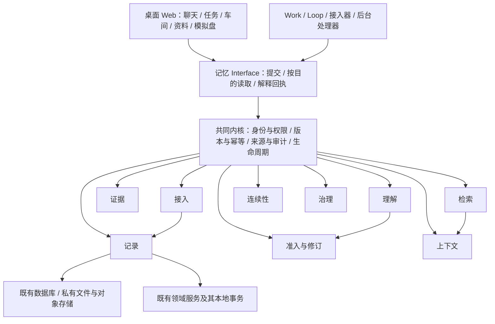

# 记忆模块设计思路

日期：2026-10-20。状态：设计草案，按主人最新意见修订；本次只调整设计与领域术语，未修改运行代码、迁移数据或改变现有进程配置。

整个体系统一称为 **记忆（Memory）**。它是所有应用持久化数据的统一存取与治理模块；现有 Brain 中的记录、证据、准入、修订、状态、检索和上下文能力逐项拆开，归入同一套记忆能力。目标结构中不保留 Brain 子系统，也不把这些能力重新打包为一个“认知引擎”。模块先独立组织，沿用当前部署；数据库、文件对象和既有领域服务继续承担各自适合的物理存储。

这一轮明确的方向是“一个记忆主题、职责可拆解、过程可查看”。下面的具体接口、目录和迁移批次仍是设计草案。本文路径保留，便于已有讨论链接继续使用。

配套可实施合同、数据模型、架构图与拆解批次见[记忆模块技术方案](./memory-module-technical-plan-2026-10-20.md)。

实施进展：首批“可信观测写入 → 确定版本读回”及第二批“消息理解 → 任务主记录 → 场景状态”核心闭环已完成隔离开发及生产产物验收。实际覆盖与未迁移边界见 [T1 验收](../verification/memory-module-t1-2026-10-20.md)、[T2 验收](../verification/memory-module-t2-2026-10-20.md)；日常数据库和实例尚未切换，本文保留最初设计记录的范围与讨论。

用户得到的直接效果是：任何一条资料、任务、记忆、运行进度或成果，都能回答“存在哪里、谁负责、哪一版、从哪里来、现在是否有效、谁能使用、出错怎样恢复”。开发者接入新功能时，复用这套能力，业务规则集中在所属领域。

设计依据：[工程原则](../architecture/engineering-cybernetics-guiding-principles.md)、[现有领域语言](../../CONTEXT.md)、[数据归属合同](../reference/memory-data-authority.md)。现有[统一记忆平台方案](./unified-memory-platform-architecture-plan.md)及[首批记忆治理验收](../verification/memory-system-governance-2026-10-20.md)是承接基础；已验证的能力按职责复用。旧方案把能力集中到 Brain 的方向由本设计调整，历史验收仍只证明当时的实现覆盖。本文提出的更大范围及新 Interface 尚未实现，不用新概念重解释历史记录。

## 1. 控制目标

### 1.1 先明确“所有存储都走它”的含义

统一三件事：

1. **统一入口**：应用保存、读取、查找、修订、归档和清除持久化数据，都经过记忆模块公开的 Interface；逐批接入，覆盖情况有清单。
2. **统一规则**：身份、权限、版本、来源、幂等、回执、派生失效、保留与恢复有共同合同。
3. **按语义管理**：原始观测、业务状态、认知记忆、资料成果、运行连续性和配置，分别使用适合的写入规则和读取方式。

统一入口可以管理多张表、多种文件后端以及跨服务主记录。业务对象仍保持结构化模型。例如任务有截止时间和状态机，模拟账户有余额与持仓约束，理解结果有候选与审核过程。“记忆”是整体主题，记录类别仍区分原始观测、正式状态、用户陈述和模型判断。

“所有”的范围包括聊天、微信、Insight、任务、Work / Loop、协作、模拟盘、文档、成果和用户配置等应用数据。密钥、登录凭据、租约与恢复日志也必须登记归属、保留及访问规则，通过专用基础能力处理；密钥正文不进入一般记录浏览、召回、embedding 或模型上下文。外部微信本地库、第三方行情服务、Git 仓库等仍是外部来源，应用保存的采集快照与读取回执归记忆模块管理。

可丢失的缓存、临时会话和界面即时状态采用轻量路径，声明所属主体、TTL、依赖及重建方式；缓存不能成为唯一业务主记录。身份根、密钥提供方和数据库连接是基础依赖，启动不经过认知处理。基础审计通过专用追加路径落盘，不递归触发“审计的审计”；基础依赖故障仍须可见。

### 1.2 为什么选择这个模块形态

| 方向 | 对调用方的作用 | 判断 |
|---|---|---|
| 包装数据库和文件的通用 CRUD | 隐藏存放位置；调用方仍要自行处理来源、权限、版本及失败恢复 | 不足以解决这次的问题 |
| 按明确能力拆分的记忆深模块 | 在较小 Interface 后统一处理完整存取合同，内部处理步骤可追溯，保留领域实现 | 建议采用 |
| 立即拆成独立网络平台 | 提供独立部署与跨应用调用，同时增加网络失败和跨服务一致性成本 | 按真实部署需要后置 |

这里的 Module 价值在于 Depth：调用方提交明确意图，Implementation 负责组合权限、事务、来源和回执。Seam 放在应用意图与受控存取之间；已有数据库、文件和远程账本通过 Adapter 接入。只有实际存在的差异才建立 Adapter，避免先设计一套尚无调用方的插件平台。

验收这个模块是否值得存在，可以做“删除检验”：删除它之后，权限、幂等、版本、来源与恢复逻辑会重新散落到各调用方，说明它确实承担了共同复杂度。

入口简洁与内部透明要同时成立：业务调用方不必组合十几个内部函数；维护者与主人能看到接入、准入、查找和装载等关键步骤的输入引用、策略版本、结果、拒绝原因和失败位置。各能力有明确的 Interface 与替换点，不能让一个总 `service` 持有全部规则。

## 2. 被控对象

### 2.1 先分清保存的是什么

以下例子全部为虚构样例。

| 数据类别 | 保存例子 | 谁决定它的有效含义 | 默认怎样取用 |
|---|---|---|---|
| 原始观测 | 微信某人说“会议周四开”；网页某时刻正文；一次工具实际返回 | 来源接入器证明来源身份和采集结果；内容只证明来源曾这样表达 | 按确定版本读证据及实际窗口 |
| 业务主记录 | 任务 T17 截止周四、状态待处理；审批 R3 待审；模拟账户 A8 第 26 版 | 任务、审批、模拟盘等所属领域的命令、校验与回执 | 精确读取当前主记录 |
| 理解、偏好与经验 | “用户通常偏好简洁回答”；“供应商延期可能影响项目，待确认” | 通用准入、审核、修订和适用性规则 | 按当前任务召回，附来源、期限及使用语义 |
| 资料与成果 | 用户上传的合同；主人编辑的项目说明；运行交付的报告 | 资料作者、文档版本及成果验收流程 | 读指定文档版本；搜索定位后再展开正文 |
| 运行连续性 | 某 Work 上轮已检查哪些来源、还有什么未解决；Loop 的业务检查点 | 对应运行与连续性合同；事实、假设、计划分开 | 核验 Work / Loop、任务绑定、来源版本与期限后恢复 |
| 配置与控制合同 | Work 职责、工具边界、Loop 安排、Harness 版本 | 配置所属领域与既有审核机制 | 精确读取当前已生效版本及运行实际装载版本 |
| 动作与审计记录 | 任务变更回执、发送尝试、审核决定、执行失败和恢复记录 | 实际命令处理器及执行器 | 按命令或对象回放，区分申请、提交、执行与确认 |

文件二进制、全文索引、向量、关系图是承载或查找这些对象的手段。比如 PDF 可以是原始附件、资料或报告成果，分类由保存目的与来源决定，不能只看文件扩展名。Wiki、Insight 同样可能是作者资料或派生理解，需在记录上明确。

### 2.2 谁负责什么

| 角色 | 负责 | 保留的责任边界 |
|---|---|---|
| 记忆模块 | 身份、受控存取、来源、版本、回执、生命周期、跨层关联及恢复 | 不替领域决定任务完成、审批通过或模拟成交 |
| 业务领域 | 本领域命令、状态机、校验、审核与执行条件 | 经记忆模块注册的处理路径保存；不得另建无治理的主记录 |
| 理解、准入与上下文能力 | 分别产生候选、审核修订、组织本次可用背景 | 按职责协作；引用业务状态，回答“目前怎样”时重读主记录 |
| Work / Loop | 推进各自获准工作，消费状态与上下文，产生观测和候选 | 身份和权限由 host 注入，模型不自行声明 |

“统一模块”是统一共同存取合同。任务完成和记忆确认仍是不同命令，调用方能看到各自的语义和结果。

## 3. 观测输入

记忆模块接收四类输入：外部原始观测、用户操作、获准领域命令、真实运行与执行回执。模型抽取属于派生候选，保留所用来源和模型 / 规则版本。

每次接入至少确定：

- 来源类型、来源稳定身份、来源版本或内容摘要，以及现有别名。
- 来源发生时间 `occurredAt`、系统观察时间 `observedAt`、写入时间 `recordedAt`；缺失的时间明确 unknown。
- host 确认的用户、Work、Loop、运行和会话归属；项目等绑定仅在可靠注册后使用，名称不代替身份。
- provider、实际读取范围、采集完整性、过期时间或新鲜度规则、降级与警告。
- 内容属于来源陈述、业务确认、用户修订还是模型解释。

来源可信度、事实成立程度、可读权限、当前适用性和行动授权分别判断。例如“用户上传的合同”可以证明文档来自用户；“合同已经生效”仍需要相应的确认依据。

已有 `interaction_events`、`brain_observations` 等原始身份优先复用，先建立映射和类型化引用。新来源按语义进入合适的记录类别；接入记忆模块不要求复制一份到 `brain_observations`。旧表名前缀属于兼容细节，不决定目标能力归属。同一正文或相同哈希只能帮助校验与去重，不能单独证明独立来源或同一外部事件。

## 4. 状态模型

### 4.1 整体结构



图中九项是同级能力，依赖受控内核协作，没有一项包住其他全部能力。“接入 / 检索 / 修订”是处理能力，“原始消息 / 正式任务 / 长期偏好”是记录类别，两种划分不能混成一棵分类树。图中仅画少量关系，省略受控回写；不要求立即新增同等数量的进程或数据库。

### 4.2 三个独立维度

1. **权威**：谁能决定某字段的当前值。任务服务决定任务状态；记忆的准入与修订规则决定某条理解或偏好的当前有效版本。
2. **有效性**：来源版本、时间和依赖是否仍适用。曾经正确的结论可以留作历史，但不进入当前任务上下文。
3. **处理进度**：是否已提交、索引是否更新、是否实际装载、业务是否验收。

不建立包办这些含义的统一 `verified` 或 `completed`。比如：

```text
任务 T17：status=completed，version=8
相关记忆 M9：review=approved，sourceVersion=7，applicability=stale
索引：indexedVersion=7，targetVersion=8
当前运行：loadedVersion=7，needsRevalidation=true
```

这时当前任务读取返回第 8 版；历史记忆注明已过期；新一轮装载受到依赖校验约束。

### 4.3 一个主记录，多种派生

每类业务对象保留一个权威写入路径。目录、摘要、图谱、搜索命中及 ContextPack 保存引用和必要投影，不各自成为新的权威副本。原始观测追加保存；普通纠错通过新观测、修订和替代关系表达。依法或按主人授权清除内容时，走独立清除流程，普通不可改写规则不阻止有效的清除要求。

## 5. 控制器 / 智能体角色

记忆模块的基础读写是确定性程序能力，普通保存与当前状态查询不依赖模型调用。理解或检索处理失败时，接入器仍可按获准策略可靠保存原始观测，并明确显示失败所在环节与后续待处理工作。

建议内部按职责组织：

| 内部能力 | 明确职责与输出 |
|---|---|
| 接入 ingestion | 校验来源、去重、接收原文或文件；输出原始记录引用与接入回执 |
| 记录 records | 保存分类记录、版本和文件清单，桥接领域主记录；输出确定版本及提交回执 |
| 证据 evidence | 解析来源、窗口、别名和派生依赖，校验同源与完整性；输出实际读回证据及缺口 |
| 理解 understanding | 提取候选、整理 Wiki / L2 状态估计和经验；输出带来源、规则版本与未决问题的派生结果 |
| 准入与修订 revision | 校验候选、应用审核、处理冲突纠错和替代；输出决定、有效版本及失效影响 |
| 检索 retrieval | 按权限执行关键词、已有索引与关系查找，记录路由和排序；输出线索及覆盖范围 |
| 上下文 context | 按读取目的、任务适用性、依赖、新鲜度与预算组织结果；输出 ContextPack 和选用 / 排除理由 |
| 连续性 continuity | 核验运行绑定、来源版本和期限，保存或恢复工作进度；输出保存 / 实际加载回执 |
| 治理 governance | 保留、归档、清除、恢复、派生重建、质量反馈和故障处理；输出状态、指标与可接管事项 |

身份、权限、事务、版本、幂等、审计和租约 fencing 是横跨这些能力的共同内核。资料 / 文件、领域主记录和配置通过记录能力的专用处理路径管理，保留前文的类别规则。某能力故障时明确标出受影响的下游环节，让无依赖的保存与精确读取继续工作，不把整个记忆模块折叠成一个不可用状态。

业务模块定义命令及校验；记忆模块调用注册的内部处理器，在受控事务能力内保存。处理器不能由模型传入，不能经通用参数选择任意表或执行任意 SQL。避免形成“业务服务调用记忆模块，记忆模块又调用同一个业务入口”的循环：对外用例入口与内部命令处理器分开，后者只接收限定能力。

租约申请、心跳、取消、故障记录和身份校验位于基础层，不依赖理解、检索或上下文组装。主人上传不要求运行租约；自动运行的业务写入检查自己的 fencing token 和依赖。系统内部身份只获得具体控制能力，不能作为通用绕权身份。

### 5.1 能力可拆解的约束

每项能力公开它的输入 / 输出合同、依赖和失败语义，具体算法可以在合同内替换。编排层只连接步骤和传递回执，不拥有抽取规则、审核策略、排序算法或领域状态机。权限由共同内核强制执行，不能因为某步骤可单独调用而绕过。

一次处理用关联 ID 连接关键阶段，允许按阶段解释和重试。例如“为什么记住这件事”能展开原始输入、抽取结果、准入依据、当前版本；“为什么这次没用”能展开权限、场景、过期、相关性和预算原因。记录必要引用与安全原因，不在日志重复复制敏感正文，也不要求持久化每个内部函数调用。

## 6. 控制动作与工具矩阵

### 6.1 公开 Interface：提交、读取、解释

以下是表达职责的草图，方法名与字段待接口设计阶段确定。

```ts
// 只能由服务端从可信身份构造，模型无法指定 owner、grant 或租约。
const data = memory.forRequest(trustedContext);

await data.submit({
  kind: "task.complete",
  ref: taskRef,
  expectedVersion: 7,
  commandId: "complete-T17-20261020-01",
});

await data.read({ purpose: "current", ref: taskRef });
await data.read({ purpose: "evidence", ref: sourceVersionRef, range });
await data.read({ purpose: "discover", query, cursor });
await data.read({ purpose: "recall", taskIntent, maxTokens: 4000 });
await data.explain({ receiptId });
```

`submit` 接收类型化命令联合，含不同命令的必要参数、规则与返回值。将它暴露给模型时，只开放对应角色实际获准的命令；内部统一入口不扩大模型工具权限。

`read` 有四种明确目的，返回类型与保证分别定义：

| 目的 | 用户问题 | 保证 |
|---|---|---|
| current | “T17 现在完成了吗？”“当前持仓多少？” | 从所属领域主记录读当前版本；可携带提交回执要求至少读到该版本 |
| evidence | “当时原文到底怎么说？” | 返回确定来源版本、实际窗口与读取回执；完整性或权限不明时不伪称已读 |
| discover | “找一找与合同有关的东西” | 返回有权限的记录线索与类别，可分页；搜索排序不决定事实成立 |
| recall | “这次工作需要记住什么？” | 依次执行授权、任务适用性、有效性、相关性与预算控制；返回 ContextPack |

因此，“所有东西可以查找”与“所有东西会被自动放进模型上下文”有不同的使用合同。精确主记录读取不依赖全文或向量索引；正文展开也会重新检查权限。

### 6.2 写入闭环

```text
接收明确命令
→ 确认身份、归属、能力与当前审核要求
→ 检查 commandId 和请求摘要，识别重试
→ 校验 expectedVersion、来源及领域不变量
→ 在所属事务中提交主记录、变更事件和回执
→ 同事务记录必要的失效与派生待处理任务
→ 返回已提交版本以及仍待完成的后续阶段
→ 后台处理、用户反馈和故障恢复继续更新处理记录
```

同一幂等命令重试返回原结果；同 ID 不同内容明确冲突。历史成功回执证明当时的提交结果，不能用于声称对象目前仍是该状态。版本冲突需重新读取并重新决定，不把旧命令直接覆盖到新版本。

| 动作 | 准入方式 | 提交后能说什么 |
|---|---|---|
| 接收消息或工具结果 | 受限接入器、可靠来源身份、去重 | 原始观测已保存 |
| 整理笔记、产生候选 | 当前 Work 获准的来源范围 | 候选已保存；不自动成为正式事实 |
| 主人完成任务 | 现有主人权限与领域版本校验 | 任务主记录已完成 |
| 运行保存进度 | 运行归属、租约、任务绑定、依赖校验 | 检查点已保存；后续加载另有回执 |
| 配置变更、审核、外部动作 | 对应领域现有边界与审核 | 按提交、已生效、已执行、已确认分阶段返回 |
| 归档、清除、恢复 | 对象类型及主人实际授权 | 指定对象的生命周期改变，不顺带重做外部动作 |

### 6.3 本地事务、跨服务和文件

**同一数据库**：主记录变化、版本、事件、目录元数据、即时失效标记、必要的派生入队在同一事务。网络、上传和模型调用放在事务外；索引正文异步重建。审计或必要入队失败则本次主变更不提交。

**既有独立领域服务**：例如模拟盘有自己的数据库权限、账户锁、版本、命令与事件事务。记忆模块传递限定能力和命令 ID，领域服务返回权威回执；记忆模块另存关联及处理进度。远端已提交而本地超时时，状态为结果待确认，按原命令 ID 查询回执再恢复。不能重复下单，也不能声称两边一个事务。领域服务必须持久化可重放事件 / 回执并提供游标对账；当前状态读取直接核验领域服务，不能依赖同步目录的速度。

**文件**：先建立上传意图与私有暂存标识 → 上传并校验摘要和大小 → 封存不可覆盖的对象版本 → 短数据库事务提交可用文件清单、业务引用、配额及回执。只有已激活的清单可被读取。激活与超时清理竞争同一个清单版本：激活只能从 `sealed` 原子转换为 `active`；清理先以版本检查取得 `deleting` 状态，取得后激活必须失败。上传中的对象被回收后，迟到上传不能重新激活旧意图。暂存超时、数据库失败及删除失败进入有界恢复或清理队列，保留原因。进程崩溃后能按上传意图寻找孤儿对象；未完成记录不显示为可用成果。跨文件与数据库使用可恢复协议，不承诺跨后端原子事务。

多对象、多服务读取返回各对象版本与 `asOf`。没有共同快照能力时明确表达，不能把多次读取包装成同一时刻的完整状态。

## 7. 边界与审核

### 7.1 权限与适用性

共同顺序为：可信主体与归属 → 操作授权（denied 优先）→ 读取目的及其有效性要求 → 排序 / 内容展开。任务适用性按读取目的处理：`recall` 和自动恢复检查当前任务绑定；主人的 `discover` 可展示有权访问的异场景与历史记录，但标记仅供发现或适用性未知；`current` / `evidence` 精确读取按对象权限和用途核验，缺少当前项目绑定不会自动隐藏有权查看的历史证据。

跨 Work 共享、owner 发现检索、运行自动装载和证据展开分别有明确权限。目录、搜索标题、命中数及错误也做防泄露处理。模型不能通过 owner、project、scope 或来源路径参数获取更多权限；未知项目身份不按全局适用处理。

记住“主人以前批准过”只是一条历史信息。当前动作仍检查本次对象、版本、审核范围和期限。普通内部保存按现有授权自动完成，保留既有关键审核节点，避免重复要求主人确认。

### 7.2 撤权、纠错与派生失效

1. 权限撤销或源版本改变时，在权威侧提交变更及失效依据；本地事务内更新必要标记。
2. 新读取、正文展开、ContextPack 输出、异步提交及关键动作前，校验当前权限和依赖版本。无法确认时，受影响的使用停止并显示原因。
3. 重算摘要、L2、向量、关系与上下文。暂未完成时保留历史，但不把旧派生当作当前有效结果。
4. 已装载的运行记录受影响来源；到后续模型调用和动作检查点时拒绝继续使用旧依赖，必要时取消 / 重建上下文。

跨服务必须定义撤权的生效裁决点：本地先停止新调用，远端在提交事务中校验授权代次 / fencing，并确认旧能力已失效。得到远端阻断回执前，显示“本地已停用，远端撤权确认中”，不能提前宣告全局完成。撤权裁决点前已提交或无法中止的外部操作保留真实结果和接管入口；裁决点之后旧能力不能再提交。缺少这种能力的 Adapter 不进入需要强撤权保证的自动动作路径。

回溯派生关系依靠明确引用。没有完整谱系的旧记录标 unknown，并按读取目的限制使用；不能由一段相似正文推断整条谱系。派生图拒绝循环自证，同源摘要与原文只算同一根来源。

已交给用户或外部模型的内容无法事后收回，界面应显示外发范围。当前 Blob Adapter 使用公开对象，敏感文件接入前必须改成私有存储或受鉴权控制的读取路径；仅增加模块查询权限无法撤销已经暴露的公开 URL。

### 7.3 生命周期按类别制定

- **纠错**：保留原观测，新增修订或权威业务命令，记录替代关系与影响范围。
- **归档 / 停用**：停止当前使用，允许有权者查看历史。
- **可恢复删除**：正文不可进入普通读取与召回；在批准的恢复窗口内受控恢复。
- **不可逆清除**：处理正文、附件、派生、索引、缓存和备份保留期；墓碑及审计只留必要的无正文信息。

恢复生成新的受控版本，并核对现行权限与当前来源；不会自动恢复撤销授权、重新发送消息或重放交易。保留期限由数据类别和主人选择决定，先盘点再定数值，不统一写死成若干天。审计日志避免记录密钥和敏感正文。

备份恢复另有上线门槛：使用不随业务快照一起回退的最小清除 / 撤权清单，恢复后先重放控制记录并清理派生、缓存和访问路径，再开放读取。清单不保存被清除的正文。拿不到足够新的清单时，禁止将早于清除的备份直接恢复上线；未过保留期的备份不能宣称已经物理清除。

## 8. 反馈与评价

记忆模块按能力分别维护反馈：接入看完整性，记录看提交与恢复，准入看错误确认与修订，检索看命中与覆盖，上下文看选用依据与使用效果。统一汇总保留这些差异，不用一个总体分数隐藏问题位置。

| 反馈信号 | 用途 | 验收口径 |
|---|---|---|
| 接入覆盖率 | 识别仍绕过统一合同的调用方 | 按数据类别、入口、实际读写流量列覆盖与遗留，不只统计改了几个文件 |
| 提交与恢复回执 | 区分成功、未提交及结果不确定 | 已确认提交可重查；所有长期 pending 都有原因、重试时间或接管入口 |
| 来源与版本完整度 | 判断结论是否可追溯 | 新接入对象保留必要引用；未知不伪造，历史缺口单列 |
| 重复 / 冲突 / 越权 | 验证稳定性与权限 | 注入重试与并发后不重复生效；拒绝场景不泄露正文、不绕路扩大权限 |
| 派生延迟与失效使用 | 验证状态变化能约束后续使用 | 观测索引目标版本、已处理版本和最老待处理；旧依赖不能越过使用检查 |
| 用户纠错与任务效果 | 衡量实际帮助 | 区分记忆修订、业务修正、采纳及实际完成，不把模型自评分当收益 |
| 延迟、队列与成本 | 判断具体能力是否成为瓶颈 | 分别记录当前状态读取、文件读取、发现检索和上下文组装；按现有基线设预算 |

权限 / 版本策略调整使用匹配场景评估，留存前后版本、失败证据及适用条件。正式阈值在盘点与基线阶段确定；本文不预设缺乏测量依据的性能数字。

## 9. 异常、扰动和降级

| 情况 | 处理方式 | 对用户与调用方的表达 |
|---|---|---|
| 理解、检索或索引某一步故障 | 原始观测和精确业务读取继续走独立路径；受影响派生排队 | 显示具体失败步骤，已保存 / 理解待处理 / 召回不可用分别返回 |
| 主数据库或必要审计失败 | 不确认业务提交，按命令 ID 查询 / 重试 | 未提交或结果待确认，禁止伪称成功 |
| 领域服务提交后连接断开 | 查原命令回执，恢复本地关联；禁止换新 ID 重做 | 结果待确认、最近查询、恢复入口 |
| 文件成功但清单提交失败 | 文件暂不可见，恢复或回收；配额不重复扣减 | 上传处理中或保存失败 |
| 删除对象失败 | 立即限制系统读取，保留物理清理任务 | 已停止使用、清除未完成及具体范围 |
| 两个运行竞争同一版本 | 冲突并保留其中一个有效提交 | 需重新读取并决定，不静默覆盖 |
| 运行租约过期 | fencing 拒绝旧运行写入，保留失败审计 | 运行失效与后续恢复状态 |
| 来源过期、撤权、绑定变更 | 当前使用前校验，受影响字段停止装载 | unknown / stale / denied 及安全原因 |
| 队列积压或来源输入过大 | 有界批次、配额、背压和暂停派生；不静默丢弃 | 最近成功、积压、容量原因与接管入口 |

读取结果区分 `ok`、`empty`、`denied`、`not_found`、`unsupported`、`unavailable`、`degraded`；写入区分 `committed`、`pending`、`conflict`、`rejected`、`unknown_outcome`。它们是拟议合同，接入时与原调用方显式映射。

`empty` 是已完成的获准查询零命中；`not_found` 只在有权完成精确查找时使用。拒绝不触发更宽权限的 legacy 回退。降级说明 provider / detail / warning / coverage，摘要不能冒充原文，上一轮回执不能冒充当前业务状态。

## 10. 页面可观测性

桌面 Web 提供唯一主题为“记忆”的入口；现有任务、资料、车间和模拟盘页面继续服务各自工作流程，并使用一致的详情与来源入口。页面按记录类别与处理过程组织，不显示一个需要另外进入的 Brain 板块。

建议按用户问题组织：

| 页面板块 | 用户能看懂什么 |
|---|---|
| 数据总览 | 保存了哪些类别，各类别来源、用量、最近更新、待处理和异常 |
| 当前状态 | 正式任务 / 工作事项 / 审批 / 发送等状态及其权威来源；状态估计另作标注 |
| 理解与经验 | 长期偏好、经验、候选、场景理解、适用范围、过期与冲突 |
| 资料与成果 | 文档、附件、成果版本、上传 / 解析 / 索引及验收阶段 |
| 运行连续性 | Work / Loop 的已保存进度、实际加载记录、未继承原因 |
| 来源与变更 | 原始证据窗口、使用链、审核、修订、删除及恢复进度 |
| 处理过程与健康 | 记录经过哪些步骤、使用哪版规则、在哪一步失败；最近成功、下次重试、积压；暂停、恢复与纠错 |

统一详情显示：类别、归属、权威来源、记录版本、来源与时间、有效性、权限、关联和处理进度。展示“任务已完成，第 8 版；摘要待更新”，避免让用户自行比较数据库字段。

搜索结果区分当前业务状态、历史原文、认知判断和资料；用户能展开真正命中的版本和窗口。纠错时按对象提供适合的操作：修改记忆、更新任务、纠正文档来源或撤销授权，明确影响范围。

用户可以暂停来源接入、暂停自动理解、停止某运行继续使用数据或关闭认知召回；这些控制分别有状态与恢复入口。失败记录不会随着暂停被清除。桌面验收覆盖主流程、窗口缩放、键盘和可读性；移动端和原生客户端专项后置。

例如点开一条偏好，可以沿“原话 → 提取候选 → 审核决定 → 当前版本 → 哪次工作使用过”查看；点开一次回答，可以看到“查了哪些来源 → 哪些被排除及原因 → 实际装载哪些版本”。这些阶段统一使用同一记录身份与关联回执。

## 11. 数据模型

以下为目标合同草图，优先复用既有表与事件；表名和字段名尚未确定。

| 概念 | 最小含义 | 存储约束 |
|---|---|---|
| 类型合同 TypeContract | 类别、领域所有者、读写能力、主记录位置、版本与保留规则 | 服务端注册；模型不能自行注册权威类型 |
| 稳定引用 RecordRef | 带领域 / 类型的稳定 ID；版本引用另指定 revision | 用户归属由可信上下文校验；旧引用保留显式 alias |
| 记录目录 RecordDescriptor | 类别、所属主体、主记录定位、版本标识、生命周期及可见元数据 | 同库可事务更新；跨服务投影标进度，不作为当前业务真相 |
| 来源关系 ProvenanceEdge | derived_from / mirrors / supersedes / depends_on、明确版本与来源根 | 循环检查、访问控制；不将派生重复计为独立证据 |
| 命令与回执 CommandReceipt | commandId、请求摘要、主体、结果版本、提交状态及错误 | 按领域聚合与权限隔离唯一；远程回执保留权威位置 |
| 读取回执 ReadReceipt | 实际对象版本、窗口、provider、时间、用途与 coverage | 引用实际读取结果，不用请求范围代替已读范围 |
| 变更及派生工作 | 源版本、目标投影、处理游标、尝试、下次重试与失败 | 同库必要入队与源变更原子；远端以持久化事件 / 游标补偿 |
| 文件清单 ArtifactManifest | 对象私有定位、摘要、大小、内容类型、阶段和版本引用 | 激活前不供读取，删除与恢复均可追踪 |

不同概念可以在现有表、metadata、事件或索引中实现，不预设每一行都新增一张表。记录目录集中可定位元数据，正文和复杂领域结构保留在合适的主记录中。高频心跳、原始采样及批量索引按流 / 批次登记，避免每条内部写放大成昂贵的全局目录事务。

目录与派生元数据尽量同库同事务；跨服务状态查询直接读取对应领域，目录只提供安全定位。跨服务的公共合同先用版本化的请求 / 回执格式表达，不要求 Python 服务依赖 TypeScript 包。

建议以现有 `apps/web/lib/memory/` 为统一归属，整理其中已有原始消息、搜索与索引实现，再逐项迁入其他位置的记忆能力。目标不再新增 `state-memory` 平行主题；`lib/brain` 作为有退出计划的旧路径处理。现有 `lib/storage` / `packages/storage` 保留文件 Adapter 的含义。随着真实跨应用复用需求出现，再抽取稳定的纯合同包。

根 [CONTEXT.md](../../CONTEXT.md) 中 Work、工作事项、运行、Loop 的定义继续沿用，补充用户已明确的“记忆”统一主题。具体目录、合同与迁移步骤仍是提案；本次不创建已决策 ADR。

### 11.1 目标代码归属

```text
memory/
  index.ts / contracts.ts   对外入口与明确合同
  kernel/                  可信身份、权限、事务、幂等与回执
  ingestion/               来源接入
  records/                 分类记录、版本、资料与主记录桥接
  evidence/                原文读取、来源关系与依赖
  understanding/           抽取、理解和状态估计
  revision/                准入、审核、冲突与纠错
  retrieval/               索引查询、路由与排序
  context/                 任务投影、预算与解释
  continuity/              进度保存与受控恢复
  governance/              生命周期、质量、恢复与维护
  adapters/                既有存储、领域服务和历史数据格式
```

这是职责位置草图，不是要求每个目录先创建一个空壳。对外统一入口使用显式导出；内部能力按合同协作，不能把全部实现通配导出给任意调用者。适配旧数据格式不等于把旧 Brain 整体当作一个 Adapter。

### 11.2 现有 Brain 拆到哪里

| 现有实现承接点 | 目标归属 | 拆解时保持的含义 |
|---|---|---|
| `service.ts` 中 observation 入口、外部交互接入 | ingestion / records | 来源身份、不可改写原文、接入回执 |
| `repository.ts`、版本与 canonical 元数据 | records / kernel | 稳定身份、分类、版本和迁移别名 |
| `evidence-reader.ts`、`evidence-lineage.ts`、`memory-dependencies*` | evidence | 实际读回范围、明确来源根与限定依赖校验 |
| 交互处理器、场景估计、摘要与经验抽取 | understanding | 产生带依据的候选 / 估计，不能直接批准自己 |
| `memory-update-admission.ts`、`memory-review.ts`、`memory-revision.ts` | revision | 原有审核、版本冲突、主人纠错与替代关系 |
| `recall-planner.ts`、候选查询、`query-retry.ts`、现有统一搜索 | retrieval | 查哪些来源、为什么重试、实际命中与缺口 |
| `context.ts`、`information-needs.ts`、`memory-use-semantics.ts` | context | 本次选用与排除理由，历史判断不能冒充当前状态或权限 |
| snapshot 接口、Work 工作记忆、Loop 检查点 | understanding / continuity | 场景估计与运行进度分清，保存与实际装载分清 |
| `policy.ts`、`runtime-applicability.ts` | kernel / context | 权限硬校验与任务适用性分开；主人发现和自动装载分开 |
| feedback、quality、retirement、backfill 批处理 | governance | 反馈可追溯，受控维护，不把质量评分当自动更新授权 |

上述不是只移动一个目录：当前 `service.ts` 混合多种用例，必须逐个拆到相应能力的编排中。理解、连续性、资料等实现也已分散在 Brain 之外，要按相同职责归并。现有召回以 SQL 候选和规则评分为主；限定实体依赖和已有辅助路由不能被描述成完整混合检索、通用谱系或全域恢复已经完成。

## 12. 测试与验收

### 12.1 用具体过程验证模型

**例一：会议改期。**

```text
接收“会议周三” → 保存原始消息 E1 → 抽取待办 / 场景候选
接收“改周四”   → 保存原始消息 E2 → 形成有来源的改期候选
按获准任务规则或主人操作 → 提交 task.reschedule，得到 T17 第 8 版
同事务标记相关投影需更新 → 理解能力形成场景估计 / 候选，准入后保存新版本并引用 E1、E2、T17@8
问“什么时候开会” → 查当前任务 T17@8；必要时展开 E2 解释改期来源
```

原消息保留原文；未经准入的模型抽取不能自行覆盖正式任务。用户能看到消息、任务和理解各自保存的内容。

**例二：用户说“我已经清仓”。** 保存用户陈述，理解能力可以形成带来源的候选；查询模拟持仓仍读账户账本。要改变模拟持仓，必须执行交易领域支持的命令和规则，记忆纠错不改写账本。

**例三：报告已保存。** 文件上传和清单激活返回保存回执；运行装载该版本产生读取回执；业务验收产生验收回执。三个阶段在页面可区分，不能用“文件存在”推断“主人已验收”。

**例四：Work 从项目 A 改为 B。** 配置生成新版本，下一次运行绑定 B；旧进度和 A 的派生理解保留历史，不能因为它们仍可读就自动装载。通用偏好在权限和适用性允许时仍可使用，未知来源明确显示缺口。

### 12.2 实施阶段必须覆盖的破坏性场景

| 场景 | 必须证明的结果 |
|---|---|
| 同命令重复提交、同 ID 改内容、响应丢失后重试 | 不重复生效；冲突可见；原回执可核验 |
| 两个运行同时修改同版本，旧租约迟到提交 | 只有合法版本生效；过期运行无法写入 |
| 主变更成功但事件 / 必要入队失败 | 同库完整回滚；不能静默少一半 |
| 远程领域提交成功，本地关联失败 | 结果待确认并按原命令恢复；不重复外部动作 |
| 上传后、校验后、激活前后分别杀进程 | 不读到未完成文件；配额一致；孤儿可恢复或清理 |
| 撤权发生在搜索、正文展开、上下文输出、异步写入或远程命令提交之间 | 本地立即停止新使用；远端裁决点与 pending 可见，完成后旧能力无法提交；无正文或元数据越权 |
| 文件激活与暂存超时清理同时发生 | 版本竞争只有一个合法结果；不存在已激活清单指向已被清理对象 |
| 索引停机、源已更新、旧上下文继续运行 | 当前状态读取正确；旧依赖使用被阻止或明确降级 |
| 同源多摘要、循环引用、旧裸 ID 歧义 | 不自证、不重复计票、不猜测类型与权限 |
| 清除、备份恢复或停用后再激活 | 旧正文不经索引 / 缓存复活；权限和外部动作不被顺带恢复 |
| 理解模型不可用、检索失败、首次申请租约、普通主人上传 | 基础路径可启动并提供真实回执，各能力降级显式可见 |
| 替换检索实现、停用抽取或单独重试审核步骤 | 记录身份、权限、审核语义保持；处理链显示实际使用的实现与版本，不依赖隐藏的总包 |

通过公开 Interface 做领域合同与故障注入测试；以真实隔离数据库验证事务，再做桌面闭环验收。测试保留源版本、环境、装载版本及证据；已编辑、已保存、实际装载、程序验证、生产效果分别报告。

本次交付是设计文件，只做文档一致性与只读架构核对；上述测试是实施验收要求，不能宣称已经通过。

## 13. 分阶段落地计划

| 阶段 | 范围与产物 | 阶段通过条件 |
|---|---|---|
| 0. 能力与调用者盘点 | 明确各能力 Interface；枚举 Brain 导出、外部散落实现、完整存储及调用者，测基线 | 每类有责任主体；旧路径、职责混杂和例外显式登记 |
| 1. 基础内核与首批拆解 | 可信上下文、引用、版本 / 幂等 / 租约与回执；先拆记录、权限和证据，承接已验收的治理逻辑 | 新能力按职责真实落地，旧入口仅作兼容转发；不改变既有业务语义 |
| 2. 跑通一个完整闭环 | 拆理解、准入、检索与上下文；原始消息 → 待办主记录 → 场景理解 / 候选 → 查询 / 装载 → 纠错 / 失效 | 并发、撤权、故障恢复和桌面操作可验证，每步依据与状态可展开 |
| 3. 资料与连续性 | 文件清单、私有读取、资料版本、实际窗口、Work / Loop 检查点与配置版本 | 崩溃恢复不出现假成果；来源 / 绑定变更不继承旧进度 |
| 4. 逐域扩展 | 聊天 / Insight / 协作 / 审批 / outbox / 模拟盘等，保留各领域命令和本地事务 | 跨服务结果不确定可恢复；每域有独立切换与回退证据 |
| 5. 收口与长期观察 | 停止新代码引用旧 Brain，实现逐项退出；关闭未登记直写，统一记忆页面与治理 | 目标中无 Brain 总包；先停冗余写再退出兼容；新数据无绕行，历史缺口不伪装完成 |

每域按“盘点 → 接入受控写入 → 影子只读对照 → 切读 → 停冗余写 → 观察 → 退出兼容”推进。影子验证使用同一权威命令结果，不执行两次真实业务命令。切换期间每对象仍有唯一权威 writer，带迁移版本 / 写入栅栏；回退先停写并对账，不能让旧 writer 覆盖新版本，也不能回放发送或交易。

接入后用明确的依赖规则限制业务入口直接引用数据库、对象存储与文件写入能力；允许位置仅为已注册的内部领域处理器和 Adapter，并注入受控事务上下文。迁移例外有责任主体和退出条件。这样才能证明“统一入口”在代码与运行中生效。

设计确认前保留现有代码和日常配置；实施时从已验证的记忆治理链路接入，不以“统一模块”为由一次重写全部表或重新导入全部私人数据。

### 13.1 Brain 兼容退出规则

每拆一项，先把实际规则和实现迁入对应能力，再让旧入口适配参数并调用新实现。迁移后的依赖方向是“旧调用 → 兼容入口 → 新记忆能力”，新能力不反向调用旧 Brain 总服务，也不以整体重导出伪装完成拆解。尚未迁移的路径单列清单，不进入完成覆盖。

既有 `brain_*` 表、引用格式和已保存配置先保留稳定解析；是否更名另做兼容迁移，不能通过批量替换破坏身份或实际装载配置。旧路径退出以真实调用量、装载版本和回归结果为依据，保留必要恢复版本；回退仍遵守单一 writer 和现行授权。

最终验收同时看三件事：产品上只有“记忆”主题；代码上没有包住全部能力的 Brain 或同义总包；处理过程能定位到具体能力的输入、决定、输出与失败。新模块目录存在或文件完成改名，均不足以证明拆解完成。

### 当前代码锚点

这些路径用于解释承接关系，不表示新模块已存在，也不表示运行实例已使用所有代码。

- [数据库事务范围](../../apps/web/lib/db/client.ts)：现有同库事务与嵌套业务写入基础。
- [Interaction 记忆命令](../../apps/web/lib/interactions/memory-command.ts)、[场景状态保存](../../apps/web/lib/interactions/scenario-state-store.ts)：已有来源校验、事务与版本链承接点。
- [Brain service](../../apps/web/lib/brain/service.ts)、[证据 reader](../../apps/web/lib/brain/evidence-reader.ts)：已有候选、召回和证据路径。
- [运行租约](../../apps/web/lib/work-runtime/execution-lease.ts)、[Brain write guard](../../apps/web/lib/brain/write-guard.ts)：基础控制与认知依赖需梳理层次，避免循环依赖。
- [上传入口](../../apps/web/app/api/files/upload/route.ts)、[实际文件 Adapter](../../packages/storage/src/adapters/vercel-blob.ts)：现有跨存储补偿与公开对象配置，接入前需处理上述合同差距。
- [模拟盘客户端](../../apps/web/lib/quant/paper-client.ts)、[模拟盘账本](../../tools/quant-service/app/paper_ledger.py)：既有独立领域事务的例子；接入统一合同保留账户与命令边界。
