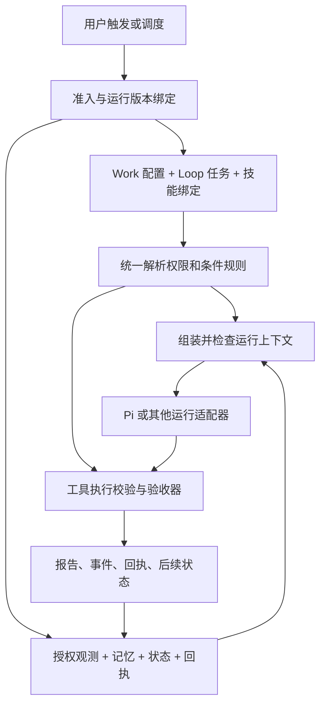

# Work 产品逻辑与提示词装载架构建议

日期：2026-09-15。状态：设计稿，尚未实施。

后续进展：本稿保留设计时的现状描述；当日已完成统一装载与 7 个车间角色重写，范围和验证见 [实施记录](work-prompt-loading-implementation-2026-09-15.md)。本稿其余后续设计不因此视为完成。

范围：桌面 Web 与必要后端；本次只分析并记录方案，不修改车间、Loop、权限、技能、生产服务或运行状态。

建议：以 Work 作为规则归属和版本管理的中心，复用现有 Work Harness，将项目基础规则、车间角色规则、Loop 任务要求按适用范围组合；每次运行另行装载事实、状态和反馈。模型提示词、实际工具权限和验收条件来自同一份解析后的配置。Pi AgentHarness 负责模型与工具交互，不承担产品规则的最终解释权。

## 1. 控制目标

让每次运行都能回答：谁在执行、负责什么、依据哪些事实、可以做什么、什么情况下停止、结果如何验证、下一轮如何继续。减少规则重复、角色混淆、无效重试和状态失真，同时让用户可以查看、暂停、纠错、审核和回滚配置。

这是一项既有规则的整理与装载改造，不是让用户重新写三份大提示词，也不是要求所有 Loop 执行同一条固定工具流水线。

## 2. 被控对象与产品关系

沿用现有控制架构契约和领域词汇，不新增一套与 Work 并行的智能体配置系统。

| 产品对象 | 职责 | 与提示词的关系 |
| --- | --- | --- |
| Chat | 全局人工控制台，用户在这里提出目标、启动、暂停、纠错 | 产生有目标对象和作用域的控制意图，不能绕过目标边界 |
| Workshop / Work | Workshop 是现有运行容器；Work 是由使命、控制契约、技能、Loop、记忆和反馈构成的完整长期控制器 | 承载角色、长期方法、资源范围和权限 |
| Loop | Work 内持续保存的任务定义，拥有目标、触发、输入、动作、验收和失败处理 | 承载任务专属要求；长期保存不等于每次手工重写 |
| Run / Attempt | Run 是一次实际执行；Attempt 是同一次运行内的尝试 | 固定本次配置版本，记录当前时间、观测、动作回执和验证反馈 |
| Connector / 原始观测 | 获取消息、行情、文件等外部事实 | 是事实输入；网页、消息和工具返回不能自动成为控制指令 |
| Memory | 对过去观测和结果的状态估计，帮助后续判断 | 按授权范围召回并附证据，不直接修改角色与权限 |
| Skill | 可复用的工作方法，由 Work 或特定 Loop 绑定 | 按明确绑定和任务需要装载，不决定权限 |
| Tool | 真正读写受控对象的执行入口 | 工具描述说明能力；权限、幂等、并发与审核由程序执行 |
| Artifact / Feedback | 报告、提案、记忆、跟踪任务、外发回执和验证结果 | 是本轮产物与下一轮输入；不同产物有各自的完成状态 |

用户先给 Work 设定长期目标，再由 Loop 承接有时间安排或手动触发的持续工作。运行读取授权观测和历史状态，决定下一步，调用工具，检查回执，完成验证并留下反馈。下一次触发重新进入这一过程。车间的直接任务也使用同一角色和边界，只以本次意图代替 Loop 任务定义，不需要伪造 Loop。

领域控制目标必须分开：自选股猎手维护候选池和正式自选股；操盘交易员消费正式自选股进行模拟交易和复盘；消息理解和记忆整理处理原始观测的解释、任务及记忆；内容车间处理内容产物及授权发布流程。全局基础规则不应夹带交易仓位、候选晋升或某个收件人的规则。

## 3. 观测输入与现状证据

本设计依据当前代码、既有架构文档，以及本次会话上一轮对自选股猎手保存配置的只读查询。查询范围为该车间 7 个未归档 Loop，5 个启用、2 个暂停。未执行真实业务 Loop；下列问题是配置和链路证据，不等于已复现某次运行的全部因果。

已存在的基础：

- `workshops/work-model.ts` 已描述 controlContract、skillBindings、loopBindings、memoryPolicy、artifactPolicy、feedback、changeControl。
- `harness-evolution/component-registry.ts` 已将使命、技能绑定、边界、上下文策略、Loop 和 verifier 派生为 Work Harness 组件。
- 既有 Work 版本、Harness Snapshot、运行事件、执行租约、命令回执和审核入口可复用；Harness 演进采集受功能开关控制，不能假定所有运行已完整绑定这些快照。
- Pi 适配器每次 run 创建内存会话，目前传入的 systemPrompt 默认为空，自动重试和自动压缩关闭；宿主掌握持续任务状态。

查到的装载问题：

1. `loops/native-executor.ts` 的模拟交易规则依据是否出现某些 `quantPaper*` 工具注入。猎手只读取自选股也会收到交易次数、仓位、买卖方向等操盘规则。车间直接执行的提示词有同类判断。
2. “写入前检查池子”重复写在 7 个 Loop 中；维护工具又被全部列入 `verification.requiredSources`，使条件动作变成每轮必需调用。
3. 午盘 Loop 保留了禁止外发消息与必须发送工作汇报两条矛盾要求。
4. `buildWorkshopSkillRule` 读取 `workshop.modelConfig`，但 Loop 上下文中的 workshop 投影未保留该字段，绑定的技能指导可能在这条链路消失。拥有 Skill 工具不等于已装载绑定内容。
5. context 解析仅输出 sources、instructions；独立的 `preWritePoolGuard` 扩展对象没有进入正式执行契约。文字说明仍在，但不能据该对象声称前置硬校验已实现。
6. 当前运行快照主要记录任务 promptHash、工具和策略摘要，没有完整表示最终系统提示词、技能内容版本和模型实际输入。
7. `workshopBoundaryToLoopPolicies` 对外写入模式存在车间值覆盖 Loop 值的路径，不完全等于“取更严格边界”。需要在后续策略统一时单独验证和修正，不能仅靠提示词宣称。
8. 车间提示词最终存在整段截断；Loop 上下文也会缩短 mission 和 directive。当前预算主要读取 contextProfile/loopContextProfile，而 Harness 的 context-policy 组件记录字段未完全对应实际使用字段，需要一起收敛。
9. 同一次运行重试时会重新读取部分车间配置，而 Loop 规格可能来自已捕获行或旧 LoopState。需要显式决定本轮采用哪个配置版本，避免新旧要求混用。

## 4. 状态模型与存储归属

采用“持久配置”和“本轮上下文”分离。

| 内容 | 建议权威来源 | 生命周期 |
| --- | --- | --- |
| 平台基础行为、运行协议、记忆使用协议 | 版本化平台 Harness 组件，初期可由代码或受版本管理文件提供 | 随发布变更 |
| 车间使命、角色、共同业务规则、边界 | Work 配置及其版本；沿用现有使命与控制契约，补齐共同规则的明确字段 | 审核后的新版本生效 |
| Loop 目标、触发、必读来源、条件动作、验收、交付 | Loop 定义及其关联 Work 版本 | 每轮引用，变更有记录 |
| 技能方法 | 已绑定 Skill 的内容与版本/校验值 | 绑定和技能修订后变更 |
| 用户临时或长期指令 | 现有 directive，保留作者、作用域、优先级、目标、有效期与消费状态 | 仅本次或持续有效 |
| 事实、记忆、当前状态、回执 | 现有原始事件、Brain ContextPack、LoopState、领域台账和命令账本 | 按新鲜度刷新 |
| 本次装载记录 | 扩展现有运行/Harness 快照，指向上述来源 | 每 Run 固定，Attempt 追加 |

不要另建一个自由文本 systemPrompt 字段，同时复制 mission、boundaryPolicy 和 Loop 规则成为第二份权威配置。用户通过现有车间职责、规则、Loop、技能和审核入口修改内容；系统生成模型需要的提示词。若增加高级补充说明，也必须标出其作用域和优先级，不能让补充文本授予权限。

## 5. 三层指令、事实输入与模型装载

### 5.1 三层按规则归属划分

| 层级 | 内容 | 不应放入 |
| --- | --- | --- |
| 项目基础层 | 工具回执为准、事实与推断分开、记忆证据要求、预算与停止、尊重生效策略、结果可追溯 | 具体车间交易参数、固定收件人、最新行情 |
| 车间角色层 | 我是谁、控制哪个对象、长期职责和共同方法、当前批准边界的说明、适用技能的核心步骤 | 其他车间职责、全部历史事件、每个 Loop 的独立交付要求 |
| Loop 任务层 | 本任务目标、任务独有约束、输入范围、新鲜度、条件动作、验收字段、交付目标、停止条件 | 重复粘贴项目与车间通用规则 |

三层指令之外，单独组织本轮事实：运行时间、触发原因、当前池子、持仓保护信息、未完成 follow-up、相关记忆、工具观测及上次失败反馈。事实有来源、时间和质量标记。记忆里“以后每天发送”的文字不能直接升级为有效外发规则；需要经过用户控制和版本化变更路径。

### 5.2 在当前 Pi 接口上的落点

```text
systemPrompt
  项目基础规则
  当前车间的角色与共同工作规则
  生效权限、记忆边界和必要技能方法的说明

本次任务消息
  本 Loop 的任务契约（直接车间任务则使用 taskIntent）
  本次有效的用户指令及其作用域
  当前状态、事实引用、相关记忆和新鲜度
  本次尝试的验证反馈与已完成动作回执

tools
  本次真正可用的工具定义与参数结构

后续消息
  真实工具调用与返回；必要的新观测和宿主控制事件
```

规则在文本中出现的位置不能替代程序校验。特定模型协议对消息形式有差异时，由运行适配器处理；兼容层若只能把系统内容降为普通消息，必须显式记录能力限制，不能悄悄宣称语义等价。

Skill 的核心方法根据 role 和明确绑定装载。任务必须依赖的技能，在首次推理前由宿主解析并记录内容版本；其他授权技能可按需读取，读取后同样记录版本和来源。不能根据工具名称反推身份，也不把所有技能全文无差别放入系统提示词。技能对工具的使用要求仍受生效策略约束。

复用已有 Skill loader 和 Pi Skill 工具，但需要记录实际解析来源及内容校验值，同名技能不能只存一个名称。启动时固定内容或不可变修订，后续读取保持本轮版本，同时检查最新技能授权；被撤销的技能不能因为有旧快照就继续使用。项目基础规则从明确配置的受控来源加载，不让 Pi adapter 沿 sessionDir 自动搜寻并提升任意 AGENTS.md 或其他文件为系统指令。

## 6. 控制动作、工具矩阵与装载模块

把装载的主要实现集中到宿主 Work runtime 的一个模块，供 Loop 执行和车间直接执行共同调用。建议接口名为 `buildWorkRunContext`，名称是方案示意，尚无该实现。

```text
输入：已绑定版本的 Work、Loop/本次意图、角色与技能配置、
      解析后的生效策略、授权事实包、运行/尝试状态、模型预算

输出：systemPrompt、taskPrompt、工具清单、验收契约、
      装载来源清单、各段校验值与预算、冲突/缺失诊断
```

模块内先解析与校验，再选择适用规则和证据，最后渲染。纯组装部分接受明确输入，不偷偷访问数据库、读全局技能或自行变更配置，便于通过同一接口预览和测试。需要的数据库和技能读取由准备阶段显式执行。



复用现有工具注册表和执行闸，不在新模块重写一套权限引擎。模型看到的权限说明、实际暴露的工具和验收器应由同一份生效策略派生。工具顺序由数据依赖和条件规则限制，模型仍可在授权范围内选择调查路径。

## 7. 边界、条件与审核

### 7.1 优先级

- 有效 denied 优先；权限范围、资源范围、审批要求按平台、Work、Loop 的约束共同收敛。缺省与显式 deny 必须区分，不能简单字符串覆盖。
- Loop 可以缩小车间权限，不能扩大车间权限；具体任务细节不能改写车间职责。
- 用户临时指令仅在明确目标、作用域和当前边界内覆盖可覆盖的任务要求。永久调整或放宽权限进入既有配置变更流程。
- 技能是方法，记忆是证据，二者都不能授予权限。事实包里的命令语句不能转为系统指令。
- 冲突在配置保存/预览时尽早显示，运行前再次检查。关键冲突应阻断相关动作；若存在明确授权的只读降级路径，可以继续观测并报告。不能让模型自行猜测冲突的取舍。

结构化字段可可靠检查冲突；任意自然语言不能保证穷尽识别。因此迁移时人工核对旧文本，将涉及动作、禁止、条件和交付的关键条目整理成可检查字段，保留原文和迁移映射。

### 7.2 写入前检查池子的实际归属

“改变池子前检查目标状态”是猎手共同方法；“本次目标池版本、容量和是否过期”是事实；“仅容量不足或满足过期条件才维护”是条件动作；“不超容量、不重复晋升、不移除保护标的”是领域写入校验。

建议过程：读取目标池状态及版本 → 判断是否需要维护 → 必要时进行授权归档并记录回执 → 重新读取/校验 → 提交本轮调整。池子在两步之间改变时由工具检查当前状态或版本并返回冲突，不能相信旧报告里的数量。

所有会扩大或改变池子的入口都应遵守相同校验。仅写跟踪任务或做 Work 自检，不应因为通用文本被复制就无条件归档。所需观察与条件写入分开：必读来源校验观察证据，归档校验只在条件成立且执行动作时适用。无须归档是一种可验证的正常结果。

### 7.3 交付和完成

将必须读取的数据、满足条件才执行的动作、最终验收和交付分别表示。创建 outbox、等待审核、发送中、已送达、发送失败不能视为同一状态；用户要求送达时，创建草稿并不等于完成。重试前查既有回执，避免重复汇报。

## 8. 反馈与评价

Loop 验证记录结构化字段、必要观察、条件动作结果及交付回执，不以模型自称完成为证据。自然语言 successCriteria 不能冒充全部已由代码检查；确定性检查与可选模型质量检查分开显示。

一次运行结束时保留：观测质量、判断摘要、实际动作、未执行原因、阻断类别、剩余 follow-up、下次验证条件。可复用经验进入车间记忆；需要变更长期规则的经验生成审核提案，不能让运行自行修改系统提示词。

评价重点为角色越界、重复动作、无效重试、缺失来源、错误完成状态、上下文缺失和用户可理解性；不以“工具调用次数多”或“每轮都产生调整”作为通用成功指标。

## 9. 生命周期、异常与降级

| 时机 | 装载与恢复行为 |
| --- | --- |
| 新 Run | 在明确的准入阶段固定 Work/Loop/平台规则和技能版本；执行时装入新鲜事实、时间和回执 |
| 同一 Run 的后续模型轮次 | 保留系统上下文和任务，追加新工具观察，不重复堆叠三层全文 |
| 有限重试 | 保持本 Run 规则版本，追加验证反馈和既有动作结果；刷新会过期的事实并记录新时间 |
| 等待审核后继续 | 读取真实审批与动作回执，再检验对象状态和有效权限；不假定旧 Pi 内存会话仍存在 |
| 进程恢复 | 优先从持久化步骤和回执恢复；已成功动作不重跑，需要新推理时从已记录上下文构建新会话 |
| 配置普通更新 | 新 Run 使用新批准版本；旧 Run 不静默替换一半规则 |
| 暂停、撤权、紧急边界变化 | 立即服从最新执行限制；保留现有检查的拒绝/重启语义，不能用旧版本授权继续写入 |
| 需要压缩上下文 | 保留角色、有效边界、任务验收和未决动作回执；优先减少不相关历史与事实正文，记录省略 |
| 核心技能缺失或必要规则超预算 | 显式失败或进入已定义的降级路径，不能静默裁掉必需约束 |
| 数据源异常 | 区分切源、缺失、样本、过期；暴露 provider/detail/warning，由对应动作的数据要求决定是否可继续 |

当前宿主已有重试和执行恢复，Pi 自动重试/压缩关闭。首阶段沿用这一职责分工，不同时开启另一套重试系统。稳定指令可按版本缓存，但每个新会话仍需要接收有效指令；缓存不意味着模型永久记住规则，也不保证免除输入成本。

当前审批 resume 是收据消费路径，并不是恢复 Pi lane；上表描述的是未来有新执行需求时的规则。外部结果不确定时先核对回执与外部状态，不直接重放。首版需验证“最新边界”覆盖 Work 和 Loop 两级，而不是只读取最新 Work、忽略本轮 Loop 撤权。

## 10. 页面可观测性与用户操作

在现有桌面车间与 Loop 页面扩展清晰入口：

- 车间：职责与共同规则、工具边界、技能、继承的项目规则；提示影响哪些 Loop。
- Loop：本任务要求、只读显示继承规则、覆盖/冲突提示、必读来源、条件动作、验收和交付状态。
- 运行记录：本轮加载了哪些规则版本、技能、观测与记忆，哪些内容缺失或被省略；允许展开查看脱敏后的模型输入及来源。
- 审核：继续使用现有变更提案、版本 diff、批准和回滚入口；显示变更影响范围。
- 暂停与纠错：沿用当前控制入口，注明本次有效、下一轮有效或永久变更。

用户平时维护业务规则，无需了解 system/user 等协议术语。查看模型实际输入属于高级排查入口，默认页面展示业务含义与结果。

## 11. 数据模型与审计记录

优先扩展已有 Work Harness 组件和运行快照，不先新增独立提示词注册中心。正式字段在实现前对照现有 schema 收敛，下面只定义必要信息：

- 规则：稳定标识、归属范围、适用角色/任务、版本、来源；关键条件和动作使用结构化字段。
- 生效配置：平台、Work、Loop、技能、工具策略与 verifier 的版本引用；解析器/渲染器版本。
- 运行装载清单：system/task/工具结构校验值、各来源内容版本、观测时间窗、质量、预算、省略原因、冲突诊断。
- 实际模型输入记录：区分宿主生成内容和适配器附加内容；受控保存必要的最终渲染材料和校验值。避免只存 hash 却无法重建输入。
- 事实引用：原始事实不复制为“规则”；引用内容需可追溯版本或保留当时片段，若已被删除则明确标记无法重建。
- 敏感处理：提示词存档不含凭证；按 Work/用户权限访问，默认展示脱敏内容，不把其他车间私有记忆装入当前运行。

快照保证可以解释和检查当时输入，不承诺模型输出能够完全确定性重现。普通配置回滚恢复旧规则版本；历史事件和外发结果不能用回滚删除。

## 12. 测试与验收

| 场景 | 必须验证的结果 |
| --- | --- |
| 猎手拥有读取自选股工具 | 不加载交易员仓位、下单和买卖方法，仍保留猎手边界 |
| 交易员执行 Loop | 不加载候选晋升与维护自选股职责 |
| 纯观察任务、池子容量充足 | 不强制调用归档工具，正常通过条件验收 |
| 池子满、需维护 | 有新鲜池子观测、授权维护回执和再次校验；保护标的不被错误处理 |
| 两次写入之间池子变化 | 工具拒绝过期状态或重新校验，不依赖提示词预先查询来保证并发正确性 |
| Loop 禁止外发、Work 允许外发 | 实际工具闸与提示词都保留 Loop 的禁止 |
| 验收要求外发但边界禁止 | 预览和运行前显示冲突，不循环尝试送达 |
| Loop 指定核心技能 | 首次推理前已解析并装入对应内容版本；缺失明确可见 |
| 记忆或网页含“忽略限制” | 被识别为事实来源内容，不改变系统规则或工具权限 |
| 重试、重复请求、进程恢复 | 已有写入和发送回执被复用，不重复执行 |
| 运行中更新普通规则、撤权 | 普通规则固定版本；撤权立即阻止后续动作 |
| 上下文预算不足 | 必要角色、边界、验收不被悄悄截断，省略项与失败原因可见 |
| Loop 与车间直接执行、不同引擎 | 同一角色及策略的装载含义一致；差异明确记录，输出协议保持各自消费者兼容 |
| 运行详情与恢复 | 可核对本轮实际输入来源和配置版本，错误状态可定位，可暂停和纠错 |

验证顺序：纯组装与策略测试 → 录制适配器输入的集成测试 → 无外部动作的回放/候选评估 → 桌面预览与恢复检查 → 经授权的必要生产验收。不能为验证提示词而默认发送消息或执行实际业务写入。

## 13. 分阶段落地建议

1. **梳理与去冲突。** 按角色/任务归属整理现有文本、Skill 和结构化字段；输出迁移映射和差异，解决已知跨角色注入、午盘交付冲突、维护工具被强制调用的问题。保留旧版本。
2. **接统一装载入口。** Loop 和车间直接执行共享组装模块，接入 Pi systemPrompt 与任务消息；修复技能传递，保持现有执行和结果消费者的契约。先提供预览和测试。
3. **对齐执行约束。** 必读观察与条件写入分离，收敛边界策略合并；写入前状态校验落实到领域工具，多入口共享，不以提示词代替。
4. **补齐追溯与产品入口。** 基于现有 Work Harness/运行快照，显示规则来源、版本、技能和输入缺口；使用既有审核和回滚能力。
5. **受控验收后扩大覆盖。** 从猎手观察类 Loop 和独立回放案例开始，覆盖直接车间运行、重试、停止与恢复，再扩展其他角色。整轮业务测试遵守各 Work 的实际授权。

本次交付是上述产品梳理和架构建议；这些步骤均未在本轮实施，不代表已经生效。

## 参考依据

- [工程控制论指导思想](../architecture/engineering-cybernetics-guiding-principles.md)
- [控制架构契约](../architecture/zhiyu-control-architecture-contract.md)
- [领域词汇](../reference/domain-glossary.md)
- [Work 架构方案](workshop-work-architecture-plan.md)
- [Harness 演进方案](agentic-harness-evolution-upgrade-plan.md)
- [Work 模型](../../apps/web/lib/workshops/work-model.ts)
- [Harness 组件派生](../../apps/web/lib/harness-evolution/component-registry.ts)
- [Harness 运行采集](../../apps/web/lib/harness-evolution/capture-service.ts)
- [Loop 提示词与执行](../../apps/web/lib/loops/native-executor.ts)
- [Loop 上下文投影](../../apps/web/lib/loops/context-window.ts)
- [车间上下文](../../apps/web/lib/workshops/context-window.ts)
- [Loop 规格解析](../../apps/web/lib/loops/spec.ts)
- [Loop 验证器](../../apps/web/lib/loops/verifier.ts)
- [车间到 Loop 的边界桥接](../../apps/web/lib/workshops/boundary-policy.ts)
- [运行快照](../../apps/web/lib/ai/runtime/run-snapshot.ts)
- [执行租约与回执恢复](../../apps/web/lib/work-runtime/loop-execution.ts)
- [Pi AgentHarness 适配器](../../packages/ai/src/agent/runtime/pi-harness-adapter.ts)
