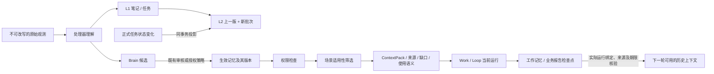

# 记忆数据归属与主记录合同

状态：2026-10-20 实施前盘点与目标合同，部分已由首批代码实现并验收，具体覆盖见[首批验收](../verification/memory-system-governance-2026-10-20.md)。下文的完整字段与接口目标不能整体视为已实现。源码存在不表示目标数据库已迁移、日常运行进程已装载或长期生产效果已验证。未读取或复制私人消息、真实任务正文及密钥。

配套计划：[记忆治理实施计划](../plans/memory-system-governance-2026-10-20.md)。现有平台总说明：[统一记忆平台说明书](./unified-memory-platform-manual.md)。发生冲突时先定位具体对象与实现覆盖，不用本合同静默重解释历史数据。

## 1. 不同对象谁说了算

| 对象 / 问题 | 源码可见主记录 | Brain、L2 与工作笔记的职责 | 当前缺口与目标合同 |
|---|---|---|---|
| 微信原始事件 | `interaction_events`；原消息存储另有 `raw_messages` | 引用、理解和摘要，不改写原文 | 不根据相似正文断言两条记录同源；需可靠外部消息身份或显式映射 |
| 微信待办 | `interaction_tasks` 的 id、status、dueAt、sourceEventIds | 保存历史判断与关联 | 完成/撤销以业务服务返回的当前版本为准；`canonicalKind=commitment` 不能覆盖任务状态 |
| Work 身份 | `workshops.id`；多个运行模块把它用作 `workId` | 归属与角色上下文 | `workshop` 与 `work` 的权限 scope 类型不能因 ID 相同就自动等价 |
| Work 指令 | `workshop_directives`，状态 active / consumed / archived | 记录指令的理解与历史 | consumed 仅表示被运行消费；不自动推出主人已验收、对外承诺已履约 |
| 聊天交办事项 | `workshop_chat_work_items`，关联 directive / latestRun，具有 revision 与 status | 为回答提供主记录引用 | 当前运行 completed 会投影为 awaiting_acceptance 或 needs_input；不能说“运行完成=事项验收完成” |
| 单轮运行 | `workshop_runs` / `loop_runs` 与结束事务、验证结果 | 历史运行经验 | runtime 完成、业务验证、交付回执分别呈现，不用模型自述替代 |
| 审批 | `workshop_review_items` 及相应领域审核服务 | 记住审批规则和历史结论 | 是否允许执行以当前待审对象、版本及审核回执为准，旧记忆不授权 |
| 外部发送 | `workshop_outbox`、attempt / resolution / recovery 记录及发送回执 | 提供联系人和发送背景 | 草稿、审核通过、尝试发送、确认已发送是不同状态 |
| 承诺履约 | 本轮 schema 搜索未发现独立 `commitments` 主实体；存在 L1 atomType、Brain 分类、图关系 | 表示识别出的承诺与历史估计 | 不虚构正式履约账本。能绑定现有 task / work item / outbox / 审批对象则引用；不能绑定则标 `untracked`，不能自动改为 fulfilled |
| 项目身份 | 本轮目标 schema / memory runtime 搜索未发现独立 projects / projectId 注册实体；owner-context 页面按图实体类型聚合“projects” | 保存项目画像和适用性提示 | 展示分组不是业务身份。可靠 host projectRef 待建立或接入；旧名称仅作 label，名称相同不归并 |
| 长期记忆 | `brain_memories` 的状态、版本及审核 / 修订回执 | 跨轮认知主记录 | 是“记忆当前版本”的主记录，不是所有业务状态的主记录 |
| L2 场景状态 | `brain_state_snapshots` 中的派生快照 | 估计场景，保留证据与未决问题 | 实施前只聚合当轮 items；首批已实现上一版＋新批次、追加版本和任务同事务投影，完整目标仍见合同与验收边界 |
| 工作进度 | workingMemory 保存事件、版本与运行时回执 | facts / hypotheses / openQuestions / nextAction；仍未经核验 | 不直接批准长期事实；保存与下一轮实际加载分开证明 |

盘点依据：[schema.pg.ts](../../apps/web/lib/db/schema.pg.ts)（interaction_tasks 2790、workshops 3390、review_items 4018、directives 4722、chat work items 4755）、[schema-sqlite.ts](../../apps/web/lib/db/schema-sqlite.ts)、[chat-work-items.ts](../../apps/web/lib/work-runtime/chat-work-items.ts)（72）、[owner-context.ts](../../apps/web/lib/brain/owner-context.ts)（254）、[scenarios.ts](../../apps/web/lib/interactions/scenarios.ts)（111）。行号是盘点时定位，修改后须重新核对。

首批链路可按下图理解。任务是业务主记录；L2 和 Brain 分别承担场景估计、长期认知，审核状态不会把它们变成所有业务的实时真相。



## 2. 权限、归属与适用性分开

合同采用三个独立判断；首批已有 typed 场景适用性与 host 绑定，正式项目实体仍待建模，不建立一个包办所有含义的“项目 scope”：

1. `ownership`：host 确认的 user、Work、Loop、来源归属。模型参数、目录路径和项目名称不能声明归属。
2. `access`：现有 requester、scope、grant 和 denied 规则决定能否读取、引用、写入、审核。适用性不能扩大授权。跨 Work 共享必须有当前有效授权；回滚、legacy fallback 及证据展开沿用同一检查。
3. `applicability`：内容适用于哪个可靠 projectRef、任务、主题和时间。只有通过 access 后才筛选；全局偏好可适用于多项目，项目不明返回 unknown，不把未知当不相关，也不把它升级成全局。

现有 `BrainScope` 有 global / workspace / workshop / work；`policy.ts` 依据主体、owner 和显式 grant 判断。本合同不把 `workspace` 文件目录或 `owner-context.projects` 展示数组改成权限来源。跨项目但获准可读的记录可以作为历史证据，必须明确“可读、适用性未确认”；不默认成为当前项目事实。参见 [types.ts](../../apps/web/lib/brain/types.ts)、[policy.ts](../../apps/web/lib/brain/policy.ts)、[workspace.ts](../../apps/web/lib/workshops/workspace.ts)。

首批 host 绑定使用已有 Work 配置中的结构，示例仅说明格式，未写入任何真实 Work：

```json
{
  "memoryApplicability": {
    "schemaVersion": "memory-applicability.v1",
    "scenarioKeys": ["project:alpha"]
  }
}
```

该对象来自已保存的 `modelConfig`，不从任务正文、名称或模型工具参数推断，也不授予权限。未配置绑定时，明确带场景的普通记忆会标 `scenario_context_required` 并不自动装载；旧无场景记录仍按原权限读取并标 unknown。修改绑定会触发连续任务隔离；没有安全 scoped reader 的自动历史事件及辅助索引会明确跳过。这是本轮的实际使用限制，不代表正式项目注册或完整绑定编辑界面已完成。

## 3. 原始身份与派生链

现有引用格式需要兼容盘点，不能批量改名后丢失原始引用：

| 格式 / 来源 | 当前解析方式 | 兼容边界 |
|---|---|---|
| `brain-observation:<uuid>` | 定型引用，按 user 读取 observation | 不把 observation UUID 当消息 UUID |
| interaction / workshop 裸 UUID | 配合 ownerHints 判断事件表与归属 | 裸 UUID 不足以自证类型或权限；歧义时拒绝猜测 |
| `legacy-raw-message:` / `raw-message:` / `raw_message:` | 后缀可对应 raw id 或 messageId | 保留旧 alias，解析后记录具体来源类型与稳定身份 |
| 工作记忆 `toolCallId` | 真实调用与结果配对、来源目录、版本和可见性核验 | 是读取回执，不等于原始来源根身份；历史调用不能冒充本轮已读 |
| 网页 `evidenceId` / `sourceEventId` / contentHash / offset | 同一不可变快照与已读窗口 | URL 相同不能证明版本相同；续读不应重新抓取替代旧快照 |
| 源码 path / sha256 / 起止行 | 文件原始字节及实际显示窗口 | 哈希相同不扩大已读行覆盖；未展示部分不能记为已读 |

参见 [evidence-reader.ts](../../apps/web/lib/brain/evidence-reader.ts)、[host-working-memory-sources.ts](../../packages/ai/src/agent/runtime/host-working-memory-sources.ts)、[research-evidence-verification.ts](../../apps/web/lib/workshops/research-evidence-verification.ts)、[codebase-read.ts](../../apps/web/lib/workshops/codebase-read.ts)。

目标身份记录应包含：版本、sourceType、sourceId、host owner、sourceVersion / contentHash、observedAt、原 ref aliases；读取回执另存 runId、toolCallId、sourceEventId、实际窗口、provider / detail / warnings。派生对象另存 parentRefs、rootObservationRefs、derivationKind、模型/规则版本、可信状态。具体字段映射优先复用现有 metadata 和事件，不由本文宣称新表已经存在。

同一原始事件的消息、摘要、图关系、L2、工作笔记和 Brain 投影共享根身份；重复读取只增加读取回执，不产生新的独立证据票数。派生节点不能回头作为自己的原始证据，不能仅凭图关系或旧摘要自动确认 Brain。原始纠错以新增观测和修订事件表示，保留原事件；有权删除/保留策略另由对应业务流程执行。

首批只对本批已获准读回的明确 `sourceEventId` 关联和 raw 同 row 别名做来源分组；未知关联不推断，不新增来源读取，不提高事实可信度。通用派生图的完整根谱系与循环准入仍是后续目标。

## 4. 统一读取结果语义目标（核心调用者已首批接入）

结果至少分别表达 `ok`、`empty`、`denied`、`not_found`、`unsupported`、`unavailable`、`degraded`，并带请求范围、provider、必要的安全原因码、warnings、完成时间和 coverage。

- `empty` 只表示本次获准查询成功但零命中，不证明现实中没有该事项；未完成全部查询不能返回它。
- `denied` 不能触发更宽 scope 或 legacy 绕过；对无权访问者不披露对象是否存在。
- `not_found` 只在已授权且完成精确查找后使用；未知引用类型是 unsupported，数据库/提供方故障是 unavailable。
- `degraded` 保留原失败与替代来源；不得把摘要回退标成原文已读取，不得使 candidate 变 active。
- 内部保留原始错误与审计原因，用户界面输出脱敏说明。失败时允许读取另一个本来获准的独立来源，但不得伪造本来源已成功。

现状：Brain evidence reader 对多数未解析 ref 只返回 unresolved，数据库故障会抛出；统一搜索已有 sourceStatuses / warnings；IndexedDB 查询分支还存在 catch 后返回空数组。目标是有界兼容适配，不在调用者尚未迁移时静默更换成功含义。

## 5. 主记录引用合同（拟实施）

涉及“完成、履约、已审批、已发送、当前持仓”等业务判断，记忆保存 `authorityRef`：领域、实体类型、实体 id、读取时版本、状态字段、observedAt、读取回执。回答当前状态前从原业务服务重读；不允许重读时明确 unknown / denied / unavailable。

Brain 保存历史判断、用户修订、派生关系与证据。业务实体改变后，历史判断可以保留，但当前状态投影必须失效或提示已被主记录更新；同一状态变化不能在 L1 task、Brain commitment、L2 openLoop 三处各自维护独立“完成”状态。没有正式承诺实体时，只有明确绑定的现有主记录可判断履约；新建独立承诺账本属于需另行建模的实现项。

## 6. Legacy 清单与退出合同

| 路径 | 已观察代码关系 | 后续处理；当前均未判定可删除 |
|---|---|---|
| interaction_memories | 实施前先写 legacy，再 try 写 Brain 并可能吞错；首批已改同 UUID、来源关联与同事务命令 | 创建/审核/删除/清理已获隔离 PG 故障回滚证据，晋升有单元回归；保留历史，后续再迁移调用者并停止冗余写入 |
| workshop_memories | 写 legacy 后调用 Brain mirror；审核、读取仍有兼容路径 | 逐入口核对事务性、事件、调用者及返回 ID，不直接删除旧表 |
| unified-search / legacy adapters / backfill | API、native/MCP 工具、Brain 补充路由与一次性脚本仍引用 | 逐项标记 canonical / discovery / evidence / derived；故障回退不得提高可信度 |
| short / mid / long engine | AI engine → IndexedDB adapter → client wrapper | 本轮未检出 Web / 后台调用 `runMemoryForgettingCycleForUser`；不是已验证运行的 7 / 90 天自动机制 |
| IndexedDB summary fallback | client query 包装可在 includeSummaryFallback 时调用 | 保留 sourceType=summary，与原文及 Brain 语义分开 |
| retention cleanup / embedding dream | Web hook 调用清理；维护模块有 embedding dream | 不属于 short / mid / long 晋升；不能作为冗余记忆功能一并关掉 |

依据：[interactions/service.ts](../../apps/web/lib/interactions/service.ts)（1343）、[workshops/service.ts](../../apps/web/lib/workshops/service.ts)（1286）、[unified-search.ts](../../apps/web/lib/memory/unified-search.ts)、[indexeddb/client.ts](../../packages/indexeddb/src/client.ts)（175、414、614）、[forgetting.ts](../../packages/indexeddb/src/forgetting.ts)、[engine.ts](../../packages/ai/src/memory/engine.ts)、[use-insight-refresh.ts](../../apps/web/hooks/use-insight-refresh.ts)（516）、[insight-maintenance.ts](../../apps/web/lib/cron/insight-maintenance.ts)。

退出顺序：枚举调用者与实际开关 → 对齐主写与回执 → 影子对照 → 切读 → 停双写 → 观察 → 保留只读历史与可切回版本。回滚恢复已核对组件和 reader / writer 策略，不删除历史事件、不回放外部动作、不自动重批记忆候选。
