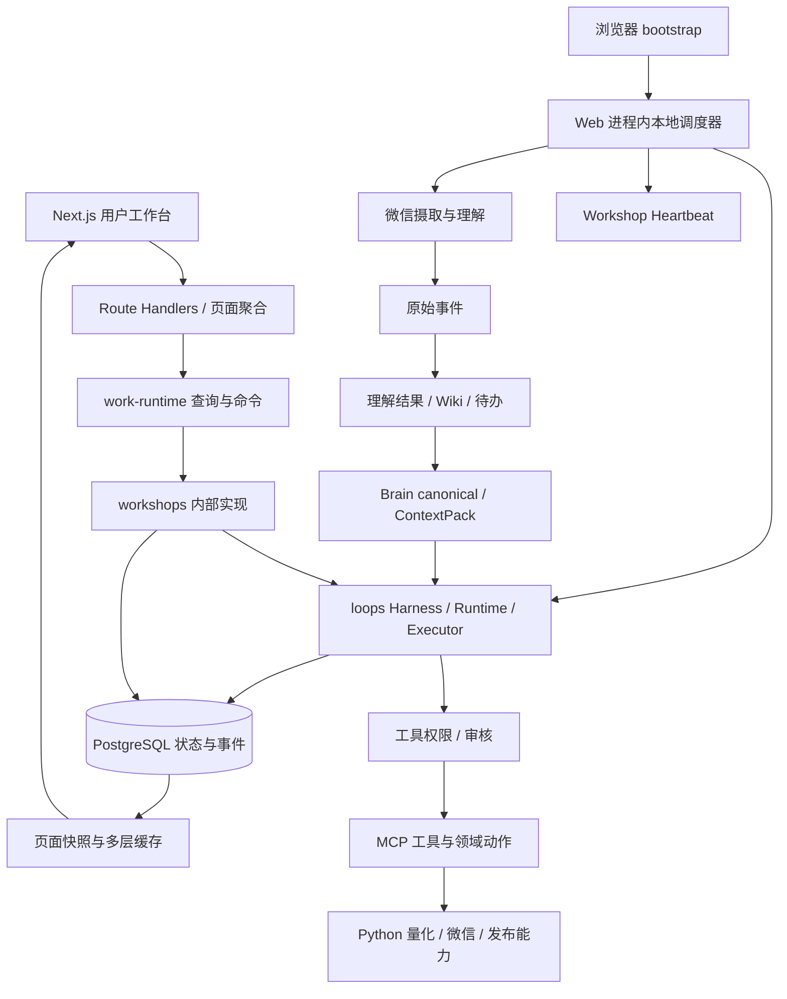

# Zhiyu 全项目架构、前端与用户体验审查

审查日期：2026-09-06。审查对象：当前工作区，包含已有未提交修改。

## 生产模式复核结论（2026-09-06 17:00 更新）

**有部分初审现象由依赖未启动、开发态加载或缓存尚未刷新造成，需要收窄结论；已确认的状态投影、计数和存储问题仍然存在。** 以下复核优先于初审时的环境描述。未修改产品代码。

本次使用已完成的生产构建，检查 Next.js（3515）、量化服务（8766）、微信桌面服务（8765）与 PostgreSQL；服务健康检查正常。重新打开车间、量化、微信代看页面，比较页面聚合接口和下游服务，重跑原失败测试与隔离账户探针。服务在线不等于全部业务任务验收通过；本次没有手动发送消息、下单或执行故障注入。

| 初审现象或问题 | 完整启动后的证据 | 修订判断 |
|---|---|---|
| 量化展示 8 月 26 日旧行情 | 下游已返回 live/tencent 数据；缓存预热后聚合接口恢复 full_market，涨 2444、跌 2913、温度 46 | 旧快照与未启动有关，不能据此说行情链路无法更新；保留降级提示与页面刷新缺陷 |
| 行情日期较旧、账户更新时间较旧 | 9 月 6 日为周日，个股报价为 9 月 4 日；账户 updated_at 为最后状态变更时间 | 不能把周五报价或账户未发生变更当成离线证据，撤回这种推断 |
| 车间加载或没有结论 | 生产页面加载后展示已有 9 月 4 日报告；检查时无浏览器 warning/error | 不再把初始空态当成业务结果缺失；开发态单次 SyntaxError 不作为稳定缺陷 |
| 调度是否已启动（F3） | 16:56 服务健康时 allowed=true、isRunning=false；页面 bootstrap 后 16:57:15 启动，16:59:16 首轮成功结束 | 调度能运行；但进程启动与调度启动仍不同，页面耦合得到实测支持 |
| 摘要事件和审核数（F6） | 三个车间均只保留最近 100 条中最旧 20 条；一个车间 pendingOutbox 为概要 68、详情 6，另一个为 118、0 | 生产模式仍复现，属于投影逻辑问题 |
| 微信数量与风险（F9） | 同一时间窗口 limit=12 时待办 12、风险 0；limit=100 时待办 100、风险 2 | 不是服务离线，截断影响风险可见性；这些数字也不是全库总量 |
| 账户覆盖（F4）、身份绕过（F1） | 临时账户探针仍为预期 2 条、实际 1 条；无 Cookie session 仍含 user | 与启动不完整无关；身份结论限定于当前本机信任模式和将来开放部署 |
| Loop 并发、外发未知结果、事件序号（F2/F7/F8） | 对应代码路径未因生产启动改变 | 保留静态风险，未声称本次发生重复执行、重复发送或跨进程冲突 |
| 4 个失败断言 | 完整服务环境下重跑 3 个文件：6 项中 2 通过、4 失败 | 仍需修正测试断言/隔离，不能直接等同为 4 个业务故障 |

调度首轮约 121 秒，其中微信摄取成功结束，原始事件去重 1 条、插入 0 条。期间下一次定时扫描返回“上一轮仍在运行”，最终成功，**不是永久卡住**。这也说明需要分别展示扫描耗时、跳过次数和各子模块结果。该轮 Loop/Heartbeat 启动数均为 0，不能据此证明所有长期任务都已执行成功。

量化缓存预热期间还有一个可重现的语义问题：聚合结果曾返回 `market_scope=watchlist_fallback`、`market_warning`，只按 1 只自选股计算涨 1/跌 0/温度 100；界面仍称“市场温度”，没有揭示统计范围降级。随后下游和聚合接口恢复全市场数据。页面初次载入的旧快照在手动重新加载后才更新；当前页面初始化请求没有持续订阅后台刷新结果。因此 F5 应修复的是**范围、新鲜度和刷新状态的呈现与收敛**，不能简单归结为量化服务坏了。

Brain 状态接口显示 migrationReady=true，但 canonical_kind/group 覆盖率均约 12.5%（185/1478），仍标记 degraded。数据库启动正常不会自动消除历史回填欠账；该数值是字段覆盖率，**不是记忆召回准确率**。

复核证据：[启动后首次取样](<D:/zhiyu/docs/reviews/2026-09-06-production-recheck.json>)、[首轮完成后取样](<D:/zhiyu/docs/reviews/2026-09-06-production-recheck-after.json>)、[复核脚本](<D:/zhiyu/docs/reviews/2026-09-06-production-recheck.mjs>)、[复核测试结果](<D:/zhiyu/docs/reviews/2026-09-06-production-recheck-tests.json>)。取样保留时间、计数和序号，移除用户及消息来源名称。

## 1. 核心判断

Zhiyu 已有明确且有价值的控制系统骨架：Work 定义、Loop 执行、分层记忆、工具边界、事件、审核与反馈。当前主要瓶颈不是缺少智能体能力，而是**各条链路对权限、运行状态、事实新鲜度和一致性的解释尚未统一**。

适合继续作为本地、单主人、有人观察的实验工作台演进。以当前实现，不应直接推导出“可无人值守长期运行”“可多进程扩容”或“可以安全开放网络访问”。这些能力需要单独验收。

建议保留模块化单体，先收紧运行时与状态契约，再考虑独立 worker；目前没有充分理由把所有业务拆成微服务。

## 2. 范围与证据强度

- 对 apps/web、packages、tools 做文件与职责盘点；其中 TS/TSX/Python 文件 1368 个、约 36.6 万行。统计含测试、schema、语言资源，不代表全部是手写业务代码，也不代表逐行审阅了整个仓库。
- 深读了身份入口、Work Runtime、Loop 调度与执行、事件写入、Outbox、Brain 权限与召回、微信事实与待办管道、量化缓存与模拟账户、核心前端页面及 CI。
- 启动 Next.js 开发服务，绑定 127.0.0.1:3515。审查进程设置 ENABLE_LOCAL_SCHEDULER=false、VERCEL=1，按现有代码关闭调度；没有触发已有智能体、微信发送、发布或模拟下单。量化与微信桌面服务保持未启动，用于观察依赖缺失时的体验。
- 初审浏览器检查：智能体车间、微信代看、证据展开、量化、统一记忆、个人记忆/主人知识库。没有完成模型调用、发布全过程、真实微信桌面操作或移动端验证；生产构建已在后续重启和本次复核中补验。
- 类型检查通过。Web 全套 Vitest：184 个测试文件，181 通过、3 失败；1172 项测试，1164 通过、4 失败、4 跳过。对 3 个失败文件再次运行，4 项仍失败。
- Python 模拟盘现有测试：7 项通过。另用临时目录复现账户存储覆盖；用纯函数输入复现摘要事件截断方向错误。
- 初审未执行生产 build；后续按用户要求运行 pnpm build，含数据库迁移、类型检查和 143 个静态路由构建，退出码 0。已使用 next start 运行生产版本并完成上述页面/API smoke 验证。

本报告区分：**实测**、**确定的静态代码路径**、**架构风险/待验证**。页面开发态耗时含首次编译，不作为生产性能结论。

## 3. 实际架构与值得保留的部分



这不是纯前后端分离项目：Next.js 同时承担页面、HTTP、业务命令、后台调度和模型执行入口；Python 工具是外部执行器；packages 则承载基础设施和共享能力。不能因为存在 runtime-worker 包，就认为核心 Loop 已脱离 Web 进程。

已经做得好的地方：

1. `work-runtime` 有查询/命令/资源入口，workshops README 也明确了内部实现身份。这是继续集中权限、一致性和审计语义的正确位置。
2. Brain 有用户隔离、工作作用域、显式 grant、过期判断、证据要求；ContextPack 能说明选中、拒绝、遗漏与冲突。它比简单堆聊天摘要更接近状态估计器。
3. 微信理解结果引用原始事件，部分写入会校验来源属于当前用户；批量摄取有数据库冲突去重。实测“看证据”能展开原始消息。
4. Loop 工具门禁将需要审核和拒绝都落实为 deny；Outbox 有预览、内容绑定确认 token 和边界检查。不能把当前系统描述成完全依赖 prompt 自律。
5. Workshop Heartbeat 已实现带条件的数据库 lease claim。它可以成为普通 Loop 抢占机制的参考。
6. 量化已有 sample/live 区分、缓存元数据、价格精度、现金冻结、T+1 与自选股限制。问题在于这些规则尚未形成全链路一致的控制契约。

参考：[Work 入口](<D:/zhiyu/apps/web/lib/work-runtime/commands.ts>)、[Brain 权限](<D:/zhiyu/apps/web/lib/brain/policy.ts>)、[心跳抢占](<D:/zhiyu/apps/web/lib/workshops/service.ts:668>)、[工具门禁](<D:/zhiyu/apps/web/lib/loops/tool-gate.ts>)。

## 4. 优先修复的问题

P1 表示会影响状态可信度、动作边界或持续任务正确性；P2 表示在规模增长、维护和日常体验上造成明显成本。身份问题在开放网络访问前属于阻断项。

### F1：身份认证被永久绕过，且部分写接口没有鉴权

**实测 + 静态确认；开放访问前阻断。** `isAuthBypassEnabled()` 无条件返回 true，auth 模块直接生成默认主人 session。无 Cookie 请求 `/api/auth/session` 返回 200 且包含 user。代理层仅放行。

此外模拟盘 orders POST 根本没有调用 auth，因此只修复 dev-auth 仍不能覆盖这个入口。调用者可传 actor 字段，其默认值也只是字符串，不是可信身份。

本地单主人免登录可以是产品选择，但必须把“本机信任模式”做成明确部署模式：默认仅回环绑定，检查可信 Host/Origin，外部访问使用真实身份。命令统一注入服务端 actor，并对所有写接口执行相同的身份/资源所有权规则。

依据：[dev-auth.ts:5](<D:/zhiyu/apps/web/lib/auth/dev-auth.ts:5>)、[auth.ts:362](<D:/zhiyu/apps/web/app/(auth)/auth.ts:362>)、[proxy.ts:3](<D:/zhiyu/apps/web/proxy.ts:3>)、[orders route:24](<D:/zhiyu/apps/web/app/(chat)/api/quant/paper/orders/route.ts:24>)。

验收：无凭据写入被拒绝；不能通过 actor 参数伪造审计身份；共享部署不能进入开发 session；本机模式无法被普通局域网请求当成主人调用。

### F2：普通 Loop 缺少数据库级的执行抢占与版本保护

**静态确认；P1。** native-scheduler 使用 Set 去重，再读取调度状态、普通 upsert 预定下一轮。runNativeLoopOnce 创建随机 runId，没有跨手动入口/调度入口共享的唯一运行声明。upsertLoopState 是先读后写，stateJson 整体替换。

两个进程、手动执行与定时执行重叠时，可以同时认为自己有权运行；随后还可能互相覆盖 lastLoopRunId、下一轮时间与反馈。当前进程内 Set 有价值，但不能承担持久状态互斥。

更严重的崩溃窗口是：先推进调度时间，再创建本轮运行。如果中间退出，原计划时刻可能已经被消费，却没有可恢复 run。此项未做真实进程杀死实验，应作为故障注入验收。

修复位置应在 Runtime 命令入口和数据库：`(loopId, scheduledAt/commandId)` 唯一键、原子 claim、leaseUntil、workerId、attempt、stateVersion；所有执行入口复用。完成回写需验证当前 lease/version，旧执行者不能覆盖新执行者。

依据：[native-scheduler.ts:222](<D:/zhiyu/apps/web/lib/loops/native-scheduler.ts:222>)、[runtime.ts:622](<D:/zhiyu/apps/web/lib/loops/runtime.ts:622>)、[service.ts:327](<D:/zhiyu/apps/web/lib/loops/service.ts:327>)、[service.ts:696](<D:/zhiyu/apps/web/lib/loops/service.ts:696>)。

验收：并发请求只执行一次；任意提交点退出后有明确恢复状态；重放不重复产生订单、提案或外发。

### F3：长期任务生命周期与页面访问耦合，故障之间缺少隔离

**生产实测 + 静态确认；P1。** ScheduledJobsInit 在页面挂载后请求 bootstrap；instrumentation 没有承担当前 Web Loop 的独立启动。启动服务但没有打开页面，不能据此认定调度已启动；关闭浏览器也不等于停止已经启动的服务端调度。本次先观测到服务在线但 isRunning=false，页面 bootstrap 后变为 true，并完成首轮扫描；问题是生命周期耦合，不是调度器不能运行。

调度扫描先恢复/清理，再顺序执行 Loop、Heartbeat、摄取、理解；多项工作共用 try/catch。前一项异常会让后续模块本轮跳过。开发模式下 ENABLE_LOCAL_SCHEDULER=false 本身也不能覆盖 `NODE_ENV === development` 的允许分支，本次额外设置 VERCEL=1 才关闭。

建议将调度启动、停止、健康与主人选择改为显式 runtime 生命周期。采用独立本地 worker 或受进程管理器管理的单实例 worker；各子扫描有独立超时和错误结果。先保持单 worker、数据库抢占，不急于分布式扩容。

依据：[scheduled-jobs-init.tsx:48](<D:/zhiyu/apps/web/components/scheduled-jobs-init.tsx:48>)、[bootstrap.ts:13](<D:/zhiyu/apps/web/lib/runtime/bootstrap.ts:13>)、[scheduler-state.ts:18](<D:/zhiyu/apps/web/lib/cron/scheduler-state.ts:18>)、[local-scheduler.ts:248](<D:/zhiyu/apps/web/lib/cron/local-scheduler.ts:248>)。

验收：不打开 UI 仍按时运行；显式关闭开关在开发/生产均有效；某数据源超时不阻塞其他控制器；UI 展示真实 worker 心跳与最近扫描错误。

### F4：模拟账户原子写文件不能保证业务事务

**隔离复现 + 静态确认；P1。** 账户存于一个 JSON 文件，多个入口都执行 load → 修改 → save。os.replace 保证文件替换的完整性，但两个请求先读同一版本再各自保存，后保存者覆盖前者。

用项目真实 `_load_account/_save_account`，在临时目录模拟两次读改写交错：预期两个记录，最终只剩一个。探针没有调用行情、真实下单或修改现有账户。

同时，GET account 和 GET orders 会 reconcile 并保存；“查看账户”也会触发状态推进。它使交易进度依赖页面轮询，扩大读写冲突，并让 GET 的行为不容易预测。

建议账户、持仓批次、订单、成交改为事务存储；至少在迁移前让完整读改写受同一把跨入口锁保护。撮合变成显式命令/定时执行，GET 只返回观察结果。订单增加客户端命令幂等键，避免每次重试都生成随机新订单。

依据：[paper_trading.py:64](<D:/zhiyu/tools/quant-service/app/paper_trading.py:64>)、[paper_trading.py:123](<D:/zhiyu/tools/quant-service/app/paper_trading.py:123>)、[paper_trading.py:266](<D:/zhiyu/tools/quant-service/app/paper_trading.py:266>)、[探针](<D:/zhiyu/docs/reviews/2026-09-06-paper-storage-probe.py>)。

验收：并发下单/撤单/查询后资金守恒；订单不丢失；重复 commandId 只产生一次动作；只读请求不改变账户。

### F5：量化的“实时”显示与实际数据新鲜度不一致

**依赖离线场景实测 + 生产预热场景复核 + 静态确认；P1。** 初审量化服务未启动时，页面仍显示绿色“实时行情 · 腾讯行情 · 缓存”，市场日期是 8 月 26 日，同时展示候选买入信号。完整启动并预热后行情可以更新，不能将初审旧快照作为正常在线环境持续故障的证据。账户 updated_at 表示最后状态变更，不能单凭其较旧判断离线；周日显示周五收盘报价也属正常。

后端已经能标记 stale、fetched_at、warning；但 UI 根据 service_mode=live 展示“实时”。只要 dashboard 和 paperAccount 都存在，`error && !paperAccount` 分支不会展示服务未连接错误。数据存在把刷新失败掩盖了。

生产预热时还实测到 watchlist_fallback：只有 1 只自选股，却显示“市场温度 100”，未呈现 market_scope/market_warning；预热完成后接口恢复 full_market、温度 46。页面初始化只抓取一次，后台刷新完成没有自动同步到已展示快照。本项应同时覆盖离线提示、统计范围降级与页面更新，而非仅要求启动服务。

撮合层另有相关缺口：`_is_matching_session` 只检查周几和时段；`_try_fill_order` 看价格是否为正与限价关系，没有核验报价 updated_at。provider 返回在线数据，不代表该报价属于当前交易日。这里是静态控制缺口，没有在真实账户上验证节假日或陈旧报价成交。

修复应分两层：UI 独立展示来源、观测时间、抓取时间、刷新结果与“历史快照”；控制入口核验日历、报价时间与允许年龄。共享交易日事实，避免 TS 调度日历与 Python 撮合日历分裂。

依据：[quant/page.tsx:239](<D:/zhiyu/apps/web/app/(chat)/quant/page.tsx:239>)、[quant/page.tsx:272](<D:/zhiyu/apps/web/app/(chat)/quant/page.tsx:272>)、[direct-snapshot.ts:100](<D:/zhiyu/apps/web/lib/quant/direct-snapshot.ts:100>)、[paper_trading.py:431](<D:/zhiyu/tools/quant-service/app/paper_trading.py:431>)、[paper_trading.py:694](<D:/zhiyu/tools/quant-service/app/paper_trading.py:694>)。

验收：断开服务时仍能看历史，但不会显示为实时；所有使用该报价的当前动作被阻断；未知交易日 fail closed；界面不把缺失值伪装成有效 0。

### F6：车间摘要丢弃最新事件，且概要统计与真实审核状态不一致

**函数复现 + 静态确认；P1。** listWorkshopEvents(order=latest) 先倒序取最近 100 条，再 reverse 成时间正序。summarySnapshotToPageState 使用 slice(0,20)，保留的是这 100 条中最旧的 20 条。

输入 seq=1…100，实测摘要 firstSeq=1、lastSeq=20，而最新事件是 100。用户依赖摘要理解最近运行时，可能漏掉刚发生的结束、失败或结果。这是摘要路径的问题，不代表数据库事件本身丢失，完整 dashboard 也可能补回。

生产真实数据复核：三个车间的摘要/完整事件尾序号分别为 1076/1156、2470/2550、4706/4786。概要与详情的 pendingOutbox 出现 68/6、118/0，pendingLoopProposals 出现 2/0，blockedLoops 出现 0/1；不同路径对提案来源和状态的筛选不一致。车间首页仍能显示已有报告，不应扩大为“所有页面都丢失最新结论”。

另外概要查询将 pendingApprovals 写死为 0，将所有 paused Loop 算作待提案；pending outbox 状态列表漏掉实际发送流程使用的 pending_approval。这会造成暂停、待审核、待发送几个状态互相混淆。

修复：摘要保留最后 N 条，明示截断与游标；概要和详情使用同一份状态投影规则，不能为了轻量查询自创状态语义。

依据：[service.ts:941](<D:/zhiyu/apps/web/lib/workshops/service.ts:941>)、[summary-page-state.ts:68](<D:/zhiyu/apps/web/lib/workshops/summary-page-state.ts:68>)、[queries.ts:34](<D:/zhiyu/apps/web/lib/work-runtime/queries.ts:34>)、[queries.ts:95](<D:/zhiyu/apps/web/lib/work-runtime/queries.ts:95>)。

验收：101 条以上事件仍包含最新结束事件；概要/详情审核数一致；暂停不自动等于等待审核。

### F7：外发缺少“结果未知”状态，重试不能获得稳定幂等语义

**静态确认；P1。** sendWorkOutbox 先检查 pending_approval/approved；下层调用外部微信发送成功后才写 sent 与事件。若外部已经发出但响应丢失，或数据库写入失败，内部仍可能认为未发送。自动发送 catch 甚至将其设回 draft。

微信服务的确认 token 有锁、一次消费和内容绑定，能防止同一 token 重用；这不能覆盖端到端幂等。token 失效或缺失时，上层会重新 preview 获取新 token。

建议引入 sending → sent / failed / unknown，发送前持久化 commandId、内容摘要、目标和尝试记录；适配器支持去重或结果查询。无法核实外部结果时保留 unknown，要求用户核对，不能直接回到普通草稿自动重发。

依据：[resources.ts:422](<D:/zhiyu/apps/web/lib/work-runtime/resources.ts:422>)、[outbox-wechat.ts:246](<D:/zhiyu/apps/web/lib/workshops/outbox-wechat.ts:246>)、[outbox-wechat.ts:370](<D:/zhiyu/apps/web/lib/workshops/outbox-wechat.ts:370>)、[server.py:47](<D:/zhiyu/tools/wechat-desktop-service/server.py:47>)。

验收：模拟外部成功但回包丢失，下一轮不自动重复发送；审核必须对应确定的内容版本与收件人。

### F8：事件序号分配在多进程下会冲突

**静态确认；P2，拆 worker 前必须修。** appendWorkshopEvent 用进程内队列串行，再读 max(seq)+1；数据库对 workshopId+seq 有唯一索引，因此跨进程竞态会抛写入错误，而不是自动生成唯一序号。它保护了数据不重复，但没有保证事件写入成功。

建议用数据库计数器/行锁分配序号，或以数据库全局事件 ID 为游标；领域状态与关键事件需要事务提交。跨进程订阅用可恢复事件游标，不只依赖内存 event-bus。

依据：[service.ts:883](<D:/zhiyu/apps/web/lib/workshops/service.ts:883>)、[schema.pg.ts:3685](<D:/zhiyu/apps/web/lib/db/schema.pg.ts:3685>)。

### F9：微信待办区的排序、数量和时间语义会误导用户

**页面实测 + 静态确认；P2。** 优先区固定拼接“待办→待回复→风险→记忆”，然后 slice(0,10)。当待办有 10 条时，其他类型没有展示机会，不能称为真正的优先处理排序。

counts 来自各类截断后的数组长度，前端每类只请求 12 条；“12 条”不一定是系统总量。generatedAt 是本次摘要生成时间，而不是最新原始消息时间。sinceDays 约束原始事件查询，没有同步约束 wiki 待办；旧待办可能合理地继续存在，但必须标注待办年龄、绝对期限和是否过期。

完整启动后相同 7 天窗口，limit=12 返回待办 12、风险 0，limit=100 返回待办 100、风险 2；生产页面也实际显示“风险 0”。不能用服务离线解释这一差异，且不能把后一个查询当作全量统计。

实测旧待办仍写“明天中午”，证据是两周前消息。页面没有把相对时间锚定到原始消息日期。原始消息应保持不变，理解层需保存 dueAt、sourceObservedAt、resolvedAt。

依据：[wechat-workbench-panel.tsx:85](<D:/zhiyu/apps/web/components/wechat-workbench-panel.tsx:85>)、[workbench-context.ts:140](<D:/zhiyu/apps/web/lib/interactions/workbench-context.ts:140>)。

验收：高风险内容不会被低优先级待办挤出；显示“共 N 条/展示 M 条”；“最后同步消息”和“本次计算”分开；确认事实与完成任务是不同动作。

## 5. 前端架构分析

### 5.1 车间页面的复杂度集中在错误的位置

`workshop-client.tsx` 约 11026 行，包含本地业务类型、状态翻译、报告归并、工具/记忆/审核/量化数据展示、页面请求协调、表单和命令处理。问题不只是文件长，而是修改一个状态定义需要同时理解多条业务链路。

目前已做请求合并、selectedIdRef 防旧响应覆盖、分面板按需拉取，这些应保留。建议按可独立解释与验收的职责分离：

- Work 概览：目标、状态、下一次运行、异常与审批数。
- 运行历史：单次 Run、时间线、产物与证据。
- 运行配置：版本化配置和差异审核。
- 审核收件箱：允许/拒绝/未知结果，以及用户接管。
- 资料与记忆：来源、有效期、权限与纠错。
- 页面数据层：统一读取 Snapshot、取消、超时、重试和新鲜度。

报告归并和状态投影优先放在后端或共享纯函数中，React 负责呈现；不能把拆文件等同于完成架构改进。重型报告与配置编辑器按入口动态加载，性能收益需通过生产包与真实交互再验证。

依据：[workshop-client.tsx:6377](<D:/zhiyu/apps/web/app/(chat)/workshop/workshop-client.tsx:6377>)、[请求合并:6554](<D:/zhiyu/apps/web/app/(chat)/workshop/workshop-client.tsx:6554>)。

### 5.2 页面状态应可链接、可恢复

selectedId、activeSideTab 等主要保存在 useState；车间卡片切换没有同步 URL。刷新、浏览器返回、复制链接时，用户难以回到具体车间和审核位置。

建议 URL 承担 `workId/tab/runId/reviewId`，局部临时交互保留组件状态；异步数据采用统一查询缓存。跨页面不要分别实现多套“是否已加载/是否刷新/是否失效”的布尔组合。

### 5.3 文案与可访问性有具体欠账

- [workshop-client.tsx:1168](<D:/zhiyu/apps/web/app/(chat)/workshop/workshop-client.tsx:1168>)：active 显示“运行”，paused 显示“已暂”，draft 甚至为“草60”。应区分“已启用”“执行中”“已暂停”“草稿”，避免用户误判运行状态。
- [watchlist-manager.tsx:144](<D:/zhiyu/apps/web/app/(chat)/quant/watchlist-manager.tsx:144>)：股票代码 textarea 没有 label/aria-label；应提供可访问名称。状态提示应采用合适的 aria-live。
- [watchlist-manager.tsx:106](<D:/zhiyu/apps/web/app/(chat)/quant/watchlist-manager.tsx:106>)：“只读观察”与“保存后更新核心自选股池”并存；用户编辑应明确为配置修改。
- 统一记忆首屏先解释 canonical、ContextPack、Legacy discovery，业务问题的输入框排在解释之后。工程诊断信息适合折叠到高级区域。
- 当前页面有大量卡片套卡片；初审加载/空态曾两处显示“还没有运行结论”，完整启动后能展示已有报告。重复空态属于条件性体验问题，不能据此认定真实报告缺失。

以上界面检查参考 [Web Interface Guidelines](https://raw.githubusercontent.com/vercel-labs/web-interface-guidelines/main/command.md)，具体问题以本地源码和页面为依据。未做完整无障碍审计、读屏测试或移动设备认证。

## 6. 后端的结构性改进方向

### 6.1 统一命令接口，减少调用者需要知道的规则

Work Runtime 应成为真正的深模块：调用者提交 commandId、目标、预期版本与请求内容，运行时负责身份、策略、事务、事件与结果。调用者不应自己决定先改哪张表、再写哪个事件、最后如何清缓存。

建议命令结果固定区分 accepted / rejected / needs_approval / completed / unknown，并带 commandId、runId、stateVersion、eventCursor、reason。HTTP 请求结束与业务动作结束应区分。

不要仅靠工具名猜测风险等级长期扩展。registry 应成为风险、作用域、参数验证、审批、幂等与适配器的统一声明来源；SDK 工具可见性、真正执行权限、UI 工具矩阵由相同定义生成。

### 6.2 状态与事实分层已经建立，应补齐原子性

| 层 | 当前主要载体 | 建议重点 |
|---|---|---|
| 原始观测 | interaction events、行情返回、工具结果 | 保留原文和 observedAt/provider，不可由理解层回写 |
| 状态估计 | Brain、Wiki、LoopState、交易计划 | 来源引用、置信度、有效期、冲突与版本 |
| 控制命令 | Work commands、工具调用、Outbox | actor、policyVersion、commandId、审批绑定 |
| 执行结果 | runs、events、订单与成交 | 成功/失败/未知必须可区分，关键状态和事件同事务 |
| 反馈 | verifier、review、quality records | 用户纠错可重新估计状态，并影响下一轮 |

### 6.3 存储与兼容成本需要明确取舍

Web 实际使用 PostgreSQL，但仍维护接近等大的 PostgreSQL/SQLite schema，以及 Tauri/旧连接器兼容分支。README 的“只聚焦 Web”与 instrumentation 等残留入口并不一致。短期可保留兼容，不宜直接删除；先盘点真实调用、确定支持矩阵，再退役无调用路径。

Brain canonical 路径已有 scope 下推，值得保留；但近期更新优先且有候选上限，grant 查询也有上限。需要针对“较旧但重要的边界记忆”和授权数量增长做召回覆盖测试。本次未将其判为已发生权限泄漏，也未测量完整召回质量。

文件接口存在遍历全工作区后过滤/分页的路径，数据增长后成本会随总文件数上升。应将权限过滤前置到目录/索引查询，并使用真正有界的分页读取。

依据：[数据库适配器](<D:/zhiyu/apps/web/lib/db/adapters/index.ts>)、[Brain 召回](<D:/zhiyu/apps/web/lib/brain/repository.ts:930>)、[文件列表](<D:/zhiyu/apps/web/app/api/workspace/files/route.ts:40>)。

### 6.4 测试不少，但运行环境与行为验收仍薄弱

4 个失败不是 4 个已证实业务缺陷：

- harness-migration 使用 journal 最后两条必须等于固定迁移名的断言，后续追加迁移会使其失效；应验证存在、顺序与实际空库/升级执行结果。
- quant-rule-tool-runtime-whitelist 用源码包含完整字符串断言；当前工具名有运行时归一/筛选路径，字符串不存在不能直接证明工具不可用。应构造角色后检查实际暴露和执行门禁。
- 两个 scheduler 测试未补齐新增恢复路径的隔离，mock 的 runDueNativeLoops 没被调用；需先完整隔离依赖，再断言故障隔离与触发行为。

全量测试日志也出现单测触及真实 PostgreSQL 查询的痕迹，并因测试 runId 非 UUID 报错。这说明“单测通过”与“测试完全隔离”是两件事。建议测试环境默认不允许加载日常数据连接，集成测试明确使用临时库。

现有 CI 有 lint、TS 与 Node 22/24 测试；没有覆盖本项目重点 Windows 服务、Python 模拟盘、无浏览器后台启动和生产构建 smoke。增加这些验收比继续堆源码字符串测试更有价值。

依据：[CI](<D:/zhiyu/.github/workflows/test.yml>)、[迁移测试](<D:/zhiyu/apps/web/tests/unit/harness-migration.test.ts:40>)、[调度测试](<D:/zhiyu/apps/web/tests/unit/loop-local-scheduler-status.test.ts:96>)。

### 6.5 记忆质量需要衡量“少制造无用工作”

主人知识库实测展示 200 条待办、393 条待确认、0 条已确认上下文，同时明确提示仍经过 legacy adapter。这表明迁移与审核在用户界面上可见，是优点；但不能把“展示出来了”理解为已形成高质量长期记忆闭环。

抽样列表中，分享视频、讨论游戏、随口询问等群聊内容被提炼为“需回应”“需跟进”的任务，并标有较高模型置信度。本次没有逐条人工标注，因此不能给出误报率，但应重点验证：请求是否指向主人、是否有明确承诺、是否已过期、是否只是引用或闲聊。模型自报 80% 不是经过校准的正确率。

建议候选提取采用“明确交付/主人承诺/直接被提及”分层，低确定性的社交线索进入可折叠线索区。审核反馈应保存误提取原因并回流，而不仅记录 confirmed/dismissed。优先指标是主人采纳率、误报率、过期待办比例、每周审核成本和证据可达率。

不同入口已有不同状态：主人知识库提供“完成”，微信代看提供“确认”。应统一底层状态机，同时保留“确认信息正确”和“任务完成”的不同语义。

## 7. 从用户旅程重新组织产品

用户每次打开应用，最先需要知道的是：**哪里需要我处理、系统最近做了什么、接下来会做什么。** 当前侧栏按技术功能组织，缺少统一的注意事项入口。

| 用户旅程 | 当前摩擦 | 建议 |
|---|---|---|
| 首次打开 | 尚未理解 Work/Loop/记忆层次，看到多套术语 | 先选一个具体目标，展示数据源、权限、预期产物和首次预览 |
| 建立长期任务 | “启用”与“正在运行”相似，调度依赖隐式 bootstrap | 明示运行环境在线情况、下次时间、预算与停止入口 |
| 每日查看 | 审核/风险分散，旧内容看起来刚更新 | 全局“需要你处理”，每条附原始时间、失败原因和下一步 |
| 审核动作 | 需要到具体车间/面板，缺少稳定深链接 | 审核项链接固定内容版本、收件人、证据、影响范围与拒绝原因 |
| 查找记忆 | 个人记忆与统一记忆命名难区分 | 主入口“我的记忆”，内部再分浏览/搜索/来源/高级诊断 |
| 处理故障 | HTTP 成功、缓存存在、绿色标签易掩盖真实状态 | 固定状态栏：在线/降级/失联、最后成功、下一次重试 |
| 纠错与接管 | “确认”可能被理解成任务已完成 | 分开“信息正确”“已处理”“稍后提醒”“忽略”，留下可追溯修正 |

建议首页先做有限的运营总览，不再增加一个大型自由聊天页面：待审核、异常、最近完成、下一次运行四组足够。车间内保留详细证据，首页只展示需要行动的摘要。

## 8. 按控制论原则落地的目标方案

| 项目 | 目标契约 |
|---|---|
| 被控对象 | Work 的目标进度、Loop 生命周期、Outbox 状态、模拟账户与记忆状态 |
| 观测输入 | 原始消息/报价/文件/工具结果，携带 sourceId、observedAt、fetchedAt、provider、quality |
| 状态模型 | 持久化状态机和版本，区分 desiredStatus、executionStatus、healthStatus |
| 控制器 | Work 定义使命，Loop 执行持续任务，owner 保留最高审批权 |
| 控制动作 | 统一 Command 入口，幂等键、预期版本、作用域、预算与可回滚说明 |
| 安全边界 | denied 优先；审批绑定动作内容；身份由服务端产生；不确定结果禁止盲目重试 |
| 反馈信号 | 运行是否按时、观测是否有效、动作结果、用户采纳/纠错、规则违反与重试原因 |
| 扰动处理 | 数据源失败显式降级；单模块失败隔离；lease 过期恢复；未知外发结果人工核对 |
| 用户介入 | 查看证据、批准/拒绝、暂停未来调度、停止当前执行、重设边界、纠正记忆 |
| 页面可观测性 | 当前状态、最后成功、最近失败、最后心跳、下次运行、证据时间和缓存年龄 |

“暂停未来调度”和“中止当前执行”应作为不同能力。前者不能承诺已发出的外部动作被撤回；后者需要执行器取消与最终结果核对。

## 9. 分阶段顺序与验收

### 阶段 A：先让状态可信

修复 F1 身份模式、F5 stale 提示、F6 摘要截断与审核计数、F9 时间/数量语义；恢复测试基线，清理“草60”等状态文案。

验收：断网不会显示实时；最新事件不会遗漏；概要/详情数值一致；匿名写接口拒绝；测试不访问日常数据库。

### 阶段 B：让动作可恢复

实施 Loop 数据库 claim/version、Outbox unknown 状态、账户事务与命令幂等；事件与状态原子提交；将撮合从查询中移出。

验收：并发、超时、断电/重启、回包丢失四类故障注入均可解释；无重复外发/重复订单，无账户覆盖，旧 worker 不能覆盖新状态。

### 阶段 C：让长期运行脱离页面

独立 worker 生命周期，统一权限声明与运行状态投影；增加 lastHeartbeatAt、lastSuccessfulRunAt、nextRunAt、lastError 和每模块健康状态。

验收：不打开浏览器持续运行；一个模块失败其他任务按时执行；worker 重启可恢复；停止开关在所有部署模式有效。

### 阶段 D：降低用户和维护者的理解成本

拆分车间页面职责，URL 深链接，统一审核入口和首页待办，记忆高级诊断折叠，明确 Web/Windows/Python 支持矩阵。

建议性能目标需在固定设备和生产构建上建立基线后验收：首个可操作状态、核心快照接口 p95、交互响应、失联提示延迟。不要用本次开发冷编译数字直接定生产 SLA。

最终上线门槛应围绕“不会越权、不会重复、不会静默失败、能够接管”定义，而不是车间数量或模型输出长度。

## 10. 本次验证记录

```text
pnpm tsc -- --noEmit
  exit 0

pnpm exec vitest run --reporter=dot  (apps/web)
  Test Files: 3 failed | 181 passed
  Tests: 4 failed | 1164 passed | 4 skipped

对上述 3 个失败文件再次运行
  4 个断言仍失败

tools/quant-service/.venv/Scripts/python.exe -m unittest discover -s tests -p 'test_paper*.py' -q
  7 tests OK（在 tools/quant-service 下执行）

隔离存储探针
  expected_orders=2, actual_orders=1

摘要纯函数探针：输入正序 seq=1..100
  firstSeq=1, lastSeq=20, newestExpected=100

未携带 Cookie 的 GET /api/auth/session
  status=200, anonymousHasUser=true
```

初次页面遇到一次 layout.js SyntaxError 并停留加载；重新加载后恢复，故仅记录开发环境瞬态现象，尚未定位根因，不计作稳定复现缺陷。未修改产品实现，报告中的方案尚未实施。
