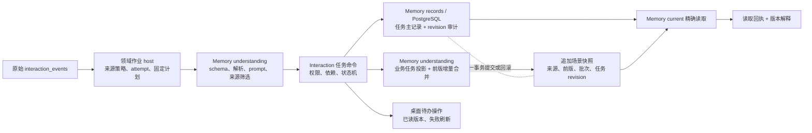

# 记忆模块 T2：消息理解、任务主记录与场景状态

日期：2026-10-20。状态：T2 核心闭环已实现；针对性回归、全量类型检查、隔离 PG、开发 HTTP、正式生产构建、产物 HTTP 与真实桌面验收通过；日常数据库及实例未切换。范围依据[记忆技术方案](../plans/memory-module-technical-plan-2026-10-20.md) T2，延续 [T1](./memory-module-t1-2026-10-20.md) 的逐项拆解，不改变既有审核权与业务主记录归属。

机器可核对证据：[T2 验收回执](./evidence/memory-module-t2-2026-10-20.json)。

## 实际闭环



被控对象是任务生命周期及其场景估计。输入是已有原始事件和绑定来源策略的固定处理计划；模型只生成候选。任务状态由 Interaction 领域命令决定，存储实现进入 Memory，理解和存储之间没有新增 Brain 总包。微信采集、模型调用、processing job 调度、候选准入及长期记忆审核仍在原有 host，后续继续拆分。

## 实际拆分与入口

| 职责 | 实际承接 | 保留边界 |
|---|---|---|
| 理解 | `memory/understanding/interaction-candidates.ts`、`interaction-prompts.ts` | schema、解析、prompt、精确来源 ID 筛选；模型传输和 job 控制保留领域 host |
| 场景状态估计 | `memory/understanding/{scenarios,scenario-state,scenario-persistence,scenario-task-projection}.ts` | 使用前版加增量；模型估计不能覆盖业务任务状态 |
| 记录 | `memory/records/{tasks,scenarios,current-state,scenario-record}.ts` 与对应 PG adapters | 保存、精确读取、审计；不导入 understanding，不判断任务能否完成 |
| 任务控制 | `interactions/task-state.ts` 与原 service 兼容入口 | 权限、依赖检查、终态规则、命令幂等及同事务投影 |
| 纯基础能力 | `memory/kernel/{locks,reference-errors,scenario-identity}.ts` | 旧 Brain 错误显式 alias 同一构造器，保留错误识别 |
| 桌面操作 | 现有 Wiki route、workshop 客户端和 `task-status-command.ts` | 带已读 revision；失败刷新并解释，不自动重发失败命令 |

旧四个场景文件只保留兼容接线；独立场景写入的原业务 gate 留在 host，再调用新的事务内实现。新 Memory 实现不运行时导入 Brain，未把旧 service 重新包装成隐藏依赖。

旧 `brainWriteSnapshot` 模型工具的通用写口禁止 `wechat_scenario_state` 保留类型，防止伪造高 revision 或业务状态身份污染 current。合法的任务 / 场景处理链走受控投影；普通 `work_state` 快照保持原行为。该限制在 service 实施，调用者改 scope 也不能绕过。

## 写入、版本与恢复合同

[0162 迁移](../../apps/web/lib/db/migrations/0162_add_interaction_task_revisions.sql)新增任务 `revision bigint`、`interaction_task_revisions` 和 `memory_state_read_receipts`。所有当前应用任务 writer——创建、action、旧 status、单项删除、批量清理——经过 Memory 存储及同事务场景投影。任一步失败，任务、版本审计和本次场景快照一起回滚。

- 任务初始 revision 为 0；后续受控变更检查旧 revision 并递增。`metadata.taskState.version` 只是兼容镜像，不是第二个时钟。
- owner + commandId 唯一；绑定动作、对象、expectedVersion、时间及删除意图。同 ID 改内容冲突，同版并发命令只有一个成功。
- 兼容创建调用可省略 commandId，此时服务器为该次调用生成 ID；调用方要跨网络重试去重，须保存并复用自己的命令 ID。
- 版本审计记录真实 actor 和 Work / run / worker / token，取自可信执行上下文，不能由任务 metadata 伪造。
- processor 用固定 job / 计划位置生成创建命令 ID；attempt 是执行信息，不改变创建意图。不同 job 的语义相同候选尚未做实体归并，不能把这个闭环说成全局语义去重。
- 创建重放返回当前权威任务，防止旧 candidate 被当成现状；action 重放返回该命令当时的固定结果，标注 `command_result_at_revision`，读取现状走 current。
- 新创建过滤模型或客户端 metadata 中的 `taskState`、`taskActions`。旧 JSON 动作历史不充当成功回执；命中无可核验的旧命令时显式冲突，用户刷新后发新命令。
- 删除保留软删除主记录与审计。clear 是主人明确的整批清理意图，事务中锁定各行并推进各自版本，不冒充逐项客户端 CAS。
- 完成、驳回和删除任务不能通过旧 status 接口重新打开；模型迟到批次也不能把它们复活。当前没有新增重开审核功能。

数据库迁移在表锁内保留合法旧版本，给旧行创建标注 `from_migration_only` 的基线；不伪造此前完整历史。非法旧版本或 metadata 明确阻止迁移，需先定位修复。迁移后的旧 INSERT、未推进版本或缺少镜像的 UPDATE、提交前没有本版审计的写入被数据库约束拒绝。

原始事件 / thread 外键清理可置空关联定位字段，不冒充新的任务生命周期动作。完整 current 读取令牌为 `task:<domain revision>:<完整返回行摘要>`，能区分这些关联变化；客户端任务操作的 expectedVersion 仍使用主记录 revision。场景读取令牌含快照 UUID 和场景序号，避免旧无序号快照都变成同一个版本。

## 场景与读取合同

场景 lineage 由 owner、类型和 NFKC / lowercase 规范 key 精确确定。current reader 直接查该 lineage 的当前版本，不扫描最近 100 条列表。新快照保留前版 ID、批次 hash、来源范围和覆盖说明；重放旧批次不会回退后来的状态。

业务任务投影带 `stateRevision`；比较业务版本优先于时间戳，低版本和同版冲突不能覆盖已有状态。旧无版本估计采用保守规则；快照仍明确是观测范围内的估计，不能把场景的每句话都当成已经确认的事实。

```json
{"purpose":"current","ref":{"kind":"interaction_task","id":"虚构任务 UUID"}}
```

```json
{"purpose":"current","ref":{"kind":"scenario_state","scenarioType":"project","scenarioKey":"虚构项目 key"}}
```

入口为 `POST /api/memory/read`；`GET /api/memory/receipts/[id]` 解释 owner 自己的历史读取元数据。任务主记录行共享锁持有到读取回执提交，回执失败不返回成功。回执保存 typed target、版本、locator、trace 和实现版本，不再次保存私人正文。任务写操作仍走领域 Wiki API；公共 submit 尚未接管全部领域命令。

当前只读主人自己的 PostgreSQL 任务与场景；Work 执行上下文不能用同一个 userId 提升为主人 client。未实现的任务历史 evidence、discover / recall、通用 ContextPack、候选修订统一入口、全域目录及远程存储治理保持未完成状态。

## 验证记录

| 检查 | 实际结果 | 范围与证据 |
|---|---|---|
| 单元 / API 回归 | 28 个文件，298 项通过 | 理解迁移、场景增量、task / cleanup、旧 Brain / T1 兼容、真实模型工具拒绝旁路、UI 命令控制 |
| 全量 TypeScript | 通过 | `pnpm run tsc --noEmit --incremental false`，项目 8 GiB 配置 |
| 隔离 PostgreSQL | 16 组反例通过 | 真实分段迁移保留 version 7 / 缺省 0、所有任务 writer、并发幂等、原子回滚、旧 writer 栅栏、跨 owner、租约与回执故障 |
| 开发 HTTP | 通过 | stage 73 / 3573；完整领域写入口、Memory current 与解释回执 |
| 正式生产构建 | 通过 | stage 31，保留正式类型检查；BUILD_ID=`kTRWPluEYK2b3uAtj-TYI` |
| 生产产物 HTTP | 通过 | 同一冻结源码产物运行，完整 T2 合同及故障回滚验证 |
| 真实桌面 | 开发和生产均通过 | 未 mock API；1440 → 1180 缩放，无整页横向溢出；键盘 Enter 确认、revision 0 → 1、刷新及重载状态保留、pageErrors 为空 |

开发验收、生产验收、构建后及最终回读的 source hash 一致：`cda7db2cc073fee9e19be762661a38ed0213266ec674b90ab9080fd366ac7e9c`。基准 HEAD 为 `019882717ddad7912836a196e060b49a29a323ab`，包含现有未提交源码；该指纹覆盖 Git 可见源码和配置，排除测试、密钥、生成物及二进制。测试 harness 和截图另存 hash，不能把它当成部署环境或全部资产指纹。

详细本地记录：[开发验收](../../.runtime/memory-module-t2/2026-10-20T09-45-04.713Z-e8f4d00f-43d4-4ce8-bbe0-1e918a919673/acceptance.json)、[生产验收](../../.runtime/memory-module-t2/2026-10-20T09-31-00.781Z-06e5b12a-4347-46f8-8c84-328dbf00daac/acceptance.json)、[正式构建](../../.runtime/memory-module-t2/2026-10-20T09-31-00.781Z-06e5b12a-4347-46f8-8c84-328dbf00daac/build-receipt.json)、[生产桌面](../../.runtime/memory-module-t2/2026-10-20T09-31-00.781Z-06e5b12a-4347-46f8-8c84-328dbf00daac/t2-desktop.json)。仓库中的精简机器回执保留关键结论和路径；完整日志与截图在本机 `.runtime`。

PG 用真实 `pg_locks / pg_blocking_pids` 屏障证明任务读取的共享锁保持到回执提交；不是用固定等待猜测竞态。有效 Work/run/token 的审计来源可核对，旧 token 和投影故障不增加任务历史；同一创建命令在故障后可恢复。模型通用快照工具的伪造高 revision 被拒，受控 current 不变。

迭代中保留了源码变更导致未通过的开发 / 构建回执，并在发现模型快照旁路后安全停止当时自有构建、修复和重跑。已有 stage 75 输出被保护机制保留，本次另用空闲 stage 31 完成正式构建。未把这些中间结果标为成功。

所有 fixture 为新建合成库，不读取私人消息或调用真实模型。自有服务和测试库已清理，Next 共享配置按原字节恢复且无冲突。local_owner 合成身份不等于登录 session 全流程验收，禁用 worker 的桌面明确显示后台离线，不伪造后台运行。

## 装载和后续

当前源码已保存；日常数据库未执行 0162，日常实例未重新装载。后续切换应让任务 writer 与迁移一起进入维护窗口，完整备份后迁移并装载匹配版本；不能迁移后继续让旧进程静默直写。回退程序前须处理新版本与审计合同，不能直接删除 revision 列或审计表来回退。

下一批 T3 承接候选准入、审核、修订、版本映射和依赖失效，继续按实际能力迁出 Brain。原始 Interaction 采集与剩余领域存取也继续登记迁移范围；本批不宣称整个 Brain 或所有持久化入口已退出。
