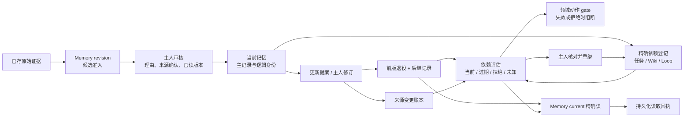

# Memory 模块 T3 实施与验收

日期：2026-10-20。承接 [技术方案](../plans/memory-module-technical-plan-2026-10-20.md) 的 T3，范围为候选准入、审核、更新提案、主人修订、版本映射与依赖失效。已完成代码迁移、联合回归、全量类型检查、隔离 PostgreSQL、开发与正式生产产物的 HTTP / 桌面验收。日常库与实例尚未切换。

机器可核对证据：[T3 验收回执](./evidence/memory-module-t3-2026-10-20.json)。

## 实际能力与边界

此次迁出的是实际业务实现与 SQL 存取，不是为 Brain 增加另一个总入口。旧 Brain 路径逐项兼容转发，表名、既有引用、`bmrv1` 令牌和领域回执 ID 保持兼容。模型仍只能提交候选；主人审核、修订与依赖重绑需要明确命令。



被控对象是记忆解释的有效版本及其派生依赖。原始证据不被修订覆盖；当前解释、审核记录、修订记录与来源变更分开存储。依赖评估是版本和权限的检查，不代表业务事实已独立证实，也不授予动作权限。领域任务终态、Work 角色与租约 gate 保留原有控制权。

| 职责 | 实际承接 | 约束 |
|---|---|---|
| 共享身份规则 | `memory/kernel/memory-types.ts`、`memory-canonical.ts` | 纯规则；records 不依赖 revision / understanding |
| 候选与审核 | `memory/revision/{writes,admission,review}.ts` | 模型写入强制候选、同身份归并、审核来源确认、版本 CAS |
| 提案与修订 | `memory/revision/{proposals,revision,common,version}.ts` | 接受 / 拒绝、同命令重放、前版退役与后继身份校验 |
| 依赖评估 | `memory/revision/{dependencies,dependency-check,dependencies-common,dependencies-entity,dependencies-entity-version}.ts` | recorded / unknown 覆盖分开，denied 优先；保留消费者权限 |
| 写入事务 | `memory/revision/{transaction,legacy-storage}.ts` | 低层执行 fence、来源 gate、事件与写入原子性；不反向依赖 Brain 或高层 execution-lease |
| 存取与映射 | `memory/records/memory-record.ts`、PG memory-records / revision-state / dependencies adapters | 主记录、精确读取和 SQL，不引入理解与修订业务判断 |
| 公开命令与读取 | `memory/revision/{owner-commands,owner-read}.ts`、`memory/client.ts` | 主人 session；Work capability 不能用相同 userId 升级为主人 client |
| 工作记忆晋升 | `workshops/working-memory-promotion-service.ts` | 默认写入 / 读取接新能力；终态、证据、晋升回执仍由领域 host 控制 |

映射、精确读取和依赖 DAO 进入 records / adapters；admission、review、revision、common、legacy-storage 中带业务保护的写 SQL 仍在 revision 用例内，没有宣称所有 SQL 已抽成 Adapter。

迁出能力的运行时依赖闭包不导入 Brain。现有 `memory/unified-search.ts` 仍有 Brain 依赖，属于 T4；专项 policy / correction / document host 也没有被宣称整体迁出。

## 公开合同与审核流程

`POST /api/memory/commands` 新增六种主人命令：

- `candidate.submit`：提交解释与证据。新内容为 candidate；相同有效记忆返回 `existing_retained`，不会降级成候选；冲突理解进入提案。
- `memory.review`：带 `expectedVersion`、decision、理由；确认采用需要 `evidenceConfirmed: true`。
- `memory.propose`：带目标和已读版本提出更新；当前主记录在接受前保持有效。
- `memory.decide`：接受或拒绝提案；同时校验提案版本与基准版本，接受需明确来源确认。
- `memory.revise`：走已有主人修订规则和原始证据关联，保留前版、后继与修订审计。
- `dependencies.bind`：主人明确登记 / 重绑 Wiki、任务或 Loop 的精确来源版本，不能漏掉已有边或用查看权限替代消费者权限。

命令只接允许的字段，不能自报 owner、scope、status 或系统 metadata。准入检查额外硬化 requester 与 incoming 的同用户条件。旧 `/api/brain` 审核 / 修订 / 提案入口直接接新实现，桌面审核继续展示原文、解释差异、理由和来源确认。

新增 [0163 迁移](../../apps/web/lib/db/migrations/0163_add_memory_revision_command_receipts.sql) 只创建 `memory_revision_command_receipts`，以 owner + commandId 唯一。公开命令结果为 `status: recorded` 和 `historical_command_outcome`，保存小型 ID / 版本 / 状态摘要，避免在回执中复制记忆正文。相同 ID 和相同输入返回固定历史结果；同 ID 改输入冲突。获取现状必须另读 current。

整个公开命令由外层事务持有；领域事务作为嵌套 savepoint，最终公开回执与主记录、审核、观察、前版退役、后继和来源账本一起提交。任一必要回执失败均完整回滚。审核和旧 upsert 也补齐同事务来源变更账本：完整持久化版本相同不写变更；正文、状态、metadata 或时间等实际版本变化记录旧 / 新令牌。

旧 in-place upsert 保留原 ID 和写入语义，新增的是失效账本，没有补造此前的正文版本档案；不能据其旧令牌承诺历史全文可读。需要前版与后继正文的更新走受控提案 / 主人修订。本批公开入口也没有实现通用历史全文 evidence。

`POST /api/memory/read` 本批新增两类 current，继续兼容 T1 原始观测和 T2 任务 / 场景读取：

```json
{"purpose":"current","ref":{"kind":"memory","id":"记忆逻辑根 UUID"}}
```

```json
{"purpose":"current","ref":{"kind":"memory_dependencies","entityKind":"interaction_task","entityId":"任务 UUID"}}
```

memory current 保持逻辑根引用，最多追踪 8 次同 owner / scope / canonical 身份的后继，返回实际当前记录与令牌。缺失、跨身份、循环或超限显式不可用。主记录共享锁保持到读取回执提交；回执失败不返回成功。读取回执只保存定位和版本，不复制正文。

依赖 current 的 `verified` 只有 coverage 为 recorded 且 assessment 为 current 才为真；unknown 不被伪装成完成验证。已登记来源修订、过期、待审或撤权时，真实任务 / Loop 动作被 gate 阻断。主人重绑须采用实际后继并核对完整已登记边；撤权优先，不能靠主人查看恢复消费者权限。denied 响应清除目标正文、标题、登记理由及来源正文。

## 验证记录

| 检查 | 实际结果 | 范围 |
|---|---|---|
| 单元 / API 联合回归 | 53 个文件，574 项通过 | 保留 T1 / T2 回归，覆盖 T3 核心、权限、兼容入口、晋升和真实错误映射 |
| 全量 TypeScript | 通过 | `pnpm run tsc --noEmit --incremental false`，8 GiB 配置 |
| 隔离 PostgreSQL | 8 组通过 | 真实并发、CAS、撤权、修订失效 / 重绑、旧 upsert、同事务故障回滚 |
| 开发 HTTP | 8 组通过 | stage 32 / 3632，六类公开命令、current、回执与真实任务 gate |
| 开发真实桌面 | 通过 | 实际旧兼容审核 route 接新 Memory；展开原文、理由、来源确认、键盘 Enter；1024 / 1440 无整页横向溢出，重载版本保持，pageErrors 为空 |
| 正式生产构建 | 通过 | stage 33，保留正式类型检查；BUILD_ID=`bWt1pMVhU2K18vyTly9FT` |
| 生产产物 HTTP / 桌面 | 通过 | 3633；同一冻结源码，8 组 HTTP 合同、真实键盘审核、1024 / 1440 无整页横向溢出、重载版本保持、pageErrors 为空 |

详细本地记录：[最终开发验收](../../.runtime/memory-module-t3/2026-10-20T10-19-33.311Z-29ec2458-fe72-4a00-99d7-04983702e1a9/acceptance.json)、[开发桌面](../../.runtime/memory-module-t3/2026-10-20T10-19-33.311Z-29ec2458-fe72-4a00-99d7-04983702e1a9/t3-desktop.json)、[正式构建](../../.runtime/memory-module-t3/2026-10-20T10-21-29.426Z-1e0196b8-5768-47d6-a640-ebcf046c9e6f/build-receipt.json)、[生产验收](../../.runtime/memory-module-t3/2026-10-20T10-21-29.426Z-1e0196b8-5768-47d6-a640-ebcf046c9e6f/acceptance.json)、[生产桌面](../../.runtime/memory-module-t3/2026-10-20T10-21-29.426Z-1e0196b8-5768-47d6-a640-ebcf046c9e6f/t3-desktop.json)。精简机器回执在仓库中保留关键结果、测试路径与 hash；完整日志和截图在本机 `.runtime`。

开发验收、正式构建、生产验收及最终回读的源码指纹一致：`71f97bf86b1d1f1f6e65bd16de5df6edec3ebf7cdfa83407ce4929c7495c4fca`，基准 HEAD 为 `019882717ddad7912836a196e060b49a29a323ab`，共 2264 个 Git 可见源码 / 配置文件，包含现有未提交源码。该指纹排除测试、文档、密钥、生成物与二进制，不等同于部署环境指纹；测试 harness 和截图另存 hash。

真实 PG 故障注入分别阻断来源变更账本、公开命令回执及读取回执，确认不出现部分退役、孤立后继、漏审计或没有持久化回执却返回读取成功。修订失败后可用原命令 ID 安全重试。真实 Work / run / lease 不能用自己的 userId 获得主人 client；删除真实合成来源 grant 后，owner inspection 也不能使消费者 denied 变成 allowed。

公开 HTTP 通过新入口完成全部六类命令；桌面通过现有 Workshop 提案审核按钮及兼容 URL 操作，未新增一套同义审核界面。浏览器没有 mock API，不访问外部网络，也没有执行 Work。local_owner 合成身份不等于登录 session 全流程验收。

中间失败回执保留：先后修正了测试 fixture 的相似候选身份、任务创建缺少精确原始事件和未展开证据折叠区的问题；未把其失败结果算成成功。类型检查也曾发现兼容 repository 缺本地 alias 导入，已修复并在最终源码重新通过。测试失败、源码变更与最终通过分开记录。

验收使用新建 loopback 合成 PostgreSQL，不读私人消息，不调用真实模型，不启动 Work / scheduler / worker。开发与生产自有服务、测试库均已清理，共享 Next 配置按原字节恢复且没有冲突。代码已编辑、已保存并完成隔离开发 / 生产装载和程序验证；日常数据库未执行本次 0163，日常实例未重新装载，长期生产效果尚未观察。后续切换需按原技术方案将全部待迁 schema 与匹配 writer 一起装载，不能删除历史审核或回执来回退。

## 后续

T4 继续拆查询、发现、召回与 ContextPack，并收口当前 `unified-search` 的 Brain 依赖。依赖登记仍只覆盖明确支持的 Wiki、任务与 Loop，登记边不等于全域关系完整性证明。本批不宣称所有存储已接入 Memory，也不宣称 Brain 已完全退出。
