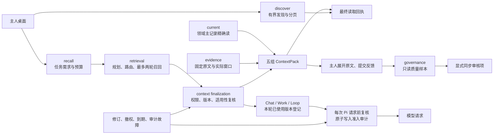

# Memory 模块 T4 实施与验收

日期：2026-10-20。承接 [技术方案](../plans/memory-module-technical-plan-2026-10-20.md) 的 T4，范围为查询、召回、ContextPack、反馈与质量只读报告，以及 Chat / Work / Loop 的实际装载入口。代码、联合回归、全量类型检查、隔离 PG、开发与正式生产产物的 HTTP / 桌面验收均已通过。日常数据库与日常实例没有切换。

机器可核对证据：[T4 验收回执](./evidence/memory-module-t4-2026-10-20.json)。

## 实际职责与闭环

这次迁出实际算法、查询、授权复核和 SQL 存取。旧 Brain 导出按名称兼容转发，原表名、记忆 ID、`bmrv1` 版本令牌、已有引用和旧合同版本保持兼容。没有新增一个总 service 来包住 Brain。



被控对象是一次任务可用的上下文及其来源版本。观测输入是已保存记忆、已注册原始观测、显式指定的业务主记录和适用性条件。状态分为原始记录、候选召回、最终选择、读取回执和反馈；搜索命中、记忆审核通过、独立业务验证与动作授权分别表达。

| 能力 | 实际实现 | 边界 |
|---|---|---|
| 候选与旧列表 | `memory/retrieval/candidates.ts`、`queries.ts`、PG reviews adapter | owner / Work 条件和有界扫描保留，不冒充全量覆盖 |
| 规划与多轮召回 | `memory/retrieval/{recall,recall-planner,query-retry,jev-recall-router}.ts` | 调用方预算不可被模型扩大；候选不能由模型自行批准；最多两轮 |
| 需求、时效、匹配 | retrieval 中 information-needs、evidence-time、recall-policy / profiles 等 | 修改时间不冒充观察时间；未独立核验明确保留 |
| ContextPack | `memory/context/{pack,from-store,finalize,budget}.ts` | 纯选择、实际取数、最终准入和预算分开 |
| 日志与投影 | context audit、records context-log、PG context-logs adapter | records 接中性 DTO，不依赖上下文业务 |
| 索引发现 | `memory/unified-search.ts`、独立 Interaction / graph readonly adapter | 索引是发现入口，不能替代当前主记录或固定原文 |
| 公开查询 | `memory/retrieval/owner-query.ts`、query-contracts、PG query-receipts adapter | 主人 session；Work capability 不能凭相同 userId 升为主人 |
| 出站准入 | `memory/context/dispatch.ts`、Pi 两个实际 adapter hook | 每次新的逻辑模型请求前核对本轮登记的 canonical memory 版本 |
| 反馈与治理 | `memory/governance/{recall-feedback,recall-quality,evidence-quality-summary,feedback-recovery,access-grants}.ts` | 反馈关联最终选择；质量 GET 只读；同步审核为显式写命令 |

## 四种读取目的

`POST /api/memory/read` 在 T1 evidence、T2 / T3 current 基础上新增 discover 和 recall。严格拒绝多余字段，客户端不能自报 requester、owner、Work、grant、accessMode 或内部 planningMode。统一传输预算为 1 MiB，非法 JSON / UTF-8 返回 400，超限返回 413。

```json
{"purpose":"discover","query":"虚构项目","limit":20,"filters":{"memoryTypes":["fact","plan"]}}
```

发现返回保存的记忆、明确状态、固定版本、600 个 Unicode 码点内的预览、截断标记、读取回执与 nextCursor。游标绑定主人、查询、过滤条件与 limit。它是实时有界分页；没有总数或完整快照承诺。发现可以展示待审和指定历史状态供主人核对，不会自动成为模型上下文。

```json
{"purpose":"recall","taskIntent":"检查虚构项目当前约束和缺口","maxTokens":8192,"currentRefs":[{"kind":"interaction_task","id":"00000000-0000-4000-a000-000000000001"}]}
```

公开 recall 使用规则规划，不访问配置中的规划模型或外部证据判断模型。Chat / Work / Loop 仍保留已有配置规划能力，但最终选择必须重新准入；交给外部证据判断器的记忆正文也先走真实准入。规则模式明确表示未独立验证，不伪造模型调用成功。

公开 `memory-context.v1` 分为五组：

- `constraints`：完整保留的安全约束。
- `currentStates`：显式指定的精确主记录。任务是业务当前状态；scenario 是保存的状态估计。
- `historicalEvidence`：已注册、固定版本的原始 observation，附实际已读窗口与回执。
- `interpretations`：理解、经验、偏好等保存的解释。
- `openQuestions`：缺失、过期、未核验、待审更新、来源或适用性不足。

没有为全部业务对象补造历史全文。此次通用历史证据只覆盖 T1 注册 observation；其他 source pointer 必须交对应领域 reader，无法展开时明确记录缺口。业务 current 仍走领域权威 reader，搜索摘要不能升级为当前业务事实。

预算实际约束 UTF-8 序列化字节数加余量，结果明确返回 `utf8_bytes_upper_bound` 单位。请求字段保留 `maxTokens` 兼容名称，但这是内部保守字节预算估计，没有证明任意 provider tokenizer 的实际 token 上界，也不包含完整 prompt / tools。安全约束放不下则明确不可用，其他组可保留 Unicode 码点前缀并标记截断。预算处理不向原文追加说明，原始证据的回执范围按最后实际返回内容计算。最终预算不满足时不返回一个虚假的合格 pack。

## 权限、并发与最终回执

召回尝试与最终使用分开记账。重试可以提高候选覆盖，不能把第一轮已撤权、已修订或过期的正文带回最终结果；必要审计失败也不能退回第一轮“成功”结果。最终独立 ContextLog 记录真实保留的选择，反馈关联这个 ID，不关联一次更大的中间尝试。

最终准入先持有 owner 共享锁，按稳定顺序持有选中记忆和有效 grant 的共享锁，再检查版本、身份、状态、到期、可见性、场景与待审更新。到期时钟在全部锁获取后读取，避免等锁期间跨过 TTL。待审提案使用 NOWAIT，不能安全检查时明确不可用。返回内容只能是已验证行的原文或合法前缀，不能伪造同版本正文。

grant 创建和撤销进入独立 governance 用例，同 owner 排他锁与准入共享锁决定提交先后；变更与审计同事务，审计失败不保留授权变化。当前表只表达正向 grant，没有新增负向授权字段。这里的拒绝优先指默认拒绝、已撤权或当前无权时阻断，不能声称存在显式 denied grant 行。

发现和最终上下文的 `memory_query_read_receipts` 保存 ID、固定版本、覆盖范围、trace 与合同版本，不复制正文。新增 [0164 迁移](../../apps/web/lib/db/migrations/0164_add_memory_query_read_receipts.sql)；必要回执失败不返回内容。公开最终 recall 的主记录、观测窗口回执、最终 ContextLog 与查询回执由同一外层事务提交。

兼容 `/api/memory/search` 明确为 discover：canonical memory 不走旧 30 秒 / 5 分钟缓存，返回前重读并共享锁定真实主记录，复核 owner、状态、版本、正文与到期，再提交发现回执。它不再返回 task ContextTrace。辅助索引可保留带状态的发现缓存，但明确没有固定源核验。count / max(updatedAt) 旧 stamp 不承担当前版本授权。

## 运行时实际使用与桌面体验

Chat SSE 的整个异步生产过程、Work 执行和 Loop 执行在各自 Memory dispatch scope 内。运行时工厂选出实际 adapter 后登记能力，经 recall coordinator 完成的初始召回和工具后续召回都登记最终版本。Pi 的 harness / core adapter 在实际 streamFn 前调用通用 host hook，每次新逻辑请求重新复核本轮经该 coordinator 登记的 canonical memory 选择；修订、撤权、到期、缺失或审计失败时不发送。

登记只保留必要引用、版本、owner、subject 与策略条件，不另存完整对话正文或 provider 配置；新版召回不能抹去旧版仍可能留在对话中的事实。单轮最多 256 项证明、64 组策略，超限明确阻断。缺少逐请求 hook 的运行时不能通过该 coordinator 在本轮接收 canonical memory 正文。

该保证是已登记选择的每次逻辑请求准入检查，不能撤回已准入后在途的请求，传输层内部重试仍属于该次准入。独立 `workshopGetMemoryEvidence` 等精确 reader 仍在读取当时按 scope / grant 检查权限；此前没有被召回的 ID 不会因精确展开自动加入 dispatch registry，其后续出站复核尚未统一覆盖。通用 RAG 文件、外部原文和历史对话也没有在此获得全面固定版本出站保护。这些 reader 的统一使用登记与文件 / 连续性衔接列为后续收口项。此次没有调用真实模型，验证的是已接入请求边界、错误与阻断行为，不是模型答案质量。

桌面 `/memory` 将“发现记忆”和“按任务召回”分开。后者展示五组内容、固定版本 / 回执、预算与缺口，可展开固定原文并提交“有用 / 缺失”反馈。反馈失败保留原 command ID，重载后重试同一条，不能重复造新反馈。输入变更与过期异步响应不会覆盖新查询。

Work 页面展示“记忆质量样本”，说明其范围是主人级有界反馈样本，不是该 Work 的全量运行健康。GET 和打开页面均不创建审核项；主人点击“同步记忆质量审核项”才执行明确 POST，失败不显示已同步。未观察到的指标仍为 unknown。

Chat 默认失败或无结果不会隐式扩大到主人全库发现；只有明确请求辅助来源才读取。Work 保留自身已有的受限 fallback 语义；场景绑定无法确认时不放宽读取。失败返回稳定代码，搜索遥测去除正文预览、人物 / 标题 / source metadata 和原始查询。

## 验证记录

冻结源码：`abb838f4b950c24ec141548a57c3166df8f2f69ea59e5246512d2ae619adfd3b`，2319 个源码 / 配置文件，HEAD=`019882717ddad7912836a196e060b49a29a323ab`。工作区保留既有未提交修改，没有创建提交或变更日常运行。

| 检查 | 实际结果 | 范围 |
|---|---|---|
| 联合单元 / API 回归 | 96 个文件，1189 项通过，4 项既有跳过 | 包含 T1–T3、规划 / 重试、权限、固定版本、预算、dispatch、真实 host 和兼容 route；未模拟的 fetch / HTTP / HTTPS 禁止出网，DB 指向关闭的 loopback 端口 |
| 全量 TypeScript | 通过 | `pnpm run tsc --noEmit --incremental false`，8 GiB 配置 |
| 源码快照回归 | 1 项通过 | 未跟踪和已修改源码入 hash；credentials / 生成物排除；真实 records 源码不能被漏掉 |
| 依赖边界静态检查 | 通过 | 36 个根、239 个工作区文件，直接 / 间接 Brain runtime 路径为 0；19 个 kernel / records 根无业务上层反向依赖；24 个旧文件仅显式转发 |
| 隔离 PostgreSQL | 通过 | 授权 / 撤权真实提交竞态、最终版本、回执故障、Unicode 窗口与反馈 |
| 开发 HTTP / 真实桌面 | 通过 | stage 35 / 3635，发现 → 召回 → 原文 → 反馈与失败重试 → 质量显式维护；1024 视口和组件内部宽度实测、1440 及键盘通过，pageErrors 为空 |
| 正式生产构建 | 通过 | stage 36；保留正式类型检查，BUILD_ID=`ZozUy0DMJNi0pJJD7KqbW` |
| 生产产物 HTTP / 真实桌面 | 通过 | 3636；相同冻结源码，相同 PG / HTTP / 桌面用例，1024 实际视口与组件内部宽度、1440、键盘、反馈失败重载后的同 ID 重试、质量只读与显式维护均通过；pageErrors 为空 |

详细开发回执：[最终开发验收](../../.runtime/memory-module-t4/2026-10-20T11-36-17.242Z-28339795-3c83-489f-a959-51f2930be1e9/acceptance.json)、[真实桌面与宽度诊断](../../.runtime/memory-module-t4/2026-10-20T11-36-17.242Z-28339795-3c83-489f-a959-51f2930be1e9/t4-desktop.json)。

详细生产回执：[正式构建](../../.runtime/memory-module-t4/2026-10-20T11-38-13.457Z-61813d47-dfad-4ad7-9524-9d0a1ffc77b4/build-receipt.json)、[最终生产验收](../../.runtime/memory-module-t4/2026-10-20T11-38-13.457Z-61813d47-dfad-4ad7-9524-9d0a1ffc77b4/acceptance.json)、[生产真实桌面](../../.runtime/memory-module-t4/2026-10-20T11-38-13.457Z-61813d47-dfad-4ad7-9524-9d0a1ffc77b4/t4-desktop.json)。源码快照、联合测试日志、全量类型日志、边界扫描和所有验收脚本 / 截图摘要已归入机器回执；开发 / 生产目录、mode 与 build stage 分别校验。

桌面首轮脚本在 React 初始化前输入，输入被重置且未发出请求，因此验收失败；改为等待真实策略加载和交互状态后重跑，没有用 API 响应 mock 或固定延时跳过。另一次完成流程但源码文案变化，source-stability 检查正确拒绝。1024 的首个超长 locator 截图被内滚动容器裁切，最终改存实际视口截图并检查组件内部宽度，确认内容正常。各次回执保留，均不计作最终通过。

源码冻结工具原来按任意目录名 `records` 排除生成数据，会漏掉新增的真实 `memory/records` 实现。本批修正了排除规则并加回归；最终冻结、开发和生产回执均包含这些源码。旧 T1–T3 证据没有重写，不能把本次增强追溯宣称为当时已经执行。

静态边界检查不执行模块，外部 npm / native / plugin 为叶子；它证明列明源码的依赖关系，不替代生产运行证据，也不代表全项目已没有 Brain。

## 遗留与切换

已编辑、已保存、程序验证、隔离实例实际装载与日常生产效果分别记录。日常实例没有重启，日常数据库没有执行迁移，没有真实私人数据、模型调用、消息发送、资金动作或 Work 业务执行。

T5 继续文件与连续性，并衔接独立精确 reader 的使用登记；T6 继续专项 policy / correction / document host、恢复治理和全域绕行收口。旧 `brain_*` 名称与有限兼容导出仍存在，不宣称 Brain 全部移除。当前验收针对桌面 Web 与 PostgreSQL；SQLite / 原生客户端没有新增覆盖声明。
