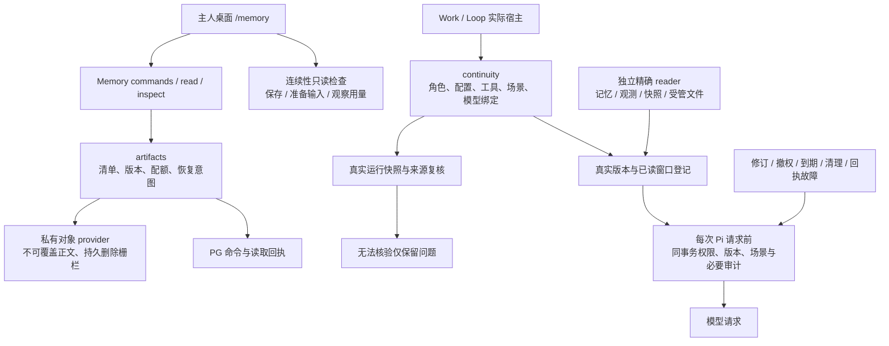

# T5 文件、连续性与独立 reader 闭环

日期：2026-10-20。状态：T5 核心闭环已完成，隔离 PostgreSQL、开发及正式生产产物验收通过；未执行日常数据库迁移，未主动重启日常实例，长期生产效果未检查。

本批把私有文件生命周期、运行连续性和通用状态快照的实际实现迁入 Memory，这些能力对应的旧 Brain / Work / Loop 路径保留显式兼容出口。独立精确 reader 现在能登记本轮实际使用的固定版本，不必先经过召回，也不制造空 ContextPack 充当凭据。

实际入口：[文件生命周期](../../apps/web/lib/memory/artifacts/service.ts)、[私有对象适配](../../packages/storage/src/adapters/private-local.ts)、[连续性恢复](../../apps/web/lib/memory/continuity/working-memory.ts)、[运行绑定](../../apps/web/lib/memory/continuity/runtime-binding.ts)、[独立精确准入](../../apps/web/lib/memory/context/exact-use-admission.ts)、[逐次请求复核](../../apps/web/lib/memory/context/dispatch.ts)、[桌面检查与恢复](../../apps/web/components/memory-files-continuity.tsx)。

## 文件的存储与恢复

被控对象是正文、清单、业务引用和配额之间的一致性。新表为 `memory_artifact_manifests`、`memory_artifact_command_receipts`、`memory_artifact_read_receipts`，由 0165 迁移创建。

公开命令为 `artifact.begin`、`artifact.seal`、`artifact.activate`、`artifact.cleanup`。状态是 `pending → sealed → active`，可清理状态通过版本竞争进入 `deleting → deleted`。同主人、同 commandId 重放已提交结果；同 ID 改变输入拒绝。文件 IO 在数据库事务外执行，前后使用真实清单版本复核，不持有长事务等待磁盘。

正文存入明确配置的 `MEMORY_ARTIFACT_STORAGE_ROOT`，不可使用 public / Next 输出目录。对象 key 随机生成，原文件名、URL 和请求路径不能提供读取权限。实际实现为 `private_local`；没有配置或不支持的 provider 明确报错，不降级成公开地址。读取先核对完整正文的大小、摘要与 MIME，再短事务核对当前清单、权限和固定版本，并写必需回执。回执失败不返回正文。

`current` 只证明清单状态，窗口为 0–0；`evidence` 明确使用字节窗口与 base64 编码，不能把二进制当作已解析文档文本。下载同样走主人鉴权与证据回执，返回 no-store、nosniff、附件响应和实际 byte range。文件激活明确不代表资料索引完成。

激活和清理按 numeric revision 竞争；激活只扣一次配额。待上传及封存清单也预留配额，防止并发超售。物理清理失败保留占用；正文已删除但最终回执失败时保留 `deleting` 与原清理意图，重载页面仍可使用原 commandId / fromRevision 恢复，成功后才释放占用。私有 provider 在原对象位置留下零字节退休栅栏，防止暂停中的旧上传进程在删除后恢复正文；这些栅栏不作为证据、不能复用，也不计正文配额。

桌面清单包括未加入“已保存文件”的附件与未完成上传，支持真实游标前后页、继续上传、激活、固定窗口读取和清理恢复。主人切换会隔离组件状态并中止旧请求。原有桌面上传入口补齐按 File 与用途稳定的 commandId。

## 连续性的保存与获取

实际实现进入 `memory/continuity`，SQL 进入 PG adapter，通用快照 DTO / 版本进入 `memory/records/state-snapshots.ts`。旧 working-memory continuity、business checkpoint、runtime snapshot 与 Brain 通用快照接口显式转发。保留原有保留类型写入保护及错误类身份，不允许普通快照写入绕过修订、依赖或场景控制。

运行绑定覆盖主人、Work、Loop、角色配置、工具边界、场景、策略、实际 engine / adapter / model / protocol；runId 保留来源身份但不混入可继承的 configHash。存储 / 恢复 reader 区分 Loop 逻辑运行与 Work 物理执行，PG 用例覆盖两者不同；当前实际执行域和业务 checkpoint 回执仍复用同一 UUID，本批没有改变既有租约合同。实际宿主确认配置后才记录已准备接续，模型提交内容不能覆盖宿主绑定。

保存的 runtime snapshot 与来源事件都须与绑定一致。历史来源必须进入当前消费 scope 的精确准入，并验证现有记忆版本和权限。未知旧路径、单独 URL / hash、没有 verifier 或无法核验的来源，不作为当前断言继承：清除事实、假设、来源引用和下一动作，仅保留带原因的问题。业务 checkpoint 只投影待问和待核验问题，不把旧 summary、verificationPassed 或自由 stateJson 当作当前结论；旧 stateJson.loopSpec 也不能覆盖正式 Loop 配置。

只读检查入口 `/api/memory/continuity` 仅从已有 runtime authority 事件投影固定标量，区分“状态已保存”“已准备模型请求”“已观察到模型用量”。没有可信保存 / 加载记录时显示 unobserved；没有真实 provider 用量时不伪造已使用。检查不运行 Work、模型或维护任务，不返回私有状态、摘要或 prompt。

## 独立 reader 的出站登记

覆盖记忆精确读、原始 observation、通用 state snapshot，以及 native Pi 新增只读 `getMemoryArtifact`。平台精确 record reader 的相应三类 SQL 投影也接入真实行准入。登记要求实际行、完整版本与合法投影；观测父记录与目标分别授权，Work 必须在真实 Work owner 与当前场景下消费，不能只凭相同 userId 冒充主人。

精确读取和召回共用版本冲突与总容量边界，但保留不同凭据。每次新的 Pi 逻辑请求前重新检查当前版本、权限、有效期、真实 Work 的数据库场景配置和必要审计；修订、撤权、清理或审计失败会在调用 provider 前阻断。没有活跃 dispatch scope 时不能把“当前可用”登记为已准入。

受管文件工具只接受精确 artifact ID 或受管 `/api/files/<UUID>` 地址，使用可信主人上下文，Work 文件读取仍明确拒绝。它只返回有界 UTF-8 文本窗口；二进制明确不支持。出站时核对实际 evidence 回执的主人、用途、范围与完整清单版本，审计语义为 `manifest_revalidated`、`objectBodyReread:false`：不能声称每次模型请求都再次读取磁盘正文。

## 验收与实际边界

集中验收覆盖受控 unit/API、完整 TypeScript、隔离 PostgreSQL 与真实私有对象，以及开发 / 正式生产产物的桌面浏览器流程。故障注入仅在本轮生成数据库内，既有日常数据库、模型、外部 provider 与 Work 业务均不运行。失败调试回执保留，最终验收只接受同一源码指纹。

旧公开云文件没有自动迁移；旧地址无法即时撤回，没有受管清单的下载 / 导入明确返回 410，不能继续任意远端 fetch。旧 RAG 原件读取只在真实 document owner 验证后映射到受管 reader；原件保存失败在上传结果里明确降级。历史对话、未注册 RAG 文本、本地工作区路径和原始业务事件没有全部纳入本轮出站保障。

当前未提高 204800 字节配额数值；新私有附件也计入占用，待上传 / 已封存清单预留空间，计量覆盖范围扩大，因此大文件会明确失败。`private_blob`、真实云对象、原生客户端与手机专项验证均未完成。本批不承诺任意 prompt 数据全覆盖、独立业务正确性或外部模型 tokenizer 的完整预算。

## 最终验收结果

| 检查 | 实际结果 |
|---|---|
| Unit / API 回归 | 133 suites，1758 项通过，4 项原有跳过；外网及误连数据库由 guard 阻断 |
| 独立完整类型检查 | `pnpm run tsc --noEmit --incremental false`，退出 0，前后源码一致 |
| 隔离 PG / 私有对象 | 文件生命周期、连续性、独立精确出站三组真实检查均通过 |
| 开发产物 | stage 10 / 3610，HTTP 和真实桌面浏览器通过，源码稳定 |
| 正式生产产物 | 全新 stage 11 / 3611，webpack 编译及 TypeScript、HTTP、真实桌面浏览器均通过 |
| 桌面流程 | 上传故障同 ID 重试、固定原文、实际下载字节、重载后原命令清理恢复、真实前后页均通过 |
| 桌面可用性 | 1440×1000 与 1024×768；键盘读取、正文与长版本引用无横向溢出，无 pageerror |
| 边界审计 | 17 个迁移 root，609 个 workspace 文件；Brain runtime 路径与底层逆依赖均 0 |
| 清理与恢复 | 两次最终验收均删除本轮数据库，移除所有私有正文；各保留 31 个零字节退休栅栏，正文合计 0 字节，共享配置恢复且无冲突 |
| 源码快照回归 | 实际 records 与被精确 unignore 的 artifacts 源码均进入指纹，回归测试通过 |

开发、生产、独立类型检查和最终回归使用同一源码指纹：`be945851c875ee2538bfd3850ead9155748d77c5b3aee81f9b1ac9565d981943`，2356 个文件，原 HEAD `019882717ddad7912836a196e060b49a29a323ab`。生产 BUILD_ID 为 `YbUbXPhgmaqkk_q9ZlOW3`。源码指纹包含实际未提交实现，不等同于已部署提交或部署配置指纹。

本批修正了真实回测暴露的问题：NextURL 归一化导致的正常本机上传误拒；上传 / 续传在激活前改变业务意图的幂等缺口；崩溃后临时正文残留；旧清理任务忽略失败并误报删除；独立 reader 沿调用链仍指向 Brain 的纯映射 / 修订导入。测试夹具的 JSONB 序列化、正式 schema 必填字段、精确读取策略和 TypeScript 类型也按实际合同修正，没有放宽权限来让测试通过。

静态结果仅证明列出的迁移能力。native 完整工具集合仍有 18 条 Brain runtime 路径，单独列为 host-only 遗留，不冒充整个 Brain 已清空。旧 grant 省略 memoryTypes 时持久化为空数组并拒绝全部类型的默认行为也保留，本轮夹具使用明确类型，没有趁迁移扩大授权。

连续性桌面验收的用量事件是明确标注的 synthetic SDK-shaped fixture，只验证已有回执的投影语义，没有真实模型调用，不能作为模型实际理解或业务执行成功的证据。源码收口期间失败或源变化的隔离回执保留，最终通过结果只接受冻结源码；单测和类型滚动日志以最终复核为准，先前错误可在本轮工具记录中核对。

最终证据：[机器验收清单](evidence/memory-module-t5-2026-10-20.json)、[开发回执](../../.runtime/memory-module-t5/2026-10-20T12-42-20.203Z-bf67d410-6347-4a2f-877f-ff32c843fd44/acceptance.json)、[生产回执](../../.runtime/memory-module-t5/2026-10-20T12-44-00.758Z-2ed43c16-6383-4668-afdf-dbb3e018b25d/acceptance.json)、[正式构建回执](../../.runtime/memory-module-t5/2026-10-20T12-44-00.758Z-2ed43c16-6383-4668-afdf-dbb3e018b25d/build-receipt.json)、[静态边界](../../.runtime/memory-technical-plan/t5-continuity-boundary-audit.json)、[出站覆盖说明](../../.runtime/memory-technical-plan/t5-boundary-summary.json)。
