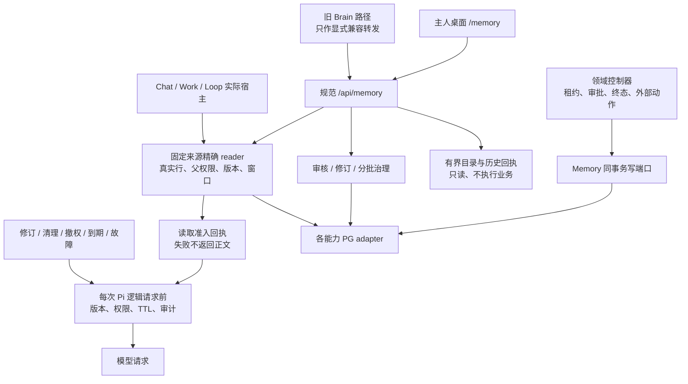

# T6 剩余实现退出与来源准入收口

日期：2026-10-20。状态：T6 核心闭环已完成；完整回归、类型检查、隔离 PostgreSQL / 私有对象、开发及全新正式生产产物的 HTTP / 桌面验收均通过。没有迁移日常数据库或重启日常实例；固定目录以外的来源显式返回缺口，不表示所有应用数据和外部领域均已迁移。

依据：[技术方案](../plans/memory-module-technical-plan-2026-10-20.md)、[T5 验收](./memory-module-t5-2026-10-20.md)、[工程原则](../architecture/engineering-cybernetics-guiding-principles.md)。

## 实际实现归属

`apps/web/lib/brain/` 的 55 个 TypeScript 文件均改为显式 named / type 兼容转发，不保留函数、类、变量初始化或 wildcard 总包。原有函数与错误构造器直接转发到同一个实现，避免重复 writer 与 `instanceof` 身份变化。生产源码及运行脚本改为导入具体 Memory 能力；旧表名、类型别名、配置键和历史 ref 中的 `brain` 字样仍保留原含义，不做数据批迁移。

本轮剩余实现按实际职责拆出：

| 能力 | 实际位置 | 保留的边界 |
|---|---|---|
| 主人纠错草稿 | `memory/revision/correction-draft{,-common}.ts`、PG correction adapter | 原始提交追加 observation；草稿和回执同事务；草稿不改变有效记忆，也不独立证明业务事实 |
| 自动更新政策与文档程序事实 | `memory/revision/auto-update-policy.ts`、`document-update.ts` 及各自 PG adapter | 主人政策 CAS、命令重放、来源事件身份、单调序列、审核与修订保护继续生效 |
| canonical 预览与分批治理 | `memory/governance/canonical-backfill{,-preview,-plan}.ts`、`backfill.ts`、`canonical-storage-status.ts` | 只读预览与实际命令分开；prepare、审核、暂停、apply、回滚及变更冲突沿用真实批次账本 |
| 中性映射、覆盖 DTO 与错误 | `memory/records/legacy-adapters.ts`、`canonical-storage.ts`、`memory/kernel/canonical-backfill-errors.ts` | records / kernel 不反向依赖治理、修订或上下文能力 |
| Work 同步记忆与终态快照 | `memory/revision/workshop-mirror.ts`、`memory/continuity/work-run-state.ts` 及 PG adapter | 只在已经获准的领域事务中调用，不自行启动 Work、改变租约或提交终态 |

SQL 进入对应 PG adapter，规则保留在 revision / governance / continuity。没有把原 service 或 repository 整体搬成新的 Memory 总服务；已有检索、ContextPack、审核、来源依赖、文件和连续性仍由各自能力实现。

源码锚点：[纠错草稿](../../apps/web/lib/memory/revision/correction-draft.ts)、[文档更新](../../apps/web/lib/memory/revision/document-update.ts)、[分批治理](../../apps/web/lib/memory/governance/canonical-backfill.ts)、[旧 service](../../apps/web/lib/brain/service.ts)、[旧 repository](../../apps/web/lib/brain/repository.ts)。

## 四处业务 writer 与事务

`work-runtime/cancel-run.ts`、`run-resolution.ts`、`run-completion.ts` 的 Work 状态快照写入改经 `writeAuthorizedWorkRunStateSnapshotInTransaction`。该端口只写固定 `work_state`，核对实际主人 / Work / run 关系，不接受任意 snapshotType。原领域锁、租约、终态竞争、命令与审计继续由调用方负责；端口复用原事务，不另开一次提交。快照写入失败会使原业务事务一起失败。

`workshops/service.ts` 的同步 mirror 改经 `ensureWorkshopMemoryMirrorInTransaction`。缺失行只插入一次，canonical advisory lock 与实际行锁串行保护；已存在行核对主人、owner 与 scope 身份。同步调用不能覆盖已经修订或退休的正文、状态，也不能借 `onConflict` 复活旧源。

直接 core table 写入检查保留一个明确例外：[隔离评测 worker](../../apps/web/scripts/lib/platform-eval-v2-workflow-worker.mts) 为测试矛盾、过期与外用户来源而插入合成 `brain_memories`。其连接流程只接受明确本机目标，创建随机 `zhiyu_test_…` 库、核对实际库名并设置隔离环境后才建 fixture。静态规则按文件、表、操作和出现次数单列该例外；它不是正常业务 writer，不能扩大为 scripts 目录通用豁免。

领域内的来源 ID 属主核验、主人处理审计与摘要展示仍可保留必要 SELECT；允许读取不等于允许直接更新，也不自动构成模型出站凭据。Task、Work、Loop、审批、outbox 和独立模拟盘账本仍属于各自领域权威，本轮不把它们改成由 Memory 自行执行的业务状态机。

源码锚点：[Work 快照端口](../../apps/web/lib/memory/continuity/work-run-state.ts)、[mirror 规则](../../apps/web/lib/memory/revision/workshop-mirror.ts)、[完成事务](../../apps/web/lib/work-runtime/run-completion.ts)。

## HTTP、桌面与兼容

实际主人 handlers 进入 `/api/memory`。旧 `/api/brain` 目录保留 19 个兼容文件，其中 18 个为路由、1 个为 `_shared.ts`；路由只声明 Next 的静态 routing mode 并显式转发同一 handler。更新与依赖使用规范路径 `/api/memory/updates`、`/api/memory/dependencies`，其余子路径按实际能力保留。

桌面页面和组件使用规范 Memory URL。兼容层不增加第二份鉴权、解析或业务实现。新请求继续使用服务器确定的主人身份，流式 JSON 预算、Work 不能冒充 owner、版本冲突与固定错误响应均在实际 handler / 能力边界执行。

来源治理桌面入口展示固定来源目录、明确缺口、有界读取 / 出站准入回执，以及按类型和 ID 的精确证据读取。后续窗口同时带内容摘要与行 / 权威版本；冲突或当前读取失败清掉旧窗口和续读令牌，重试从首窗开始，主人切换不显示上一个主人的迟到响应。样本和读回执不被标为全库覆盖、模型已使用或业务已执行。

源码锚点：[规范 Memory API](../../apps/web/app/api/memory)、[旧 HTTP 兼容](../../apps/web/app/api/brain)、[来源面板](../../apps/web/components/memory-source-governance.tsx)。

## 固定来源与实际出站

`memory/sources/catalog.ts` 是服务端固定目录及公开字段合同，不接受模型动态注册表、拼接 SQL、选取任意字段或自报版本。目录覆盖明确登记的 Work / Loop 行、运行事件、控制与审核记录、对话消息、Interaction 原始 / 理解记录、旧记忆与图索引行，以及分别登记的 `rag-document-metadata` / `rag-document`。现有 canonical memory、observation、snapshot 和私有 artifact 继续使用其专用精确凭据。

来源语义分别标为保存的观测、读时观测、保存的控制或派生内容。目录中的主记录只是该域在读取时的记录，不能由一行 `running`、一份计划、历史审批或记忆状态推断执行器当前活跃、当前业务事实已核验或本次动作已获准。

实际 reader 在短事务内核对物理行、主人和必要父记录，持共享锁比较合法投影，生成含真实版本和权威依赖的准入回执。`msrc1`、canonical、快照、RAG 与 artifact 各自保留不透明版本合同，不统一伪装成一个 revision 整数。回执失败不返回成功正文。

Chat 保存的对话历史、工具精确来源和 Work / Loop 宿主实际放入 prompt 的已登记来源进入本轮 dispatch scope。每个支持的 Pi 逻辑请求真正发送前，再按原版本与当前权限复核并提交必要审计。新增工具读取同样登记；源改变、撤权、到期、配置变更、脱离 run scope 或审计失败会阻断后续请求，不能悄悄换成新正文。已经放行的请求属于 `in_flight`，不承诺从外部模型收回。

源码锚点：[固定目录](../../apps/web/lib/memory/sources/catalog.ts)、[真实行 adapter](../../apps/web/lib/memory/adapters/postgres/source-records.ts)、[来源 reader](../../apps/web/lib/memory/sources/service.ts)、[精确准入](../../apps/web/lib/memory/context/exact-use-admission.ts)、[dispatch](../../apps/web/lib/memory/context/dispatch.ts)。

### Work 能力、场景与到期

Work / Loop 不因拥有相同 userId 获得主人全部来源。通常只能消费当前 Work 或已保存的、启用的明确来源 Work 链接；场景绑定从可信配置读取，旧历史不能自报项目适用性。跨 Work 来源链接和当前配置均进入权威版本，不能用调用方缓存代替数据库现值。

有限的主人全局 Interaction 读取使用明确的 source capability：`wechatListRecordedMessages`、`ownerContextGetEvidence`、`interactionListWiki`、`ownerContextListCandidates`。实际读取和后续出站都核对真实运行租约、当前 Work 配置允许工具、禁止工具与硬边界；禁止优先。该能力不开放任意 owner table，也不能在已绑定场景时把全局旧内容当项目事实。

现有 canonical 生命周期继续生效；旧 `workshopMemories`、`interactionMemories` 的 `expiresAt` 也在持锁完成后使用当前时钟检查。正文和版本没有变化但 TTL 已到期，同样拒绝使用。没有给所有来源凭空增加统一 TTL，也不把读取时的授权视为永久许可。

### RAG、原件与工作区

Web PG 的 RAG 适配分别核验文档元数据与保存的 chunk 正文，元数据读取不冒充正文读取。正文检查现有 chunk 完整性，最多 2048 个 chunk、合计 2 MiB；主人证据窗口最多 8000 个 UTF-16 单位并避免切断代理对。语义是保存的解析文本，`originalBinaryVerified:false`，不是原文件逐字节证明。

若 `blobPath` 为明确 `artifact:<UUID>`，还须共享锁核对同主人的 active 清单，并把完整 artifact ref 纳入版本；清理原件、替换映射或清单版本改变会使读取 / 后续出站拒绝。没有该映射的历史文本明确标独立保存文本，不能伪造原件关系，也不能宣称旧公开云对象已被撤回。出站核验不宣称再次读取磁盘原件。

Work RAG / 文件尚无正式来源绑定，主人导入、文件 URI 或工具 allowlist 都不补成 Work 授权。相应 staging、读取、编辑和转换入口显式返回缺口，不先复制正文再报拒绝。既有代码库专用读取授权单独保留。旧 Chat 文件路径 / memory-path helper 不再用任意 FS、URL、PDF 或 base64 展开正文；主人工作区 HTTP 查看仍是主人 UI 能力，不是模型固定来源凭据。

源码锚点：[RAG 版本合同](../../apps/web/lib/memory/evidence/rag-record.ts)、[RAG PG adapter](../../apps/web/lib/memory/adapters/postgres/rag.ts)、[工作区工具边界](../../apps/web/lib/workshops/pi-local-tools.ts)。

## 明确未完成与不承诺

- 出站保护依赖实际 Pi `pi-agent-harness` / `pi-agent-core` hook；native agent 对尚未接入的非 Pi runtime 返回 422。Work / Loop 绑定实际 adapter，有来源登记时不能以不支持的 adapter 静默运行。保留旧 SDK 代码不等于本批已为它证明来源隔离。
- 旧保存计划没有可核验的来源依赖，native `phase=execute` 返回显式缺口；不加载旧 prompt / plan 重包装为已授权的新请求，需使用当前受控来源重新发起。
- 没有实现操作系统 sandbox。cwd、隐藏进程或去除环境变量都不是文件隔离；Memory 模型运行中的未隔离 Bash / PowerShell 不开放，改用已批准领域动作或受管 artifact。
- 外部网页、行情与独立远端账本保留 provider / 时间 / 降级语义，只是 t0 观测；本地 PG 共享锁不证明远端持续新鲜、完成发送、真实成交或跨服务强撤权。
- 原生 SQLite 精确 RAG、未注册来源、任意 prompt 全覆盖、外部 tokenizer token 上界、全量历史迁移、备份清除 / 远端恢复完整闭环与长期生产效果不在本稿的完成声明中。内部容量边界也不替代完整 prompt / tools 的 provider 预算。
- 本轮未执行日常数据库迁移、批量修正历史数据或启动真实 Work / Loop / 模型；正式实例切换与生产效果必须由实际回执另行确认。

## 验收与证据登记

中间失败、源码变化和 OOM 都保留，不能当作通过，也不能用目录数量代替实际入口验证。独立类型检查、最终完整回归、开发 HTTP / 浏览器及正式生产构建 / HTTP / 浏览器均使用源码指纹 `0598510b3ff24cca4ff0b31488c6dab603059cd4f8426d4d31365c0db44b5a0a`，2416 个文件；HEAD 为 `019882717ddad7912836a196e060b49a29a323ab`。生产 BUILD_ID 为 `b3gSz3ikyigU50ffoqCtw`。指纹包括实际未提交源码，排除测试、密钥和生成产物，不是已部署提交或配置指纹。

| 检查 | 最终结果 |
|---|---|
| Unit / API / 桌面组件 | 181 套，2177 项通过，4 项原有跳过；181 套均经 JSON 核对实际执行，套件 / 源码稳定，保留 T4 外网及误连数据库 guard；包含共用工具名称 / 权限与配置恢复测试 |
| 完整 TypeScript | 12 GiB、`--noEmit --incremental false`，退出 0、诊断 0、源码稳定；8 GiB OOM 与先前夹具类型错误归档保留 |
| 隔离 PG | 五组通过：T5 连续性 / 独立精确 reader、T6 治理 / 来源出站 / RAG 原件；包含真实领域写入、当前租约和工具配置、前缀与大小写权限、TTL、同事务审计故障回滚 |
| 开发 HTTP / 桌面浏览器 | stage 12 / 3612 通过；规范与兼容 API、实际 UTF-16 窗口、跨主人拒绝、版本冲突、回执故障重试、无正文历史解释；1440 / 1024 与键盘读取，无 pageerror 或横向溢出 |
| 正式生产产物 / HTTP / 桌面浏览器 | 全新 stage 13 / 3613 通过；webpack 12.2 分钟、构建自带 TypeScript 83 秒均通过；相同真实 HTTP / 桌面链路及 1440 / 1024、键盘验证通过，无 API 模拟、真实模型或业务 Work 执行 |
| 静态依赖与 writer 边界 | 197 个实际闭包 root、2035 个检查文件、26 个底层 root、55 个纯兼容文件；生产 Brain 导入 / 运行时路径、底层能力逆依赖和违规外层 writer 均 0；1980 个生产导入文件无丢失 Memory named export，隔离 fixture 单例外独立登记 |
| 隔离库与私有正文清理 | 最终开发 / 生产均删除本轮数据库、正文合计 0 字节，各保留 4 个零字节退休栅栏；全部历史轮次数据库已清理，逐目录核验正文无残留；共享配置按原字节恢复，无冲突，配置锁释放 |
| 源码与证据核验 | 源码快照回归通过；逐组核五组 PG、HTTP / 桌面、正式构建，不以总数代替；套件 / runner / guard / scanner / 配置 / 日志 / 截图 hash 与当前文件核对通过 |

程序证据入口：[单测当前记录](../../.runtime/memory-technical-plan/t6-unit-suites.json)、[单测历史轮次](../../.runtime/memory-technical-plan/t6-unit-iterations)、[类型当前记录](../../.runtime/memory-technical-plan/t6-types.json)、[类型历史轮次](../../.runtime/memory-technical-plan/t6-types-iterations)、[依赖与写口审计](../../.runtime/memory-technical-plan/t6-boundary-audit.json)、[生产导入及导出检查](../../.runtime/memory-technical-plan/t6-production-import-audit.json)。这些是程序和隔离验收证据，不是日常部署配置或模型实际理解的证明。

最终回执：[机器验收清单](evidence/memory-module-t6-2026-10-20.json)、[开发验收](../../.runtime/memory-module-t6/2026-10-20T14-04-40.314Z-b82492d9-cd90-4ea8-9f00-76ab495a587d/acceptance.json)、[生产验收](../../.runtime/memory-module-t6/2026-10-20T14-06-25.092Z-39c12b14-19f5-4eaf-a04d-82a190395d8b/acceptance.json)、[正式构建](../../.runtime/memory-module-t6/2026-10-20T14-06-25.092Z-39c12b14-19f5-4eaf-a04d-82a190395d8b/build-receipt.json)、[开发桌面 1024](../../.runtime/memory-module-t6/2026-10-20T14-04-40.314Z-b82492d9-cd90-4ea8-9f00-76ab495a587d/t6-development-desktop-1024.png)、[生产桌面 1440](../../.runtime/memory-module-t6/2026-10-20T14-06-25.092Z-39c12b14-19f5-4eaf-a04d-82a190395d8b/t6-production-desktop-1440.png)。

## 本轮真实反馈与修正

- 来源权限规则层：独立复核发现 Work 源准入与工具执行对 MCP 前缀 / 大小写的处理不一致。提取共用纯名称函数；允许及三类拒绝列表统一归一化、拒绝优先。先保留失败反例，再以实际 adapter 单测和真实 Work 租约 / PG 配置检验初次准入、正常请求及后续撤权阻断。
- 页面状态层：续读在 404 / 503 下仍保留旧正文，现改为任意读取失败清正文和可续读令牌；暂时故障恢复从首窗重读，409 要求重新读取。主人切换通过卸载、abort 与 generation 隔离迟到正文。
- 来源语义层：RAG 元数据与正文使用不同表示身份；正文标为派生解析文本，不证明原始二进制。受管原件的清理可阻断使用，历史 chunk 和未受管旧文本按各自生命周期保留，不能制造云对象已撤回的结论。
- 验收工具层：修正真实 schema 必填字段、PostgreSQL 时间编码与类型完整夹具，不放宽准入。Windows 暂时共享写冲突采用有界重试，重试前再次核对本轮配置所有权；并发外部编辑保留为冲突备份。实际恢复失败的原回执保留，另存精确恢复回执。键盘测试等待按钮可用后再发送 Enter，避免加载期间丢失按键被误判业务失败。

这些是本轮确定实现、程序验证和隔离装载的反馈，没有推断长期真实业务收益，也没有据此自动扩大工具权限。
