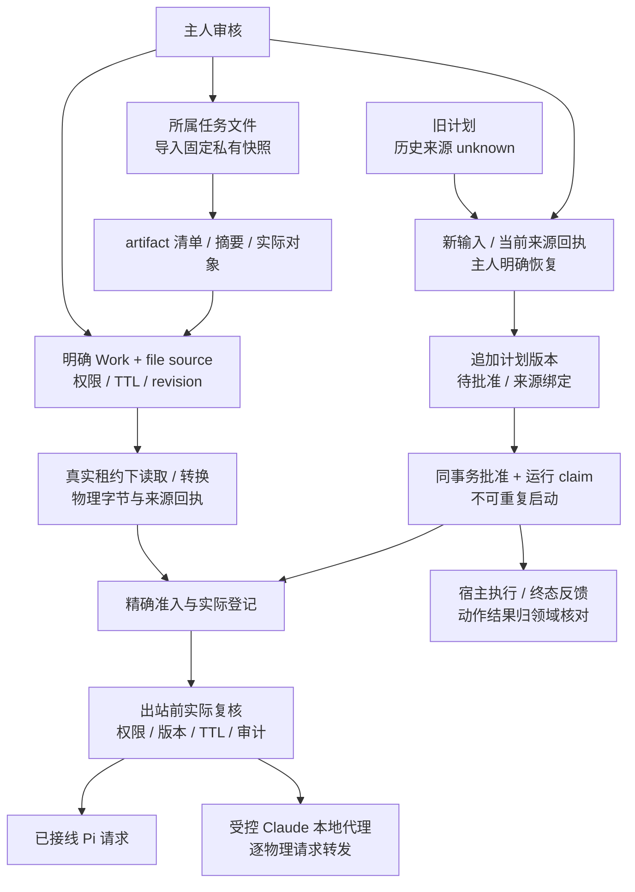

# T7 本地文件、保存计划与受控 Web 出站

记录日期：2026-10-20（UTC）；最终验收为北京时间 2026-10-21。状态：`accepted_isolated_only`。同源码的完整回归、全量类型检查、隔离 PostgreSQL、真实开发 HTTP、全新生产构建 / HTTP、桌面浏览器和实际安装 SDK 均通过。模型上游是本地合成服务；日常数据库未迁移，日常实例未切换，没有以程序验证代替真实外部模型或长期业务效果。

依据：[技术方案 13.8](../plans/memory-module-technical-plan-2026-10-20.md)、[T6 验收](./memory-module-t6-2026-10-20.md)、[工程原则](../architecture/engineering-cybernetics-guiding-principles.md)。

最终程序核验：[机器证据](./evidence/memory-module-t7-2026-10-20.json)。工作区源码摘要为 `6b1389bb08c1605f38f39f28b2c89734e4998888795e9c6f784f61d1e5104772`，共 2447 个源码 / 配置文件；包含未提交实现，不把当前 HEAD 当作已提交交付。测试、runner、网络 guard、浏览器截图、原始日志和保留策略另外按 SHA-256 约束。源码指纹不含环境机密、二进制资产，也不声称是日常部署配置指纹。

## 实际能力与边界

### 文件快照与 Work 明确绑定

`memory/files` 增加所属任务文件的受控导入、绑定 / 撤销、真实字节读取和派生产物。0166 的 `memory_file_import_receipts`、`memory_file_bindings`、`memory_file_binding_commands`、`memory_work_file_upload_intents` 保存导入 / 上传意图、固定版本与权限变更；现有私有 artifact 清单、对象和读取回执继续承担正文生命周期，没有新增可接受任意路径的通用文件 reader。

本地导入根据服务器确认的 Chat 属主选择管理根，拒绝绝对路径、目录逃逸、各级链接、硬链接及特殊文件；打开后核对身份、大小、修改时间、读取长度和 SHA-256。导入产物是当时的固定快照，不能证明原路径此刻仍相同；新原件要重新导入和审核绑定。

Work / Loop 读取必须同时满足真实租约、当前 Work / 场景 / 工具边界、已启用 file source、同主人的 active artifact 固定版本、binding revision、read / convert 权限及有效期。虚拟 `inputs/...` 只是 locator。私有对象在 SQL 事务外读出并校验，在短事务内重新核对当前权威及保存读取 / 准入回执；失败不返回成功正文。读取受管文本使用有界 UTF-16 窗口；二进制转换依赖单独 convert 权限并保存新的派生 artifact，不能覆写原件。

每次后续出站对已登记的文件 / artifact proof 准备当前物理核验，再持锁复核原版本及当前权限与审计。不能把“清单没改”当作磁盘正文仍正确，也不能以调用方自报摘要伪造 physical ticket。旧路径、无 binding 的来源和旧缓存正文保留明确缺口。

主人 API 已接入 `/api/memory/files/import`、`/api/memory/files/bindings` 和 `/api/memory/files/bindings/[id]/revoke`。实际 Work 上传保存私有快照与稳定的完整请求意图，最终在同一事务中写 source、binding、事件和回执；页面的文件授权区域展示期限、撤销和失败重试。旧 file.content 不再从 executor、Loop、只读工具、MCP 或 planner 冒充文件正文，而是只给 descriptor。文件 descriptor 的准入带 `file_source_descriptor.v1` 标记；没有标记的旧文件正文回执不能恢复成有效来源，须重新受控读取。中央开发 HTTP / 浏览器已核对实际入口，正式生产状态在下方单独登记。

源码：[导入](../../apps/web/lib/memory/files/import.ts)、[本地快照](../../apps/web/lib/memory/files/local-snapshot.ts)、[绑定命令](../../apps/web/lib/memory/files/commands.ts)、[Work 上传](../../apps/web/lib/memory/files/upload.ts)、[授权面板](../../apps/web/components/workshop-file-bindings.tsx)、[真实读取](../../apps/web/lib/memory/files/read.ts)、[物理证明](../../apps/web/lib/memory/files/physical.ts)、[精确出站](../../apps/web/lib/memory/context/exact-use-admission.ts)。

### 计划来源、恢复与重复执行保护

新计划通过 `memory/plans` 保存追加版本、输入 observation、来源回执、task / workDir 和有效期，0167 提供计划记录与命令账本。旧 native plan 不被直接当作已授权的 prompt；没有来源凭据的历史计划明确 unknown。

主人可从 `/memory/plans/[planId]` 检查旧提案，输入当前要求、至多 62 条当前来源回执并确认恢复。回执先经真实版本、权限和必要物理内容核验；恢复只得到新的待批准版本，历史来源仍未补证。重试相同原操作保留同一个 commandId / 请求正文；版本冲突要求重新审核。

批准时固定 `mplan1` 版本、来源和执行上下文，在父事务里同时追加批准版本、登记出站来源、写审计及 claim running。容量、来源或审计故障回滚整个批准事务。同 commandId 重试和换 commandId 都不能重复启动已经批准的版本。执行终态独立记录为 running / completed / failed / interrupted；批准、流结束和具体业务动作成功分开。

页面显示当前状态、修订、来源数、版本、有效期、执行状态及时间；提供复制版本、故障刷新、稳定命令重试与撤销。只有可用的 ready 版本且存在真实 taskId 才可由主人显式启动真实 Pi execute。来源故障后的迟到 done 不显示成功；owner 切换关闭旧请求和执行回调，缺 task 的旧提案不能由页面伪造任务执行。已发出的动作不能由“撤销计划”倒回。

源码：[计划合同](../../apps/web/lib/memory/plans/contracts.ts)、[计划用例](../../apps/web/lib/memory/plans/service.ts)、[计划账本](../../apps/web/lib/memory/adapters/postgres/plans.ts)、[主人 API](../../apps/web/app/api/memory/plans)、[审核页面](../../apps/web/components/memory-plan-review.tsx)、[真实 Web agent 入口](../../apps/web/app/api/native/agent/route.ts)。

### 受控非 Pi Web 出站

T7 新增受控 Claude SDK 与父进程本地转发代理，不把所有非 Pi adapter 自动视为已保护。SDK 不加载用户配置、自动记忆、旧会话、插件或内置文件 / shell 工具，仅挂载宿主批准的工具；真实上游凭据留在父进程。代理仅接受受控令牌和允许的 Anthropic Messages / count_tokens 路径，实际物理请求在来源、权限、版本和审计复核之后转发，重试和 SDK 内部请求同样经过该出口。拒绝重定向、未知协议、未知工具与不支持的输入；准入故障不发模型请求。

该实现是应用层受控工具和出站边界，不是操作系统 sandbox。临时目录、清环境和空工具列表不单独证明整个主机已隔离。Work / Loop 的旧 Claude adapter 仍 unsupported，不能把这个 Web 受控出口推广为它们也已接入。已经放行的 in_flight 请求不能从外部模型收回；其他 SDK、native 客户端、外部行情 / 网页 / 远端账本和任意未注册输入不在全覆盖声明内。

源码：[受控 SDK](../../apps/web/lib/ai/extensions/agent/claude/controlled-sdk.ts)、[真实网络出口](../../apps/web/lib/ai/extensions/agent/claude/guarded-transport.ts)、[dispatch](../../apps/web/lib/memory/context/dispatch.ts)。实际 Web、Work / Loop adapter 与能力限制以中央真实入口回执为准，不以新文件存在宣称所有模型路径均开放。

额外核对的自动建议入口移除了未准入的旧 insight / profile 正文及模型生成，当前返回明确标记 withheld 的固定建议和页面警告。旧洞察的模型理解与压缩入口也在构造 prompt、初始化模型和更新领域状态前明确拒绝，返回来源未登记和恢复说明。这些是有限入口的显式降级，不是全业务 AI 的来源保护完成声明。源码：[建议 handler](../../apps/web/app/(chat)/api/chat/suggestions/route.ts)、[共享政策](../../apps/web/lib/ai/chat-suggestions-policy.ts)、[洞察来源保护](../../apps/web/lib/insights/source-protection.ts)。

### 构建产物回收与两套保留

旧构建清理由用户明确授权，未停止日常实例，未删除数据库、私有业务文件、通用 C 缓存或 vendor / toolchain。只回收核对过的 Next、发行 bundle 和带项目 owner marker / 准备回执的孤儿产物。活跃日常 65 占一个名额，首次清理后的非活跃 13 占另一个；中央新构建申请名额时可以退役 13，不能停止 65。两套都受活跃进程、租约或锁保护、无法安全腾出名额时明确阻断。

首次三批合计删除逻辑 138,714,547,756 字节；当时测量库存，D 盘可用空间从 82.345 GB 增至约 210.704 GB，C 从约 43.361 GB 增至约 52.586 GB。逻辑文件大小、归档占用、压缩 / 重复存储及其他进程的并行写入会使其不同于净盘释放量，不能混称同一个数字。首次清理后的库存为 65 与 13 两套；后续中央开发 14 和生产 15 构建继续按租约腾出名额。最终 16:36 UTC 库存恰为两套：日常活跃 65 与本轮生产 15；当时 C 可用约 52.337 GB、D 约 210.991 GB。开发 14 和失败的旧 15 已按实际预约退役，历史验收与失败证据保留。

原始日志、trace、BUILD_ID、发行 manifest 和回执先复制、校验 SHA-256，再用 PowerShell `Remove-Item -LiteralPath` 删除实际目标；junction 单独核对并解除，不递归进入未知 target。旧验收成功记录不修改，retirement manifest 说明对应产物已回收。一次清理启动后才补充了 delivery.json 保留规则，遗漏的最新发行元数据已根据现存独立历史回执恢复为逐字节一致，恢复 SHA-256 与原回执完全匹配；该过程单独记录，没有伪造新的历史验收。

正式 Web / review / Windows 发行和中央隔离 HTTP 的真实生命周期已经接入 reserve / finish；同一受控发行构建的 Next 与 installer 两种投影按最新有效租约关联，后来单独重建 Next 会取消旧组并回收无名额的旧 installer。发行显式声明 currentPayload，核对既有准备 stage 的版本和生成 marker，避免旧 owner marker 把新准备目录误判成历史目录；准备投影和名额语义记录在回执中。旧 payload / previous / archived 不藏在父目录无限保留。Windows 之外显式 not_enforced，未宣称跨平台删除已验证。绕过受控入口的历史手工脚本仍须先盘点，不宣称已重写所有历史脚本。

说明：[保留合同](../architecture/build-output-retention.md)。程序证据：[首批实际回收](../../.runtime/build-retention/retirements/20261020T144314968Z/manifest.json)、[发行实际回收](../../.runtime/build-retention/operations/6733623d-5f36-47be-81c0-582632a8bc99.json)、[孤儿安装包](../../.runtime/build-retention/operations/b3a27319-59ca-44c2-886c-3d8063cdebd0.json)、[首次两套库存](../../.runtime/build-retention/operations/02a5c5f0-2e15-4588-8ab4-785180072758.json)、[最终两套库存](../../.runtime/build-retention/operations/740cd325-f054-4e57-8239-1d056b28cc6e.json)、[元数据恢复](../../.runtime/build-retention/retirements/6733623d-5f36-47be-81c0-582632a8bc99/delivery-metadata-recovery.json)。

## 观测、故障与验收登记

实施中发现并修正了实际反例：仅按父目录计数会藏住旧发行 payload，且按子备份 mtime 选择可能挤掉当前 bundle；现在旧备份单独识别并回收，受控多投影只能按固定关联登记。首次清理的日期解析核对失败时没有执行删除，原失败 manifest 保留。页面在撤销或恢复结果不确定时先清除旧可执行状态，不能保留旧按钮假装没有变化；来源错误后的迟到完成回调也不能覆盖失败。

真实验收还暴露并修复了以下反例，失败记录不覆盖：

- [15:48 开发失败](../../.runtime/memory-module-t7/2026-10-20T15-48-26.380Z-d596c0f9-8dc1-408c-bf91-098859b02a4a/acceptance.json)：ChatContext 的服务端初始随机任务与浏览器缓存任务不一致，Greeting 首屏发生 hydration 错误。现改为服务端 / 客户端共用 URL 初值，再在 effect 恢复缓存；保留子组件新建任务 / 新运行，真实 renderToString → hydrateRoot 回归验证恢复时序。
- [16:00 开发失败](../../.runtime/memory-module-t7/2026-10-20T16-00-57.811Z-aa1b5e5e-9b33-4b65-b12b-fe773533cccf/acceptance.json)：真实 SDK 计划含 `notes: undefined`，JSON 存储省略字段后与原指纹不一致，正常执行被拒绝。现采用与 JSON 存储一致的规范化摘要，UUID 身份字段归一化且不改变任意文本大小写；先补红灯回归，再用实际 PostgreSQL 与 HTTP 重跑。
- [16:16 生产构建失败](../../.runtime/memory-module-t7/2026-10-20T16-16-05.931Z-8d6a7e3a-ec84-4831-9af0-3e20b930659d/build.log)：Next 的 source-asset NFT 静态追踪把运行时 `resolve(tmpdir())` 校验表达式当成资产目录，尝试扫描用户 Temp 后遇到 EPERM；服务端动作 `server` 未定义为连带错误。原提前 `traceIgnores` 只在 Windows 发行构建生效，现扩到所有服务端构建，保留运行时安全校验。真实 Next 配置 / TraceEntryPointsPlugin / NFT 的秒级回归先红后绿，实际入口仍被追踪、合法项目资产仍被保留；去掉 AppData 排除的负对照仍能重现外扫意图，且在进入 C 盘前拒绝，没有读取私人临时文件。新完整开发和生产验收另行登记，不复用失败构建。

[16:08 开发重跑](../../.runtime/memory-module-t7/2026-10-20T16-08-36.417Z-7e10f6d5-cf94-4413-b4ea-e65e1bdacd40/acceptance.json) 的 17 组全部通过，所有桌面报告 `pageErrors: []`。真实 Native HTTP 生成计划后按固定版本批准执行；相同命令重发未增加 provider 请求。另一计划的首请求放行后修改 RAG 来源，实际工具调用 / 结果已发生，SDK 下一物理请求被拒绝，终态为 aborted 且清理完成；不把已放行首请求描述为已撤回。该轮早于上条构建配置修复，不能代替最终同源码验收。

目前可单独核对的针对性结果：

- Windows retention：最终 10 项真实合成文件系统 / 租约测试通过，含两个活跃名额阻断、失败后收敛、目录逃逸、外部链接拒绝、数据库标记保护、证据归档、发行备份清理、跨入口旧分组失效及新准备 stage 保护。原始日志、命令、T4 网络 guard 与前后源码摘要（含最终中央 runner）见 [版本约束记录](../../.runtime/build-retention/validation/2026-10-20T15-44-15.966Z-98ce39b7-adef-442c-864a-57f632af57bc/record.json)。没有以该测试代替实际 Next 构建或日常实例验证。
- 计划主人 API / 页面：2 套 22 项受网络 guard 测试通过，包含鉴权、Work 不可冒充主人、请求上界、错误不泄露 SQL、62 / 63 来源上限、固定命令重试、撤销失败不报成功、迟到 owner 响应隔离、来源故障后 done 不报成功和已批准版本不可重启。见 [原始日志](../../.runtime/memory-technical-plan/t7-unit-iterations/2026-10-20T15-19-13-729Z-2e4d3290-5485-4ba1-9f23-48700b1b590e/raw.log)。流式执行为模拟 callback，没有调用真实模型或执行真实业务。

最终数值与状态由程序交叉核验；历史失败、夹具错误、回滚故障和源码变化均保留：

| 检查 | 最终状态 / 程序回执 |
|---|---|
| 完整受 guard 回归 / 实际执行 suite 清单 | 201 个实际执行 suite，2310 passed / 4 既有 skipped；[同源码回归](../../.runtime/memory-technical-plan/t7-unit-suites.json) |
| 完整 TypeScript 与构建自带类型检查 | 全量 12 GiB / noEmit / incremental false 零诊断；[类型回执](../../.runtime/memory-technical-plan/t7-types.json)。生产构建自带类型检查另通过，未设置 skip |
| 构建私有目录追踪回归 | 3 / 3，通过真实 Next 配置与 NFT；[独立机器回执](../../.runtime/memory-technical-plan/t7-private-runtime-tracing.json)，负对照不进入 C 盘 |
| 隔离 PostgreSQL：文件 / 计划 / 非 Pi 网络边界及历史闭环 | 开发 / 生产均通过 15 组模块检查，含 T5 / T6 历史闭环、文件 PG 10 项及计划 PG 6 项关键检查、真实 transport 和已安装 SDK 7 种模式；不能用这些分项替代真实 HTTP |
| 开发 HTTP / 1440、1024 与键盘 | 修复后同源码 17 / 17，通过实际 owner import / Work upload / bind / revoke、旧计划恢复与故障重试、真实 SDK HTTP；[最终开发回执](../../.runtime/memory-module-t7/2026-10-20T16-28-56.644Z-d20e38cc-d02d-4c99-af27-f30f2c4fe758/acceptance.json)。三份桌面报告均无 pageErrors，六张截图覆盖 1440 / 1024 与键盘 |
| 全新正式生产构建 / HTTP / 同桌面流程 | [生产验收](../../.runtime/memory-module-t7/2026-10-20T16-32-30.477Z-4f0bebe0-ceeb-45f1-bf1f-4c3f2f594c55/acceptance.json)：18 / 18（含全新构建 + 同样 17 组闭环）；[构建回执](../../.runtime/memory-module-t7/2026-10-20T16-32-30.477Z-4f0bebe0-ceeb-45f1-bf1f-4c3f2f594c55/build-receipt.json)，BUILD_ID `O3skPGxcOMNwA6NMMlys_`。webpack 84 秒，构建类型检查 37.8 秒；真实 HTTP 未 mock，1440 / 1024 与键盘通过，浏览器零 pageErrors |
| 源码 / 测试 / runner / guard / 日志与截图 hash | [机器证据](./evidence/memory-module-t7-2026-10-20.json) 锁定同一源码及当前实际文件；开发 / 生产来源摘要相同，12 张截图及三类桌面报告均保存独立 hash |
| 新增运行依赖 / writer / 兼容边界审计 | 211 roots / 2064 files，55 个 Brain 兼容文件均为纯转发；运行时 Brain 导入、反向依赖与禁止 writer 为 0；[边界审计](../../.runtime/memory-technical-plan/t7-boundary-audit.json)、[2009 文件导出审计](../../.runtime/memory-technical-plan/t7-production-import-audit.json)、[非 Pi 入口范围](../../.runtime/memory-technical-plan/t7-nonpi-entry-audit.json) |
| 隔离库、正文、临时进程与共享配置恢复 | 两轮均 cleanup true、managed bodyBytes 0（保留 10 个零字节退休栅栏）、合成 app-data 正文 0、共享配置精确恢复且无冲突；配置锁已释放、3614 / 3615 不再监听。日常 3515 / PID 25096 保留 |
| 构建两套保留与日常实例保护 | Windows 10 / 10 合成真实文件系统检查，真实 reserve / finish 生效；最终库存 65 + 15 共两套，65 为活跃保护产物 |

## 明确保留的限制

- Memory 保存观测、估计、控制提案与使用凭据，不获得领域动作权限，不独立证明发送、成交、任务完成或运行器活跃。
- 文件导入是固定快照，不同步原路径；过期、物理对象损坏、配置变化与无权限必须暴露为缺口。没有全主机 sandbox 或任意文件路径授权。
- 文件 `read` 的单窗上限为 8000 个 UTF-16 单元；全对象摘要只证明被核验的对象，不表示模型读过全文。绑定有效期限制 Work 的使用，不自动删除快照或撤销主人直接查看权限。
- 旧计划的历史来源保持 unknown，主人恢复是新的控制审核，不是为历史事实补造证明。批准或执行流结束不能替代领域动作回执；已批准版本不可通过换命令编号重跑。
- 已放行网络请求存在 in_flight 边界；受控 Claude 适配范围、协议、工具与附件限制不能外推到所有 SDK 或 native / SQLite。
- 实际 Native HTTP 端到端覆盖 plan / execute 与来源变更阻断；普通 run 由入口接线和已安装 SDK normal 场景覆盖，`count_tokens` 由真实 transport 场景覆盖。没有宣称所有来源 × 所有格式 × 所有运行器的组合均实测。
- Work 文件授权面板已有组件与真实 HTTP / PG 分段验证；本轮完整桌面浏览器重点是 Memory 来源页面、旧计划审核和固定建议，没有把这些回执写成 Work 上传面板的完整浏览器交互验收。
- 运行进程硬退出可能来不及登记终态，账本保留 running 与开始时间，不把它当作实时心跳或允许自动重跑；须核对领域动作记录后撤销或重新生成提案。
- 构建保留策略只管理明确生成产物；历史验收证据保留，日常部署和长期实际效果须另行验证。最终 T7 状态以主验收登记为准。

## 后续日常部署验收

2026-10-21 已完成真实日常库 0161–0167 迁移、可恢复备份验证、3515 修正版切换，以及实际桌面私有文件 / Work 授权撤销 / 非 Pi 计划生成 / 页面审核执行 / 防重放 / 旧格式计划恢复撤销。新验收修复了真实上游会话路由与独立 reader 分类缺口，单测增至 204 文件 / 2369 passed；保留 15 + 16 两套构建。原本轮记录属于当时隔离验收，不追改为真实日常通过。详见 [日常迁移与桌面报告](memory-module-t7-daily-production-2026-10-21.md) 及其机器证据和明确限制。
